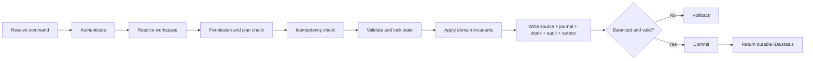

# Blueprint Conventions

**Status:** Authoritative conventions

## 1. Standard section template

Every workflow document should use the relevant parts of this structure:

1. Purpose and boundaries
2. Actors and permissions
3. Entry points and prerequisites
4. Information architecture/screens
5. Happy-path sequence
6. Field and validation specification
7. Decision/algorithm rules
8. Command/API contract
9. Database and transaction effects
10. Accounting/inventory effects
11. Background jobs and notifications
12. State machine
13. Failure, conflict and recovery behavior
14. Security/privacy/plan controls
15. Analytics events
16. Acceptance and edge-case tests
17. Flowchart/sequence diagram

## 2. Requirement language

- **MUST:** mandatory for correctness, security or selected scope.
- **MUST NOT:** forbidden behavior.
- **SHOULD:** default unless documented evidence justifies deviation.
- **MAY:** optional implementation choice that does not change the contract.
- **Deferred:** explicitly outside the December release.

## 3. Actor vocabulary

| Actor | Meaning |
|---|---|
| Visitor | Anonymous person on marketing, storefront or shared-document page |
| User | Verified Rekordly identity with at least one session |
| Owner | User who owns a Personal or Business workspace |
| Member | User invited into a Business workspace |
| Customer | Party recorded by a business; may not be a Rekordly user |
| Supplier | Party recorded by a business; may not be a Rekordly user |
| Recipient | Anyone holding an authorized guest document link |
| Worker | Trusted background process consuming bounded jobs |
| System admin | Restricted internal operational actor, never an assumed workspace member |

Customer/supplier party identity and Rekordly user identity are always separate until an explicit verified link is created.

## 4. Workspace vocabulary

- `Personal`: private personal-finance ledger.
- `Business`: business ledger with sales, purchasing, inventory and storefront modules.
- `All`: authorized owner summary over Personal and Business; never a merged ledger.
- `scope_type`: business, personal, mixed or transfer classification on supported capture drafts.
- `workspace_id`: resolved by server membership/session context; never trusted from an arbitrary body alone.

## 5. Money convention

- Posted amounts and journal lines: signed `BIGINT` minor units.
- JSON minor-unit integers: strings.
- Currency: ISO 4217 code plus exponent metadata.
- Rates, quantities and fractional unit costs: fixed-precision decimal.
- UI major-unit input: validated plain decimal string.
- Binary floating point: forbidden for financial calculation.
- Debit and credit minor-unit totals: exactly equal before commit.

Example:

```json
{
  "amount_minor": "150005",
  "currency": "NGN",
  "currency_exponent": 2
}
```

Display: `NGN 1,500.05`.

## 6. Time convention

- Store instants in UTC.
- Store workspace/user timezone separately.
- Financial documents carry an effective local date and a posted UTC timestamp.
- Date-only values are not silently converted through browser UTC.
- Backdating obeys open-period and inventory-costing rules.

## 7. ID and public-link convention

- Internal resource IDs are opaque UUID/ULID-style identifiers.
- Public document access uses an independent random token with at least 128 bits of entropy.
- Store only public-token hashes.
- URLs must not grant access based on sequential IDs.
- Idempotency keys are scoped to actor/workspace/command and payload hash.

## 8. State categories

### Durable domain state

Committed in PostgreSQL and authoritative, such as invoice status, journal entry, stock movement and subscription state.

### Projection state

Rebuildable derived data, such as dashboard totals, current balances and search indexes.

### UI state

Ephemeral state, such as an open drawer, selected filter or unsubmitted form.

### Job state

Queued, running, succeeded, retry-scheduled, failed/dead-letter or cancelled.

UI or realtime messages never replace durable domain state.

## 9. Command convention

Every mutation command includes or resolves:

- authenticated actor/session;
- workspace/membership;
- permission and entitlement;
- idempotency key;
- validated typed payload;
- expected version where concurrency matters;
- correlation/request ID.

Financial command sequence:



## 10. Query convention

- Tenant queries require `workspace_id`.
- Sensitive resource lookup verifies ownership even when the ID is opaque.
- Financial lists use deterministic cursor pagination and bounded date ranges.
- Aggregates run in PostgreSQL, not by downloading all records.
- Query responses identify stale/as-of time where relevant.

## 11. Error contract

Every public API error contains:

- stable machine code;
- safe user message;
- field errors where relevant;
- correlation ID;
- retryability classification when relevant.

It must not expose SQL, stack traces, secrets, provider payloads or cross-tenant existence.

Representative codes:

- `VALIDATION_FAILED`
- `AUTH_REQUIRED`
- `SESSION_EXPIRED`
- `FORBIDDEN`
- `NOT_FOUND`
- `CONFLICT`
- `IDEMPOTENCY_CONFLICT`
- `PLAN_LIMIT_REACHED`
- `PERIOD_LOCKED`
- `INSUFFICIENT_STOCK`
- `ALLOCATION_EXCEEDS_OUTSTANDING`
- `DEPENDENCY_UNAVAILABLE`

## 12. UI state minimum

Every data surface defines:

- initial loading skeleton;
- populated state;
- actionable empty state;
- filtered-empty state;
- permission denied;
- plan locked;
- recoverable error and retry;
- offline/stale state;
- destructive confirmation where applicable;
- success feedback with source/history navigation.

## 13. Async job convention

- Source transaction and outbox job are committed atomically.
- Worker claims with `FOR UPDATE SKIP LOCKED` or an equivalent safe mechanism.
- Job payload references records rather than embedding large files/documents.
- Every handler is idempotent.
- Every attempt has a timeout.
- Retry schedule is bounded; exhausted jobs are visible in a dead-letter state.
- User-visible source state distinguishes posting success from delivery/PDF failure.

## 14. Diagram convention

- Flowchart: decisions and navigation.
- Sequence diagram: actor/service interaction and transaction boundary.
- State diagram: allowed durable transitions.
- Entity relationship diagram: ownership/cardinality, not every column.
- Diagram node labels use product vocabulary, not framework class names.

## 15. Acceptance-test convention

Each test specifies:

- preconditions;
- actor/permission;
- action;
- expected durable state;
- expected journal/stock effects where applicable;
- audit/idempotency expectation;
- visible user result.

Critical invariants require happy, failure, retry, concurrent and cross-tenant cases.

