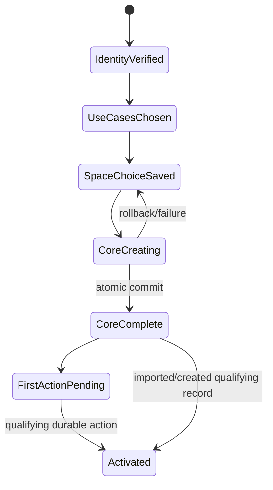
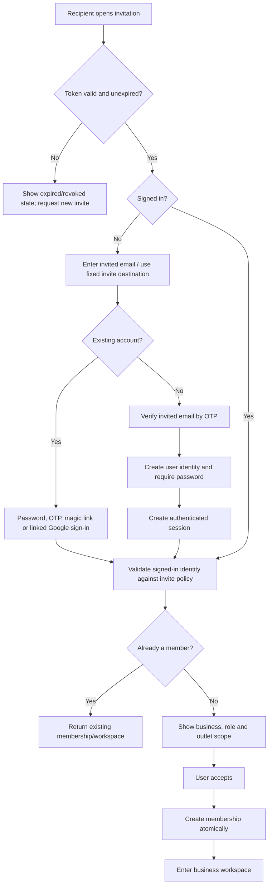

# Registration, Authentication and Onboarding Blueprint

**Status:** Founder-approved for implementation; authentication-method revision incorporated 7 November 2026  
**Release:** December responsive web/PWA

## 1. Purpose and boundaries

This flow takes a visitor from first entry to a verified session, creates the correct Personal/Business workspace combination, captures only essential setup information and routes the user to the first meaningful action.

Included:

- marketing/shared-link/storefront authentication entry;
- password, email OTP and email magic-link registration/sign-in;
- Google social sign-in, identity linking and first-login password creation;
- session creation, refresh, revocation and logout;
- role/use-case selection;
- Personal, Business or both workspace creation;
- business basics and currency/timezone setup;
- optional first records and invite deferral;
- interrupted-onboarding resume;
- duplicate identity and abuse handling.

Deferred unless re-approved:

- SMS OTP;
- mandatory KYC for ordinary bookkeeping;
- passkeys/MFA UI;
- native mobile onboarding;
- forcing a customer/supplier guest to register before viewing a shared document.

## 2. Actors

| Actor | Capabilities |
|---|---|
| Visitor | Start registration/sign-in; open permitted guest link |
| Verified user | Maintain session; complete/resume onboarding |
| Business owner | Create Business workspace and become Owner |
| Invited member | Verify the invited email, create/sign in to an account and accept invitation into an existing Business workspace |
| Worker | Send OTP, magic-link, password-reset, invitation and security email jobs |

## 3. Entry contexts

The auth flow preserves a safe `return_to` context:

- `/` or pricing → onboarding/home after verification;
- shared invoice/PO → return to the same guest document; registration stays optional;
- storefront → return to storefront/cart; do not force workspace creation just to shop;
- business invitation → invitation acceptance flow;
- protected app URL → intended authorized page after onboarding.

Only allowlisted internal paths may be used for `return_to`; external open redirects are forbidden.

## 4. Primary email authentication flow

```mermaid
flowchart TD
    A[Visitor chooses Get started or Sign in] --> B[Enter email]
    B --> C{Valid and within abuse limits?}
    C -- No --> C1[Show safe validation or cooldown]
    C -- Yes --> D{Existing verified account?}
    D -- Yes --> E[Show password plus OTP, magic-link and Google alternatives]
    E --> F{Chosen method succeeds?}
    F -- No --> F1[Safe error, reset or alternate method]
    F -- Yes --> G[Create/rotate session]
    D -- No --> H[Create registration OTP challenge and send email]
    H --> I[Verify single-use OTP]
    I --> J[Create user and verified email identity]
    J --> K[Require password creation and confirmation]
    K --> L[Store password hash and create session]
    G --> M{Onboarding complete?}
    L --> N[Choose use cases]
    M -- Yes --> O[Resolve safe return route]
    M -- No --> N
    N --> P[Choose Personal / Business / Both]
    P --> Q[Configure selected workspace basics]
    Q --> R[Create workspace(s), memberships and defaults atomically]
    R --> S[Show first-action checklist]
    S --> T[Enter app]
```

This approved UX intentionally distinguishes a new email from an existing account after submission. That can reveal account existence to a determined observer, so rate limits, bot/risk controls and generic credential errors are mandatory. Password-reset, OTP and magic-link request responses remain neutral and must not disclose more account information than the screen already reveals.

## 5. Screens and fields

### 5.1 Welcome/auth entry

Elements:

- Rekordly value statement in plain language;
- `Continue with email` primary action;
- `Continue with Google` social option;
- sign-in and registration share the email-first entry, then branch by account state;
- privacy and terms links;
- preserved guest-document/storefront context indicator when applicable.

States:

- default;
- invalid/expired invitation or guest context;
- provider/service unavailable;
- offline with explanation that authentication requires connection.

### 5.2 Email form

Field:

- email, required, trimmed, Unicode/domain-normalized according to chosen library rules, maximum safe length.

Rules:

- Existing verified account: continue to the password screen with OTP, magic-link and Google alternatives.
- New email: create a registration OTP challenge and continue to verification.
- Credential, OTP, magic-link and reset failures use generic wording and never reveal password/social-link details.
- Rate limits apply by normalized email, IP/device signal and global provider budget.
- Submit button becomes a progress state and prevents accidental duplicate requests.

### 5.3 Existing-account sign-in

Fields/actions:

- masked/confirmed email with change-email action;
- password input with show/hide control;
- `Sign in`;
- `Forgot password?`;
- divider labelled `or`;
- `Sign in with OTP`;
- `Email me a magic link`;
- `Continue with Google`.

Rules:

- Password errors are generic: “Email or password is incorrect.”
- Password sign-in is rate-limited by account/email, IP and risk signal.
- OTP and magic-link requests show neutral delivery wording.
- The form preserves allowlisted invitation, guest-document, storefront and protected-route return context.
- A user with a social identity but no password can use Google/OTP/magic link, then is routed to password creation.

### 5.4 OTP verification

Fields/display:

- code input;
- masked destination;
- expiry countdown as guidance, with server time authoritative;
- resend action after cooldown;
- change-email action invalidating the current flow where appropriate.

Rules:

- OTP is single use and short lived.
- Store challenge digest, never raw OTP.
- Constant-time comparison where applicable.
- Consuming OTP and creating/continuing identity happens transactionally.
- Resend invalidates or supersedes older active challenges according to one documented rule.
- Failed attempts produce increasing delay and temporary challenge/email/IP blocking.
- Logs never contain code or full email.

OTP purposes are distinct: `registration`, `sign_in`, `invitation`, `password_reset`, `contact_change` and other approved purposes. A challenge for one purpose cannot satisfy another.

### 5.5 Password creation

Shown after:

- a new email registration OTP is verified;
- a first social sign-in creates an account without a password;
- an invited new member verifies the invited email;
- an existing passwordless account signs in by OTP or magic link.

Fields:

- password;
- confirm password;
- show/hide controls;
- strength/requirement guidance;
- submit.

Rules:

- Password creation is required before completing new-user onboarding or invitation acceptance under the selected launch policy.
- Never log, email or store plaintext password.
- Hash with the approved Argon2id configuration and store algorithm/parameter metadata for later rehashing.
- Compare passwords through the approved hash verifier; never decrypt a password.
- Apply a maximum byte length before hashing to prevent resource abuse and a practical minimum length policy.
- Permit password-manager paste/autofill and long passphrases; do not silently truncate.
- Reject known-compromised passwords if a privacy-safe breach check is introduced; provider failure must have a documented fallback.
- After successful creation, rotate/create the authenticated session and record a security event.

### 5.6 Password reset

1. User chooses `Forgot password?` and submits email.
2. API returns the same neutral response regardless of account existence.
3. Existing eligible account receives a single-use reset link or reset OTP.
4. Successful verification opens Set new password.
5. New hash replaces the old credential atomically.
6. Other session families are revoked by default; current reset completion creates a fresh session.
7. User receives a security notification.

Password reset never sends an old or temporary password by email.

### 5.7 Magic-link sign-in

- Create a high-entropy, single-use, short-lived token bound to `sign_in`, intended account/email and safe return context.
- Store only a token digest/hash.
- The emailed URL is HTTPS and token-bearing paths/query values are redacted from application logs and analytics.
- Opening the link consumes it atomically and creates/rotates a session.
- Replay, expiry, revocation and superseded-generation attempts fail safely.
- If the account has no password, continue to Password creation before onboarding/app entry.
- Email-security scanners may open links; implementation must avoid a design where an automated prefetch irreversibly consumes the only login opportunity without a browser confirmation step or equivalent mitigation.

### 5.8 Google social sign-in

- Use Google OAuth 2.0/OpenID Connect with authorization code flow, PKCE, `state` and `nonce` validation.
- Accept identity/email claims only after verifying issuer, audience, signature, expiry and required email-verification claim.
- A new verified Google identity creates a user/account identity, then requires password creation before onboarding continues.
- When the verified Google email matches an existing account but Google is not linked, require proof through an existing method (password, OTP or magic link) before linking; do not silently merge accounts by email.
- An already linked Google subject signs into the linked user and rotates/creates a session.
- Denial/provider failure returns to the auth screen without losing safe return context.
- Google tokens are never exposed to analytics or stored unnecessarily; any required provider token is encrypted/restricted and retention-bounded.
- Disconnecting Google is blocked if it would leave no valid login/recovery method.

### 5.9 Use-case selection

Question: “What do you want Rekordly to help you manage?”

Multi-select options:

- Personal money and lifestyle
- Freelance work
- Small business without stock
- Retail/inventory business

Selection is used for defaults and checklist ordering, not permanent feature denial.

Mapping:

| Selection | Recommended spaces | Default first action |
|---|---|---|
| Personal | Personal | Add income/expense or set budget |
| Freelance | Personal + Business | Add client or record income |
| Small business | Business, optional Personal | Add customer/service or record money |
| Retail/inventory | Business, optional Personal | Add outlet/product/opening stock |
| Multiple selections | Both when any personal + business need exists | User chooses checklist priority |

User may override recommendation before creation.

### 5.10 Space choice

Options:

- Personal only
- Business only
- Personal and Business

Explanation:

- Ledgers stay separate.
- Owner may view an `All` summary when both exist.
- Choosing one now does not prevent adding the other later.

### 5.11 Personal setup

Required:

- display/preferred name;
- base currency, default NGN;
- timezone, default detected Africa/Lagos with confirmation.

Optional/deferred:

- month-start preference;
- initial budget;
- opening cash/bank balance through a guided financial command after workspace creation.

Do not ask for lifestyle details before the user has seen value.

### 5.12 Business setup

Required:

- business/display name;
- business type/use case;
- base currency;
- timezone;
- country, default Nigeria but editable.

Conditionally requested:

- inventory enabled from retail selection;
- default outlet name, initially “Main outlet”;
- costing method only before the first posted stock movement and explained using examples;
- tax/VAT registration status may be `not registered`, `registered`, or `not sure`.

Optional and skippable:

- logo;
- phone/address;
- tax number;
- opening balances;
- import;
- invite team;
- storefront setup.

KYC is not an onboarding gate for bookkeeping. Payment-provider features that legally require verification introduce their own later gate.

### 5.13 First-action checklist

The checklist is adaptive and dismissible.

Personal example:

1. Record first income or expense.
2. Add a money account/opening balance.
3. Create a monthly budget.

Service business example:

1. Add a customer.
2. Add a service.
3. Create an invoice or record money.

Inventory business example:

1. Confirm costing method.
2. Add outlet.
3. Add product/variant.
4. Record opening stock or first procurement receipt.

Checklist completion is derived from durable actions; it is not maintained as independent financial truth.

## 6. Workspace-creation algorithm

Input:

```text
verified_user_id
selected_space_kinds[]
personal_settings?
business_settings?
idempotency_key
```

Algorithm:

1. Authenticate session and confirm onboarding privilege.
2. Validate idempotency key and payload hash.
3. Validate selected kinds are unique and supported.
4. Validate currency and timezone identifiers.
5. Begin PostgreSQL transaction.
6. Lock user/onboarding state.
7. If the same completed idempotency key exists, return original workspace IDs.
8. Create missing Personal workspace at most once for the owner.
9. Create Business workspace when selected.
10. Create Owner memberships and system role bindings.
11. Create default chart-of-accounts templates independently per workspace.
12. Create base money accounts/categories without financial balances.
13. For inventory-enabled Business, create default outlet configuration; do not create stock movement.
14. Create entitlement/usage baselines for the beta plan.
15. Mark onboarding core complete and store non-sensitive preference answers.
16. Write audit events and outbox welcome/checklist event.
17. Commit.
18. Return workspace IDs and recommended route.

If any mandatory creation fails, roll back everything. The user must not receive a half-created ledger.

## 7. Default records versus opening balances

Workspace creation may create configuration but never invent financial value.

Allowed defaults:

- chart-of-account definitions;
- categories;
- empty cash/bank account shells when clearly labeled;
- roles/permissions;
- default outlet;
- report and notification preferences.

Not allowed without explicit user confirmation:

- cash/bank opening balance;
- accounts receivable/payable balance;
- opening stock quantity/value;
- loans, assets or investments;
- tax liability;
- customer/supplier balances.

Opening values use later guided commands with an effective date, balancing account and audit trail.

## 8. Authentication data model

### `users`

- id
- display_name
- locale/timezone preference
- status
- onboarding status/version
- created/updated timestamps

### `auth_identities`

- id, user_id
- provider (`email`, `google`)
- provider subject for social identity, or normalized email identity reference
- normalized identifier and lookup-safe representation
- verified timestamp
- status
- linked/unlinked timestamps and linking audit reference

Unique constraints prevent one active Google subject or normalized email identity from linking to multiple users.

### `password_credentials`

- id, user_id
- Argon2id password hash/encoded parameters
- hash algorithm/version
- created/updated/last-rehashed timestamps
- credential status
- failed-attempt/risk metadata stored with PII minimization or through a dedicated throttling store

There is at most one active password credential per user. Plaintext, reversible encryption and password hints are forbidden.

### `otp_challenges`

- id
- normalized-recipient lookup reference/hash
- code digest
- purpose
- expiry
- attempts and resend generation
- consumed/invalidated timestamps
- request risk/rate-limit metadata with PII minimization

### `magic_link_challenges`

- id, user/account lookup reference
- token digest
- purpose and safe return-context reference
- expiry and generation
- consumed/invalidated timestamps
- request risk/rate-limit metadata

### `oauth_login_attempts`

- id and provider
- state/nonce/PKCE correlation digests as applicable
- safe return/invitation context
- expiry, completion and failure classification
- no unnecessary long-term provider token storage

### `password_reset_challenges`

May reuse the typed OTP/magic-link challenge tables when purpose, token/code semantics and audit remain explicit. Reset challenges are single-use, short-lived and invalidated after password replacement.

### `sessions`

- id, user_id
- refresh/session-family digest
- device/session display metadata
- issued, expires, last-seen and revoked timestamps
- revocation reason

### `workspaces`, `memberships`, `roles`

Created according to the final architecture. Identity creation and workspace creation are distinct so a verified user can safely resume onboarding.

## 9. Session behavior

### Creation

- Create after successful password verification, OTP consumption, magic-link consumption or verified linked-social callback.
- New OTP/social/invited accounts without a password complete password creation before receiving the normal onboarding/application session; a narrowly scoped pre-auth completion session may bridge those steps.
- Rotate identifiers at authentication and privilege changes.
- Use Secure, HttpOnly cookies in production when cookie strategy is selected.
- Apply SameSite and CSRF controls appropriate to cross-domain API/frontend architecture.

### Refresh

- Short-lived access/session proof plus refresh rotation.
- Reuse of a superseded refresh token revokes the affected family and requires sign-in.
- Concurrent-tab refresh must not incorrectly revoke a legitimate family; allow a narrowly defined grace/replay strategy.

### Logout

- Revoke current session server-side.
- Clear cookies/local cached private data.
- Next protected API request fails.
- “Log out all devices” revokes all active session families for the user.

### Session management

Settings displays approximate device/browser, created/last active time and current-session marker. User can revoke another session.

## 10. Interrupted onboarding and resume

Onboarding progress is server-side and step-versioned.



Rules:

- Returning user resumes the first incomplete mandatory step.
- Back navigation may edit preferences before core creation.
- After financial activity, base currency/costing changes follow separate controlled workflows, not onboarding edits.
- Onboarding version allows new optional steps without blocking existing users.

## 11. Invitation branch



An invited member does not need to create a separate Business workspace. Personal-space creation remains optional and separate.

## 12. Guest document/storefront branch

- Opening a valid shared invoice/PO/receipt/storefront never redirects immediately to registration.
- Guest completes the permitted task first.
- Registration prompt is secondary and explains the benefit.
- If user registers, preserve the document/cart context.
- Account creation does not automatically expose other documents; party-link claiming follows document 05 rules.

## 13. API command/query outline

| Method/path | Purpose | Idempotency |
|---|---|---|
| `POST /v1/auth/email/continue` | Normalize email and return approved next auth screen/registration challenge result | Rate-limited/request dedupe |
| `POST /v1/auth/password/sign-in` | Verify email/password and create session | Rate-limited; safe retry semantics |
| `POST /v1/auth/password/create` | Create first password after verified pre-auth flow | Required/pre-auth context bound |
| `POST /v1/auth/password/reset/request` | Request neutral reset delivery | Rate-limited/request dedupe |
| `POST /v1/auth/password/reset/complete` | Consume reset proof, replace hash and rotate/revoke sessions | Required challenge semantics |
| `POST /v1/auth/otp/request` | Request email OTP | Request dedupe/rate-limited |
| `POST /v1/auth/otp/verify` | Consume OTP and create/continue identity/session | Required challenge semantics |
| `POST /v1/auth/magic-link/request` | Request sign-in magic link | Request dedupe/rate-limited |
| `POST /v1/auth/magic-link/consume` | Validate/consume link and create pre-auth/full session | Required challenge semantics |
| `GET /v1/auth/oauth/google/start` | Create state/nonce/PKCE attempt and redirect to Google | Attempt-bound |
| `GET /v1/auth/oauth/google/callback` | Verify Google response, sign in or require secure linking/password creation | State/nonce single completion |
| `POST /v1/auth/oauth/google/link/complete` | Link Google after proof of existing account | Required/pre-auth context bound |
| `DELETE /v1/me/auth-identities/{id}` | Disconnect social identity when another login method remains | Required/recent auth |
| `POST /v1/auth/refresh` | Rotate/refresh session | Token-family controlled |
| `POST /v1/auth/logout` | Revoke current session | Safe repeat |
| `POST /v1/auth/logout-all` | Revoke all sessions | Required |
| `GET /v1/me` | Current user/onboarding/workspaces | Query |
| `PUT /v1/me/onboarding/preferences` | Save resumable non-financial selections | Required/versioned |
| `POST /v1/me/commands/create-initial-workspaces` | Atomically create selected spaces/defaults | Required |
| `POST /v1/invitations/{token}/accept` | Accept membership invitation | Required |
| `GET /v1/me/sessions` | List sessions | Query |
| `DELETE /v1/me/sessions/{id}` | Revoke session | Safe repeat |

Exact public token placement must avoid accidental logging; invitation token handling is reviewed during implementation.

## 14. Background jobs and email

Jobs:

- send OTP email;
- send magic-link email;
- send password-reset email;
- send welcome/get-started email;
- invitation email;
- security notification for meaningful session changes.

OTP delivery special case:

- Challenge exists before email job.
- If delivery fails, verification cannot occur and UI offers resend/change address.
- Retry is bounded to avoid sending stale or repeated codes.
- A newer challenge generation invalidates/supersedes older delivery jobs.
- Provider error is sanitized; delivery state is observable internally.

Magic-link and password-reset delivery follow the same bounded job principles. Superseded/consumed/expired challenges cannot become valid because a delayed email job eventually succeeds.

## 15. Security and abuse controls

- Layered throttling by normalized recipient, IP/device signal and provider/global budget.
- Generic credential, OTP, magic-link and password-reset errors; the approved email-first branch may reveal new-versus-existing state after the initial email submit and therefore receives stricter enumeration/risk throttling.
- Challenge expiry, attempt cap, single-use consumption and resend cooldown.
- Argon2id password hashing with reviewed memory/time/parallelism parameters, maximum input bytes and rehash-on-login support.
- Password sign-in throttling and breached/common-password policy where an approved privacy-safe service/list is available.
- Password reset revokes other sessions by default and emits a security notice.
- OAuth/OIDC authorization-code flow with PKCE, state, nonce, verified issuer/audience/signature/expiry and email-verification claim.
- No automatic social-account merge solely from an email claim; existing-account proof is required before linking.
- CSRF protection for cookie-authenticated unsafe API methods.
- Strict frontend-origin allowlist.
- Session fixation prevention and refresh rotation.
- No OTP/full email in logs or analytics.
- Safe return URL allowlist.
- Invitation and guest tokens hashed at rest and revocable.
- Cross-workspace access test after every onboarding combination.
- Bot protection may be introduced after suspicious thresholds, not imposed on every legitimate user by default.

## 16. Failure and recovery matrix

| Failure | User experience | Durable outcome |
|---|---|---|
| OTP email provider timeout | “Code could not be delivered yet”; resend available after rule | Challenge may remain pending/invalidated; no session |
| Wrong OTP | Inline error, attempts remaining without sensitive detail | Failure counter increments |
| Expired OTP | Request new code | Old challenge unusable |
| Wrong password | Generic credential error and alternate methods | No session; throttle/risk counter updates |
| Password hash parameters outdated | Sign-in succeeds if valid | Hash is upgraded atomically/soon after verification |
| Reset link/OTP replay | Safe expired/used message | No password/session change |
| Magic link opened by scanner/prefetch | Browser confirmation or mitigation prevents unintended terminal consumption | No attacker/scanner session |
| Google denied/unavailable | Return to sign-in with alternate methods | No identity/session/link created |
| Google email matches existing unlinked account | Require existing password/OTP/magic proof | No automatic account merge |
| Social/OTP account has no password | Require password-creation completion | No normal onboarding/app entry until credential exists |
| Duplicate verify retry | Return existing successful session outcome where safe | No duplicate user |
| Workspace transaction fails | Stay/resume at setup with retry | No partial workspace/defaults |
| Browser closes mid-onboarding | Resume at last server-saved safe step | No invented balances |
| Network drops after workspace commit | Retry returns same workspace IDs | Idempotency prevents duplicates |
| Invitation already accepted | Enter existing workspace | No duplicate membership |
| User lacks invite email match | Verification/approval path or reject | No unauthorized membership |
| Unsupported currency/timezone | Field error with valid choices | No workspace created |

## 17. Analytics events

Permitted product events use internal IDs and exclude OTP/email values:

- `auth_started`
- `otp_requested`
- `otp_verified`
- `auth_failed_reason_class`
- `onboarding_use_case_selected`
- `onboarding_space_choice_selected`
- `onboarding_core_completed`
- `onboarding_first_action_clicked`
- `activation_qualifying_action_completed`
- `invitation_accepted`
- `onboarding_abandoned_step`

Measure conversion by entry context and use case without recording sensitive financial input.

## 18. Activation definition

Registration is not activation.

Initial activation occurs when a verified user completes at least one meaningful durable action:

- posts a confirmed income/expense/transfer;
- issues a valid invoice;
- adds opening stock through a confirmed command;
- imports and confirms at least one record;
- accepts a business invitation and completes an allowed operational action.

Track stronger activation separately, such as three records plus a report/view return within seven days.

## 19. Acceptance and edge-case tests

### Core

- New email verifies once and creates exactly one user.
- Existing email branches to password/OTP/magic-link/social choices and signs into the same user.
- New email cannot create an account until OTP verification and password creation succeed.
- Password, OTP, magic-link and Google methods resolve the same linked user without duplicate accounts.
- Personal-only creates one Personal workspace and Owner membership.
- Business-only creates one Business workspace and Owner membership.
- Both creates separate ledgers and an authorized combined view, not merged accounts.
- Retry after committed workspace creation returns original IDs.
- Default setup creates no financial value.

### Password/OTP/magic-link/social/session

- Valid password signs in; invalid password produces no session and no detailed credential disclosure.
- Passwords are Argon2id-hashed, never stored/logged plaintext, and old parameters can be rehashed safely.
- Password creation checks confirmation, byte limits and approved password policy without blocking password managers/paste.
- Reset response is neutral; reset proof is single-use; completion revokes other sessions and sends a security notice.
- Expired, consumed, invalidated and over-attempt OTPs fail.
- Concurrent verification consumes challenge once.
- Resend behavior follows generation rule and does not allow old-code replay.
- OTP purpose cannot be reused across registration, sign-in, invitation, reset or contact change.
- Magic-link replay/expiry/supersession fails and scanner/prefetch mitigation prevents unintended login consumption.
- Google callback rejects invalid state, nonce, issuer, audience, signature, expiry or unverified email.
- Matching Google email does not silently merge an existing account; proof/link flow is required.
- New social, invitation and passwordless OTP users must create a password before normal onboarding/app entry.
- Disconnecting Google cannot remove the last login/recovery method.
- Logout revokes current session; logout-all revokes every family.
- Refresh-token replay triggers configured family protection.
- Cross-origin unsafe request without CSRF proof fails under cookie auth.

### Invitations/guests

- Non-member can view a valid shared document without registration.
- Registration preserves safe return context.
- Registration does not expose unshared documents.
- Invitation cannot grant a role/outlet scope beyond its signed server record.
- Revoked/expired invitation fails without workspace information leakage.
- New invited member verifies the invited email, creates password and then accepts the exact role/outlet scope.
- Existing invited member may authenticate by password, OTP, magic link or linked Google subject before acceptance.

### Tenancy and concurrency

- User cannot access another user's onboarding/workspaces by supplied ID.
- Two concurrent initial-workspace commands cannot create duplicate Personal workspaces.
- Failed default-account creation rolls back workspace and membership.
- Idempotency key with changed payload returns conflict.

### Accessibility/responsive

- Complete flow works by keyboard and screen reader labels.
- OTP fields support paste without trapping focus.
- Error messages are linked to fields and not color-only.
- Small mobile viewport does not hide primary/resend/back actions.

## 20. End-to-end sequence

```mermaid
sequenceDiagram
    actor V as Visitor
    participant W as Next.js Web
    participant A as Go API
    participant D as PostgreSQL
    participant J as Outbox/Worker
    participant E as Email API

    V->>W: Enter email
    W->>A: Continue with email
    A->>D: Resolve account state under rate/risk controls
    alt Existing account
        A-->>W: Password screen + OTP/magic/Google alternatives
        V->>W: Submit password or choose alternative
        W->>A: Authenticate selected method
        A->>D: Verify credential/challenge/linked identity; create session
    else New email
        A->>D: Store registration OTP challenge + outbox job
        A-->>W: OTP verification screen
        J->>D: Claim OTP email job
        J->>E: Send code
        E-->>J: Delivery result
        V->>W: Submit OTP
        W->>A: Verify challenge
        A->>D: Consume challenge and create verified passwordless identity
        A-->>W: Password creation step
        V->>W: Create password
        W->>A: Submit password under pre-auth context
        A->>D: Store Argon2id hash and create session atomically
    end
    D-->>A: User/session/onboarding state
    A-->>W: Session + next step
    V->>W: Choose use cases/spaces and enter basics
    W->>A: Create initial workspaces (idempotent)
    A->>D: Begin transaction
    A->>D: Create workspace(s), owners, defaults, audit, outbox
    A->>D: Commit
    A-->>W: Workspace IDs + recommended first action
    W-->>V: App checklist/dashboard
```

