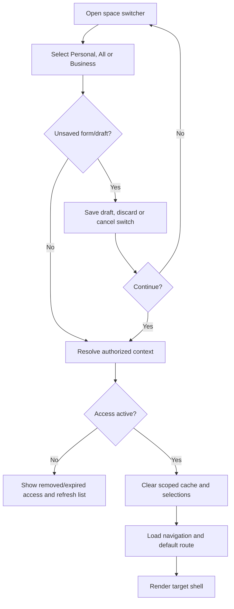
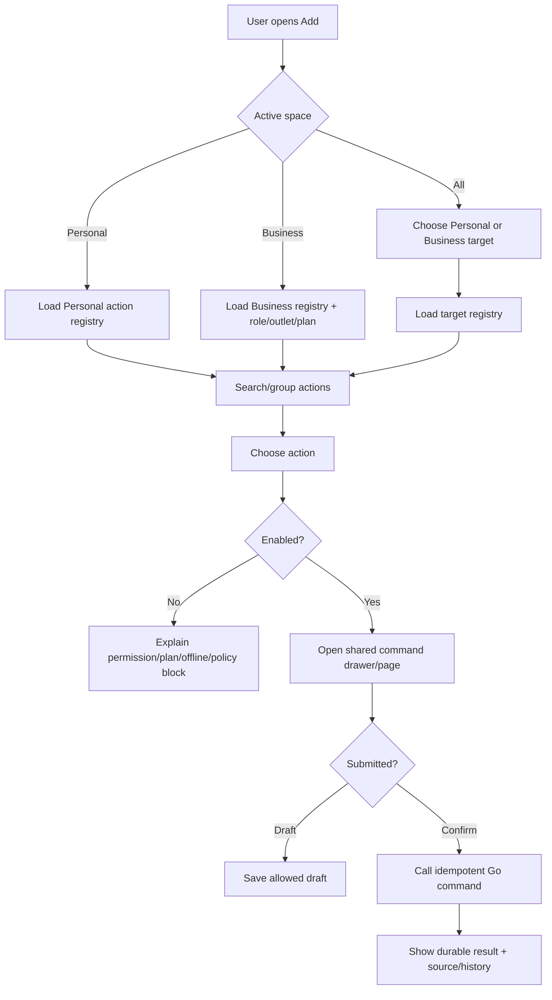
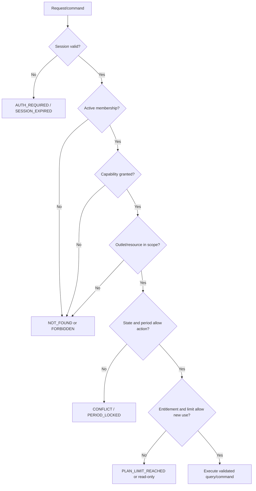
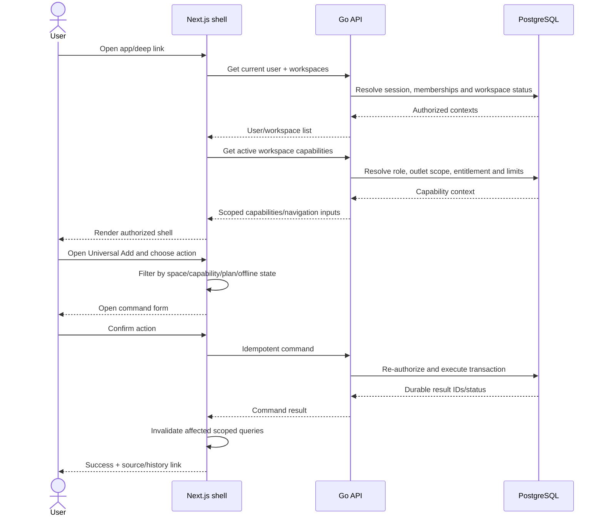

# App Shell, Navigation and Permissions Blueprint

**Status:** Complete draft  
**Depends on:** `00-blueprint-conventions.md`, `01-registration-authentication-and-onboarding.md`

## 1. Purpose and boundaries

This document defines how an authenticated user moves through Rekordly, switches financial spaces, discovers actions, sees pending work and receives only the capabilities permitted by workspace role, outlet scope, plan and record state.

It covers:

- Personal, Business and All shell modes;
- desktop sidebar, mobile bottom navigation and More menu;
- workspace/space switching;
- Universal Add and command discovery;
- global search and command palette;
- review inbox, notifications and background-job status;
- role, permission, outlet and entitlement evaluation;
- responsive, loading, offline and read-only behavior;
- route and API authorization;
- keyboard and accessibility behavior.

It does not define the internal form logic of money, sales, inventory or procurement commands; those follow in documents 03–09.

## 2. Shell principles

1. The active space is always visible.
2. Personal and Business books are never merged.
3. `All` is a read-oriented owner summary, not a posting destination.
4. Navigation reflects capability, but hidden UI is never the security boundary.
5. The user can always find the primary Add action.
6. Review/approval work appears as a first-class inbox.
7. Page titles and actions use plain language; accounting terms appear where professional detail is needed.
8. Existing data remains readable/exportable after downgrade, subject only to lawful/security restrictions.
9. Context is preserved when switching between list and detail pages.
10. A financial command reports a durable result; ambiguous spinner completion is forbidden.

## 3. Shell anatomy

### Desktop

```text
┌──────────────────────────────────────────────────────────────────────┐
│ Logo | Space/Business switcher | Search | Review | Alerts | Help | Me│
├────────────────┬─────────────────────────────────────────────────────┤
│ Sidebar        │ Page header: title / context / primary actions      │
│                ├─────────────────────────────────────────────────────┤
│ Context nav    │ Filters / tabs / banners                            │
│                ├─────────────────────────────────────────────────────┤
│                │ Page content                                        │
│ Universal Add  │                                                     │
│ Sync status    │                                                     │
└────────────────┴─────────────────────────────────────────────────────┘
```

### Mobile

```text
┌────────────────────────────┐
│ Space switcher       Alerts│
│ Page title / actions       │
├────────────────────────────┤
│ Page content               │
│                            │
├────────────────────────────┤
│ Home | Module | + | Inbox | More │
└────────────────────────────┘
```

The central `+` opens Universal Add. Bottom navigation changes by active space but retains stable positions for Home, Add and More.

## 4. Space and workspace switcher

### Available entries

- Personal, when the user owns a Personal workspace.
- All, when the owner has both Personal and at least one owned Business workspace.
- Each owned or invited Business workspace.
- `Create/add workspace` when entitlement permits.
- `Join with invitation` entry when relevant.

For a business with multiple outlets, outlet selection is a secondary context inside that Business workspace; outlets never appear as top-level financial spaces.

### Display

Each switcher item shows:

- workspace name;
- kind icon/label;
- optional business logo;
- invited/owned indicator only when useful;
- unread review count where permitted;
- archived/read-only marker;
- current item checkmark.

### Switching algorithm

Input: target workspace/space and optional safe return route.

1. Confirm active session.
2. Find target in the server-returned authorized workspace list.
3. If target is `All`, verify owner-summary eligibility.
4. If target is Business, resolve membership status, role and outlet scope.
5. Discard or explicitly preserve unsaved form state after confirmation; never silently move a financial draft into another workspace.
6. Update active context in URL/path and user preference.
7. Clear workspace-scoped query caches, form selections and sensitive local data.
8. Load target navigation capabilities and default route.
9. Restore only filters that are safe and valid for the target workspace.

The server still derives workspace authorization on every API call. A remembered active workspace is convenience, not authority.

### Switching flow



## 5. Personal navigation

### Desktop sidebar

1. Home
2. Activity
3. Budgets
4. Accounts
5. Reports
6. More

`More` expands or routes to:

- Loans
- Investments
- Assets
- Categories
- Attachments
- Imports
- Settings
- Subscription
- Support

### Mobile bottom navigation

1. Home
2. Activity
3. Add
4. Budgets
5. More

### Personal Home

Sections, ordered for plain-language comprehension:

- current period: came in, went out, remains;
- account balances;
- spending by category;
- budget progress;
- recent activity;
- factual alerts/insights;
- onboarding checklist when incomplete.

### Activity

Tabs/filters:

- All
- Income
- Expenses
- Transfers
- Loans
- Investments
- Assets
- Drafts/needs review

The mobile page uses filters or segmented controls without horizontally hiding totals/actions.

## 6. Business navigation

### Desktop sidebar

1. Home
2. Money
3. Sales
4. Purchases
5. Inventory
6. Storefront
7. Contacts
8. Reports
9. Review
10. Settings

The sidebar may collapse visually but keeps accessible labels/tooltips and keyboard focus.

### Mobile bottom navigation

1. Home
2. Sales
3. Add
4. Review
5. More

When an inventory-first business preference is selected, the second slot may be Inventory instead of Sales. The choice is a server-stored preference; essential modules remain in More.

### Business More menu

- Money
- Sales, when not pinned
- Purchases
- Inventory, when not pinned
- Storefront
- Contacts
- Reports
- Settings
- Switch outlet
- Help/support

### Module sub-navigation

#### Money

- Overview
- Transactions
- Accounts
- Payments
- Transfers
- Reconciliation/import
- Journals, when permitted

#### Sales

- Overview
- Orders
- Estimates/proformas
- Invoices
- Payments/receipts
- Customer deposits
- Returns/adjustments

#### Purchases

- Overview
- Purchase requests
- Purchase orders
- Goods receipts
- Supplier bills
- Supplier payments
- Supplier returns

#### Inventory

- Overview
- Products/services
- Stock by outlet
- Movements
- Transfers
- Counts/adjustments
- Batches/expiry
- Serial items
- Damaged/defective/expired
- Categories/collections

#### Storefront

- Overview/status
- Appearance
- Catalogue visibility
- Orders
- Contact/policies
- Subdomain
- Custom domain

#### Contacts

- Customers
- Suppliers
- Organization contacts
- Statements

#### Reports

- Business summary
- Profit and Loss
- Balance Sheet
- Cash Flow
- Trial Balance
- General Ledger
- Cash movement
- Receivables/payables aging
- Inventory valuation/COGS
- VAT/WHT schedules
- Budget versus actual
- Exports

#### Review

- My work
- All permitted work
- AI drafts
- Import matches/duplicates
- Purchase approvals
- Receiving variances
- Bill approvals
- Stock adjustments/count variances
- Corrections/reversals
- Failed jobs/delivery issues when the role permits

#### Settings

- Business profile
- Members and invitations
- Roles and permissions
- Outlets
- Chart of accounts
- Tax/currency
- Document numbering/templates
- Inventory policy
- Storefront/domains
- Notifications
- Subscription/add-ons
- Integrations
- Audit log
- Export/privacy/deletion

## 7. All summary navigation

`All` is visible only to an owner who has Personal plus at least one owned Business workspace.

Allowed:

- combined cash-position summary with clear source labels;
- total personal/business inflow and outflow;
- workspace-level cards;
- cross-workspace recent activity links;
- consolidated owner alerts/checklist;
- time and currency filters where comparison is valid.

Not allowed:

- posting a record without selecting a target workspace;
- transferring value by editing a combined total;
- combining journals into one legal/business report;
- letting an invited Business workspace appear in owner's combined private summary unless explicitly designed and authorized later.

Universal Add opened from `All` asks for Personal or a specific Business workspace before showing the rest of the action form.

## 8. Page-header convention

Every page header includes the smallest relevant set:

- title;
- optional plain-language description;
- workspace/outlet/as-of context;
- primary action;
- secondary actions in an overflow menu;
- status banner when offline, read-only, archived, plan-limited or stale.

Examples:

| Page | Primary action | Secondary actions |
|---|---|---|
| Activity | Add record | Import, export |
| Invoices | New invoice | New estimate, export |
| Purchase orders | New PO | New request, export |
| Products | Add product | Import catalogue, categories |
| Reports | Export/report-specific | Date, basis, comparison |
| Members | Invite member | Roles, pending invitations |

Do not show an action merely because the route exists. It must pass capability evaluation.

## 9. Universal Add

Universal Add is one action registry used by sidebar, mobile `+`, quick actions, keyboard shortcut and empty states. Features do not wire separate duplicate flows.

### Personal actions

- Add income
- Add expense
- Transfer money
- Type what happened (AI draft)
- Add loan event
- Add investment event
- Add asset
- Add/opening balance through controlled setup
- Import records

### Business actions

#### Money

- Record money in
- Record money out
- Transfer between own accounts
- Type what happened (AI draft)
- Import/reconcile

#### Sales

- New sale
- New estimate/proforma
- New invoice
- Record customer payment
- Customer deposit
- Customer return/refund

#### Purchases

- Purchase request
- Purchase order
- Goods receipt
- Supplier bill
- Supplier payment/advance
- Supplier return

#### Inventory

- Product/service
- Opening stock
- Stock transfer
- Stock count
- Stock adjustment
- Damage/expiry record

#### Other

- Customer
- Supplier
- Outlet
- Storefront order/manual order
- Invite member, when permitted

### Universal Add filtering algorithm

For every registered action:

```text
visible = correct_space
          AND module_available
          AND membership_active
          AND has_view_or_create_capability
          AND record/workspace_state_allows_discovery

enabled = visible
          AND has_required_permission
          AND entitlement_allows_new_usage
          AND usage_limit_not_exhausted
          AND online_if_required
          AND period/policy_allows_start
```

If visible but disabled, show one clear reason and safe next action. Examples: upgrade, ask an admin, switch outlet, connect to internet, resolve locked period. Do not expose actions a role must not know exist when that would leak sensitive capability.

### Ranking

1. Contextual page actions
2. User-pinned actions
3. Recent successful actions
4. Use-case defaults
5. Remaining actions grouped by module

Recent ranking is workspace-specific. It must never suggest a Business action while in Personal without making the target explicit.

### Universal Add flow



## 10. Search and command palette

### Entry

- Desktop search field and `/` shortcut when not typing.
- Mobile search inside top bar/More.
- Optional command palette via `Ctrl/Cmd + K`.

### Searchable records

Scoped to the active authorized workspace:

- transactions/references;
- customers and suppliers;
- invoices, estimates, orders and receipts;
- POs, goods receipts and supplier bills;
- products, variants, SKU/barcode;
- reports/settings navigation;
- actions the user may discover.

Personal search excludes Business data and vice versa. `All` search groups results by workspace and never returns private data from an invited workspace beyond granted access.

### Search behavior

- Debounce input and require a minimum useful query unless searching locally cached navigation.
- Server enforces workspace, permission, outlet and record sensitivity.
- Results identify type, workspace, status and relevant date.
- Keyboard navigation and screen-reader result count are supported.
- Recent searches are local/minimized; never store raw sensitive search indefinitely.
- Empty state suggests permitted actions, not inaccessible records.

### Command palette

May include:

- navigate to page;
- run a Universal Add action;
- switch workspace/outlet;
- open support;
- open recent permitted record.

It cannot bypass confirmation, permissions or plan checks.

## 11. Review inbox

The Review inbox collects work requiring attention, not all notifications.

### Item shape

- type and plain-language title;
- workspace/outlet;
- source and submitter;
- created/due age;
- risk/priority without misleading accounting severity;
- required action and permission;
- linked source record;
- status/version.

### Review item sources

- AI drafts needing confirmation;
- CSV rows/matches needing resolution;
- purchase approvals;
- receipt variances;
- supplier bill approvals;
- stock count/adjustment approvals;
- correction/reversal approvals;
- failed export/PDF/email/domain jobs requiring retry or intervention.

### Review rules

- Badge count contains actionable items the current user may handle, not inaccessible total workspace count.
- Opening item reloads current durable state.
- Approve/reject requires expected version to prevent double action.
- Concurrent completion returns “already handled” with actor/time, not a generic failure.
- Self-approval rules are configured per workflow and enforced server-side.
- Review actions produce audit events.

## 12. Notifications

Notifications inform; Review requests action.

Categories:

- financial/document status;
- inventory and expiry;
- order/procurement;
- security/session;
- subscription/usage;
- delivery/job failure;
- product/support.

States:

- unread/read;
- archived/dismissed where appropriate;
- action link;
- channel delivery status.

Rules:

- Notification count is per user, not per browser.
- Mark-read is idempotent.
- Sensitive values are minimized in push/email subjects.
- Clicking rechecks current authorization; stale notification does not grant access.
- User preferences control optional channels, but critical security/account notices remain deliverable as policy permits.

MVP refresh uses page load/refetch and bounded polling while the notification surface is open. WebSockets are not required.

## 13. Role templates

Role templates provide starting points; permissions are the authority.

### Owner

- Full Business workspace authority including subscription, deletion and ownership-sensitive actions.
- Cannot bypass accounting invariants or erase immutable history.

### Admin

- Broad operational administration, members, settings and reports.
- Cannot transfer ownership, permanently delete workspace or change billing owner unless explicitly granted by a future protected capability.

### Accountant/Bookkeeper

- Money, journals, sales/purchases accounting, reconciliation, reports and period operations.
- Inventory operational authority only when separately granted.
- Cannot manage subscription/ownership by default.

### Sales

- Customers, estimates, invoices, sales/orders and permitted payments.
- Cost/margin, supplier and general-ledger visibility denied by default.

### Cashier

- Fast sale, receipt and allowed customer payment actions for assigned outlets.
- Cannot view broad reports, costs, settings or historical corrections beyond policy.

### Inventory Manager

- Catalogue, stock, transfers, receipts, counts and adjustments for assigned outlets.
- Product cost visibility is a separate permission.
- Cannot see unrelated bank/customer financial data by default.

### Procurement

- Suppliers, requests, POs, receiving and bills according to approval policy.
- Supplier payment execution is separate from bill entry/approval.

### Viewer/Auditor

- Read-only access to explicitly granted modules/reports.
- Export is separately granted because it creates a portable copy.

Personal workspace has only its owner in the MVP; sharing personal books is deferred unless explicitly approved later.

## 14. Permission vocabulary

Permissions use capability names, not route names. Representative set:

```text
workspace.view
workspace.manage_profile
workspace.manage_members
workspace.manage_roles
workspace.manage_subscription
workspace.request_deletion

money.view
money.create_draft
money.confirm
money.reverse
money.reconcile

sales.view
sales.create
sales.issue
sales.record_payment
sales.refund

purchases.view
purchases.request
purchases.approve_po
purchases.receive
purchases.approve_bill
purchases.pay_supplier

inventory.view_quantity
inventory.view_cost
inventory.manage_catalogue
inventory.transfer
inventory.count
inventory.adjust

storefront.view
storefront.manage
storefront.publish
storefront.manage_domain

reports.view_basic
reports.view_accounting
reports.export

audit.view
period.close
period.lock
```

Permissions may be constrained by outlet and, later, approval amount. Do not encode every combination as a new role.

## 15. Authorization evaluation algorithm

Inputs:

- actor/session;
- target workspace;
- capability;
- resource ID/type if applicable;
- outlet/dimension if applicable;
- command payload metadata;
- current workspace/resource/subscription state.

Algorithm:

1. Validate session and revocation.
2. Resolve membership from server data.
3. Require active workspace and active membership, except protected read/export grace rules.
4. Load resolved role permissions and explicit overrides.
5. Require capability; deny by default.
6. Check outlet/resource scope.
7. Verify resource belongs to workspace and allowed outlet/dimension.
8. Check record state, period lock and separation-of-duty rule.
9. Check plan entitlement and usage limit for new operations.
10. For a mutation, validate idempotency and current resource version.
11. Allow command or return a stable safe denial.
12. Audit sensitive allowed/denied actions according to policy without logging confidential payloads.



Frontend capability checks improve UX only. The Go API repeats the authoritative evaluation.

## 16. Outlet scope

Membership outlet scope can be:

- all outlets;
- one outlet;
- selected outlets;
- no operational outlet restriction for company-wide accounting roles.

Rules:

- A scoped cashier sees and records only assigned-outlet sales/payments.
- A scoped inventory member sees only assigned-outlet quantities/movements, subject to cost permission.
- A transfer requires source/destination visibility or a workflow that hands off at the boundary.
- Company-level reports require explicit company-wide report permission.
- Search, counts, badges and exports apply the same scope.
- The client cannot widen outlet scope by changing a filter parameter.

## 17. Entitlement and permission are separate

- **Permission:** is this actor allowed by the workspace owner/role?
- **Entitlement:** does the subscribed plan include this capability/limit?
- **Record state:** is the action valid now?

All three must allow a mutation.

Examples:

| Situation | Result |
|---|---|
| Owner lacks custom-domain entitlement | Show upgrade; domain action disabled |
| Cashier on paid plan lacks refund permission | Hide/disable refund; plan does not override role |
| Accountant has confirm permission but period locked | Block with period explanation |
| Downgraded workspace over product limit | Existing products readable; new product blocked |
| Subscription expired | Read/export preserved; paid-only new actions blocked after grace |

## 18. Navigation-generation algorithm

The server returns a compact capability/entitlement context after sign-in/workspace switch. The frontend generates navigation from a static registry plus that context.

Each navigation item declares:

- allowed space kinds;
- required discovery/view capability;
- module entitlement/availability;
- route;
- child items;
- badge source;
- mobile priority;
- optional feature status.

Algorithm:

1. Start with the registry for active space kind.
2. Remove items for unavailable/deferred modules.
3. Remove items the user cannot discover/view.
4. Mark entitled-but-temporarily-blocked items with appropriate state only when useful.
5. Apply mobile pin preference to eligible module slot.
6. Resolve actionable badge counts from scoped queries.
7. Ensure Home, Add and More remain available.
8. If the current route is no longer allowed, redirect to the safest permitted default and show a concise access-change notice.

Never accept navigation output as proof of API authority.

## 19. Route behavior

### Direct URL

- Unauthenticated: redirect to sign-in with allowlisted return path.
- Authenticated but onboarding incomplete: resume onboarding unless route is a permitted guest/public page.
- Missing membership: safe not-found/forbidden without leaking workspace.
- Missing capability: permission state with navigation to an allowed page.
- Plan locked: read-only existing data when permitted, with upgrade explanation.
- Archived/deletion grace: dedicated banner and restricted actions.

### Deep links

Deep links include workspace context. On open:

1. authenticate;
2. authorize workspace;
3. switch active context after handling unsaved state;
4. authorize resource;
5. show current durable version or an unavailable state.

## 20. Offline and stale shell behavior

When offline:

- show persistent offline banner and last successful sync time;
- mark cached dashboards/reports stale;
- keep safe cached navigation and minimized read data;
- allow only explicitly supported queued draft/mutation actions;
- disable OTP, AI, payment-provider, document send, domain and other online-only actions;
- show pending queue count and capacity;
- never claim a queued command is posted/paid/issued until server confirmation.

Workspace switching while offline is allowed only when the target has safely cached context and data separation can be maintained. Logout clears sensitive local cache.

## 21. Loading, empty and error states

### Shell bootstrap

- Render layout skeleton immediately.
- Fetch session/user/workspaces and active capability context.
- Do not flash unauthorized navigation before capability load.
- If session refresh succeeds, continue transparently.
- If it fails, clear private state and route to sign-in.

### No workspace

- Resume onboarding or invitation flow.
- Do not render an empty dashboard pretending setup succeeded.

### Membership removed during session

- Next query/command fails authorization.
- Clear that workspace's cache.
- Switch to another authorized space or a no-access screen.
- Do not retain sensitive visible data.

### Module service failure

- Keep shell/navigation usable.
- Show scoped retry state with correlation ID.
- Do not convert a failed query into a misleading zero balance/empty list.

## 22. Responsive rules

- Breakpoints follow the design system, not feature-specific arbitrary widths.
- Mobile bottom navigation has five stable targets maximum.
- Tables become cards or focused lists without hiding status, amount, currency or required action.
- Drawers may become full-screen sheets/pages on small screens.
- Sticky confirm bars must not cover form errors or mobile browser controls.
- Filters collapse behind an accessible button with active-count indicator.
- Desktop hover enhancements always have keyboard/touch equivalents.
- Tap targets meet accessible size guidance.

## 23. Keyboard and accessibility

Required:

- logical landmark structure: header, navigation, main, complementary regions;
- skip-to-content link;
- visible focus;
- focus restoration when closing dialogs/drawers;
- Escape closes dismissible overlays but never silently discards data;
- screen-reader labels for icon-only actions;
- status conveyed by text/icon, not color alone;
- active navigation exposed with `aria-current`;
- badge counts have meaningful labels;
- command palette and menus use correct composite-widget behavior;
- reduced-motion preference respected.

Suggested shortcuts:

- `/`: focus search
- `Ctrl/Cmd + K`: command palette
- `N` or documented chord: Universal Add, only when not inside input
- `G` sequences may be added later only with discoverable shortcut help

Shortcuts never execute irreversible actions directly.

## 24. Data-fetching and cache boundaries

Cache keys include:

- authenticated user/session identity where relevant;
- workspace ID;
- outlet scope/filter;
- finance scope;
- date/filter/cursor;
- permission-sensitive view variant.

On workspace switch, logout, role change or membership removal:

- cancel in-flight scoped queries;
- clear sensitive cached data;
- invalidate capability context;
- reset forms and selections;
- clear queued navigation results.

Financial mutation success invalidates only affected projections plus source lists/details. The mutation response returns durable IDs so the UI can navigate without guessing.

## 25. Shell API outline

| Method/path | Purpose |
|---|---|
| `GET /v1/me` | User, onboarding and session summary |
| `GET /v1/me/workspaces` | Authorized workspace list and basic status |
| `GET /v1/workspaces/{id}/capabilities` | Resolved role/outlet/entitlement context |
| `PUT /v1/me/preferences/active-context` | Remember active workspace/outlet/nav preference |
| `GET /v1/workspaces/{id}/search` | Permission-scoped search |
| `GET /v1/workspaces/{id}/review-items` | Actionable review inbox |
| `POST /v1/workspaces/{id}/review-items/{item}/commands/{action}` | Versioned approve/reject/etc. |
| `GET /v1/me/notifications` | User notifications across authorized context |
| `POST /v1/me/notifications/{id}/commands/mark-read` | Idempotent read state |
| `GET /v1/workspaces/{id}/jobs/{job}` | Known async job status |

Capability responses are cacheable only briefly and must be invalidated on role, membership, subscription or workspace-state changes.

## 26. Audit events

Audit sensitive shell/authorization actions:

- workspace switched where security context changes materially;
- member/role/outlet-scope change;
- sensitive export/search access where policy requires;
- approval/rejection;
- permission denial for high-risk attempted action;
- session/membership removal;
- plan override or admin support action.

Ordinary page navigation is product analytics, not immutable audit history.

## 27. Product analytics

Safe events:

- `space_switched`
- `navigation_item_opened`
- `universal_add_opened`
- `universal_add_action_selected`
- `search_used`
- `review_item_opened`
- `review_item_completed`
- `permission_block_shown`
- `plan_gate_shown`
- `offline_banner_shown`
- `module_empty_state_action_clicked`

Metadata may include module, role-template class, space kind and device class. It must exclude search terms, names, amounts, document contents and sensitive identifiers.

## 28. Acceptance and edge-case tests

### Space separation

- Personal navigation never exposes Business modules.
- Business navigation never exposes Personal records.
- All view cannot post without an explicit target.
- Workspace switch clears prior workspace search/results/forms.
- Invited Business data does not enter the owner's private All summary.

### Permissions

- Every protected route and command denies absent capability server-side.
- A hidden button cannot be called successfully by direct API request.
- Outlet-scoped user cannot query, search, export or mutate another outlet.
- Inventory quantity permission does not imply cost visibility.
- Supplier bill entry does not imply supplier payment permission.
- Viewer cannot export unless separately granted.
- Removed membership loses access on next request and cached data clears.

### Entitlements/state

- Downgrade blocks new over-limit activity but preserves existing read/export.
- Locked period blocks posting even with permission.
- Archived/deletion-grace workspace displays correct restricted state.
- Plan gate and permission gate show distinct explanations.

### Universal Add

- Same registry powers navbar/sidebar/mobile/empty-state actions.
- All context forces target selection.
- Disabled action gives one correct reason.
- Offline-only restrictions are enforced.
- Idempotent retry does not duplicate record.

### Review/notifications

- Badge counts include only actionable scoped items.
- Two users approving concurrently produce one transition and a clear already-handled result.
- Stale notification cannot grant removed access.
- Mark-read retries do not create duplicate state.

### Responsive/accessibility

- Mobile primary destinations remain reachable with one tap.
- More contains every non-primary permitted module.
- Keyboard can switch navigation, open/close Add and complete search.
- Focus returns correctly after drawer/dialog.
- Permission, status and offline states are not color-only.

### Failure behavior

- Capability endpoint failure does not flash full navigation.
- Query failure is not displayed as zero balance or empty business.
- Network failure after command submission resolves through idempotency/status lookup.
- Role change during an open form is revalidated on submit and fails safely.

## 29. End-to-end shell sequence



## 30. Implementation handoff checklist

- Static navigation/action/permission registries are defined and reviewed.
- Go authorization service denies by default and supports workspace/outlet/resource checks.
- Capability response contract is versioned.
- Personal, Business and All routes use distinct scoped layouts.
- Universal Add has one action registry and one dispatcher.
- Cache keys and clearing rules include workspace/outlet/permission boundaries.
- Review and notification concepts remain separate.
- No WebSocket dependency is introduced.
- Direct-route and membership-removal cases are tested.
- Mobile and keyboard acceptance tests pass before module expansion.

