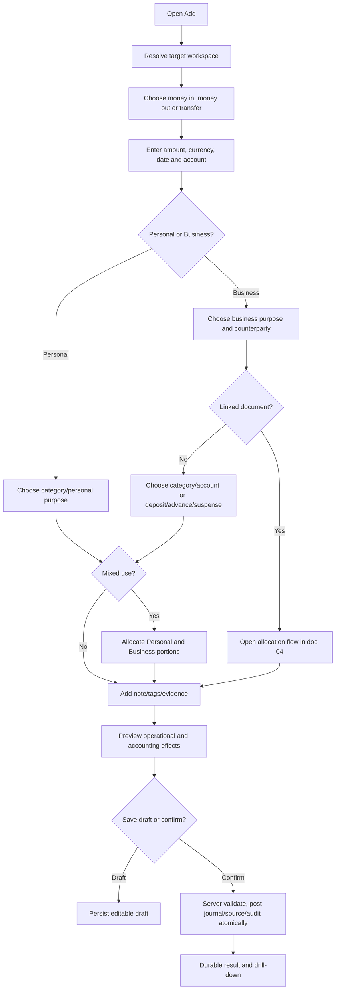
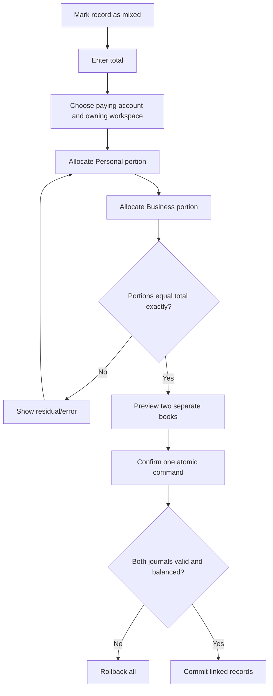
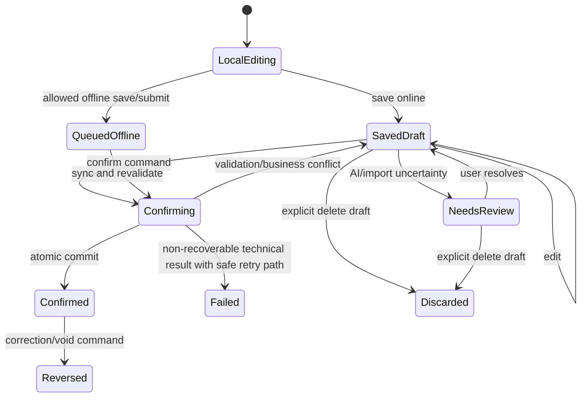
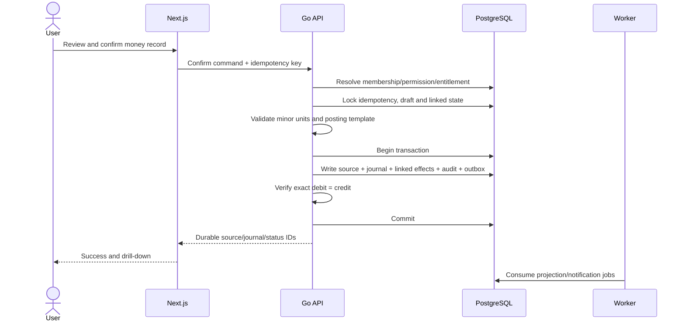

# Money Capture, Classification and Confirmation Blueprint

**Status:** Complete draft  
**Depends on:** documents 00–02 and final-plan documents 03 and 11  
**Boundary:** Captures and posts money records; detailed payment-to-document allocation is defined in document 04

## 1. Purpose

This blueprint defines how a Personal or Business user records money accurately without needing accounting knowledge. It covers:

- manual income, expense and transfer capture;
- plain-language/AI draft entry at the product boundary;
- Personal, Business, Mixed and Transfer classification;
- exact major-unit string to minor-unit conversion;
- money account, category, counterparty and purpose selection;
- attachments and evidence;
- accounting-effect preview;
- draft, confirmation, posting and idempotency;
- opening balances and unknown/unclassified records;
- correction, void and reversal;
- responsive, offline, permission and edge-case behavior.

It does not allow the frontend or AI to post ledger entries directly.

## 2. Core concepts

### Direction

- `money_in`: increases a selected asset account or reduces a selected liability.
- `money_out`: decreases a selected asset account or increases a selected liability where applicable.
- `transfer`: moves value between the user's own accounts and is neither income nor expense.
- `adjustment`: controlled accounting correction/opening/reclassification workflow, shown only to permitted users.

Direction is user language, not sufficient accounting instruction by itself. Purpose and linked source determine the journal.

### Finance scope

- `personal`: belongs entirely to a Personal workspace.
- `business`: belongs entirely to a Business workspace.
- `mixed`: one real-world payment requires explicit Personal and Business portions.
- `transfer`: money moves between owned accounts; each side remains in its own workspace/account context.

`All` is never stored as a scope. It is a view.

### Money account

An account representing where money is held or owed, such as:

- cash;
- bank account;
- mobile wallet;
- card/credit account when supported;
- clearing account;
- customer/supplier deposit control account through controlled workflows.

The user sees plain names. The backend maps them to ledger accounts.

### Category

A user-facing reason grouping, such as Food, Transport, Rent, Sales or Utilities. A category maps to an allowed accounting account/rule but is not itself the ledger.

### Purpose/link

For Business, the record must state what the money settles or represents:

- invoice/sale;
- customer deposit;
- supplier bill/purchase;
- supplier advance;
- loan;
- tax;
- owner capital/drawing;
- refund;
- transfer;
- other;
- not yet known.

## 3. Entry points

- Universal Add → money in/money out/transfer.
- Personal Activity empty state.
- Business Money page.
- Customer/supplier detail.
- Invoice/bill/sale detail.
- Dashboard quick action.
- Plain-language input.
- CSV import creates drafts through a separate batch path.
- Offline queue creates local drafts/commands under document 15 rules.

Every entry point dispatches into the same command-form system with explicit defaults. Context may preselect workspace, direction, counterparty or document, but never bypass confirmation.

## 4. High-level flow



## 5. Form architecture

The form is progressive, not one overwhelming accounting form.

### Stage 1 — context and direction

Fields:

- target space/workspace;
- money in, money out or transfer;
- optional entry method indicator (manual, AI-assisted, import, offline).

Defaults:

- Active Personal/Business space preselects itself.
- `All` requires target selection.
- Customer/invoice entry points preselect Business and money in.
- Supplier/bill entry points preselect Business and money out.

### Stage 2 — amount, currency and date

Fields:

- amount as major-unit string;
- currency;
- effective date;
- optional time for cash/POS history where relevant.

Rules:

- Amount is required and greater than zero for ordinary capture.
- User enters magnitude; direction determines sign/effect.
- Currency defaults to workspace base currency.
- Different currency activates exchange-rate/base-value review.
- Future effective dates are blocked or treated as scheduled drafts, never silently posted.
- Backdating checks open period and inventory/source rules.

### Stage 3 — money account

Money in:

- “Where did the money arrive?”

Money out:

- “Where was it paid from?”

Transfer:

- “From” and “To” accounts.

Rules:

- Account belongs to the target workspace and is active.
- Transfer source and destination differ.
- Account currency mismatch requires supported conversion logic.
- A user cannot select a raw control/ledger account unless the advanced permission/workflow permits it.
- Recently used account ranking is workspace-specific.

### Stage 4 — purpose and links

Personal choices:

- normal income/expense category;
- loan borrowed/repaid/lent/collected;
- investment contribution/income/disposal;
- asset purchase/disposal;
- refund/reimbursement;
- owner transfer between Personal and owned Business;
- not yet classified.

Business choices:

- customer invoice/sale payment;
- immediate sale;
- customer advance/deposit;
- supplier bill payment;
- immediate purchase/expense;
- supplier advance linked optionally to a PO;
- customer refund or supplier refund;
- loan movement;
- owner capital/drawing;
- tax payment/refund;
- transfer;
- other income/expense;
- not yet known.

Selecting a document-based purpose delegates allocation to document 04 and returns the allocation result to this confirmation flow.

### Stage 5 — classification details

Fields as required:

- category;
- counterparty;
- tags;
- description/reference;
- Personal/Business allocation;
- tax treatment for direct Business income/expense;
- attachment/evidence;
- notes visible only internally;
- linked source documents.

The form displays only fields relevant to the chosen purpose.

### Stage 6 — review and confirm

Shows:

- money direction, amount and account;
- effective date;
- Personal/Business portions;
- purpose/category/counterparty;
- linked document allocation and remainder;
- base-currency amount/rate where applicable;
- tax effect;
- balance effect;
- report/receivable/payable/loan/deposit effect in plain language;
- attachments upload state;
- warnings and required acknowledgements;
- `Save draft` and `Confirm` actions.

No record is included in confirmed totals before successful server confirmation.

## 6. Exact money parsing algorithm

### Inputs

- `major_amount`: user/API string, for example `"0010.05"`;
- `currency`: ISO code, for example `NGN`;
- server currency metadata exponent, for example `2`.

### Accepted syntax

- ASCII digits;
- optional single decimal point;
- surrounding whitespace trimmed;
- optional leading plus may be normalized or rejected consistently;
- no sign for ordinary magnitude inputs;
- no group separators in machine payload;
- no exponent notation;
- no hexadecimal, NaN or Infinity.

Localized UI may accept display separators, but it normalizes into canonical machine string before submission and shows the normalized value for confirmation.

### Conversion pseudocode

```text
function parseMajorToMinor(input, exponent):
    s = trim(input)
    require s matches DIGITS ["." DIGITS]?
    split s into whole and fraction (fraction defaults "")
    whole = removeLeadingZeros(whole); if empty then "0"
    require length(fraction) <= exponent
    fraction = rightPadWithZeros(fraction, exponent)
    digits = whole + fraction
    minor = checkedParseInt64(digits)
    require minor > 0 for normal record
    require minor <= productConfiguredMaximum(currency)
    return minor
```

Examples for exponent 2:

| Input | Result |
|---|---:|
| `0.05` | `5` |
| `.05` | Rejected by strict machine grammar; UI may normalize to `0.05` |
| `00010.05` | `1005` |
| `10` | `1000` |
| `10.5` | `1050` |
| `10.050` | Rejected unless an explicit rounding workflow applies |
| `1e3` | Rejected |
| `1,000.00` | Rejected at API boundary; UI normalizes display input |

For zero-exponent currency, a fractional part is rejected. For three-exponent currency, exactly up to three fractional digits are padded.

### JSON output

```json
{
  "amount_minor": "1005",
  "currency": "NGN",
  "currency_exponent": 2
}
```

Minor integers are strings in JSON to avoid JavaScript safe-integer loss.

## 7. Currency and exchange-rate algorithm

### Same as workspace base currency

- Transaction and base minor units are identical.
- Exchange rate is `1` internally; it need not distract the user.

### Foreign currency

Required data:

- transaction currency and amount minor;
- base currency;
- fixed-decimal exchange rate with direction clearly defined;
- base minor amount after rounding;
- rate source and timestamp/manual indicator.

Rules:

- MVP may restrict unsupported foreign-currency account/document combinations.
- User can review/edit a manual rate when permitted.
- Store original transaction amount and rate; never rewrite history when rates change.
- Round base amount once using documented currency rule.
- Currency gain/loss appears only through supported settlement/revaluation workflows, not guessed by the frontend.

## 8. Category behavior

### Default categories

Personal examples:

- Salary/income
- Food
- Transport
- Housing
- Utilities
- Health
- Education
- Family/support
- Entertainment
- Other

Business examples:

- Sales/service revenue
- Rent
- Utilities
- Transport/delivery
- Marketing
- Office/administration
- Professional fees
- Repairs
- Bank/payment fees
- Other operating income/expense

Defaults are editable labels/mappings subject to system-account protections.

### Selection algorithm

1. Filter by workspace, direction and purpose.
2. Exclude inactive categories from new records while preserving history.
3. Rank recent/frequent valid categories.
4. Show recommended categories based on deterministic context or AI draft, labeled as suggestions.
5. Allow search and permitted create-new action.
6. Validate server mapping at confirmation.

### Category creation

Fields:

- name;
- direction applicability;
- Personal/Business context;
- mapped accounting type/account determined or reviewed under safe rules;
- optional color/icon for UI only.

Duplicate names may be warned/normalized within workspace. Creating “Sales” must not allow mapping revenue to cash or another invalid account class.

### Reclassification

- Draft category can be edited freely.
- Confirmed record cannot be silently rewritten.
- An allowed reclassification creates an auditable adjustment/reclassification entry under correction rules.
- Category renaming changes display configuration, not the historical ledger account/effect.

## 9. Counterparty behavior

Counterparty is optional for ordinary Personal capture and conditionally required for Business/document flows.

Choices:

- existing customer;
- existing supplier;
- organization contact;
- guest/walk-in customer;
- one-time name/reference without full contact creation;
- self/owner;
- government/tax authority;
- unknown.

Rules:

- Customer/supplier need not be a Rekordly user.
- Search is workspace-scoped.
- One party may hold customer and supplier roles.
- Creating a party inline requires only minimal fields and returns to the draft.
- Historical record snapshots required display data so later party changes do not rewrite history.
- Counterparty choice filters open documents for allocation but does not automatically allocate.

## 10. Personal, Business and Mixed classification

### Ordinary classification

- Record created inside Personal defaults Personal.
- Record created inside Business defaults Business.
- Record created in All requires target selection.
- User may identify mixed use before confirmation where the workflow supports it.

### Mixed meaning

Mixed applies when a single external cash movement contains both Personal and Business economic portions, for example a mobile-data payment used 70% for business and 30% personally.

It does not mean:

- merge the Personal and Business ledgers;
- show one journal across two workspaces;
- make an unexplained guess;
- use All as a posting scope.

### Mixed allocation fields

- total amount minor;
- Personal portion minor and category;
- Business portion minor and category/purpose;
- shared payment account owner/location;
- allocation method: exact amount or percentage assistance;
- explanation/note where required.

### Allocation algorithm

```text
require personal_minor >= 0
require business_minor >= 0
require personal_minor + business_minor == total_minor
require at least one portion > 0
```

Percentages are input helpers only:

1. Calculate high-precision share.
2. Round one portion to minor units using documented rule.
3. Assign the exact residual to the other portion.
4. Display both final minor amounts before confirmation.

### Cross-workspace posting

Mixed posting uses one server command and one database transaction when both workspaces are in the same database and owned/authorized by the actor:

1. Lock idempotency key and relevant accounts.
2. Validate access to Personal and Business workspaces.
3. Write a source grouping record with no merged ledger authority.
4. Post a balanced journal in Personal for the Personal portion.
5. Post a balanced journal in Business for the Business portion.
6. Add due-to/from owner/inter-workspace clearing effects where required by which workspace owns the paying account.
7. Write linked audit events in both workspaces.
8. Commit all or roll back all.

The accounting rulebook must define the exact due-to/from treatment for each paying-account ownership case before implementation. The UI states which account paid and how each book is affected.

### Mixed flow diagram



## 11. Transfer workflow

### Same workspace and currency

Fields:

- source account;
- destination account;
- amount;
- effective date;
- optional fee, recorded separately;
- reference/evidence.

Journal effect:

- debit destination asset;
- credit source asset.

No income or expense is created except an explicit fee.

### Different currencies

Requires transaction amounts/rate and supported foreign-exchange logic. If not safely supported in MVP, block with a clear limitation rather than approximating.

### Personal ↔ Business owner transfer

This is not ordinary income/expense:

- Personal → Business: owner contribution/capital or owner loan according to selected purpose.
- Business → Personal: owner drawing/distribution, reimbursement, repayment or salary only through the correct selected purpose.

The user must choose the economic meaning. The system never assumes that any cross-space transfer is revenue.

### Transfer invariants

- source and destination differ;
- both accounts authorized;
- one transfer source record links both sides;
- retries cannot duplicate one side;
- reversal reverses both sides atomically;
- deleting one side is forbidden.

## 12. Business purpose resolution

Purpose determines required fields and posting template.

| Purpose | Required/conditional inputs | Primary effect |
|---|---|---|
| Invoice payment | Customer, invoice allocation | Cash ↑, receivable ↓ |
| Immediate sale | Customer/Guest, lines or revenue category, tax | Cash ↑, revenue/tax; stock/COGS if goods |
| Customer deposit | Customer | Cash ↑, customer-deposit liability ↑ |
| Supplier bill payment | Supplier, bill allocation | Cash ↓, payable ↓ |
| Immediate purchase | Supplier optional, expense/item/asset, tax | Cash ↓, expense/inventory/asset ↑ |
| Supplier advance | Supplier, optional PO | Cash ↓, supplier-advance asset ↑ |
| Loan proceeds | Lender/loan | Cash ↑, loan liability ↑ |
| Loan repayment | Loan, principal/interest allocation | Cash ↓, liability/interest effect |
| Owner capital | Owner | Cash ↑, equity/owner balance ↑ |
| Owner drawing | Owner | Cash ↓, drawings/equity effect |
| Tax payment | Tax type/period | Cash ↓, tax payable/expense as supported |
| Other | Category/account and explanation | Template-dependent |
| Unknown | Counterparty/reference if known | Suspense/clearing until resolved |

Linking/allocating document payments uses document 04. Goods sale/purchase logic also invokes inventory/sales/purchasing rules and may not be represented as a simple category-only record.

## 13. Unknown and unclassified records

Unknown is allowed so users do not fabricate categories, but it is controlled.

### Personal

- Post to an Unclassified Income or Unclassified Expense account/category.
- Show in Needs Review.
- Include transparently in cash movement; reports identify unclassified total.

### Business money in

- If payer/purpose unknown, use Unidentified Receipts liability/suspense, not revenue.
- Later resolution allocates to invoice, deposit, loan or income through an adjustment.

### Business money out

- Use controlled Payments Clearing/Suspense, not arbitrary expense.
- Later resolution moves to payable, advance, expense, asset, loan or other supported purpose.

### Resolution rules

- Original bank/cash movement remains immutable.
- Resolution posts a linked reclassification/allocation; it does not create a second cash movement.
- Partial resolution is allowed; unresolved balance remains visible.
- Suspense aging and material balances appear in Review/reports.

## 14. Attachments and evidence

Supported:

- receipt photo;
- PDF;
- other allowlisted document/image types.

Flow:

1. Client requests signed upload authorization.
2. Server validates workspace, permission, file type/size intent.
3. Client uploads directly to authenticated/private Cloudinary delivery or approved storage.
4. Server receives/fetches verified asset metadata.
5. Attachment remains pending until scan/validation completes where implemented.
6. Draft references pending asset.
7. Confirmation policy either requires clean attachment or allows record with quarantined/unavailable evidence status.

Rules:

- Default public Cloudinary upload is forbidden for financial evidence.
- Store asset identifier, hash, size, MIME, owner, status and retention metadata.
- Signed access is short lived.
- Attachment failure does not create a false confirmed financial record unless user explicitly proceeds under allowed policy.
- Removing evidence from a confirmed record is an audited action and may be restricted by retention rules.

## 15. Plain-language/AI draft boundary

The capture surface may accept text such as:

> I paid ₦8,500 for fuel from my business bank account yesterday.

AI returns a typed, untrusted draft containing proposed:

- workspace/scope;
- direction;
- major/minor amount candidate;
- currency;
- date;
- account;
- purpose/category;
- counterparty;
- uncertainty/missing fields.

Rules:

- AI never returns final ledger lines as authority.
- Server validates every field against the same manual schemas.
- Low-confidence or missing fields are highlighted.
- User can edit all permitted fields.
- Confirmation preview is identical to manual entry.
- Confirm command enters the same deterministic posting path.
- Entry source records AI assistance/model audit metadata without treating prompt text as product analytics.

Detailed prompt, credit, retry and provider behavior belongs to document 12.

## 16. Draft lifecycle



Drafts do not affect balances, reports, stock, receivables or payables.

## 17. Confirmation preview

The preview translates backend-computed effects.

Examples:

Personal expense:

```text
NGN 8,500.00 will leave GTBank.
Transport spending for 7 November will increase by NGN 8,500.00.
```

Invoice payment:

```text
NGN 40,000.00 will enter Business Bank.
Invoice INV-102 outstanding balance will reduce from NGN 65,000.00 to NGN 25,000.00.
No new sales income will be created because the invoice already recorded the sale.
```

Customer advance:

```text
NGN 20,000.00 will enter Cash.
It will be recorded as money owed to/held for this customer, not as sales income yet.
```

Transfer:

```text
NGN 15,000.00 will move from Cash to Bank.
Income and expense totals will not change.
```

The preview comes from a deterministic backend effect calculator/posting template. The frontend does not independently calculate authoritative accounting.

## 18. Confirm-money command

Representative payload:

```json
{
  "draft_id": "opaque-id",
  "expected_version": 3,
  "effective_date": "2026-11-07",
  "amount_minor": "850000",
  "currency": "NGN",
  "money_account_id": "opaque-id",
  "purpose": "business_direct_expense",
  "category_id": "opaque-id",
  "counterparty_id": null,
  "attachment_ids": [],
  "client_command_id": "opaque-id"
}
```

`Idempotency-Key` is required in the request header. Workspace is resolved through authorized route/session context, not trusted from an arbitrary body.

## 19. Posting algorithm

1. Authenticate session.
2. Resolve workspace and active membership.
3. Require create/confirm capability and outlet scope.
4. Check plan entitlement/usage.
5. Validate idempotency key and payload hash.
6. Validate draft ownership/version if draft-based.
7. Parse/validate minor units, currency and dates.
8. Lock relevant document/account/control state.
9. Validate category, counterparty, linked sources and period.
10. Resolve purpose-specific deterministic posting template.
11. Validate allocation or cross-workspace rules when applicable.
12. Begin/continue PostgreSQL transaction.
13. Create immutable source money record.
14. Create balanced journal entry/lines in minor units.
15. Create payment/allocation, loan, tax, stock or other linked effects where the purpose requires them.
16. Verify debit sum equals credit sum exactly.
17. Write audit event and outbox jobs.
18. Mark draft confirmed with source reference.
19. Store idempotency result.
20. Commit.
21. Return source ID, journal ID, status and affected projections.

Any invariant failure rolls back the entire command.



## 20. Journaling examples

These are templates; configured control accounts are resolved per workspace.

### Cash personal expense

| Debit | Credit |
|---|---|
| Expense category | Cash/Bank |

### Cash business income not previously invoiced

| Debit | Credit |
|---|---|
| Cash/Bank | Revenue and tax liability as applicable |

### Invoice collection

| Debit | Credit |
|---|---|
| Cash/Bank | Accounts Receivable |

### Customer advance

| Debit | Credit |
|---|---|
| Cash/Bank | Customer Deposits liability |

### Supplier bill payment

| Debit | Credit |
|---|---|
| Accounts Payable | Cash/Bank |

### Supplier advance

| Debit | Credit |
|---|---|
| Supplier Advances asset | Cash/Bank |

### Same-workspace transfer

| Debit | Credit |
|---|---|
| Destination money account | Source money account |

## 21. Opening balances

Opening balance is an advanced guided command, not ordinary income/expense.

Required:

- account;
- amount/direction;
- opening effective date;
- balancing source/account chosen by valid opening-balance rule;
- optional evidence/note;
- confirmation that this existed before Rekordly tracking.

Rules:

- Opening cash does not become current-period income.
- Opening receivables/payables require party-level detail or a controlled summary with limitations.
- Opening inventory uses stock opening commands with quantity and cost, not a money-only record.
- Repeated opening commands are idempotent and auditable.
- Once normal activity exists, changing opening values uses correction/reversal, not overwrite.

## 22. Corrections, voids and reversals

### Draft

- Edit or delete freely within permission and retention policy.

### Confirmed record

- Cannot be hard-deleted or silently edited.
- User chooses Correct or Reverse/Void with a reason.
- System previews all linked effects.
- Open period: create reversal and optional replacement.
- Locked period: post adjustment in an allowed open period referencing the original.
- Linked payment, allocation, loan and stock effects reverse consistently.
- Evidence/history remains accessible according to retention policy.

### Correction algorithm

1. Load original and linked effects.
2. Verify permission, workspace, period and current state.
3. Require reason and expected version.
4. Compute inverse of every active journal/linked operational effect.
5. Validate reversal remains legal (for example stock already consumed may require a return/adjustment workflow rather than naïve reversal).
6. Post reversal atomically.
7. If replacement requested, validate/post it in the same controlled command or a linked subsequent command.
8. Mark source as reversed/voided through append-only state/event fields.
9. Audit actor, reason and links.

## 23. Plan and permission gates

Representative capabilities:

- `money.view`
- `money.create_draft`
- `money.confirm`
- `money.reverse`
- `money.reconcile`
- `journal.view`
- `opening_balance.manage`

Rules:

- A user who can draft may require approval/confirmation by another role.
- A cashier may record permitted receipts but not arbitrary general expenses or reversals.
- Inventory-related direct purchases/sales require corresponding module permission.
- Plan limits block new confirmed usage, not access to existing history/export.
- AI credit exhaustion does not block manual entry.

## 24. Offline behavior

Allowed offline:

- create/edit bounded local manual drafts;
- queue supported simple commands with client-generated ID/idempotency key;
- attach local evidence pending later upload within storage/size policy.

Not allowed offline:

- AI parsing;
- document allocation requiring current outstanding balance;
- confirmation against stale stock, wallet, loan or period state when unsafe;
- foreign-exchange provider lookup;
- final issue/send of invoices/documents.

On sync:

1. Authenticate current session.
2. Recheck permissions, plan, account status, dates and server state.
3. Detect duplicate client command/idempotency key.
4. If safe, post and return durable record.
5. If changed/conflicting, move to Needs Review; never silently alter amount/category/purpose.

## 25. Loading and error behavior

### Form boot

- Show structural skeleton for account/category selectors.
- Preserve typed amount locally while option queries retry.
- Do not default to an account/category until valid options are known.

### Submission

- Disable duplicate click but allow safe navigation warning.
- Show `Confirming…`, not `Saved`, until durable response.
- If response is lost, query by idempotency/client command ID before offering retry.
- Validation conflict returns fields and retains draft.
- Provider/attachment failure is separated from financial posting result.

### Stable errors

- `INVALID_MONEY_FORMAT`
- `UNSUPPORTED_CURRENCY_PRECISION`
- `AMOUNT_OUT_OF_RANGE`
- `ACCOUNT_INACTIVE`
- `CATEGORY_NOT_ALLOWED`
- `PERIOD_LOCKED`
- `ALLOCATION_REQUIRED`
- `ALLOCATION_MISMATCH`
- `DOCUMENT_BALANCE_CHANGED`
- `IDEMPOTENCY_CONFLICT`
- `PERMISSION_CHANGED`
- `PLAN_LIMIT_REACHED`
- `DEPENDENCY_UNAVAILABLE`

## 26. Data model additions/clarifications

### `money_records`

- id, workspace_id
- direction, purpose, scope type
- amount_minor (`BIGINT`), currency, exponent snapshot
- base_amount_minor and fixed-decimal exchange rate where applicable
- money account
- effective date, posted timestamp
- category/counterparty
- description/reference
- source/entry method
- status, reversal/reference links
- created/confirmed actor
- idempotency/client command references

### `money_record_parts`

For mixed or purpose allocation:

- grouping/source ID
- target workspace
- amount minor/currency
- purpose/category/account
- linked journal/source

### `money_record_links`

Typed links to invoice, bill, sale, order, loan, tax period, PO advance or other source.

### `drafts`

- owner/workspace/target context
- schema version and typed payload
- state/version
- source method and AI/import metadata references
- expiry/retention metadata
- confirmed source reference

Draft payload is validated and size-bounded; sensitive free text is minimized.

## 27. API outline

| Method/path | Purpose |
|---|---|
| `POST /v1/workspaces/{id}/money-record-drafts` | Create manual/AI-assisted draft |
| `PATCH /v1/workspaces/{id}/money-record-drafts/{draft}` | Versioned draft edit |
| `DELETE /v1/workspaces/{id}/money-record-drafts/{draft}` | Discard draft |
| `POST /v1/workspaces/{id}/money-record-drafts/{draft}/preview` | Deterministic effect preview |
| `POST /v1/workspaces/{id}/commands/confirm-money-record` | Confirm/post record |
| `POST /v1/workspaces/{id}/commands/transfer-money` | Atomic transfer |
| `POST /v1/owner/commands/confirm-mixed-record` | Atomic linked Personal/Business posting |
| `POST /v1/workspaces/{id}/money-records/{record}/commands/reverse` | Reverse confirmed record |
| `POST /v1/workspaces/{id}/money-records/{record}/commands/correct` | Reversal/replacement workflow |
| `GET /v1/workspaces/{id}/money-records` | Cursor/date/filter list |
| `GET /v1/workspaces/{id}/money-records/{record}` | Source/effect/history detail |
| `POST /v1/workspaces/{id}/attachments/upload-authorizations` | Authorized private upload |

Every mutation requires idempotency except versioned draft edits where the exact concurrency contract provides equivalent protection.

## 28. Detail/source drill-down

Confirmed record detail shows:

- plain summary and status;
- amount/currency/account/date;
- purpose/category/counterparty;
- Personal/Business parts;
- linked documents/loan/tax/source;
- payment allocations where applicable;
- attachments;
- journal effect with optional accounting detail expansion;
- balance/report effects;
- entry source (manual, AI-assisted, import, offline);
- audit timeline;
- correction/reversal actions when permitted.

The default presentation stays understandable; accountants can expand journal lines.

## 29. Notifications and review items

Create Review items for:

- AI uncertainty;
- unclassified Personal record;
- unidentified Business receipt/payment;
- failed/partial import;
- mixed allocation mismatch;
- document balance changed before confirmation;
- attachment quarantine/failure;
- sync conflict;
- reversal requiring approval.

Ordinary successful manual record does not need a notification; inline durable confirmation is sufficient.

## 30. Product analytics

Safe events:

- `money_capture_started`
- `money_direction_selected`
- `money_purpose_selected`
- `mixed_allocation_selected`
- `money_preview_viewed`
- `money_draft_saved`
- `money_record_confirmed`
- `money_confirmation_failed_class`
- `money_record_reversal_started/completed`
- `unclassified_resolution_completed`

Metadata may include scope kind, direction, purpose class, entry method and failure class. Never send amount, account name, counterparty, description or attachment data.

## 31. Acceptance and edge-case tests

### Money parsing

- `0.05` NGN stores `5` minor units.
- `00010.05` stores `1005` without leading-zero ambiguity.
- `10.5` stores `1050` for exponent 2.
- Excess precision, exponent notation, separators and overflow fail safely.
- Zero-exponent and three-exponent currencies follow metadata.
- JSON minor values remain strings end-to-end.

### Classification

- Personal record cannot select a Business-only category/account.
- Business record requires valid purpose.
- Invoice payment does not create revenue twice.
- Customer overpayment does not become revenue silently.
- Supplier advance does not reduce payable without allocation.
- Unknown Business receipt posts to liability/suspense and Review.
- Transfer does not affect income/expense.
- Owner transfer requires capital/drawing/loan/reimbursement meaning.

### Mixed

- Personal plus Business portions equal total exactly.
- Percentage rounding assigns deterministic residual.
- Failure in either workspace rolls back both.
- User lacking access to either workspace cannot post mixed record.
- All summary shows linked records without merging journals.

### Posting/idempotency

- Debit and credit minor totals match exactly.
- Same idempotency key/payload returns original result.
- Same key/different payload returns conflict.
- Lost response followed by retry cannot duplicate source/journal.
- Concurrent draft confirmation posts once.
- Role/plan/period changes are revalidated at confirm time.

### Drafts/AI/offline

- Draft does not alter balances/reports.
- AI proposal requires user confirmation.
- Offline queued record is not shown as posted.
- Server conflict moves offline command to Needs Review.
- AI credit exhaustion leaves manual path functional.

### Corrections

- Confirmed record cannot be directly updated/deleted.
- Reversal creates exact opposite journal and linked effects.
- Locked-period correction uses allowed open-period adjustment.
- Linked invoice/loan/stock effects remain consistent.
- Reversal retry is idempotent.

### Security/tenancy

- Account, category, counterparty, draft, attachment and source IDs from another workspace fail.
- Client-supplied workspace/ledger lines are not trusted.
- Cashier/role limitations are enforced by API.
- Signed attachment access expires and cannot expose another tenant.

### UX/accessibility

- Full simple expense can be completed on a small mobile screen.
- Review exposes final normalized amount before confirmation.
- Error focus moves to the first invalid field.
- Status is announced without color-only meaning.
- Back navigation warns before discarding unsaved data.

## 32. Implementation handoff checklist

- Go minor-unit value type and checked arithmetic helpers exist with exhaustive tests.
- Currency metadata source/version and rounding rules are defined.
- Purpose-to-posting-template registry is deterministic and reviewed.
- Category mappings cannot create invalid account-class journals.
- Manual and AI drafts share schemas and confirmation path.
- Mixed-record accounting treatment is signed off before implementation.
- Effect preview and posting use the same backend rules.
- Idempotency covers all confirmation/transfer/reversal commands.
- Drafts remain outside financial totals.
- Attachment uploads are authenticated/private.
- Document allocation integration matches document 04.
- Property tests assert every posting template balances.

