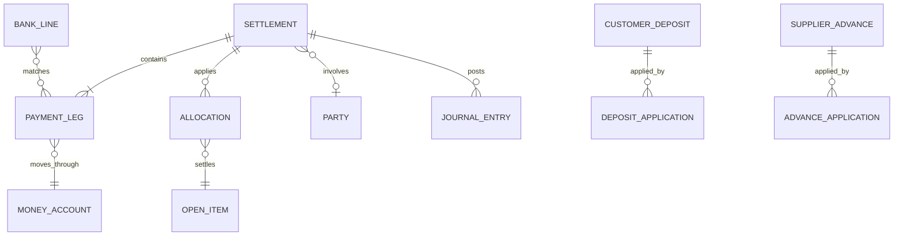
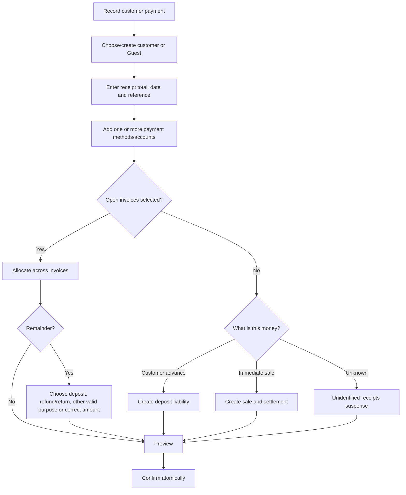
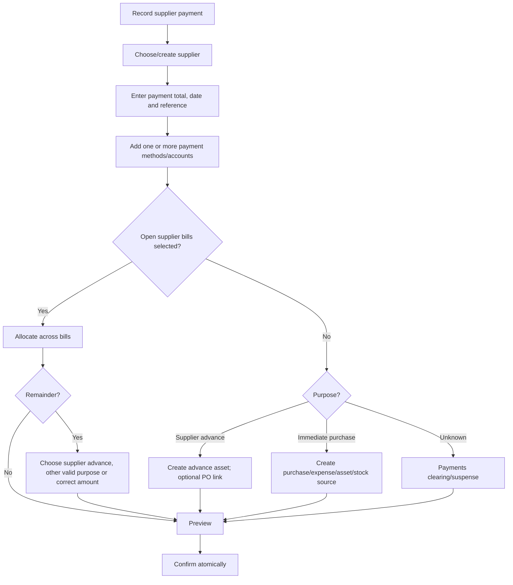
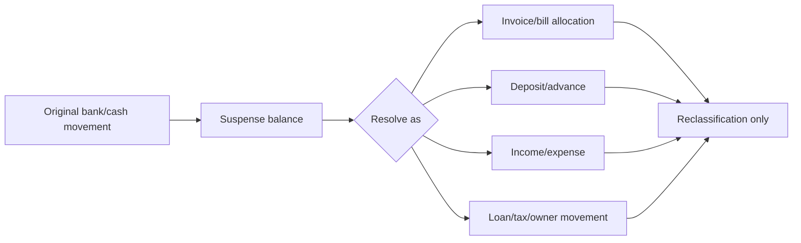
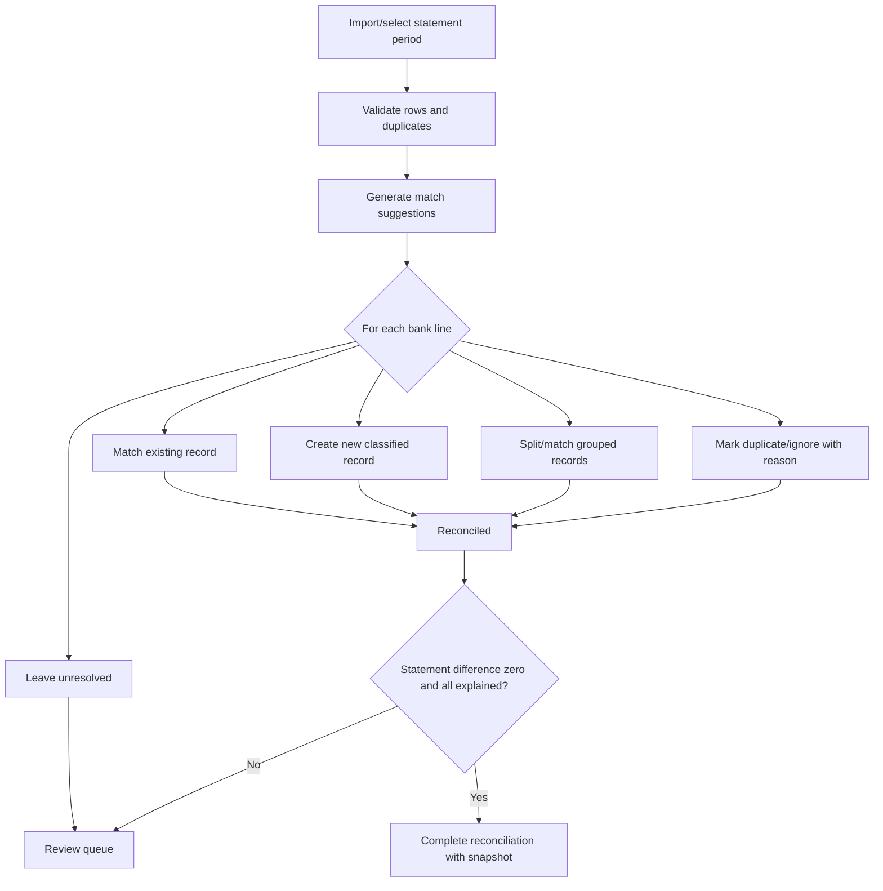

# Payments, Allocations and Reconciliation Blueprint

**Status:** Complete draft  
**Depends on:** documents 00–03  
**Applies to:** Business receivables/payables, Personal loans/reimbursements where explicitly supported, and imported bank/cash activity

## 1. Purpose

This blueprint defines how Rekordly records movement of money and connects it to the obligations it settles. It distinguishes:

- a payment event;
- one or more payment methods/accounts used in a settlement;
- allocation across one or more invoices/bills/loan components;
- customer deposits and supplier advances;
- unidentified receipts/payments;
- refunds and reversals;
- imported bank lines and reconciliation;
- partial, over-, under- and multi-document settlement.

The goal is to prevent common accounting errors such as recording invoice collection as new sales income, treating customer advances as revenue, treating a PO as a payable or duplicating cash when an imported bank line matches an existing payment.

## 2. Definitions

### Payment

A durable record of value received or paid by the workspace, including date, counterparty, currency and settlement context.

### Payment leg

One money-account component of a settlement. Example: a NGN 50,000 sale paid with NGN 30,000 cash and NGN 20,000 bank transfer has two payment legs.

### Allocation

A relationship assigning all or part of a payment to an outstanding document or supported obligation.

### Settlement

The user action grouping payment legs and allocations. It may be one payment record with several legs or a controlled parent record linking method-specific payment records, depending on final schema.

### Customer deposit

Money received from a customer before it is earned/applied. It is a liability until allocated to a valid sale/invoice or refunded.

### Supplier advance

Money paid to a supplier before a payable is recognized/applied. It is an asset until allocated to a supplier bill, refunded or otherwise resolved.

### Unidentified receipt/payment

A real money movement whose purpose/counterparty is not yet sufficiently known. It remains in a controlled suspense/clearing account and Review queue.

### Reconciliation

The process of matching Rekordly money records to external bank/wallet statement lines and explaining every difference without creating duplicates.

## 3. Conceptual model



An open item may be an invoice, supplier bill or supported loan/tax obligation. Purchase orders are not open payable items.

## 4. Entry points

- Universal Add → Record customer payment.
- Universal Add → Supplier payment/advance.
- Invoice detail → Record payment.
- Customer detail → Receive money/deposit.
- Supplier bill detail → Pay bill.
- Supplier detail → Pay/record advance.
- Sale/POS checkout → immediate settlement.
- Money/Transactions → identify an unallocated receipt/payment.
- Bank import/reconciliation → match or create.
- Loan detail → repayment received/paid.
- Refund/return workflow → issue or receive refund.

Entry context supplies defaults but never changes the accounting meaning silently.

## 5. Customer receipt workflow



### Required fields

- customer/Guest/unknown payer choice;
- settlement amount and currency;
- effective date;
- at least one payment leg;
- purpose/allocation;
- reference/evidence where available;
- treatment of any remainder.

### Customer selection

- A named customer is required for deposit/on-account credit.
- Guest may be used for an immediate sale but cannot accumulate an anonymous reusable wallet/deposit balance.
- Unknown payer routes to unidentified receipts until resolved.
- Customer need not be a Rekordly user.

## 6. Supplier payment workflow



A PO may be referenced by a supplier advance, but payment to a PO is never presented as reducing Accounts Payable unless a supplier bill/payable exists.

## 7. Payment-method split

A settlement can use several accounts/methods.

Example:

```text
Settlement total: NGN 50,000
Cash leg:         NGN 30,000
Bank leg:         NGN 20,000
```

Rules:

- Sum of active payment legs must equal settlement total exactly.
- Each leg has money account, amount minor, method label and optional provider/reference.
- Method label maps to a configured money account; it is not the accounting authority by itself.
- Legs may share currency only unless a supported multi-currency settlement explicitly defines conversion.
- Fees are separate expense/payment effects, not silently subtracted from customer receipt.
- Reversal may reverse all legs or use a controlled partial-refund workflow; it cannot delete one leg from a finalized balanced settlement.

### Leg validation

```text
require each leg_minor > 0
require all leg currencies are supported by settlement
require sum(leg_minor) == settlement_total_minor
require every money account belongs to workspace and is permitted
```

## 8. Multi-document allocation

A single settlement may apply across several invoices or bills.

Example:

```text
Receipt:            NGN 100,000
Invoice INV-001:    NGN  60,000
Invoice INV-002:    NGN  25,000
Customer deposit:   NGN  15,000
```

Rules:

- Allocations use minor units.
- Each allocation is greater than zero.
- Allocation cannot exceed the current outstanding amount.
- Total allocations cannot exceed settlement total.
- Remainder requires explicit treatment.
- Default suggestion is oldest due/oldest issued first, but user can override.
- Closed, voided, fully paid or cross-customer documents cannot be allocated.
- A payment in one currency can allocate only under supported same-currency or explicit FX settlement rules.

### Allocation algorithm

```text
available = settlement_total_minor

for each requested allocation in deterministic request order:
    lock open item
    outstanding = currentPostedTotal - activeAllocations - activeCredits
    require outstanding > 0
    require requested > 0
    require requested <= outstanding
    require requested <= available
    available = available - requested

remainder = available
require remainder treatment is explicit
```

Outstanding is computed/transactionally maintained from source documents and active allocations; the client-provided displayed balance is never trusted.

## 9. Allocation screen

### Header

- customer/supplier;
- settlement amount;
- unallocated remainder;
- currency;
- date and money-account summary.

### Open-item list

Each row/card shows:

- document number/type;
- issue/due date;
- original total;
- already paid/credited;
- current outstanding;
- allocation input;
- status/overdue indicator.

Controls:

- Auto-allocate oldest first.
- Clear allocations.
- Search/filter documents.
- Apply exact outstanding.
- View source in a safe side panel.

### Footer

- allocated total;
- remaining total;
- remainder treatment selector;
- confirmation preview.

Mobile uses stacked cards and a sticky summary that does not cover validation messages.

## 10. Auto-allocation algorithm

Default ordering:

1. Same currency.
2. Eligible open status.
3. Earliest due date, with no-due-date after dated overdue/current items.
4. Earliest issue date.
5. Stable document ID tie-breaker.

```text
remaining = settlement_total_minor
for document in orderedEligibleDocuments:
    if remaining == 0: break
    allocation = min(document.outstanding_minor, remaining)
    suggest(document, allocation)
    remaining -= allocation
```

This produces suggestions only until user confirmation. Server recalculates eligibility/outstanding inside the confirmation transaction.

## 11. Invoice and bill status derivation

Status is derived from document state, due date, credits and active allocations.

Representative rules:

```text
outstanding = max(0, posted_total - active_credits - active_payment_allocations)

if document is voided: VOIDED
else if document is draft: DRAFT
else if outstanding == 0: PAID
else if active_payment_allocations > 0: PARTIALLY_PAID
else if due_date < workspace_today: OVERDUE
else: UNPAID
```

An overdue partially paid invoice remains `PARTIALLY_PAID` with an overdue indicator or uses a composed status model; status design must not hide overdue remainder.

Do not store a manually editable `paid_amount` as independent truth.

## 12. Customer deposits

### Creation

When money is received without current earning/allocation:

| Debit | Credit |
|---|---|
| Cash/Bank | Customer Deposits liability |

### Deposit balance

```text
available deposit = posted deposits
                    - active applications to invoices/sales
                    - active refunds
                    - active reversals
```

Balance cannot be negative.

### Applying a deposit

1. Select customer and open invoice/sale.
2. Show available deposit balance.
3. Enter application amount not exceeding both balance and outstanding.
4. Lock deposit balance and document.
5. Post application:

| Debit | Credit |
|---|---|
| Customer Deposits liability | Accounts Receivable or supported sale settlement account |

6. Update projections and audit atomically.

No new cash movement is created when applying an existing deposit.

### Refund deposit

| Debit | Credit |
|---|---|
| Customer Deposits liability | Cash/Bank |

Refund requires sufficient available balance, permission, reason and payment leg.

## 13. Supplier advances

### Creation

| Debit | Credit |
|---|---|
| Supplier Advances asset | Cash/Bank |

### Applying to supplier bill

| Debit | Credit |
|---|---|
| Accounts Payable | Supplier Advances asset |

Rules mirror customer deposits:

- supplier-specific balance;
- no negative balance;
- application cannot exceed bill outstanding;
- PO may be referenced but does not become payable;
- supplier refund reverses the advance into cash/bank;
- application creates no new cash movement.

## 14. Overpayment and underpayment

### Underpayment

- Allocate available amount.
- Document becomes/continues partially paid.
- Outstanding remains visible.
- No write-off is implied.

### Overpayment

User must choose one valid treatment:

- customer deposit;
- supplier advance;
- allocate to additional eligible documents;
- correct entered settlement amount;
- explicit supported write-off/rounding adjustment under permission and threshold;
- return/refund the excess through a separate linked payment.

Rekordly never silently:

- creates revenue from customer excess;
- creates expense from supplier excess;
- allows negative receivable/payable;
- discards the remainder.

## 15. Small differences, fees and write-offs

Payment-provider/bank fees:

- gross customer payment settles receivable;
- fee is a separate bank/processing expense;
- net bank deposit may be reconciled using a grouped settlement/clearing workflow.

Rounding/small-balance write-off:

- separate permission;
- configured maximum threshold in minor units;
- explicit reason/account;
- auditable journal;
- never automatic solely because amounts differ.

Example gross NGN 10,000 sale, provider fee NGN 150, bank receives NGN 9,850:

| Debit | Credit |
|---|---|
| Bank NGN 9,850 | Accounts Receivable NGN 10,000 |
| Processing Fee Expense NGN 150 | |

The grouped journal remains balanced.

## 16. Unidentified receipts and payments

### Receipt

| Debit | Credit |
|---|---|
| Cash/Bank | Unidentified Receipts liability |

### Outgoing payment

| Debit | Credit |
|---|---|
| Payments Clearing/Suspense asset/expense-class per reviewed policy | Cash/Bank |

### Resolution workflow

1. Open Review → Unidentified money.
2. Inspect date, amount, reference, account and import evidence.
3. Choose counterparty and purpose.
4. Allocate all or part to documents/deposit/advance/loan/income/expense.
5. Preview reclassification without another cash movement.
6. Confirm adjustment.
7. Retain unresolved remainder and aging.



Resolution never duplicates the cash/bank leg.

## 17. Refunds

Refunds are not negative payments edited onto the original.

### Customer refund

Possible sources:

- return/credit note;
- excess customer deposit;
- payment reversal due to error;
- goodwill/other approved adjustment.

Requirements:

- customer;
- source/credit/deposit reference;
- refund amount and money account;
- reason;
- inventory return decision handled separately;
- approval if configured.

Refund cannot exceed available refundable credit/deposit without a separate authorized expense/adjustment source.

### Supplier refund

May recover supplier advance, return credit or overpayment. It increases cash/bank and reduces the corresponding supplier asset/receivable/credit.

### Payment-provider reversal/chargeback

Modeled as its own event with provider reference, dispute state, fee and receivable/customer resolution. It must not silently void a sale when goods/service remain delivered.

## 18. Reversal and correction

### Finalized payment

- Cannot be directly edited or deleted.
- Full erroneous payment may be reversed if linked-state rules permit.
- Incorrect allocation may be unallocated/reallocated through audited commands without inventing a second cash movement.
- Actual returned money uses refund, not mere journal reversal.

### Full reversal algorithm

1. Load settlement, legs, allocations, deposit/advance and journal effects.
2. Verify permission, period and current downstream dependencies.
3. Require reason and expected version.
4. Lock affected documents and balances.
5. Reverse active allocations and restore outstanding balances.
6. Reverse deposit/advance creation/application where valid.
7. Post exact opposite journal lines.
8. Mark settlement reversed and link reversal.
9. Audit and commit atomically.

If a later refund/application depends on the payment, require dependency resolution or a purpose-specific correction rather than corrupting the chain.

## 19. Reallocation without new cash movement

Use when payment amount/account/date are correct but document allocation was wrong.

1. Select payment → Manage allocation.
2. Show active allocations and available unallocated amount.
3. Remove/reduce eligible allocations, restoring document outstanding.
4. Add new eligible allocations/deposit treatment.
5. Validate sum and current balances.
6. Post allocation/reclassification journal adjustments if control accounts differ.
7. Keep original payment leg unchanged.
8. Record full audit timeline.

Closed periods may require adjustment in an open period and prevent historical allocation rewrite.

## 20. Import and bank-line model

A bank line is evidence from an external statement, not automatically a new Rekordly transaction.

Fields:

- import batch/account;
- statement date/value date;
- signed amount minor/currency;
- description/reference;
- external transaction ID/hash where available;
- match/reconciliation state;
- linked Rekordly records;
- duplicate fingerprint.

States:

- imported/unreviewed;
- suggested match;
- matched;
- created and matched;
- ignored with reason;
- duplicate/excluded;
- conflict.

## 21. Duplicate detection

### Exact signals

- provider/external transaction ID within account;
- stable statement reference plus amount/date/account;
- identical import-row fingerprint within/between batches.

### Probable signals

- same account, signed amount and near date;
- normalized reference/description similarity;
- matching counterparty/reference;
- unmatched Rekordly payment with compatible amount/time.

Algorithm produces:

- exact duplicate: exclude by default with explanation;
- high-confidence match suggestion: user reviews unless deterministic provider integration permits safe rule;
- possible match: show candidates;
- no match: offer create/classify;

Never delete/import-overwrite silently. Store exclusion/match decision and actor.

## 22. Matching algorithm

Candidate generation is account/currency scoped.

```text
candidate if:
    same money account
    AND same currency
    AND compatible signed amount
    AND record date within configured window
    AND record not fully reconciled to another exclusive line
```

Score examples:

- exact external ID: decisive;
- exact amount: high;
- exact reference: high;
- date distance: decreasing weight;
- normalized description/counterparty similarity: supporting;
- record already linked: negative/exclusion.

Scores only suggest. The UI displays why a candidate matched. No AI may finalize reconciliation without user confirmation in MVP.

## 23. Reconciliation workflow



### Reconciliation totals

At period completion, store/recompute:

- statement opening balance;
- statement closing balance;
- imported inflows/outflows;
- matched/book balance;
- outstanding/unmatched Rekordly items;
- unresolved statement lines;
- calculated difference.

Completion requires zero unexplained difference under the configured model. A user cannot force-complete by editing the difference field.

## 24. One bank deposit for several payments

Example: several card/POS sales settle as one provider deposit net of fees.

Support grouped match:

```text
sum(gross payment legs)
- provider fees
- refunds/chargebacks
= bank deposit
```

Rules:

- Every component links to the settlement batch.
- Provider clearing account bridges timing between customer payment and bank deposit.
- Bank line matches the net clearing settlement, not every sale independently.
- Difference requires explicit fee/refund/adjustment.
- Batch cannot reconcile twice.

## 25. Cash reconciliation

Cash has no imported bank line by default. Support cash count/reconciliation:

- expected book cash;
- counted cash by denomination optional;
- variance;
- reason and approval;
- posted cash over/short adjustment when confirmed.

Cash count does not silently change earlier sales/payments.

## 26. Currency rules

- Payment legs and allocations must use compatible currencies.
- Same-currency is the default MVP path.
- Foreign-currency invoice settlement requires original currency, settlement currency, rate, base amounts and realized gain/loss rules.
- Partial FX settlement preserves per-allocation base/history values.
- Never compare integer minor units across currencies without conversion and currency metadata.
- Unsupported combinations fail clearly rather than coercing.

## 27. Atomic confirmation algorithm

Inputs:

- settlement draft/version;
- party/purpose;
- payment legs;
- allocations;
- remainder treatment;
- effective date/reference;
- idempotency key.

Algorithm:

1. Authenticate and resolve Business workspace.
2. Require relevant receive/pay/allocate permission and outlet scope.
3. Validate plan, period and idempotency.
4. Parse/validate all minor-unit strings and currencies.
5. Require leg sum equals settlement total.
6. Lock selected open items in stable order to reduce deadlocks.
7. Recompute each outstanding balance.
8. Validate allocations and remainder.
9. Lock customer deposit/supplier advance balances when affected.
10. Resolve deterministic journal template.
11. Begin/continue transaction.
12. Create settlement and payment legs.
13. Create allocations/applications/remainder record.
14. Create balanced journal entry/lines.
15. Update rebuildable projections/statuses.
16. Write audit and outbox events.
17. Verify exact debit/credit equality and non-negative controlled balances.
18. Store idempotency result and commit.
19. Return durable settlement/payment/allocation/document IDs and statuses.

All or nothing. A successful cash leg with failed allocation cannot be committed as an unexplained partial result unless the user explicitly selected an unallocated remainder before confirmation.

## 28. Concurrency strategy

Lock order should be deterministic:

1. idempotency record;
2. settlement draft;
3. open items sorted by stable ID;
4. deposit/advance balance record;
5. related money-account/reconciliation state where required.

Use database constraints and transaction isolation appropriate to prevent:

- two payments over-settling one invoice;
- two deposit applications producing negative balance;
- one bank line matching two exclusive payments;
- reversal racing with new allocation;
- stale UI allocating to a now-paid bill.

On conflict, reload current outstanding/balance and let the user adjust. Do not silently reduce allocation.

## 29. Permissions and approval

Representative capabilities:

- `sales.record_payment`
- `sales.manage_deposit`
- `sales.refund`
- `purchases.pay_supplier`
- `purchases.manage_advance`
- `money.resolve_suspense`
- `money.reconcile`
- `money.reverse_payment`
- `money.write_off`

Separation examples:

- Sales user can record customer receipt but not supplier payment.
- Procurement user can enter supplier bill but payment execution is separate.
- Cashier can settle assigned-outlet sale but not issue refund above policy.
- Accountant can reconcile and reallocate; large refund/reversal may require Owner/Admin approval.

Approval threshold is evaluated on server using amount minor, currency/base conversion policy and action type.

## 30. Offline behavior

Allowed:

- draft a simple payment locally;
- queue an immediate sale payment only under explicitly safe offline POS rules in document 15.

Normally not confirmed offline:

- multi-document allocation;
- deposit/advance application;
- refund;
- suspense resolution;
- reconciliation;
- payment against balance that may change concurrently.

These require current server balances. Offline UI may capture intent, but sync reopens review before posting when state is stale.

## 31. Data model

### `settlements`

- id, workspace, party
- direction/purpose
- total minor/currency/exponent
- effective/posted timestamps
- status/reversal links
- source/reference
- draft/version/idempotency metadata

### `payment_legs`

- settlement ID
- money account/method
- amount minor/currency
- provider/reference
- outlet where relevant
- reversal state/link

### `payment_allocations`

- settlement/payment reference
- open item type/ID
- amount minor/currency
- active/reversed state
- created/reversed journal references

### `customer_deposit_movements`

- customer
- deposit/application/refund/reversal type
- amount minor/currency
- settlement/document/source and journal links

### `supplier_advance_movements`

Same pattern for supplier advances.

### `bank_import_batches`, `bank_lines`, `reconciliation_matches`

Keep imported evidence, fingerprints, match decisions, actors and reconciliation snapshots without overwriting financial sources.

## 32. API outline

| Method/path | Purpose |
|---|---|
| `POST /v1/businesses/{id}/settlement-drafts` | Create payment/settlement draft |
| `PATCH /v1/businesses/{id}/settlement-drafts/{draft}` | Versioned edit |
| `GET /v1/businesses/{id}/parties/{party}/open-items` | Eligible invoices/bills |
| `POST /v1/businesses/{id}/settlement-drafts/{draft}/auto-allocate` | Return suggestions, not post |
| `POST /v1/businesses/{id}/settlement-drafts/{draft}/preview` | Deterministic effect preview |
| `POST /v1/businesses/{id}/commands/confirm-customer-settlement` | Atomic customer receipt |
| `POST /v1/businesses/{id}/commands/confirm-supplier-settlement` | Atomic supplier payment |
| `POST /v1/businesses/{id}/commands/apply-customer-deposit` | Apply existing deposit |
| `POST /v1/businesses/{id}/commands/apply-supplier-advance` | Apply existing advance |
| `POST /v1/businesses/{id}/settlements/{settlement}/commands/reallocate` | Audited allocation correction |
| `POST /v1/businesses/{id}/settlements/{settlement}/commands/reverse` | Full allowed reversal |
| `POST /v1/businesses/{id}/commands/refund-customer` | Customer refund |
| `POST /v1/businesses/{id}/bank-imports` | Create import batch/upload job |
| `GET /v1/businesses/{id}/bank-lines` | Review/match lines |
| `POST /v1/businesses/{id}/bank-lines/{line}/commands/match` | Match existing record(s) |
| `POST /v1/businesses/{id}/reconciliations/{recon}/commands/complete` | Complete zero-difference reconciliation |

All mutation commands require idempotency and expected version where relevant.

## 33. UI detail views

### Settlement detail

- total, direction, date and status;
- customer/supplier;
- payment legs;
- allocations and remaining/unallocated amount;
- deposit/advance effect;
- linked invoices/bills/sale/PO;
- journal effect;
- bank reconciliation state;
- attachments/reference;
- audit timeline;
- allowed reallocate/refund/reverse actions.

### Customer/supplier statement

Chronological view includes:

- invoices/bills;
- credit/debit notes;
- payments;
- allocations;
- deposits/advances and applications;
- refunds/reversals;
- opening balance where valid;
- running balance under documented basis.

Statement shared externally excludes internal notes, journal accounts, margins and unrelated documents.

## 34. Errors and recovery

Stable errors:

- `PAYMENT_LEGS_MISMATCH`
- `ALLOCATION_EXCEEDS_PAYMENT`
- `ALLOCATION_EXCEEDS_OUTSTANDING`
- `DOCUMENT_BALANCE_CHANGED`
- `DEPOSIT_BALANCE_INSUFFICIENT`
- `ADVANCE_BALANCE_INSUFFICIENT`
- `CURRENCY_MISMATCH`
- `PAYMENT_ALREADY_REVERSED`
- `DEPENDENT_APPLICATION_EXISTS`
- `BANK_LINE_ALREADY_MATCHED`
- `RECONCILIATION_DIFFERENCE_REMAINS`
- `WRITE_OFF_THRESHOLD_EXCEEDED`
- `PERIOD_LOCKED`

Recovery:

- Preserve draft/inputs.
- Reload current outstanding/deposit/advance values.
- Highlight changed rows.
- Require user to confirm revised allocation.
- On lost response, resolve by idempotency key before retry.

## 35. Notifications and review items

Review:

- unidentified receipt/payment;
- overpayment needing treatment;
- payment awaiting approval;
- refund/reversal approval;
- allocation conflict;
- probable duplicate import;
- unmatched bank line;
- reconciliation difference;
- stale long-running customer deposit/supplier advance.

Notifications:

- customer payment recorded;
- supplier payment approved/completed;
- refund completed/failed;
- reconciliation completed;
- import processing complete/failed.

Posting success and email/receipt-delivery success remain separate statuses.

## 36. Analytics

Safe events:

- `settlement_started`
- `payment_leg_added`
- `multi_document_allocation_used`
- `auto_allocation_applied`
- `deposit_or_advance_created/applied`
- `settlement_confirmed`
- `settlement_conflict_class`
- `bank_import_completed`
- `bank_line_matched`
- `reconciliation_completed`

Exclude amounts, account names, party names, document numbers, references and statement descriptions.

## 37. Acceptance and edge-case tests

### Payment legs

- One and multiple legs sum exactly to settlement total.
- Zero/negative legs fail.
- Cross-workspace account fails.
- Fee is separate and journal stays balanced.

### Allocation

- Full payment sets paid status.
- Partial payment leaves correct outstanding.
- One payment can settle several invoices/bills.
- Split methods and multi-document allocations coexist correctly.
- Over-allocation fails transactionally.
- Stale outstanding fails with current balance; server never silently reduces it.
- Concurrent payments cannot make outstanding negative.

### Deposits/advances

- Unallocated customer money becomes liability, not revenue.
- Supplier prepayment becomes asset, not expense/AP reduction.
- Applying existing balance creates no second cash movement.
- Concurrent applications cannot create negative deposit/advance balance.
- Refund cannot exceed available balance.

### Documents/status

- Invoice collection does not record revenue twice.
- PO payment remains advance until payable/application exists.
- Reversal restores open-item outstanding.
- Credit notes affect outstanding under the documented formula.
- Overdue partial document retains overdue visibility.

### Suspense

- Unknown receipt/payment posts to correct clearing account.
- Resolution reclassifies without duplicating cash.
- Partial resolution retains exact remainder.
- Suspense aging remains visible.

### Import/reconciliation

- Exact external duplicate is excluded with evidence.
- Probable duplicate requires review.
- Imported line matching existing payment creates no new money record.
- One provider deposit can reconcile grouped gross receipts minus fees/refunds.
- Bank line cannot be exclusively matched twice.
- Reconciliation cannot complete with unexplained difference.

### Reversal/refund

- Finalized payment cannot be edited/deleted.
- Reversal is exact, linked and idempotent.
- Actual returned cash uses refund workflow.
- Dependency prevents unsafe reversal.
- Locked-period behavior follows adjustment policy.

### Permissions/tenancy

- Sales user cannot pay supplier.
- Procurement bill entry does not grant payment execution.
- Cashier respects outlet/refund limits.
- Cross-workspace documents, parties, accounts and bank lines fail.

### UX/accessibility

- Allocation totals/remainder remain visible on mobile.
- Status uses text, not color only.
- Auto-allocation can be reviewed/overridden.
- Conflict returns focus to changed allocation.
- External customer/supplier registration is never required to record or share payment documents.

## 38. Implementation handoff checklist

- Settlement, leg and allocation concepts are separate in schema and UI.
- Minor-unit sum helpers use checked arithmetic.
- Open-item balance formula has one backend implementation.
- Lock ordering and concurrency tests are documented/implemented.
- Customer deposit and supplier advance subledgers cannot go negative.
- PO is never treated as AP without a bill.
- Import lines are evidence, not automatic duplicate transactions.
- Reconciliation completion requires zero unexplained difference.
- Refund, reversal and reallocation are distinct commands.
- Every mutation is idempotent and auditable.
- Detailed accounting templates are reconciled with the rulebook.

