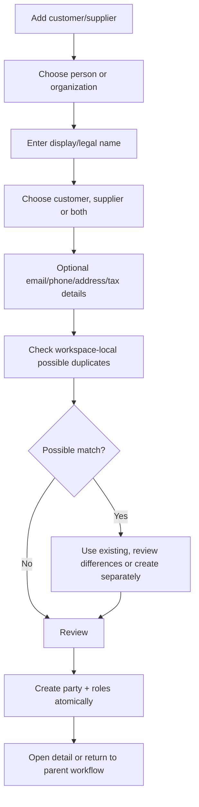
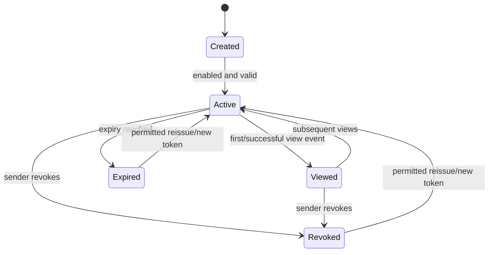
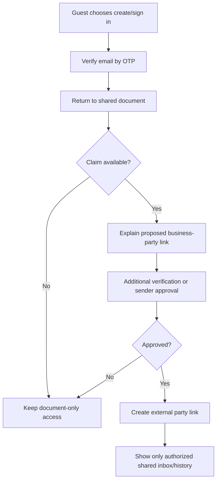

# Customers, Suppliers and External Portals Blueprint

**Status:** Complete draft  
**Depends on:** documents 00–04  
**Core rule:** A customer or supplier is a workspace-owned party record and is not required to be a Rekordly user

## 1. Purpose

This blueprint defines:

- customer, supplier, organization and contact records;
- customer/supplier roles on one party;
- guest/walk-in and one-time counterparties;
- balances, activity timelines and statements;
- opening balances and corrections;
- duplicate detection and merge controls;
- public invoice, receipt, estimate, statement, PO and remittance portals;
- secure share tokens and recipient permissions;
- optional recipient registration and verified party claiming;
- messages, disputes, acknowledgements and audit evidence;
- privacy boundaries between businesses and external users.

## 2. Identity separation

Rekordly maintains three different concepts:

| Concept | Owner | Purpose |
|---|---|---|
| User identity | Rekordly/user | Authentication and access to Rekordly |
| Party record | Business workspace | Business's customer/supplier/contact record |
| External-party link | Verified relationship | Grants a user limited access to shared party-facing information |

Rules:

- A business can create and transact with a party without email, phone or Rekordly account.
- Contact details do not prove account ownership.
- The same real person may exist as separate party records in several businesses.
- Rekordly never globally merges those records.
- Registering after viewing an invoice does not automatically expose all documents for a matching email.
- The business retains its accounting record even if an external user disconnects or deletes their Rekordly account, subject to law/policy.

## 3. Party types and roles

### Types

- Person
- Organization/business
- Government/authority
- Guest/walk-in placeholder
- Other controlled type

### Roles

A party may have one or more workspace roles:

- Customer
- Supplier
- Both customer and supplier
- Organization contact only
- Lender/borrower or other supported counterparty role

Roles affect available workflows; they do not create separate duplicate identities.

### Organization contacts

An organization may have linked people with roles such as:

- billing contact;
- purchasing contact;
- delivery/contact person;
- owner/manager;
- accounts payable/receivable contact;
- general contact.

Historical documents snapshot the chosen organization/contact/address. Editing the live contact later does not rewrite issued documents.

## 4. Entry points

- Universal Add → Customer/Supplier.
- Contacts → Customers/Suppliers.
- Sale/invoice/estimate inline creation.
- Purchase/PO/bill inline creation.
- Payment/settlement flow.
- Storefront order creates or suggests a party/contact according to dedupe policy.
- CSV import.
- Guest recipient claim/invitation.

Inline creation captures minimum required data and returns to the parent draft without forcing a long CRM form.

## 5. Contact information architecture

### Customer list

Columns/cards:

- name;
- type;
- phone/email where permitted;
- outstanding receivable;
- available deposit;
- last activity;
- status/tags;
- action menu.

Filters:

- active/archived;
- owing/credit/no balance;
- person/organization;
- tags;
- recent/inactive;
- outlet/owner when supported.

### Supplier list

- name/type/contact;
- outstanding payable;
- available advance/credit;
- last purchase/payment;
- status/tags;
- action menu.

### Party detail tabs

1. Overview
2. Activity
3. Documents
4. Payments
5. Deposits/advances
6. Statement
7. Contacts/addresses
8. Notes/files
9. Audit, when permitted

## 6. Party creation flow



### Minimum fields

Person:

- display/name;
- at least one role.

Organization:

- organization/display name;
- at least one role.

Email, phone and address are optional unless needed to send/deliver a particular document.

### Extended fields

- legal name;
- preferred display name;
- emails and phones with purpose labels;
- billing/shipping/physical addresses;
- tax identifier and registration status;
- contact preferences;
- credit terms/limit as a later controlled policy;
- opening balance through dedicated command;
- tags;
- internal notes;
- external reference;
- default currency;
- status.

## 7. Field validation

- Normalize whitespace and prevent blank/only-symbol names.
- Preserve original display case while maintaining normalized search values.
- Email is syntactically validated but not treated as verified ownership.
- Phone is stored with country context and normalized representation where possible.
- Tax IDs follow configured country/type format without claiming government verification unless a verification service actually succeeded.
- Address fields support Nigerian and international formats without forcing US-style states/ZIP.
- Notes are size-limited and never included on external documents unless explicitly copied into a public field.
- Sensitive identifiers are masked in lists/logs according to policy.

## 8. Guest and walk-in customer

A system Guest/Walk-in party supports immediate anonymous retail sales.

Rules:

- One controlled placeholder per Business/outlet policy, not a new duplicate for every sale.
- Optional sale-level customer name/contact snapshot may be recorded.
- Guest cannot hold a reusable customer deposit/wallet.
- Guest cannot receive a full historical statement.
- Credit/deferred sale generally requires a named customer record.
- User can convert/link a sale snapshot to a named party through an audited workflow.
- Guest placeholder cannot be deleted while referenced.

## 9. Search and selection

Search matches permitted fields:

- display/legal name;
- normalized email/phone;
- organization contact name;
- external reference;
- tax ID only under permission and safe exact-search behavior.

Results show role, organization/person indicator and balance summary only if the user has financial-balance permission.

Selection ranking:

1. exact name/reference/contact match;
2. recent relevant parties;
3. frequent relevant parties;
4. other matches.

Search is workspace-scoped and respects outlet/member restrictions.

## 10. Duplicate detection

### Signals

- exact normalized email;
- exact normalized phone;
- exact external reference/tax ID where permitted;
- strongly similar normalized name plus shared contact/address;
- organization and contact relationships;
- storefront submission using known verified contact.

### Result classes

- probable duplicate: warn and recommend existing record;
- possible duplicate: show candidates;
- no meaningful match: create normally.

Duplicate detection is advisory unless an exact workspace uniqueness constraint applies. Family members or businesses may legitimately share contact details.

## 11. Merge algorithm

Party merge is destructive to identifiers but must preserve financial history.

Preconditions:

- same workspace;
- permitted role;
- neither party is system Guest;
- review customer/supplier roles, currencies, tax IDs, linked user claims and conflicts;
- preview affected documents/balances.

Algorithm:

1. Choose survivor and duplicate.
2. Lock both party records.
3. Recalculate balances from linked sources.
4. Reject incompatible verified external links or require explicit resolution.
5. Move role/contact/address/tag relationships with deterministic dedupe.
6. Redirect/relink financial documents through a merge mapping while preserving original party snapshot/audit references.
7. Preserve duplicate ID as merged alias/tombstone.
8. Write audit event with actor/reason and safe field choices.
9. Commit atomically.

Merge does not combine or net receivable and payable accounting automatically. Customer and supplier subledgers remain separately explainable.

Unmerge is not assumed possible; require export/preview and confirmation.

## 12. Archive and deletion

### Archive

- Prevents new ordinary selection.
- Preserves all history, balances and statements.
- Party with open balance can be archived with warning but remains in financial review.
- Can be restored.

### Delete

- Empty unreferenced draft party may be hard-deleted under policy.
- Referenced party is not hard-deleted through ordinary UI.
- Privacy requests anonymize/remove non-required personal fields while preserving lawful accounting/audit records under the privacy policy.
- Deletion/anonymization does not unbalance journals or remove issued document snapshots unlawfully.

## 13. Party balances

### Customer

Separate balances:

- receivable outstanding;
- unapplied customer deposit liability;
- available credits;
- overdue amount;
- optionally net display, but never replace separate legal/accounting balances.

### Supplier

- payable outstanding;
- supplier advance asset;
- supplier credits/refunds due;
- overdue amount.

### Derivation

Balances derive from posted documents, credit/debit notes, allocations, applications, refunds, reversals and opening items.

```text
customer receivable = issued invoice/debit balances
                      - active credits
                      - active payment allocations

customer deposit = deposit receipts
                   - applications
                   - refunds
                   - reversals
```

Do not present a net zero as “settled” when the business simultaneously owes a customer deposit and is owed a receivable unless a valid application/netting command occurs.

## 14. Opening balances

Opening customer/supplier balances use dedicated commands.

Customer opening receivable requires:

- party;
- amount/currency;
- as-of date;
- due date/reference optional;
- balancing opening-equity/migration account;
- evidence/note.

Supplier opening payable mirrors the above.

Opening customer credit/deposit or supplier advance uses its correct control account, not a negative receivable/payable shortcut.

Rules:

- Not current-period revenue/expense.
- Included in statements with “Opening balance” source.
- Correct through reversal/adjustment after posting.
- Batch import reconciles total opening subledger to control account.

## 15. Activity timeline

Chronological party timeline may include:

- creation/profile change;
- estimate/proforma;
- order/sale/invoice;
- PO/receipt/bill;
- payment/allocation;
- deposit/advance/application;
- credit/debit/refund note;
- return/refund;
- statement shared;
- guest message/dispute/acknowledgement;
- archive/restore/merge;
- external link claimed/revoked.

Financial timeline uses effective date with posted timestamp available. Administrative/contact changes use event timestamp. Filters distinguish them.

## 16. Statements

### Statement types

- Customer receivable statement
- Customer deposit statement
- Supplier payable statement
- Supplier advance statement
- Combined activity statement with clearly separated balance columns

### Inputs

- party;
- date range/as-of date;
- currency;
- include zero-balance/voided entries option;
- opening balance basis;
- output format/view/share.

### Statement rows

- effective date;
- source type/number;
- description/reference;
- charge/debit;
- payment/credit;
- running balance;
- status/link where permitted.

### Rules

- Generated from server report result, not client arithmetic.
- Running balance direction is labeled in plain language.
- Currency is never mixed in one unlabeled total.
- Voids/reversals remain traceable.
- Shared statement excludes internal notes, profit/margin, general-ledger accounts and unrelated party data.
- PDF and web view use the same result basis/as-of metadata.

## 17. Public document portal

Supported public document types:

- estimate/proforma;
- invoice;
- receipt;
- customer statement when explicitly shared;
- purchase order;
- remittance/payment advice;
- storefront order status.

The portal is mobile-first and does not require a Rekordly account.

### Public page content

- sender name/logo and verified contact context;
- document type/number/status;
- issue/due dates;
- recipient snapshot;
- public line items/totals/tax;
- payment/outstanding status where appropriate;
- sender-provided public notes/policies;
- permitted actions;
- optional Rekordly signup prompt after the document/action.

Must not include:

- internal notes;
- journal accounts;
- cost, margin or supplier information on customer documents;
- other documents/history unless separately authorized;
- staff-only audit data;
- private attachments;
- hidden contact fields.

## 18. Share-link lifecycle



Reissue normally creates a new token and invalidates the prior token rather than resurrecting leaked credentials.

## 19. Token design

### Generation

- Cryptographically secure random token with at least 128 bits of entropy.
- Token shown only in the URL delivered to recipient.
- Store a keyed hash/digest and token metadata, never plaintext token.
- Token is independent from internal document ID.

### Metadata

- workspace/document/type;
- permitted actions/scopes;
- created by/time;
- expiry;
- revoked timestamp/reason;
- optional recipient binding/challenge policy;
- last-access aggregate metadata under privacy limits;
- version.

### Validation algorithm

1. Normalize/extract token without logging it.
2. Compute lookup digest.
3. Find active share record.
4. Use constant-time verification where applicable.
5. Check expiry/revocation/document/workspace state.
6. Check optional OTP/recipient challenge.
7. Apply rate limits and abuse signals.
8. Load a public projection containing allowlisted fields only.
9. Return security headers and no private cache leakage.

Invalid, expired and revoked links return safe states without exposing internal document existence.

## 20. Portal actions by document

| Document | Guest actions |
|---|---|
| Estimate/proforma | View, download, accept, decline, ask question |
| Invoice | View, download, see status/outstanding, send payment reference/evidence, payment link later |
| Receipt | View/download |
| Customer statement | View/download under stronger expiry/challenge policy |
| Purchase order | View/download, acknowledge, decline/request change/message |
| Remittance advice | View/download, acknowledge/message |
| Order status | View current public state, contact merchant/cancel request when allowed |

Every action is explicitly enabled per share. View permission does not imply accept/message/download permission.

## 21. Estimate acceptance/decline

### Acceptance

Inputs:

- recipient display name;
- optional title/organization;
- acknowledgement checkbox;
- optional comment;
- verification step when policy requires.

Algorithm:

1. Validate share/action scope and current estimate version/status.
2. Display immutable document/version hash summary.
3. Capture acknowledgement, time and minimized device/network evidence under policy.
4. Append acceptance event; do not rewrite document.
5. Notify business.
6. Optionally create a draft order/invoice conversion request; never silently issue financial document unless configured and confirmed by authorized business user.

If estimate changed after the recipient opened it, reject stale acceptance and show the latest issued version.

### Decline/request change

- Reason/comment optional or required by sender setting.
- Append event and notify.
- Does not delete estimate.

## 22. PO acknowledgement

Supplier can:

- acknowledge receipt;
- accept expected terms;
- request changes;
- decline;
- message the buyer.

Acknowledgement does not create stock, payable or goods receipt. It changes communication/workflow state only.

## 23. Payment evidence submission

A guest may submit:

- claimed payment date;
- claimed amount/currency;
- reference;
- private attachment;
- comment.

This creates a review item, not a confirmed payment.

Business user verifies bank/cash receipt and then uses the ordinary settlement command. Guest input is untrusted and cannot change invoice balance directly.

## 24. Guest messages and disputes

Message thread is scoped to one shared document/party-facing case.

Rules:

- Sender/recipient identities are labeled.
- Attachments use private signed access.
- Rate and size limits apply.
- Spam/abuse reporting and thread closure are supported.
- Internal staff notes remain a separate private channel.
- Message does not alter document/payment state unless an authorized command follows.
- Important acceptance/dispute events are auditable.

## 25. Optional account prompt

Prompt appears after the recipient can see/act on the document:

> Keep invoices and receipts shared with you in one place. Create a free Rekordly account.

Rules:

- No fake requirement or blocked download solely to force signup.
- Preserve safe return to the document after OTP.
- Explain what linking will and will not reveal.
- Do not pre-check marketing consent.
- Store referral/share context without exposing sender secrets.

## 26. Claim/link workflow



### Claim proof options

- signed invitation tied to a specific contact;
- verified email/phone matching plus sender policy;
- additional OTP to a party contact channel;
- explicit business approval;
- stronger verification for statements/high-risk data.

Matching an email alone may propose a claim but is not always sufficient because shared addresses and mistyped/stale contacts exist.

## 27. External-party link permissions

The link may grant:

- receive future shared documents from this business;
- see documents explicitly published to the external inbox;
- maintain own preferred contact/delivery details as suggestions;
- message/respond through allowed workflows;
- revoke personal platform link.

It does not grant:

- Business workspace membership;
- internal customer/supplier notes;
- ledger/audit access;
- other customers' data;
- all historical documents automatically;
- ability to edit the business's party record directly;
- access to other businesses' records.

## 28. External inbox

A registered recipient may see:

- business/sender;
- document type/number/status/date;
- amount/outstanding where published;
- permitted actions;
- message/unread state.

Documents are grouped by sending business. Each sender controls which documents are published. A link to a party does not merge sender-specific balances.

## 29. Contact-update suggestions

External user may suggest updated email, phone or address.

1. User edits their external profile or sends suggestion.
2. Rekordly creates a suggestion for each linked business.
3. Business accepts/rejects according to policy.
4. Issued historical document snapshots remain unchanged.
5. Audit records the change without exposing other linked businesses.

Never propagate one business's private note or contact correction into another business automatically.

## 30. Sharing channels

- Copy secure link
- Email through worker/provider
- WhatsApp share intent containing a short safe message and link
- Download PDF

Rules:

- WhatsApp sharing does not require WhatsApp Business API for MVP.
- Link token must not be exposed in analytics, referrer logs or error tracking.
- Use an appropriate Referrer-Policy and avoid third-party scripts on token pages.
- Email delivery status is separate from document issue/share status.
- Recipient phone/email is chosen explicitly when multiple contacts exist.

## 31. Public portal security headers and behavior

- HTTPS only.
- Strict Content Security Policy.
- `Referrer-Policy` preventing token leakage.
- Appropriate `Cache-Control` for private token pages.
- `X-Content-Type-Options: nosniff`.
- Frame protection unless an intentional embed flow is designed.
- No third-party advertising/behavioral trackers.
- Sanitize sender-entered rich text or restrict to safe plain/structured content.
- Signed, short-lived asset/PDF URLs.
- Rate limiting and abuse monitoring.
- Token redaction in logs/traces.

## 32. Document PDF and download

- PDF is generated from the same versioned server document result as web view.
- Store document version/hash and generation status.
- Download link is short-lived/signed.
- If PDF generation is pending, show progress/status; do not claim missing document.
- A regenerated PDF for the same issued version must retain identical financial content even if template rendering changes, or retain archived issued artifact according to legal/product policy.
- Revoked share prevents future portal download; business internal access follows workspace permission.

## 33. Data model

### `parties`

- id, workspace
- type and display/legal names
- status/merged-into ID
- default currency/terms where supported
- created/updated actors/timestamps

### `party_roles`

- party ID
- customer/supplier/other role
- status and role-specific settings

### `party_contacts`

- person/contact identity
- organization relationship/title/purpose
- status and preferences

### `party_contact_methods`

- type/purpose
- normalized lookup value and display value
- verification/source metadata without falsely asserting ownership
- primary/status

### `party_addresses`, `party_tags`, `party_notes`

Notes are internal by default.

### `document_shares`

- document/version
- token digest
- permission/action scopes
- expiry/revocation
- recipient binding/challenge policy
- created actor/time

### `external_party_links`

- business workspace/party
- Rekordly user
- link status/proof/approval
- granted document-inbox scope
- created/revoked timestamps

### `external_document_events`, `external_messages`

Versioned append-only acceptance, decline, acknowledgement, evidence, message and dispute events.

## 34. API outline

### Authenticated Business API

| Method/path | Purpose |
|---|---|
| `GET /v1/businesses/{id}/parties` | Search/filter customers/suppliers |
| `POST /v1/businesses/{id}/parties` | Create party and roles |
| `PATCH /v1/businesses/{id}/parties/{party}` | Versioned profile edit |
| `POST /v1/businesses/{id}/parties/{party}/commands/archive` | Archive |
| `POST /v1/businesses/{id}/parties/{party}/commands/merge` | Controlled merge |
| `GET /v1/businesses/{id}/parties/{party}/balances` | Separate balance projections |
| `GET /v1/businesses/{id}/parties/{party}/statement` | Server statement result |
| `POST /v1/businesses/{id}/documents/{doc}/shares` | Create/reissue share |
| `POST /v1/businesses/{id}/document-shares/{share}/commands/revoke` | Revoke share |
| `POST /v1/businesses/{id}/external-link-claims/{claim}/commands/approve` | Approve party-user link |

### Public/recipient API

Use token-safe routes/headers designed to avoid logs; conceptual endpoints:

| Purpose | Behavior |
|---|---|
| Resolve public document | Return allowlisted projection only |
| Accept/decline/acknowledge | Versioned, rate-limited, idempotent event |
| Submit message/evidence | Untrusted review input |
| Request claim | Requires authenticated verified user and proof flow |
| Download PDF/asset | Short-lived signed authorization |

Exact URL/token transport receives security review before implementation.

## 35. Permission model

Representative capabilities:

- `contacts.view`
- `contacts.create`
- `contacts.edit`
- `contacts.archive`
- `contacts.merge`
- `contacts.view_balance`
- `contacts.view_private_notes`
- `contacts.export`
- `documents.share`
- `statements.generate`
- `external_links.approve`

Sales staff may see customers without supplier data. Procurement may see suppliers without customer balances. Contact visibility does not automatically grant financial balance or private-note access.

## 36. Notifications and review

Business notifications/review items:

- estimate accepted/declined/change requested;
- PO acknowledged/declined;
- guest payment evidence submitted;
- dispute/message received;
- party claim requested;
- external contact update suggested;
- share delivery/PDF failed;
- duplicate/merge review;
- statement generation completed.

Recipient notifications:

- new shared document;
- sender response;
- document status update;
- claim approved/revoked;
- security-sensitive account/link change.

## 37. Failure and recovery

| Failure | Behavior |
|---|---|
| Invalid/revoked/expired share | Safe unavailable state; sender contact option only when configured |
| PDF not ready | Show pending/retry; web document remains authoritative view |
| Guest action on stale version | Reject and show latest issued version |
| Party claim conflict | Require sender review; expose no other claimant details |
| Email delivery failure | Document remains issued; business sees delivery failure/retry |
| Merge conflict | No partial merge; retain preview and resolution list |
| External evidence upload fails | No payment status change; retry/remove attachment |
| Membership/permission removed | Internal action fails; public share remains governed by share state |

## 38. Analytics

Safe events:

- `party_created`
- `party_duplicate_warning_shown`
- `party_merged`
- `statement_generated/shared`
- `document_share_created`
- `public_document_viewed`
- `public_action_completed_type`
- `recipient_signup_prompt_clicked`
- `external_claim_requested/approved`
- `guest_message_submitted`

Do not send party name, email, phone, address, token, amount, document number, message or attachment data to product analytics.

## 39. Acceptance and edge-case tests

### Party identity

- Customer/supplier can be created without Rekordly account.
- One party can hold both roles without duplicate core identity.
- Email match does not automatically prove account ownership.
- Party records from different businesses never merge or leak.
- Guest customer cannot hold reusable deposit/credit account.

### Balances/statements

- Receivable and customer deposit remain separate.
- Payable and supplier advance remain separate.
- Statement running balance matches subledger and control-account reconciliation.
- Opening balance does not create current revenue/expense.
- Void/reversal remains visible and balances correctly.
- Mixed currencies are separated/labeled.

### Duplicate/merge

- Shared phone/email warns but permits legitimate separate records.
- Merge preserves document snapshots, journal/subledger integrity and audit.
- Merge conflict rolls back entirely.
- System Guest cannot be merged/deleted incorrectly.

### Public portal

- Valid guest can view permitted document without registration.
- Invalid/expired/revoked token exposes no internal data.
- Token is not stored in logs/analytics/referrer.
- Public projection excludes notes, costs, margins and unrelated documents.
- Share action scope prevents unauthorized acceptance/message/download.
- Stale estimate version cannot be accepted.
- Guest payment evidence cannot mark invoice paid.

### Claiming

- Optional signup returns to document.
- Matching email alone does not expose all history under strict policy.
- Approved link shows only documents explicitly published to inbox.
- Link does not grant Business membership.
- User can revoke link without deleting business accounting record.
- One business cannot see user's relationship with another.

### Security/tenancy

- Cross-workspace party/contact/statement/share IDs fail.
- Signed asset URLs expire.
- Rate limits stop token brute-force/message spam.
- External rich text/content cannot inject script.
- Internal member lacking balance/private-note permission sees restricted projection.

### Responsive/accessibility

- Invoice, statement, estimate and PO render legibly on small mobile screens.
- Download/accept/decline controls are keyboard and screen-reader accessible.
- Status uses text, not color alone.
- Registration prompt does not obstruct the primary document/action.

## 40. Implementation handoff checklist

- Party and user schemas remain separate.
- Party roles avoid duplicate customer/supplier identities.
- Historical document snapshots are immutable.
- Balances derive from posted sources, not editable party totals.
- Statement engine reconciles with control accounts.
- Guest/walk-in restrictions are enforced.
- Share tokens are random, hashed, scoped, expiring/revocable and log-redacted.
- Public document projection is allowlist-based.
- Guest payment evidence creates review only.
- Claim flow requires explicit proof/approval.
- External link never grants workspace membership implicitly.
- Privacy/anonymization preserves lawful financial integrity.

