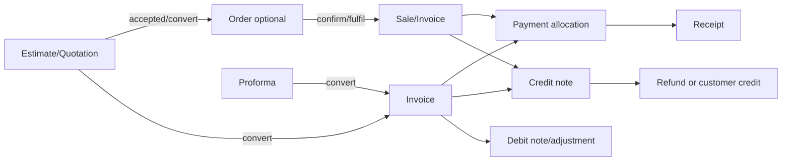
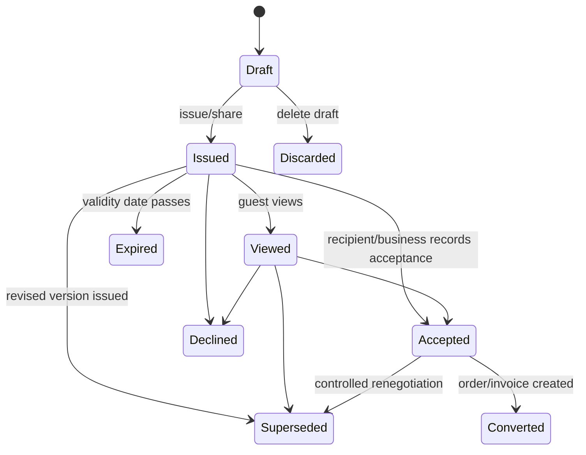
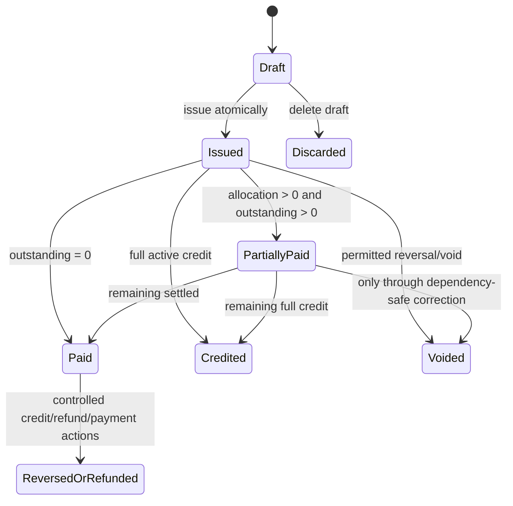

# Sales, Estimates, Invoices and Receipts Blueprint

**Status:** Complete draft  
**Depends on:** documents 00–05  
**Accounting basis:** Business accrual accounting with a separate cash-movement view

## 1. Purpose

This blueprint defines the customer-sales lifecycle:

- estimates/quotations and proformas;
- direct/immediate sales;
- invoices and credit sales;
- reusable products/services and custom lines;
- Guest/walk-in sales without mandatory customer creation;
- prices, discounts and tax calculation;
- issue, delivery and fulfilment boundaries;
- payment, deposit application and receipts;
- partial payment and outstanding status;
- returns, refunds, credit/debit notes and write-offs;
- corrections, voids and immutable version history;
- external sharing and acceptance;
- document numbering, PDFs and audit.

Detailed payment allocation is governed by document 04. Product stock/costing movement is governed by document 07.

## 2. Sales document types

### Estimate/quotation

A non-posting commercial proposal. It may be accepted/declined and converted, but creates no receivable, revenue, stock movement or tax liability.

### Proforma invoice

A pre-sale/request document. It resembles an invoice but is not a posted tax/accounting invoice and creates no receivable/revenue by itself.

### Invoice

An issued receivable document. Under the selected accrual basis, issue/recognized delivery posts revenue, tax and Accounts Receivable according to policy.

### Direct sale

A sale confirmed together with immediate or deferred settlement. It may create an invoice/receipt internally, but the UI provides a fast workflow.

### Receipt

Evidence of money received/allocated. A receipt does not create revenue again when the sale/invoice already recorded revenue.

### Credit note

Reduces a posted sale/invoice for an authorized return, pricing correction, cancellation or allowance.

### Debit note/adjustment invoice

Increases customer obligation through a new authorized document; it never silently changes an issued invoice total.

### Refund

Actual money returned to the customer. It is distinct from a credit note or payment reversal.

## 3. Document relationship



Conversion copies/snapshots commercial data with source links. It does not mutate the source type into another record invisibly.

## 4. Entry points

- Universal Add → New sale.
- Universal Add → New estimate/proforma.
- Universal Add → New invoice.
- Customer detail → Create estimate/invoice/sale.
- Storefront order → Confirm/convert to sale/invoice.
- Sales page empty state/list action.
- Reorder/duplicate an earlier draft as a new draft.
- Accepted estimate → Convert.

## 5. Sales information architecture

### Sales overview

- sales/revenue current period;
- money collected current period, shown separately;
- outstanding receivables;
- overdue amount/count;
- estimates awaiting response;
- orders needing action;
- returns/refunds;
- recent sales activity.

### Lists

- Orders
- Estimates/proformas
- Invoices
- Direct sales
- Payments/receipts
- Customer deposits
- Returns/credit notes

Filters include status, date, customer, outlet, salesperson, currency, amount range, overdue and source.

## 6. Common document fields

### Header

- workspace/business and outlet;
- document type;
- draft/internal ID;
- customer or Guest;
- billing/shipping/contact snapshot;
- issue/effective date;
- due date/terms where relevant;
- currency and exchange-rate data when supported;
- price list/channel;
- salesperson/owner;
- reference/PO number;
- tax mode;
- public and internal notes.

### Lines

- product/service variant or custom line;
- description snapshot;
- quantity as fixed decimal;
- unit;
- unit price fixed decimal input;
- line discount;
- tax code/rate;
- outlet/fulfilment source for goods;
- line total minor;
- inventory/COGS policy reference for goods.

### Totals

- subtotal;
- line/document discounts;
- taxable base by tax code;
- tax total;
- rounding adjustment where required;
- grand total;
- allocated/paid;
- credits;
- outstanding.

## 7. Customer selection

Options:

- existing customer;
- inline new customer;
- Guest/walk-in;
- one-time name/contact snapshot under policy.

Rules:

- Immediate paid sale can use Guest.
- Deferred/credit sale normally requires a named customer.
- Estimate/invoice intended for sharing requires sufficient recipient delivery/contact data, but no Rekordly account.
- Customer currency/terms are defaults only and remain editable within permission.
- Customer status/credit policy warnings do not silently change price/payment terms.
- Customer deposit application requires a named customer.

## 8. Line types

### Stock-tracked product

- References active product variant.
- Quantity and outlet required.
- Stock/reservation/fulfilment rules apply.
- Revenue and COGS/stock effects occur at the configured recognition/fulfilment event.

### Non-stock product

- Catalogue item without quantity tracking.
- Revenue/tax applies; no stock movement/COGS from inventory.

### Service

- Reusable service catalogue item.
- No stock movement.
- May have quantity/hours/unit.

### Custom line

- Free description, quantity, price, tax and valid revenue mapping.
- Permitted for services/charges and non-inventory items.
- Cannot masquerade as tracked stock or deduct inventory.
- Permission/policy may restrict custom revenue-account selection.

### Shipping/fee/discount line

Uses explicit type and accounting/tax mapping. Negative arbitrary lines are not a substitute for credit notes or document discount logic.

## 9. Product and price selection

On selection:

1. Load active variant/service permitted for outlet/channel.
2. Snapshot name, SKU/unit and applicable price.
3. Apply selected price list and effective-date rule.
4. Apply customer-specific price only when configured.
5. Validate tax and stock policy.
6. Allow authorized price override with reason/audit if policy requires.

Changing catalogue data later does not rewrite issued document snapshots.

Price override and discount permissions may be threshold-based. A cashier cannot bypass them by entering a custom line equivalent to a protected product.

## 10. Quantity and pricing precision

- Quantity uses fixed decimal with unit-specific maximum scale.
- Unit price may support more precision than currency minor units.
- Multiplication occurs in fixed decimal.
- Each line converts/rounds to minor units at the documented boundary.
- Document total is the sum of stored rounded lines/taxes/adjustments.
- JavaScript floating point is never authoritative.

```text
gross_line_decimal = quantity_decimal × unit_price_decimal
discount_decimal = applyConfiguredDiscount(gross_line_decimal)
taxable_decimal = gross_line_decimal - discount_decimal
tax_decimal = applyTax(taxable_decimal, tax_configuration)

gross_line_minor = roundToCurrencyMinor(gross_line_decimal)
discount_minor = deterministicRoundedDiscount(...)
tax_minor = deterministicRoundedTax(...)
line_total_minor = gross_line_minor - discount_minor + tax_minor
```

Backend preview and posting share this calculation implementation.

## 11. Discount model

Supported:

- line percentage;
- line fixed amount;
- document percentage;
- document fixed amount;
- explicit promotional/authorized adjustment later.

Rules:

- Discount cannot make an eligible line negative.
- Document discount is allocated across eligible lines using deterministic ratios and residual assignment.
- Tax base treatment follows configured/legal rule.
- Discount reason/authorization may be required above threshold.
- Customer-facing document shows discount transparently according to template.
- Discount is not a cash payment.

### Document discount allocation

1. Identify eligible pre-discount bases.
2. Compute proportional high-precision allocation.
3. Round each allocation to minor units.
4. Assign residual minor units deterministically, for example largest remainder then stable line order.
5. Verify allocations sum exactly to document discount.

## 12. Tax model

Each line has an explicit tax code:

- standard VAT rate;
- zero-rated;
- exempt/out-of-scope;
- no tax where valid;
- other configured tax type.

Tax mode:

- tax exclusive;
- tax inclusive.

Rules:

- Business tax registration/configuration controls defaults.
- User can override only with permission and valid code.
- Issued document snapshots tax code/rate/basis.
- Later tax configuration change does not rewrite history.
- Tax total is reconciled to line allocations.
- WHT/withholding is not treated as ordinary line discount or payment fee; it uses a separate supported tax/settlement workflow.
- Rekordly provides schedules/records, not an unsupported promise of automatic government filing.

## 13. Draft calculation algorithm

For every edit:

1. Validate basic field shape locally for UX.
2. Send or execute shared non-authoritative preview request.
3. Server validates active catalogue, pricing permission, currency and tax rules.
4. Server computes line and document amounts using fixed decimal/minor-unit rules.
5. Return totals plus warnings/errors.
6. UI renders returned values.

At issue/confirm time, server recalculates from submitted authoritative inputs and current required state. A stale preview cannot be posted blindly.

## 14. Estimate workflow



Rules:

- No journal, receivable, tax payable or stock movement.
- Validity/expiry is commercial, not accounting.
- Revision creates a new version/supersedes old issued version.
- Acceptance refers to exact version/hash.
- Conversion copies accepted snapshots into a new draft/source link.
- Conversion does not post until the resulting order/invoice/sale is confirmed.

## 15. Proforma workflow

Proforma behaves like a pre-sale request:

- draft/issued/viewed/accepted/expired/superseded/converted states;
- no posted receivable/revenue/tax merely because it looks like an invoice;
- prominently labeled “Proforma” and “Not a tax invoice” where appropriate;
- prepayment received against it becomes customer deposit until a valid sale/invoice/application event.

## 16. Invoice workflow

### Draft

- Fully editable by permitted user.
- Number may be reserved or assigned at issue according to numbering policy.
- No accounting effect.

### Issue

1. Validate customer, lines, dates, number, period, tax and currency.
2. Validate goods recognition/fulfilment policy and stock dependencies.
3. Recalculate totals.
4. Lock numbering sequence and related source state.
5. Create issued immutable document version.
6. Post journal/stock effects required by policy.
7. Create receivable/open item.
8. Create audit and PDF/share outbox jobs.
9. Commit atomically.

### Typical service invoice journal

| Debit | Credit |
|---|---|
| Accounts Receivable | Service/Sales Revenue |
| | VAT/Tax Payable, if applicable |

### Goods invoice/fulfilment

Depending on selected recognition policy, revenue/receivable and inventory/COGS must occur at documented events. The system must not deduct stock twice if invoice and fulfilment are separate.

## 17. Invoice state model

Use separate dimensions where one status cannot express everything:

- lifecycle: draft, issued, voided, superseded;
- payment: unpaid, partially paid, paid, credited;
- due: current, overdue;
- delivery: not sent, queued, sent, failed, viewed;
- fulfilment for goods: unfulfilled, partial, fulfilled, returned.



Payment/due/fulfilment state is derived from linked records rather than manually edited.

## 18. Direct sale workflow

Direct sale supports fast service/retail recording.

1. Select outlet and customer/Guest.
2. Add catalogue and/or allowed custom lines.
3. Validate stock for tracked goods.
4. Calculate discounts/tax/total.
5. Choose payment:
   - full immediate;
   - partial plus receivable;
   - several payment methods;
   - customer deposit application;
   - pay later for a named customer.
6. Preview sale, payment, stock and COGS effects.
7. Confirm one atomic command.
8. Generate receipt/share link.

### Atomic effects

Depending on lines/payment:

- sales source/document;
- revenue/tax journal;
- payment legs and allocations;
- receivable for unpaid portion;
- stock movements and COGS for tracked goods;
- customer-deposit application;
- audit/outbox.

Any critical failure rolls back all. A sale cannot post while its required inventory or journal effect fails.

## 19. Sale without inventory

Supported explicitly:

- service line;
- non-stock catalogue item;
- permitted custom line.

No stock movement is created. The user does not need to create inventory just to record consulting, transport, design, rent or another service sale.

Tracked product cannot bypass stock policy by toggling “do not use inventory” during sale. User must choose a non-stock/service/custom item with appropriate permission or correct the catalogue policy through a controlled workflow.

## 20. Sale without a new customer

Supported for:

- paid walk-in/Guest sale;
- optional one-time name/contact snapshot;
- anonymous retail receipt where law/policy permits.

Named customer is required when:

- tracking receivable/debt;
- holding/applying customer deposit;
- issuing a customer statement;
- applying credit terms;
- sharing history beyond one document;
- policy/legal fields require identity.

The UI explains why customer creation becomes necessary instead of silently blocking late in the flow.

## 21. Invoice payment and receipt

Payment uses document 04.

Rules:

- Payment allocation reduces Accounts Receivable; it does not credit revenue again.
- Partial payment updates outstanding/status.
- One payment can allocate across invoices.
- Several payment methods can fund one settlement.
- Customer deposit application creates no new cash movement.
- Receipt references payment/settlement and allocations.
- Receipt can be shared with a non-member through public portal.

Receipt shows:

- amount received;
- date;
- payment method labels without sensitive account details;
- invoice/sale allocations;
- remaining invoice balance;
- business/customer snapshot;
- receipt number/status.

## 22. Customer deposit at checkout

If customer pays more than current sale/invoice:

- allocate up to outstanding;
- require explicit treatment of excess;
- named customer may hold excess as deposit liability;
- Guest cannot accumulate anonymous deposit;
- refund excess through separate refund command if not held.

If customer pays before an invoice/sale exists, record deposit. Creating an invoice later does not apply it automatically without configured/confirmed application.

## 23. Document numbering

### Requirements

- Separate configurable sequences by document type and possibly outlet/fiscal period.
- Prefix/suffix/zero-padding presentation.
- Unique within workspace/sequence.
- Assigned under database lock/atomic sequence operation.
- Issued numbers are never reused after void.
- Drafts may use temporary internal IDs.
- Manual imported number stored separately or under controlled migration policy.

Example:

```text
INV-2026-000123
EST-2026-000045
RCPT-2026-000981
```

Sequence gaps are acceptable and safer than reusing numbers. Policy must explain gaps caused by failed/voided issuance where relevant.

## 24. PDF, share and delivery

After issue/confirmation:

1. Source transaction commits with outbox event.
2. Worker generates PDF from versioned server document result.
3. Store authenticated/private artifact metadata.
4. Worker sends email when requested.
5. User can copy public portal/WhatsApp link.

Financial issue success is separate from PDF/email success.

Delivery states:

- not requested;
- queued;
- generated/sent;
- failed with retry;
- viewed through portal.

Public portal does not require recipient registration.

## 25. Returns

### Customer return request

Required:

- original sale/invoice/order line;
- returned quantity;
- condition: saleable, damaged, defective, expired/other;
- return date/reason;
- outlet;
- resolution: credit, refund, replacement, no financial resolution pending;
- evidence where required.

Rules:

- Return quantity cannot exceed eligible sold quantity net of prior returns.
- Service returns use allowance/credit logic, not stock return.
- Saleable goods may return to stock at original cost where determinable.
- Damaged/defective goods route to appropriate non-saleable/write-off state.
- Return approval and refund are separate permissions/actions.
- Returning goods does not itself prove money was refunded.

## 26. Credit notes

Credit note references original invoice/sale and reduces customer obligation/revenue/tax under valid reason.

Possible effects:

| Debit | Credit |
|---|---|
| Sales returns/allowances or revenue reversal | Accounts Receivable/customer credit |
| Tax payable reversal | |

Inventory return/COGS reversal is linked but governed by document 07.

Rules:

- Cannot exceed eligible remaining original line value/quantity.
- Full credit may bring outstanding to zero or create customer credit if already paid.
- Customer credit can be refunded or applied under controlled workflow.
- Issued credit note is immutable and numbered.
- Credit note is not a negative editable invoice.

## 27. Refunds

Refund follows document 04 and references available refundable source:

- customer deposit;
- credit note/customer credit;
- eligible payment reversal/error;
- approved return.

Rules:

- Credit note may exist without immediate cash refund.
- Refund creates money-out payment leg.
- Refund cannot exceed available credit/deposit/source.
- Stock return is not inferred from refund.
- Refund failure does not undo an already valid credit note; statuses remain distinct.

## 28. Debit note/additional charge

Used for a valid post-issue increase:

- additional delivered quantity/service;
- underbilling correction;
- approved charge.

It creates a new numbered linked receivable/revenue/tax effect. It does not change the original issued invoice amount.

## 29. Void, correction and supersession

### Draft

- Edit/delete normally.

### Issued estimate/proforma

- Revise by new version/supersede.
- Preserve versions and recipient events.

### Issued invoice/sale

- No direct edit/delete.
- Correct using credit/debit note, reversal and replacement, return/refund or void under allowed state.
- Void only when policy/dependencies permit and must reverse all posted effects atomically.
- Payment/stock dependencies may require separate reversal/return/refund chain.
- Locked period posts adjustment in open period.

### Incorrect recipient/address only

Historical legal/document snapshot changes follow policy. If correction is permitted, create a corrected version/superseding document; do not mutate a delivered issued artifact without trace.

## 30. Issue-invoice algorithm

Inputs include draft/version, customer, lines, dates, currency, discounts, tax, outlet, recognition/fulfilment intent and idempotency key.

1. Authenticate and resolve Business workspace/membership.
2. Require sales issue permission and outlet scope.
3. Check entitlement/limits and open period.
4. Validate idempotency/draft version.
5. Validate customer/Guest policy.
6. Lock draft, numbering sequence and relevant source/order state.
7. Resolve/snapshot products/services, prices, tax and customer data.
8. Recalculate totals using fixed decimal/minor units.
9. Validate stock/fulfilment dependencies if this event moves goods.
10. Generate document number.
11. Create immutable issued version.
12. Create receivable/revenue/tax journal.
13. Create stock/COGS effects exactly once where policy requires.
14. Create audit/outbox and idempotency result.
15. Verify balanced journals and stock invariants.
16. Commit.
17. Return document/status/effects; PDF/email remain asynchronous.

## 31. Confirm-direct-sale algorithm

1. Perform steps 1–9 above.
2. Validate payment legs, allocations/deposit application and unpaid remainder policy.
3. Lock customer-deposit balance/open items where affected.
4. Create sale/document and number.
5. Post revenue/tax/receivable journal.
6. Post stock/COGS movements for tracked goods.
7. Create settlement/payment legs and allocate to sale receivable.
8. Apply deposit without duplicate cash where selected.
9. Confirm exact journal balance, stock availability and non-negative controlled balances.
10. Create receipt/audit/outbox/idempotency records.
11. Commit all or roll back all.

```mermaid
sequenceDiagram
    actor U as User
    participant W as Next.js
    participant A as Go API
    participant D as PostgreSQL
    participant J as Worker

    U->>W: Confirm direct sale
    W->>A: Sale + lines + payment + idempotency
    A->>D: Lock draft/sequence/stock/deposit as required
    A->>A: Recalculate pricing, tax and permissions
    A->>D: Begin transaction
    A->>D: Write sale/invoice + journal + stock/COGS
    A->>D: Write payment/allocation + receipt + audit + outbox
    A->>A: Verify balance/stock/deposit invariants
    A->>D: Commit
    A-->>W: Durable sale/payment/receipt IDs
    J->>D: Claim PDF/email/projection jobs
    W-->>U: Sale confirmed; delivery status separate
```

## 32. Concurrency

Protect against:

- duplicate issue number;
- same order converted/fulfilled twice;
- stock oversell;
- customer deposit over-application;
- invoice overpayment;
- return quantity exceeding sold quantity;
- credit note exceeding eligible value;
- two users issuing the same draft.

Use deterministic locking/version checks and constraints. On conflict, return current status and require review; never silently change lines or amounts.

## 33. Permissions

Representative capabilities:

- `sales.view`
- `sales.create_draft`
- `sales.issue`
- `sales.override_price`
- `sales.apply_discount`
- `sales.sell_below_cost` if ever allowed
- `sales.record_payment`
- `sales.apply_deposit`
- `sales.return`
- `sales.credit_note`
- `sales.refund`
- `sales.void`
- `sales.view_margin`
- `sales.export`

Cost/margin visibility is independent from ability to sell. Cashier/outlet scope is enforced on products, stock, documents, payments and returns.

## 34. Offline behavior

Potentially supported under document 15:

- create local draft;
- simple Guest cash sale with pre-cached catalogue/stock policy and strict queue;
- issue temporary local receipt clearly marked pending sync.

Not safely final offline by default:

- invoice number assignment;
- credit sale against customer/current balance;
- deposit application;
- stock sale when available quantity may have changed unless an explicit offline stock policy exists;
- refund/credit/return;
- tax/FX combinations requiring server data.

Pending offline sale is not final financial truth until server confirms. Sync conflict must be reviewed.

## 35. Data model

### `sales_documents`

- workspace/outlet/customer
- type and source links
- draft/issued version and immutable snapshots
- number/sequence
- dates/terms/currency/rate
- totals in minor units
- lifecycle status/reversal/supersession
- created/issued actors/timestamps

### `sales_document_lines`

- product/variant/service/custom reference
- description/SKU/unit snapshots
- fixed-decimal quantity/unit price
- discount/tax bases and minor totals
- revenue/tax mappings
- outlet/fulfilment/costing links
- source line and returned/credited projections

### `sales_orders`, `fulfilments`, `returns`

Order/request and physical movement states remain distinct from invoice/payment.

### `document_versions`, `document_events`

Issued versions, share/delivery/view/acceptance/conversion/supersession history.

### `credit_notes`, `debit_notes`

May share a document table with typed behavior, but accounting/state invariants remain explicit.

## 36. API outline

| Method/path | Purpose |
|---|---|
| `POST /v1/businesses/{id}/sales-document-drafts` | Create estimate/proforma/invoice draft |
| `PATCH /v1/businesses/{id}/sales-document-drafts/{draft}` | Versioned edit |
| `POST /v1/businesses/{id}/sales-document-drafts/{draft}/preview` | Pricing/tax/effect preview |
| `POST /v1/businesses/{id}/commands/issue-estimate` | Issue non-posting estimate version |
| `POST /v1/businesses/{id}/commands/issue-proforma` | Issue non-posting proforma |
| `POST /v1/businesses/{id}/commands/issue-invoice` | Post issued invoice/receivable |
| `POST /v1/businesses/{id}/commands/confirm-direct-sale` | Atomic sale/payment/stock command |
| `POST /v1/businesses/{id}/sales-documents/{doc}/commands/convert` | Create linked draft/order/invoice |
| `POST /v1/businesses/{id}/commands/record-customer-return` | Return source |
| `POST /v1/businesses/{id}/commands/issue-credit-note` | Credit original source |
| `POST /v1/businesses/{id}/commands/issue-debit-note` | Additional linked charge |
| `POST /v1/businesses/{id}/sales-documents/{doc}/commands/void` | Dependency-safe void/reversal |
| `GET /v1/businesses/{id}/sales-documents` | Cursor/filter list |
| `GET /v1/businesses/{id}/sales-documents/{doc}` | Detail/effects/history |

Payment, share and PDF endpoints follow documents 04–05 and 14.

## 37. Detail page

Sections:

- status dimensions and warnings;
- customer/document header;
- line items/totals;
- payment/credit/outstanding summary;
- fulfilment/return summary;
- related estimate/order/invoice/credit/refund chain;
- public share/delivery status;
- attachments/public/internal notes;
- accounting/stock effect expansion;
- audit timeline;
- allowed actions.

Primary action depends on state, such as Issue, Send, Record payment, Fulfil, Credit/Return or View receipt. Avoid showing every action equally.

## 38. Errors and recovery

Stable errors:

- `DOCUMENT_VERSION_CONFLICT`
- `DOCUMENT_NUMBER_CONFLICT`
- `CUSTOMER_REQUIRED_FOR_CREDIT`
- `INVALID_LINE_TYPE`
- `PRICE_OVERRIDE_FORBIDDEN`
- `DISCOUNT_LIMIT_EXCEEDED`
- `TAX_CONFIGURATION_INVALID`
- `INSUFFICIENT_STOCK`
- `DEPOSIT_BALANCE_INSUFFICIENT`
- `RETURN_QUANTITY_EXCEEDED`
- `CREDIT_AMOUNT_EXCEEDED`
- `DOCUMENT_HAS_DEPENDENCIES`
- `PERIOD_LOCKED`

Preserve draft and display current changed product/stock/customer/permission state. Never replace a failed issue with a partially posted document.

## 39. Notifications and review

Review items:

- price/discount override approval;
- credit sale/customer-policy approval;
- stock shortage/negative override request;
- return/credit/refund approval;
- invoice void/correction approval;
- stale accepted estimate conversion;
- PDF/email delivery failure.

Notifications:

- estimate accepted/declined;
- invoice viewed/overdue;
- payment recorded;
- return/credit/refund completed;
- order/sale ready for fulfilment;
- delivery failure.

## 40. Analytics

Safe events:

- `estimate_created/issued/accepted/converted`
- `invoice_draft_created/issued`
- `direct_sale_confirmed`
- `guest_sale_used`
- `custom_line_used`
- `invoice_partially_paid/paid`
- `customer_return_recorded`
- `credit_note_issued`
- `refund_completed`
- `sales_command_failure_class`

Exclude customer, amount, line description, product name/SKU, document number and payment references.

## 41. Acceptance and edge-case tests

### Documents

- Estimate/proforma creates no journal, receivable, tax or stock movement.
- Invoice issue creates exactly one receivable/revenue/tax effect.
- Conversion preserves source link and snapshots without posting twice.
- Issued number is unique and never reused after void.
- Historical document is unchanged by catalogue/customer edits.

### Sales modes

- Service/custom-line sale posts without inventory.
- Tracked product cannot bypass stock policy through custom toggle.
- Walk-in paid sale works without creating customer.
- Deferred sale/deposit requires named customer.
- Immediate full, partial, split-method and pay-later flows balance.

### Calculation

- Fractional quantity/unit price rounds deterministically.
- Discounts allocate exactly to eligible lines.
- Inclusive/exclusive tax reconciles to total.
- Client-tampered totals are ignored/rejected; server recalculates.
- Debit and credit minor-unit totals match exactly.

### Payment

- Invoice payment does not create revenue twice.
- Partial payment leaves correct outstanding/overdue visibility.
- Deposit application creates no cash movement.
- Guest overpayment cannot become anonymous deposit.
- Receipt reflects payment allocations and remaining balance.

### Inventory

- Tracked sale posts one stock issue and COGS effect.
- Invoice and fulfilment separation never deducts stock twice.
- Concurrent sale cannot oversell under policy.
- Service/non-stock line creates no stock movement.

### Returns/credits/refunds

- Return quantity cannot exceed eligible sold quantity.
- Credit note is immutable and does not itself prove refund.
- Refund cannot exceed available credit/source.
- Saleable versus damaged return routes stock correctly.
- Already paid full credit produces customer credit/refund option, not negative receivable.

### Corrections/concurrency

- Issued invoice cannot be directly edited/deleted.
- Duplicate issue/confirm retry returns original result.
- Two users cannot issue one draft twice or duplicate a number.
- Stale estimate version cannot be accepted/converted as latest.
- Locked-period correction uses open-period adjustment.

### Security/tenancy

- Cross-workspace customer/product/outlet/document/deposit IDs fail.
- Cashier respects outlet, price, discount, return and refund permission.
- User without cost permission cannot infer margin from API response.
- Public document excludes internal/cost information.

### Responsive/accessibility

- Line editing, totals and confirm actions work on small mobile.
- Totals remain visible and labeled by currency.
- Status dimensions are understandable without color.
- Validation points to exact line/field.
- Guest portal requires no registration.

## 42. Implementation handoff checklist

- Document types and accounting behavior are distinct.
- Estimate/proforma are guaranteed non-posting.
- Pricing/tax engine uses fixed decimal and minor units.
- Preview and posting share server calculations.
- Numbering is atomic and non-reusing.
- Direct sale is one atomic sale/payment/stock transaction.
- Service/custom/Guest flows are first-class and tested.
- Invoice payment never duplicates revenue.
- Inventory recognition event is explicit and exactly once.
- Credit, return and refund are separate linked concepts.
- Issued documents are immutable with correction chain.
- PDFs/public links use exact issued version.

