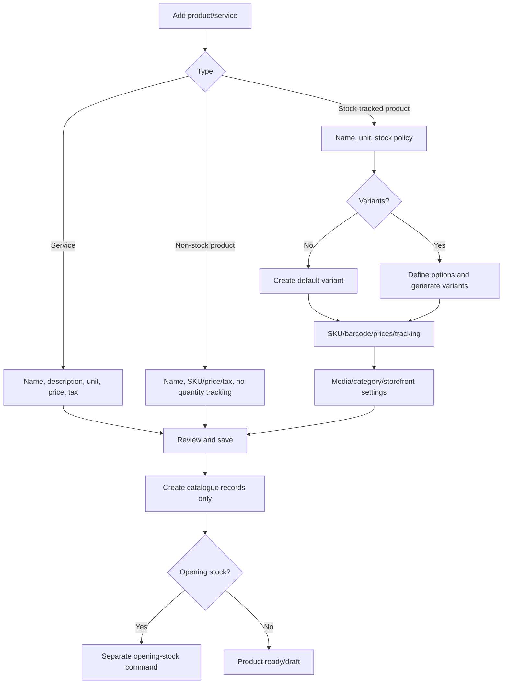
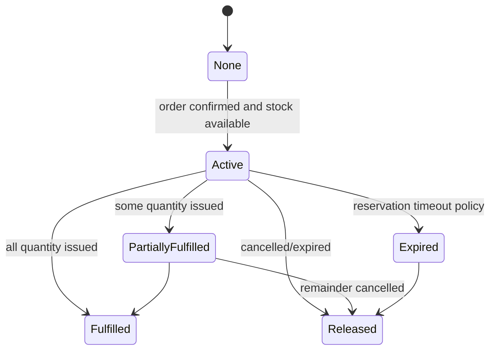
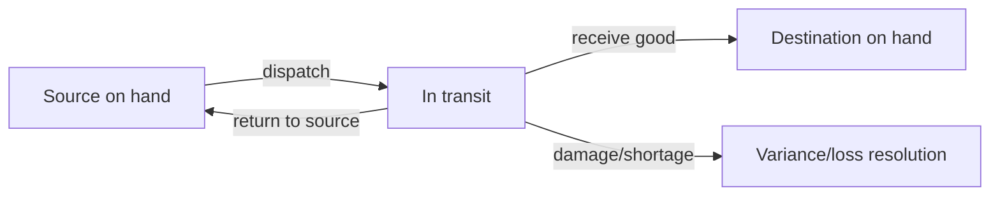
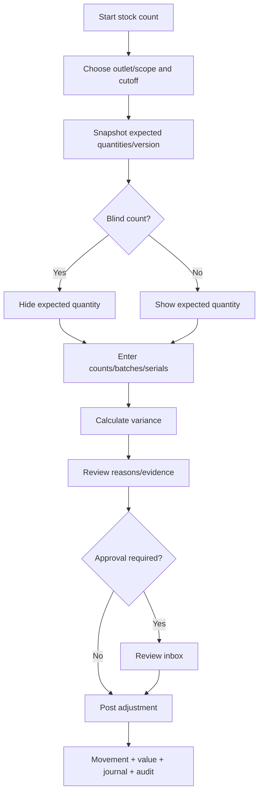
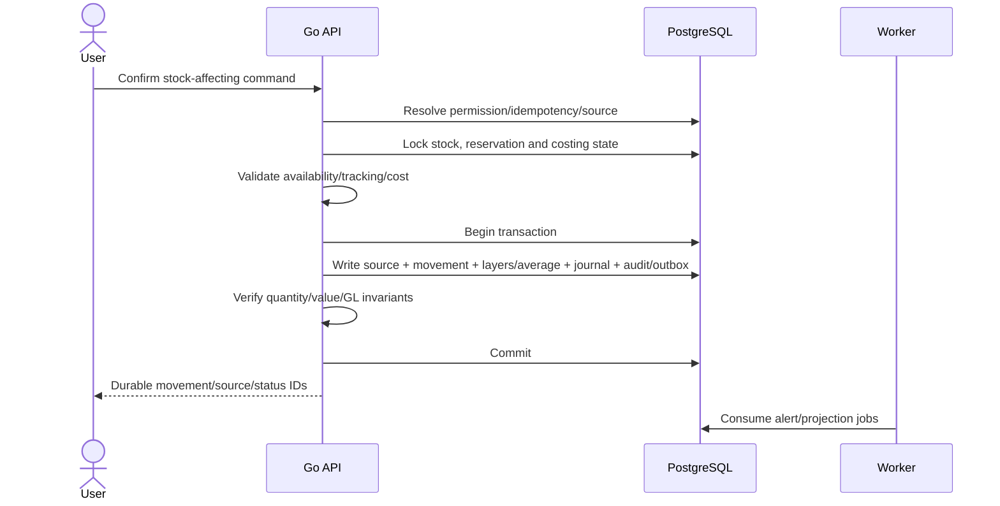

# Catalogue, Inventory and Outlets Blueprint

**Status:** Complete draft  
**Depends on:** documents 00–06  
**Integrity rule:** Stock quantity, stock value, COGS and the general ledger must remain reconcilable from immutable source movements

## 1. Purpose

This blueprint defines:

- products, services, variants, units, SKUs and barcodes;
- categories, collections, media and prices;
- stock-tracked versus non-stock items;
- outlets and outlet-scoped permissions;
- immutable stock movements and rebuildable balances;
- available, reserved, on-hand and in-transit quantities;
- FIFO and weighted-average costing;
- opening stock, procurement receipts and sales issues;
- reservations, fulfilment, cancellations and overselling prevention;
- outlet transfers and transfer variance;
- batches, expiry and serial/unique identifiers;
- stock counts, adjustments, damage and write-offs;
- customer/supplier returns;
- concurrency, backdating and reconciliation.

## 2. Catalogue concepts

### Product

A reusable item offered, bought or tracked by a Business. It may have one or more variants.

### Variant

The specific sellable/stockable identity, such as `T-Shirt / Black / Large`. Stock, SKU, barcode, price and costing are attached to variant level.

### Service

A reusable non-stock offering. It can have price, tax and unit (hour/session/item) but never creates stock movement.

### Non-stock product

A tangible or charge-like catalogue item that is not quantity-tracked. It creates no stock movement or inventory costing.

### Stock-tracked product

A product whose variants have quantity and value movements per outlet.

### Outlet

A business location/stock responsibility unit such as shop, warehouse or branch. An outlet may also be a sales context without separate physical address.

## 3. Catalogue information architecture

### Products/services list

Displays:

- image/name;
- product/service/non-stock type;
- variant count;
- SKU/barcode;
- selling price/currency;
- total/selected-outlet available stock when permitted;
- low-stock/expiry state;
- active/draft/archived status.

Filters:

- type;
- active/archived/draft;
- category/collection;
- stock status;
- outlet;
- batch/expiry/serial tracking;
- missing price/cost/SKU;
- storefront visibility.

### Product detail tabs

1. Overview
2. Variants/options
3. Pricing
4. Stock by outlet
5. Movements
6. Batches/serials
7. Purchasing/suppliers
8. Sales/history
9. Storefront/media
10. Audit

Cost and margin sections require separate permissions.

## 4. Product/service creation



Creating a stock-tracked product creates no quantity/value. Opening stock is a separate confirmed financial/stock command.

## 5. Product fields

### Common

- name/title;
- internal/public description;
- kind: service, non-stock or stock-tracked;
- status: draft, active, archived;
- unit of measure;
- category/collections/tags;
- tax code;
- income/revenue mapping;
- storefront visibility;
- media;
- supplier references optional.

### Stock-tracked

- inventory asset account mapping;
- COGS account mapping;
- adjustment/write-off mappings;
- negative-stock policy;
- batch tracking flag;
- expiry tracking flag;
- serial tracking flag;
- low-stock threshold per outlet/default;
- default purchasing unit/conversion where supported;
- costing method inherited from workspace policy.

### Validation

- Name required and length-limited.
- Kind cannot change freely after posted movements.
- Tracking flags cannot be disabled when unresolved tracked stock exists.
- Service cannot have stock/batch/serial settings.
- SKU/barcode uniqueness follows workspace policy and active/archive rules.
- Accounting mapping must use valid account classes.

## 6. Variants and options

Example:

```text
Product: T-Shirt
Option 1: Colour = Black, White
Option 2: Size = S, M, L
Variants: Black/S, Black/M, Black/L, White/S, White/M, White/L
```

Rules:

- Option/value names are normalized within product.
- Variant option combination is unique.
- Each variant has its own SKU, barcode, prices, active state and stock.
- Variant generation previews count before creation.
- Configured maximum prevents accidental combinatorial explosion.
- Removing an option/variant with history archives it; it does not erase history.
- Merging variants with posted stock is not a simple edit; use controlled stock transfer/reclassification workflow if supported later.

## 7. SKU and barcode

### SKU

- User-entered or generated.
- Unique within Business workspace under configured case normalization.
- Stable historical snapshot on documents.
- Archived SKU reuse is blocked by default to avoid ambiguity.

### Barcode

- Supports allowlisted formats and scanner input.
- Unique for active variant within workspace unless packaging rules explicitly allow alternatives.
- Scan lookup is outlet/workspace scoped.
- Unknown barcode offers permitted create/search flow.
- Barcode is an identifier, not proof of price or stock.

## 8. Units of measure

Examples:

- each/item;
- kilogram/gram;
- litre/millilitre;
- metre;
- pack/carton;
- hour/session for services.

Rules:

- Quantity stored as fixed decimal with per-unit scale.
- Base stock unit remains stable after movements.
- Purchase/sale units may convert to base unit through explicit rational/fixed conversion.
- Conversion snapshot is stored on source line.
- Floating point is forbidden.
- Serial-tracked quantity must be whole and equal serial count.

## 9. Catalogue pricing

### Price records

- variant/service;
- currency;
- price list/channel;
- amount/precision;
- tax-inclusive/exclusive flag;
- effective period;
- minimum quantity later if supported.

Price lists may represent retail/wholesale/storefront. Price changes do not rewrite issued sales documents.

Cost is never inferred from selling price. Margin uses inventory cost projections and requires permission.

## 10. Catalogue media

- Cloudinary public/optimized media for product/storefront images.
- Image order, alt text and visibility.
- File type/size/dimension limits.
- Signed upload authorization.
- Removing media from catalogue does not delete a historical document's embedded snapshot/artifact requirement unexpectedly.
- Internal evidence/images use authenticated/private delivery, not public product media policy.

## 11. Outlets

Fields:

- name/code;
- type: shop, warehouse, branch, other;
- address/timezone if different;
- active status;
- sales/fulfilment flags;
- default cash/bank/money accounts where appropriate;
- document sequence/policy references;
- stock and low-stock settings.

Rules:

- Business onboarding may create `Main outlet` configuration only.
- Outlet creation creates no stock.
- Outlet with history is archived, not deleted.
- Closing outlet requires zero/resolved available, reserved and in-transit stock or an explicit transfer/adjustment plan.
- Member outlet scope applies to searches, counts, movements, sales, receipts, reports and exports.

## 12. Stock quantity model

For each workspace/outlet/variant:

```text
on_hand = sum(posted signed stock movements)

reserved = sum(active reservation quantities not released/fulfilled)

available = on_hand - reserved

in_transit = dispatched transfer quantity
             - received quantity
             - returned/cancelled-in-transit quantity
```

Definitions:

- `on_hand`: physically recorded quantity at outlet under posted movements.
- `reserved`: on-hand quantity committed to confirmed orders but not yet fulfilled.
- `available`: quantity sellable/committable under policy.
- `in_transit`: no longer at source but not yet accepted at destination.

Balances may be transactionally maintained projections, but immutable movements/reservations are authoritative and projections must be rebuildable.

## 13. Stock movement ledger

Every movement includes:

- workspace and outlet;
- variant;
- signed base-unit quantity;
- movement type;
- source type/ID/line;
- effective and posted time;
- actor;
- unit/total cost values;
- costing-layer/average references;
- batch/serial references where required;
- reversal link;
- reason/evidence for adjustments.

Movement types:

- opening stock;
- procurement receipt;
- customer sale/fulfilment;
- customer return;
- supplier return;
- transfer dispatch;
- transfer receipt;
- transfer variance;
- positive/negative adjustment;
- stock-count variance;
- damage/defective/expiry;
- owner drawing/internal use;
- reversal.

Posted movements are immutable. Corrections use reversing/compensating movements.

## 14. Stock value and ledger reconciliation

Inventory value is derived from cost layers/average state and movements. General-ledger Inventory must reconcile to inventory subledger by outlet/variant/account dimensions as designed.

At every value-changing command:

- stock movement quantity/value;
- inventory costing state;
- COGS/expense/GRNI/AP journal effects;
- source document;
- audit/outbox

commit atomically where the event recognizes them together.

Reconciliation checks:

```text
sum inventory subledger value by inventory account
== corresponding general-ledger inventory account balance
```

Differences are launch blockers and must never be hidden by editing a projection.

## 15. Costing-method selection

Supported:

- FIFO;
- perpetual weighted average.

Rules:

- Chosen per Business before first posted stock movement.
- Explain using examples during setup.
- Method is locked after first stock movement for MVP.
- Changing method later requires a formal migration/revaluation project with cutover, reconciliation and accountant review; it is not a settings toggle.
- All outlets follow the selected method unless a later explicitly designed policy changes this.

## 16. FIFO model

### Receipt layer

Each inbound valued receipt creates a layer:

- variant/outlet;
- source/receipt line;
- original and remaining base quantity;
- unit cost fixed decimal;
- total value minor/base precision;
- effective/posted ordering keys;
- batch links where relevant.

### Issue algorithm

1. Lock available eligible layers for variant/outlet in deterministic FIFO order.
2. Require sufficient quantity unless approved negative-stock exception exists.
3. Consume earliest remaining layer quantities.
4. Create issue-layer records linking outbound movement to each layer.
5. Sum consumed costs using fixed precision and deterministic rounding.
6. Post stock issue and COGS/value journal atomically.
7. Update remaining-layer projection.

```text
required = issue_quantity
for layer in FIFO(effective_at, posted_sequence, id):
    take = min(layer.remaining, required)
    create issue_layer(layer, take, layer.unit_cost)
    required -= take
    if required == 0: break
require required == 0
```

### Return

Customer return should restore original issued cost/layer reference when determinable. Supplier return removes stock at receipt/layer cost. Generic current FIFO approximation is not used when source cost is known.

## 17. Weighted-average model

Maintain state per outlet/variant unless final architecture explicitly chooses company-wide pool:

- quantity;
- value;
- average unit cost fixed decimal;
- version.

### Receipt

```text
new_quantity = old_quantity + received_quantity
new_value = old_value + eligible_received_value
new_average = new_value / new_quantity
```

Use high-precision fixed decimals. Stored minor-unit GL value and subledger state must reconcile through deterministic residual handling.

### Issue

```text
issue_value = issue_quantity × current_average_cost
new_quantity = old_quantity - issue_quantity
new_value = old_value - issue_value
```

When final quantity reaches zero, any rounding residual is cleared deterministically so value also reaches zero under policy.

### Concurrency

Lock/version average state per outlet/variant for every receipt/issue. Concurrent issues cannot read the same old quantity/value and both commit incorrectly.

## 18. Landed/additional cost

Eligible procurement costs may include freight, duty or handling according to policy.

Allocation bases may include:

- quantity;
- line value;
- weight/volume later;
- manual fixed allocation.

Rules:

- Allocation sums exactly to total landed cost in minor units.
- Residual assigned deterministically.
- Added cost updates receipt layers/average and inventory/clearing journal under documented timing.
- If cost arrives after stock was partially sold, revaluation/COGS adjustment logic is required; do not rewrite history silently.
- MVP may require landed cost before final receipt or use a controlled later adjustment workflow.

## 19. Negative stock

Default: blocked.

Why:

- FIFO lacks a valid layer cost.
- Weighted average can produce misleading negative quantity/value.
- Later receipt/backdating can rewrite COGS.
- Overselling harms storefront/order trust.

If a later override exists:

- explicit workspace policy;
- restricted permission;
- reason and alert;
- provisional cost rule;
- automatic reconciliation when receipt arrives;
- visible negative-stock queue;
- deterministic COGS adjustment;
- not available for serial/batch-controlled items when identity is absent.

Public beta should keep negative stock disabled unless both costing methods pass deterministic fixtures and accountant review.

## 20. Opening stock

Required per line:

- outlet;
- variant;
- base quantity;
- unit/total cost;
- effective opening date;
- batch/expiry/serial details where required;
- balancing opening-equity/migration account;
- evidence/reference optional.

Effects:

- inbound opening stock movement;
- FIFO layer or weighted-average state;
- debit Inventory, credit Opening Balance Equity/migration account;
- audit/source document.

Rules:

- Not purchase expense or current revenue.
- Serial count equals quantity.
- Batch quantities sum to line quantity.
- Duplicate command idempotent.
- Corrections use reversal/replacement.

## 21. Procurement receipt

Goods receipt details are specified further in document 08.

Inventory-side algorithm:

1. Lock PO/receipt state and variant/outlet costing state.
2. Validate received quantity against policy and prior receipts/returns.
3. Validate batch/expiry/serial requirements.
4. Determine eligible receipt cost and landed-cost allocation.
5. Create inbound movement.
6. Create FIFO layer or update weighted average.
7. Post Inventory versus GRNI/AP/clearing effect according to rulebook.
8. Update PO received projection.
9. Audit and commit atomically.

Receipt creates stock; supplier bill creates payable. They may be separate events.

## 22. Sale reservation lifecycle

Storefront checkout request does not reserve stock.

Reservation begins when the merchant confirms an order or another configured commitment event occurs.



Reservation does not reduce on-hand; it reduces available.

## 23. Reserve-stock algorithm

For each outlet/variant in deterministic order:

1. Lock stock projection/version.
2. Compute `available = on_hand - active_reserved` from authoritative state.
3. Require requested quantity ≤ available.
4. Create active reservation linked to order line.
5. Update reserved/available projection.
6. Commit with order confirmation.

All lines reserve or the order confirmation fails/returns a clearly designed partial-reservation state; MVP preference is all-or-nothing confirmation.

Concurrent orders cannot reserve the same last unit.

## 24. Fulfilment/stock issue

1. Load confirmed order/sale and active reservations.
2. Validate outlet, quantity and serial/batch picks.
3. Lock reservation and costing state.
4. Create outbound stock movement.
5. Consume FIFO layers or weighted-average value.
6. Release/fulfil corresponding reservation quantity.
7. Post COGS debit and Inventory credit.
8. Update fulfilment/order state.
9. Audit and commit.

If a direct sale issues stock immediately, reservation may be omitted and availability/issue occurs in the same transaction.

Invoice issue must not also deduct stock if fulfilment already did. The recognition event is explicit and exactly once.

## 25. Transfer between outlets

### States

- draft;
- requested;
- approved;
- dispatched;
- partially received;
- received;
- cancelled before dispatch;
- closed with variance.

### Dispatch

- Validate source availability.
- Select batch/serial where required.
- Create outbound source movement.
- Move quantity/value into in-transit state/account.
- Consume/associate source costing layers.

### Receipt

- Enter received quantity and condition.
- Create inbound destination movement at carried source cost.
- Create destination FIFO layer/update average.
- Remove received quantity/value from in-transit.
- Preserve total company inventory value absent variance.

### Variance

- shortage, damage or overage requires reason/evidence and approval.
- Post explicit variance movement and loss/receivable/clearing effect.
- Cannot silently edit dispatch quantity after posting.



## 26. Batch and expiry tracking

Batch fields:

- batch/lot identifier;
- variant/outlet;
- source receipt;
- manufacture/expiry dates;
- quantity/value state;
- status/quarantine.

Rules:

- Batch required on inbound/outbound movements when tracking enabled.
- Batch quantity reconciles to variant/outlet movement totals.
- Expired/quarantined batch is not available for ordinary sale.
- Pick suggestion may use FEFO (first expiry, first out) while accounting cost remains selected FIFO/weighted-average method. Physical pick order and costing method are distinct.
- Expiry alerts are based on workspace date/timezone and configurable windows.
- Editing expiry after receipt is audited and permission-controlled.

## 27. Serial/unique identifiers

Each serial item has:

- unique serial within workspace/product policy;
- variant;
- current outlet/state;
- receipt/source and cost association;
- sale/customer/return/warranty links where applicable.

States:

- available;
- reserved;
- sold/issued;
- in transit;
- returned pending inspection;
- damaged/defective;
- supplier-returned;
- written off.

Rules:

- Inbound serial count equals quantity.
- Outbound selects exact available serials.
- Same serial cannot be active in two outlets/states.
- Serial history is immutable event-driven.
- Correction uses state transitions/reversal, not changing current outlet directly.

## 28. Stock count

### Flow



### Count scope

- full outlet;
- category/product subset;
- selected variants;
- batch/serial subset.

### Concurrency/cutoff

Choose a policy:

- freeze relevant stock movements during count; or
- snapshot expected at cutoff and include post-cutoff movements in variance calculation.

The UI must explain the policy. Naïve expected quantity from count-start without post-start movements produces false variance.

## 29. Stock adjustment

Types:

- count gain/loss;
- damage;
- defective;
- expiry;
- internal use/owner drawing;
- data correction;
- theft/loss;
- transfer variance;
- other controlled reason.

Required:

- outlet/variant/quantity;
- batch/serial where required;
- reason code and note;
- cost source/rule;
- evidence/approval by threshold;
- effective date.

Effects:

- movement;
- FIFO/average value change;
- expense/loss/equity/clearing journal as reason requires;
- audit.

Adjustment is never used to conceal a sale, purchase receipt or return.

## 30. Damage, defect and expiry

1. Select affected stock identity.
2. Move to non-saleable state or issue/write off according to inspection policy.
3. Require reason/evidence.
4. Preserve batch/serial trail.
5. Post inventory value reduction and loss/claim account.
6. If supplier/customer claim exists, create linked receivable/return workflow separately.

Expired goods cannot be restored to available without authorized reversal/correction and valid reason.

## 31. Customer return inventory effects

1. Reference original sale/fulfilment line.
2. Validate eligible quantity net of prior returns.
3. Identify returned batch/serial where applicable.
4. Record condition.
5. If saleable, inbound stock at original issued cost where determinable.
6. Reverse COGS/restore Inventory for eligible value.
7. If damaged/non-saleable, route to quarantine/write-off and correct value effect.
8. Credit/refund remains separate linked financial resolution.

Return cannot create more stock than originally issued.

## 32. Supplier return

1. Reference original goods receipt/layer.
2. Validate remaining eligible stock quantity and identity.
3. Remove stock at receipt/original cost.
4. Reduce FIFO layer/update average correctly.
5. Post supplier debit/credit/receivable or clearing effect according to bill status.
6. Update receipt/PO matching projections.
7. Await refund/credit application separately where necessary.

## 33. Backdating

Backdating can change costing sequence and COGS.

MVP policy should restrict:

- backdating before closed/locked periods;
- inserting receipts/issues before later dependent movements without recalculation;
- backdating serial/batch state inconsistently;
- changing effective sequence after reports/returns rely on it.

If permitted:

1. Detect affected later movements.
2. Recompute costing deterministically in a transaction or controlled job.
3. Post auditable COGS/inventory adjustments rather than rewriting issued financial history silently.
4. Reconcile subledger to GL.
5. Surface affected documents/reports.

For December, prefer tight backdate windows and block complex historical recomputation until tested.

## 34. Inventory reconciliation

Required reports/checks:

- movement sum versus on-hand projection;
- reservation sum versus reserved projection;
- FIFO remaining layers/weighted-average quantity versus on-hand;
- subledger inventory value versus GL Inventory;
- issue costs versus GL COGS;
- in-transit dispatch/receipt/variance;
- batch quantities versus variant quantity;
- serial state count versus quantity;
- negative/zero-quantity nonzero-value anomalies;
- zero-quantity FIFO remaining layers/average residual.

Rebuild tooling:

- runs per workspace/outlet/variant/date range;
- produces differences before applying repair;
- never fabricates repair without trace;
- repair requires permission, audit and accountant review for financial value.

## 35. Inventory dashboard

Shows permitted metrics:

- on-hand/available/reserved/in-transit;
- low/out of stock;
- expiring/expired batches;
- pending transfers/receipts;
- count/variance reviews;
- inventory value and COGS only with cost permission;
- stock movement trends.

All totals specify outlet scope, currency/value basis and as-of time.

## 36. Permissions

Representative capabilities:

- `inventory.view_quantity`
- `inventory.view_cost`
- `inventory.manage_catalogue`
- `inventory.manage_price`
- `inventory.receive`
- `inventory.reserve`
- `inventory.fulfil`
- `inventory.transfer_request`
- `inventory.transfer_approve`
- `inventory.transfer_dispatch`
- `inventory.transfer_receive`
- `inventory.count`
- `inventory.adjust`
- `inventory.write_off`
- `inventory.manage_tracking_policy`
- `inventory.export`

Cost/margin, adjustment, approval and transfer receive/dispatch are separate powers. Outlet scope applies throughout.

## 37. Atomic movement algorithm

Generic inputs: command/source, workspace/outlet/variant, signed quantity, effective date, batch/serials, cost context and idempotency key.

1. Authenticate and resolve workspace/membership/outlet permission.
2. Validate entitlement and idempotency.
3. Validate source state/version and open period.
4. Parse fixed-decimal quantity/unit conversion.
5. Lock stock projection, reservation and costing state in deterministic order.
6. Validate availability and tracking identities.
7. Resolve movement type and cost.
8. Create immutable movement and costing-layer/state changes.
9. Create source/status transition.
10. Create balanced inventory/COGS/clearing journal where applicable.
11. Update rebuildable projections.
12. Write audit/outbox.
13. Verify quantity/value/serial/batch/reservation invariants.
14. Store idempotency result and commit.



## 38. Concurrency and lock order

Suggested deterministic order:

1. idempotency/source record;
2. workspace policy/period if needed;
3. outlet/variant stock states sorted by outlet then variant ID;
4. reservations sorted by source/ID;
5. FIFO layers or weighted-average states;
6. batch/serial identities sorted stably;
7. transfer/in-transit state.

Tests must cover concurrent:

- last-unit sales;
- two order reservations;
- receipt and sale;
- count and sale;
- transfer and local sale;
- deposit/payment plus fulfilment atomic sale;
- two serial selections;
- average-cost issues/receipts.

## 39. Offline behavior

Catalogue:

- cached permitted catalogue/price data may support draft/offline sale.
- create/edit product offline may be saved as a local draft, not final active variant/SKU uniqueness truth.

Inventory:

- offline stock view is clearly stale/as-of.
- offline count capture may be allowed with snapshot/version and later conflict review.
- offline sale/issue is high risk and requires explicit bounded policy; default is queue pending server validation.
- transfers, adjustments, receipts and serial/batch movements normally require online confirmation.
- queued command never decrements authoritative stock until server commit.

## 40. Data model

### Catalogue

- `products`
- `product_variants`
- `product_options`, `product_option_values`
- `units`, `unit_conversions`
- `categories`, `collections`, mapping tables
- `price_lists`, `variant_prices`
- `product_media`
- `supplier_product_refs`

### Inventory

- `outlets`
- `stock_movements`
- `stock_balance_projections`
- `stock_reservations`
- `inventory_cost_layers`
- `inventory_issue_layers`
- `inventory_average_state`
- `batches`, `batch_movements`
- `serial_items`, `serial_events`
- `stock_transfers`, `stock_transfer_lines/events`
- `stock_counts`, `stock_count_lines`
- `inventory_adjustments`
- `inventory_reconciliation_runs/differences`

All tenant records include workspace ID and applicable outlet/variant dimensions.

## 41. API outline

| Method/path | Purpose |
|---|---|
| `GET /v1/businesses/{id}/catalogue` | Search/filter catalogue |
| `POST /v1/businesses/{id}/products` | Create product/service configuration |
| `PATCH /v1/businesses/{id}/products/{product}` | Versioned safe edit |
| `POST /v1/businesses/{id}/products/{product}/commands/archive` | Archive |
| `POST /v1/businesses/{id}/commands/post-opening-stock` | Atomic opening quantity/value |
| `GET /v1/businesses/{id}/stock` | Outlet/variant stock projection |
| `GET /v1/businesses/{id}/stock-movements` | Cursor/date movement list |
| `POST /v1/businesses/{id}/commands/reserve-stock` | Usually embedded in order confirmation |
| `POST /v1/businesses/{id}/commands/fulfil-order` | Issue stock/COGS |
| `POST /v1/businesses/{id}/stock-transfers` | Create transfer draft/request |
| `POST /v1/businesses/{id}/stock-transfers/{transfer}/commands/dispatch` | Dispatch to in-transit |
| `POST /v1/businesses/{id}/stock-transfers/{transfer}/commands/receive` | Destination receipt/variance |
| `POST /v1/businesses/{id}/stock-counts` | Start count/snapshot |
| `POST /v1/businesses/{id}/stock-counts/{count}/commands/submit` | Submit count |
| `POST /v1/businesses/{id}/stock-counts/{count}/commands/approve` | Post variance adjustment |
| `POST /v1/businesses/{id}/commands/post-stock-adjustment` | Controlled adjustment |
| `POST /v1/businesses/{id}/inventory-reconciliations` | Run reconciliation/report |

## 42. Errors and recovery

Stable errors:

- `SKU_CONFLICT`
- `BARCODE_CONFLICT`
- `VARIANT_COMBINATION_CONFLICT`
- `PRODUCT_KIND_LOCKED`
- `COSTING_METHOD_LOCKED`
- `INSUFFICIENT_STOCK`
- `STOCK_VERSION_CONFLICT`
- `RESERVATION_CONFLICT`
- `BATCH_REQUIRED`
- `BATCH_EXPIRED_OR_QUARANTINED`
- `SERIAL_REQUIRED`
- `SERIAL_NOT_AVAILABLE`
- `TRANSFER_QUANTITY_EXCEEDED`
- `COUNT_SNAPSHOT_CONFLICT`
- `RETURN_QUANTITY_EXCEEDED`
- `INVENTORY_RECONCILIATION_FAILED`

Recovery reloads current state and preserves draft/count input. It never silently reduces sale/transfer quantity or substitutes another batch/serial.

## 43. Notifications and review

Review items:

- low/out-of-stock exception;
- negative-stock override request if enabled;
- transfer approval/variance;
- receipt variance;
- stock count variance;
- adjustment/write-off approval;
- expiring/expired batch action;
- serial conflict;
- inventory/GL reconciliation difference;
- cost revaluation/backdate impact.

Notifications:

- low stock;
- batch nearing expiry;
- transfer dispatched/received;
- count assigned/completed;
- reconciliation failed;
- catalogue import complete/failed.

## 44. Analytics

Safe events:

- `product_or_service_created`
- `variant_generated`
- `opening_stock_posted`
- `stock_reserved/released/fulfilled`
- `transfer_requested/dispatched/received`
- `stock_count_started/completed`
- `stock_adjustment_posted_reason_class`
- `batch_expiry_alert_shown`
- `inventory_reconciliation_completed/failed`

Exclude product name/SKU/barcode, quantities, costs, outlet names, batch/serial identifiers and supplier/customer data.

## 45. Acceptance and edge-case tests

### Catalogue

- Service and non-stock item create no stock movement.
- Product creation creates zero quantity/value.
- Variant combination, SKU and barcode constraints hold concurrently.
- Archived item remains on historical documents.
- Kind/tracking/costing cannot be changed unsafely after movements.

### Quantity/reservation

- On-hand/reserved/available/in-transit formulas reconcile.
- Checkout request does not reserve.
- Confirmed order reserves atomically.
- Cancellation releases exact remainder.
- Fulfilment consumes reservation and stock once.
- Two concurrent orders cannot reserve/sell the same last unit.

### FIFO

- Issues consume deterministic oldest eligible layers.
- Partial layer consumption leaves exact remainder.
- Customer return restores original issued cost where known.
- Supplier return uses original receipt/layer cost.
- Layer quantity/value reconciles to stock/GL.

### Weighted average

- Multiple receipts calculate correct high-precision average.
- Concurrent receipt/issue cannot corrupt state.
- Issue value/remaining value reconcile.
- Zero quantity clears residual value deterministically.
- Returns/backdating follow documented rule.

### Transfers

- Dispatch reduces source on-hand and creates in-transit at same value.
- Partial receipt creates destination stock and leaves exact in-transit remainder.
- Good transfer does not change company total inventory value.
- Variance is explicit, approved and journaled.
- Serial/batch identity moves consistently.

### Batch/serial

- Batch quantities reconcile to variant stock.
- Expired/quarantined stock cannot be sold ordinarily.
- Serial count equals quantity and serial cannot exist in two active states.
- FEFO pick suggestion does not change accounting costing method.

### Counts/adjustments

- Count cutoff handles concurrent movements correctly.
- Blind count hides expected quantity.
- Variance posts one movement/value/journal chain.
- Adjustment cannot conceal sale/purchase/return.
- Approval threshold and outlet scope apply.

### Sales/returns

- Tracked sale posts one issue and one COGS effect.
- Invoice/fulfilment separation cannot deduct twice.
- Service sale has no stock effect.
- Return cannot exceed sold quantity.
- Saleable and damaged returns route correctly.

### Integrity/security

- Movement, costing subledger and GL reconcile after every fixture.
- Cross-workspace/outlet/product/batch/serial IDs fail.
- Quantity permission does not expose cost.
- Posted movement cannot be edited/deleted.
- Idempotent retry cannot duplicate receipt/issue/transfer/adjustment.
- Reconciliation difference blocks launch gate.

### Responsive/accessibility

- Product creation/variant editing usable on mobile.
- Scanner/manual barcode fallback works.
- Stock table becomes cards without hiding quantity/status.
- Count entry works with keyboard/touch and clear offline/stale indicators.

## 46. Implementation handoff checklist

- Product/service/non-stock/stock-tracked behaviors are distinct.
- Quantity uses fixed decimal and money uses minor units/fixed costing decimals.
- Movement ledger is immutable and projections rebuildable.
- FIFO and weighted-average fixtures are signed off.
- Costing method locks before first movement.
- Negative stock defaults off.
- Reservation event and stock-issue event are explicit.
- Sale/invoice/fulfilment cannot double-deduct.
- Transfer preserves value absent explicit variance.
- Batch/serial/count invariants have concurrency tests.
- Inventory subledger reconciles to GL/COGS.
- Backdating policy is deliberately restricted/tested.
- Every stock-affecting command is idempotent and atomic.

