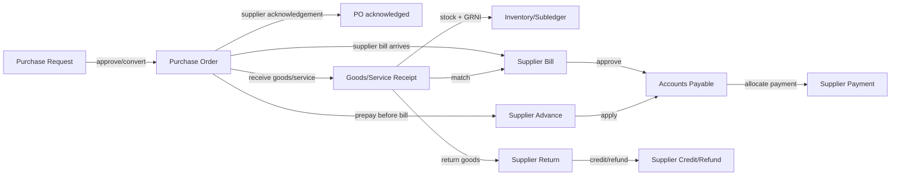
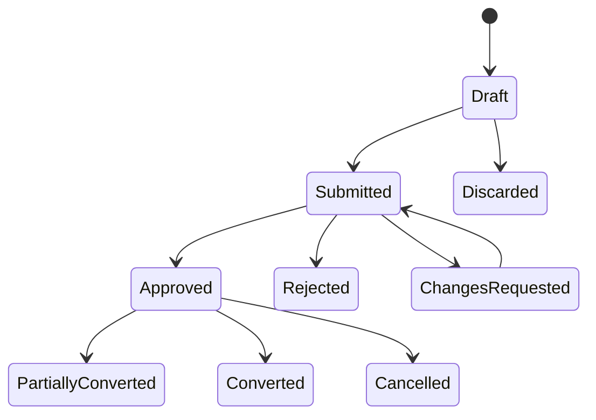
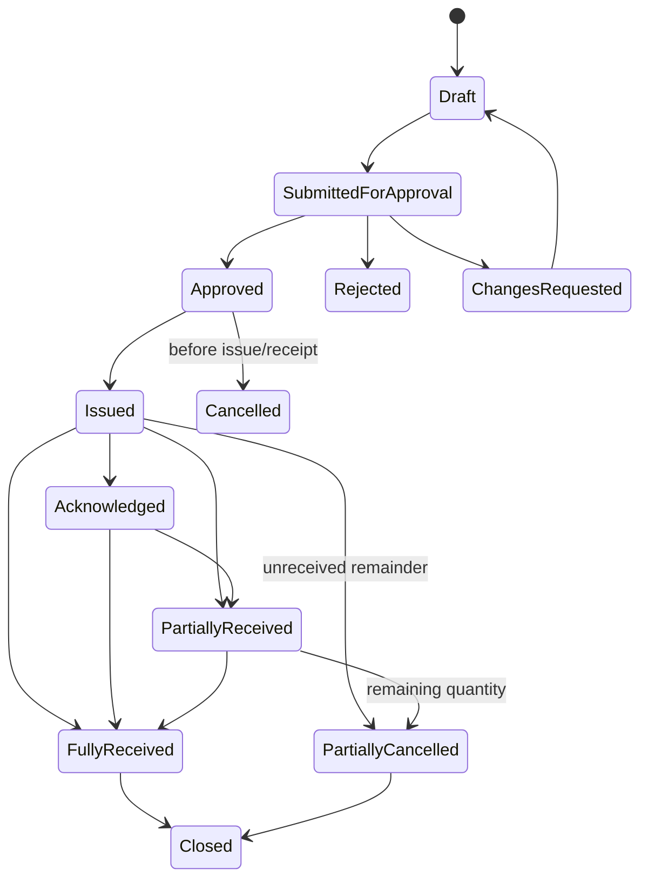
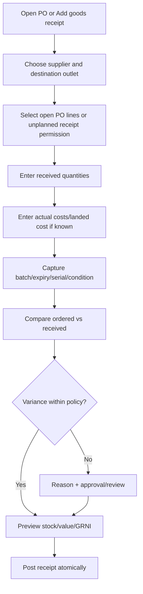
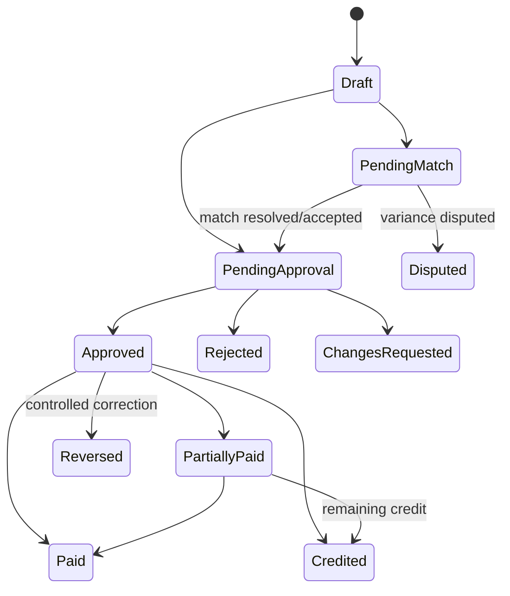
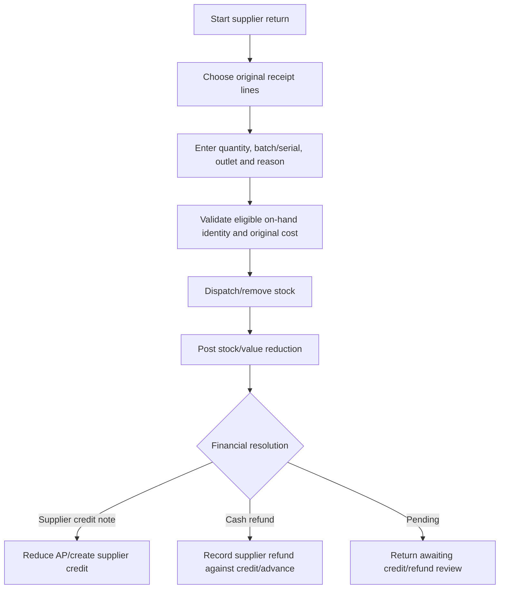

# Purchasing, Procurement and Payables Blueprint

**Status:** Complete draft  
**Depends on:** documents 00–07  
**Core rule:** Purchase request, purchase order, goods receipt, supplier bill and supplier payment are separate events

## 1. Purpose

This blueprint defines:

- purchase requests and approvals;
- requests for quotation as a future-compatible concept;
- purchase orders and supplier acknowledgement;
- partial goods/service receipt;
- cost, quantity, batch, expiry and serial capture;
- Goods Received Not Invoiced (GRNI);
- supplier bills and Accounts Payable;
- two-way and three-way matching;
- quantity, price, tax and landed-cost variance;
- supplier advances and bill payment;
- supplier returns, credits and refunds;
- cancellation, close, correction and period behavior;
- permissions, approval thresholds, concurrency and audit.

## 2. Procurement documents

### Purchase request

Internal request describing what is needed. It creates no stock, payable, expense or cash movement.

### Purchase order

Approved commercial commitment sent to supplier. It creates no stock or payable by itself.

### Goods receipt

Evidence that goods were physically received. It creates stock and inventory value/GRNI effects under selected accounting policy.

### Service receipt

Evidence that a service/milestone was accepted. It may support accrual/GRNI treatment where configured but creates no physical stock.

### Supplier bill

Supplier's payable document. Approval posts Accounts Payable and clears GRNI or records expense/asset/inventory according to source/match.

### Supplier payment

Cash/bank movement settling an approved bill or creating/applying supplier advance. It never creates the underlying purchase again.

### Supplier return

Physical goods returned to supplier, linked to receipt/cost identity. Financial credit/refund is a related but separate resolution.

## 3. Lifecycle overview



## 4. Purchasing information architecture

### Overview

- requests awaiting approval;
- POs awaiting approval/supplier/receipt;
- expected/late deliveries;
- receipts awaiting bill;
- bills awaiting match/approval/payment;
- overdue payables;
- supplier advances;
- return/credit/refund follow-up;
- variance and failed-job alerts.

### Lists

- Purchase requests
- Purchase orders
- Goods/service receipts
- Supplier bills
- Supplier payments/advances
- Supplier returns/credits

Filters include status, supplier, outlet, requester/buyer, date/due range, unmatched/variance, overdue, currency and approval owner.

## 5. Purchase request workflow

### Fields

- requesting user/team/outlet;
- needed-by date;
- reason/project/reference;
- suggested supplier optional;
- lines: product/service/custom request, quantity/unit, estimated price/currency, notes;
- attachments/evidence;
- urgency/priority under policy.

### States



### Rules

- Submission freezes a review version.
- Approval may be line-level or whole request according to policy; MVP should prefer whole-document plus approved-quantity fields.
- Approval creates no financial/stock effect.
- Conversion creates one or more PO drafts grouped by supplier/outlet/currency.
- Requester cannot exceed approved quantity/value during conversion.
- Rejection/change request retains history/reason.

## 6. Approval policy

Policy inputs may include:

- document type;
- total base-currency amount;
- outlet;
- category/product;
- requester/role;
- supplier risk/status;
- variance type/amount;
- self-approval restriction.

Representative levels:

- below threshold: authorized role may approve;
- medium: Admin/Procurement Manager;
- high: Owner;
- sensitive/new supplier: additional review.

Algorithm:

1. Compute trusted base-currency approval amount server-side.
2. Resolve applicable policy/version.
3. Generate required approval steps.
4. Prevent self-approval where configured.
5. Require all mandatory steps in order/parallel policy.
6. Recalculate approval if amount/supplier/material terms change.
7. Invalidate stale approval on material draft revision.

Approvals never bypass accounting, stock or plan validation.

## 7. Purchase order creation

Entry sources:

- approved request conversion;
- direct PO draft by permitted buyer;
- reorder/low-stock suggestion;
- duplicate prior PO into a new draft.

### Header

- supplier;
- destination outlet;
- order date/expected date;
- currency/exchange-rate context;
- payment terms;
- buyer/reference;
- shipping/delivery address snapshot;
- tax mode;
- public supplier note/internal note;
- source request(s).

### Lines

- variant/service/custom line;
- description snapshot;
- ordered quantity/unit and base conversion;
- expected unit cost;
- discount/tax;
- expected landed/additional cost;
- destination outlet;
- batch/expiry/serial requirements;
- source request line.

### PO numbering

- Atomic, unique, non-reused issued sequence.
- Drafts use internal IDs.
- Revision/supersession preserves issued versions.

## 8. PO state model



Bill/match status is a separate dimension: unbilled, partially billed, billed, variance/open.

## 9. PO issue and supplier sharing

Issue algorithm:

1. Validate supplier, lines, outlet, approvals and current draft version.
2. Recalculate expected totals.
3. Assign PO number/version atomically.
4. Create immutable issued snapshot.
5. Write audit/outbox.
6. Commit.
7. Worker generates PDF/sends email if requested.

No stock, payable or expense journal is created merely by issuing PO.

Supplier can open guest portal without Rekordly account and acknowledge, decline or request change. Acknowledgement is communication state only.

## 10. PO revisions and cancellation

### Before receipt

- Material changes create revised issued version requiring approval as policy dictates.
- Prior version remains visible/superseded.

### After partial receipt

- Received quantity/cost history is immutable.
- Only unreceived remainder/expected terms can be revised/cancelled.
- Revised quantity cannot fall below already received/returned/committed amounts.

### Cancellation

- Cancelling unreceived PO remainder creates no stock/financial reversal.
- Existing receipts/bills/payments remain and must be resolved independently.
- Cancellation reason/actor/version is audited.

## 11. Goods receipt workflow



### Header

- supplier;
- destination outlet;
- PO/source optional under permission;
- receipt/delivery note reference;
- received/effective date/time;
- receiver;
- attachment/evidence;
- general condition/note.

### Lines

- PO/product variant;
- ordered, previously received, remaining;
- quantity received/accepted/rejected;
- base-unit conversion;
- actual/expected cost basis;
- batch/expiry/serial identities;
- landed-cost allocation;
- variance reason.

## 12. Receipt validation

- Quantity > 0 for accepted receipt lines.
- Received quantity does not exceed open PO quantity unless over-receipt policy/approval permits.
- Product/variant/outlet active and authorized.
- Unit conversion valid and snapshotted.
- Batch/expiry/serial details complete where required.
- Serial count equals accepted base quantity.
- Duplicate delivery/receipt reference warning/constraint under policy.
- Effective date in open permitted period.
- Cost input uses fixed decimal; value uses deterministic rounding.
- Rejected/damaged-at-delivery quantity is not added to available stock unless placed in explicit quarantine state.

## 13. Receipt accounting and stock

For inventory received before supplier bill:

| Debit | Credit |
|---|---|
| Inventory | GRNI / Received-not-invoiced liability |

For consumable/expense or service receipt under configured accrual policy:

| Debit | Credit |
|---|---|
| Expense/asset/work-in-progress | Accrued purchases/GRNI |

Receipt algorithm invokes document 07 to:

- create stock movement;
- create FIFO layer/update weighted average;
- preserve batch/serial identity;
- post Inventory/GRNI journal;
- update PO receipt state.

Supplier bill later clears GRNI into Accounts Payable, with variance handled explicitly.

## 14. Partial receiving

```text
remaining_to_receive = approved_order_quantity
                       - accepted_receipt_quantity
                       + accepted_supplier_return_quantity_that_reopens_commitment_if_policy
                       - cancelled_remainder
```

Rules:

- Multiple receipts link to one PO line.
- PO status becomes partially received until eligible remainder is zero/closed.
- Each receipt has independent batch/serial/cost/effective date.
- One receipt can cover lines from one PO; cross-PO consolidated delivery may use a receiving session grouping while preserving per-PO receipt lines.
- Closing short requires explicit cancel/close remainder reason.

## 15. Unplanned receipt

Sometimes goods arrive without PO.

Allowed only with permission/policy:

- select/create supplier;
- capture complete product/cost/tracking data;
- mark source `unplanned`;
- require reason and possibly approval;
- create stock/GRNI effect;
- appear in Review until matched to bill/retrospective PO where policy requires.

Do not block physical truth by forcing a fake PO, but make exception visible.

## 16. Service receipt

For accepted services/milestones:

- reference PO/service line;
- accepted quantity/milestone/date;
- evidence/approver;
- no stock movement;
- optional accrued expense/asset versus GRNI under policy;
- supports bill match.

If service acceptance/accrual is outside MVP, supplier bill becomes the expense-recognition event and service receipt remains operational evidence. The selected policy must be consistent.

## 17. Supplier bill creation

Entry sources:

- PO/receipt match;
- direct bill without PO;
- import/attachment extraction into draft;
- recurring copy later.

### Header

- supplier;
- supplier invoice number;
- bill/effective date;
- due date/terms;
- currency/rate;
- PO/receipt references;
- tax mode;
- attachment/evidence;
- internal/public reference.

### Lines

- receipt/PO/product/service/custom reference;
- billed quantity;
- unit cost;
- discount/tax;
- expense/asset/inventory/GRNI mapping;
- landed cost where applicable;
- project/outlet dimensions.

## 18. Duplicate supplier bill prevention

Signals:

- workspace + supplier + normalized supplier invoice number;
- supplier + amount + bill date;
- attachment/document hash;
- PO/receipt quantities already billed;
- imported external reference.

Exact invoice-number duplicates are blocked/warned under policy. Suspected duplicates enter Review. A supplier may legitimately reuse numbers across branches/currencies, so uniqueness policy must be explicit.

No duplicate bill can be created by retry due to idempotency.

## 19. Bill states



Due/overdue and payment states are derived dimensions.

## 20. Two-way and three-way matching

### Two-way

Compare PO to supplier bill:

- ordered versus billed quantity;
- expected versus billed unit cost;
- discount/tax;
- total/currency.

### Three-way

Compare PO, accepted receipt and supplier bill:

- ordered;
- accepted received;
- billed;
- expected/received/billed cost;
- tax/discount;
- returns and prior bills.

### Match projection

For each PO line:

```text
open_to_receive = ordered - accepted_received - cancelled + qualifying_return_reopen
open_to_bill = accepted_received - accepted_returned - billed_quantity
```

Depending on policy, billing before receipt may be allowed but remains unmatched/prepaid/accrued and visible.

## 21. Match algorithm

1. Candidate lines share supplier, currency and source references where possible.
2. Prefer exact PO/receipt line references.
3. Compare product/service identity, quantity, unit and price.
4. Account for prior receipts, bills, returns and credits.
5. Calculate quantity, unit-cost, tax and total variance in fixed precision/minor units.
6. Apply configured tolerance solely as approval routing, never as silent value change.
7. Classify:
   - exact/within approved tolerance;
   - quantity variance;
   - price variance;
   - tax/discount variance;
   - unmatched line;
   - overbilled/duplicate risk.
8. Require resolution/approval for exceptions.

## 22. Variance handling

### Quantity variance

- Bill exceeds accepted receipt: hold/dispute excess, treat as prepayment only if explicitly paid/approved, or await receipt.
- Receipt exceeds PO: require over-receipt approval/correct PO.
- Short receipt: leave open or close remainder explicitly.

### Price variance

When bill price differs from receipt estimate:

- update inventory value for stock still on hand where policy permits;
- adjust COGS for already issued quantity through auditable variance journal;
- use Purchase Price Variance or inventory revaluation account under selected policy;
- never overwrite original receipt layer/history silently.

### Tax/discount variance

- Require valid supplier document/tax treatment.
- Post actual approved bill tax/discount with explicit variance.

## 23. Supplier bill accounting

### Matched inventory already received

Expected portion:

| Debit | Credit |
|---|---|
| GRNI | Accounts Payable |

Approved price/tax/landed variance additionally posts to Inventory/COGS/variance/tax accounts as rule requires.

### Direct expense bill without prior receipt

| Debit | Credit |
|---|---|
| Expense/asset/tax recoverable | Accounts Payable |

### Inventory bill without receipt

Policy must not create available stock merely from a bill. It may post a prepayment/in-transit/clearing position or remain pending receipt according to selected workflow.

Bill approval creates payable. Draft/received supplier PDF alone does not.

## 24. Bill approval algorithm

1. Authenticate and require bill approval capability.
2. Validate workspace/supplier/period/idempotency/version.
3. Detect duplicates.
4. Lock bill, PO lines, receipt lines, prior bill allocations and relevant costing state.
5. Recompute match/variance.
6. Verify required approvals/tolerances.
7. Recalculate totals/tax in minor units.
8. Create immutable approved bill/version.
9. Post GRNI/AP/expense/inventory/variance/tax journal.
10. Apply inventory/COGS revaluation if required.
11. Update matching and payable projections.
12. Audit/outbox/idempotency.
13. Verify journal and inventory/GL reconciliation.
14. Commit.

All effects roll back if revaluation/matching/journal fails.

## 25. Supplier advance

Before bill/payment due:

| Debit | Credit |
|---|---|
| Supplier Advances asset | Cash/Bank |

Advance may reference PO but does not mark PO received/billed.

When approved bill exists:

| Debit | Credit |
|---|---|
| Accounts Payable | Supplier Advances asset |

Application cannot exceed available supplier advance or bill outstanding. It creates no new cash movement.

## 26. Supplier bill payment

Uses document 04:

- one payment may settle several bills;
- several payment accounts/methods may fund one settlement;
- partial payment leaves outstanding;
- advance can be applied;
- overpayment becomes explicit supplier advance;
- payment reduces AP, not expense/inventory again;
- supplier need not be Rekordly user;
- remittance advice can be shared through guest portal.

## 27. Supplier return workflow



Rules:

- Return quantity cannot exceed eligible received quantity remaining after prior returns and consumption constraints.
- Uses original receipt/layer cost where determinable.
- Serial/batch identity required when tracked.
- Physical return and supplier credit/refund are separate linked events.
- If goods were already consumed/sold, ordinary supplier return cannot invent stock; use claim/credit workflow.

## 28. Supplier credit note

May arise from:

- returned goods;
- price/tax correction;
- rebate/allowance;
- cancelled service/charge.

It reduces AP or creates supplier receivable/credit balance. It may also adjust Inventory/COGS/expense/tax based on source and remaining stock.

Supplier PDF is evidence; an authorized user must review/approve the credit entry.

## 29. Supplier refund

Actual cash received from supplier:

- references advance/credit/return;
- increases cash/bank;
- reduces supplier advance/receivable/credit;
- does not create miscellaneous income by default;
- cannot exceed available refundable source without another valid purpose.

## 30. Closing PO

PO may close when:

- all ordered quantity is received or remainder explicitly cancelled/closed;
- billing/match state is resolved according to policy;
- returns/variance are resolved or accepted;
- no pending approval blocks closure.

Closing does not delete/open-item history. Reopening requires permission/reason and cannot undo posted receipts/bills.

## 31. Corrections and reversals

### Purchase request/PO draft

- Edit/delete under state/permission.

### Issued PO

- Revise/supersede unreceived terms; preserve version.

### Posted goods receipt

- Cannot edit/delete.
- Correct with reversal/replacement only when downstream stock/cost dependencies permit.
- If stock has been sold/transferred, use supplier return, adjustment or controlled cost correction.

### Approved supplier bill

- Cannot edit/delete.
- Correct through supplier credit/debit/reversal and replacement.
- Allocated payments/closed periods require dependency-safe workflow.

### Payment

- Governed by document 04; cash refund is distinct from reversal.

## 32. Concurrency and lock ordering

Protect against:

- two receipts exceeding PO remainder;
- duplicate serial receipt;
- two bills billing the same receipt quantity;
- bill approval racing with supplier return;
- two advances applied beyond balance;
- receipt/cost revaluation racing with sale issue;
- duplicate PO/bill number under retry.

Suggested lock order:

1. idempotency/document draft;
2. supplier bill duplicate key/number;
3. PO and lines sorted by ID;
4. receipt lines sorted by ID;
5. stock/cost states sorted by outlet/variant;
6. supplier advance/bill balances;
7. numbering sequence.

Return current state on conflict; never silently reduce received/billed/payment amount.

## 33. Permissions

Representative capabilities:

- `purchases.request`
- `purchases.approve_request`
- `purchases.create_po`
- `purchases.approve_po`
- `purchases.issue_po`
- `purchases.receive`
- `purchases.receive_unplanned`
- `purchases.view_cost`
- `purchases.create_bill`
- `purchases.approve_bill`
- `purchases.accept_variance`
- `purchases.pay_supplier`
- `purchases.manage_advance`
- `purchases.return`
- `purchases.close_po`
- `purchases.export`

Separation of duties:

- requester need not approve;
- receiver need not approve bill;
- bill entry does not imply payment;
- supplier master-data edit may require separate permission;
- self-approval can be prohibited.

## 34. Offline behavior

Potentially allowed:

- draft request/PO/bill;
- capture receiving intent/counts/evidence locally for later review.

Normally requires online confirmation:

- approval;
- PO issue/number;
- goods receipt/stock movement;
- bill approval/AP;
- advance application/payment;
- supplier return/credit/refund;
- match resolution.

Server state may change concurrently, so offline capture becomes a draft/Needs Review and is never shown as posted stock/payable.

## 35. Data model

### `purchase_requests`, `purchase_request_lines`, `approval_steps`

Request, approved quantities/amounts, source/decision events.

### `purchase_orders`, `purchase_order_versions`, `purchase_order_lines`

Supplier/outlet/currency/terms, issued snapshots, quantities/costs and source links.

### `goods_receipts`, `goods_receipt_lines`

Accepted/rejected quantities, base conversion, actual/expected cost, batch/serial, movement/layer and GRNI journal links.

### `supplier_bills`, `supplier_bill_lines`

Supplier number/date/due/currency/totals, PO/receipt mappings, AP/journal/status.

### `purchase_matches`, `purchase_match_variances`

Ordered/received/returned/billed quantity/value and variance resolution.

### `supplier_returns`, `supplier_return_lines`

Original receipt/layer, stock movement, credit/refund state.

Supplier advance/payment tables follow document 04.

## 36. API outline

| Method/path | Purpose |
|---|---|
| `POST /v1/businesses/{id}/purchase-requests` | Create draft/request |
| `POST /v1/businesses/{id}/purchase-requests/{request}/commands/submit` | Submit for approval |
| `POST /v1/businesses/{id}/purchase-requests/{request}/commands/approve` | Versioned approval |
| `POST /v1/businesses/{id}/purchase-orders` | Create PO draft/direct or conversion |
| `POST /v1/businesses/{id}/purchase-orders/{po}/commands/approve` | Approve PO |
| `POST /v1/businesses/{id}/purchase-orders/{po}/commands/issue` | Number/version/share |
| `POST /v1/businesses/{id}/goods-receipt-drafts` | Capture receipt draft |
| `POST /v1/businesses/{id}/commands/post-goods-receipt` | Stock/value/GRNI atomically |
| `POST /v1/businesses/{id}/supplier-bill-drafts` | Create/import bill draft |
| `POST /v1/businesses/{id}/supplier-bill-drafts/{bill}/match` | Recompute match/variance preview |
| `POST /v1/businesses/{id}/commands/approve-supplier-bill` | AP/GRNI/variance atomically |
| `POST /v1/businesses/{id}/commands/apply-supplier-advance` | Apply existing advance |
| `POST /v1/businesses/{id}/commands/record-supplier-return` | Physical return/value effect |
| `POST /v1/businesses/{id}/commands/approve-supplier-credit` | Financial credit effect |
| `POST /v1/businesses/{id}/purchase-orders/{po}/commands/close` | Resolve/close remainder |

Sharing, payment and files use documents 04, 05 and 14.

## 37. Detail pages

### PO detail

- version/status/approval;
- supplier/outlet/terms;
- lines with ordered/received/returned/billed/open quantities;
- expected versus actual costs;
- receipt/bill/payment/advance links;
- supplier acknowledgement/messages;
- match/variance summary;
- document/share/audit timeline;
- permitted next actions.

### Receipt detail

- delivery/source/receiver;
- accepted/rejected quantities;
- batch/serial/expiry;
- inventory movement/cost/GRNI effect;
- bills/match/returns;
- correction history.

### Bill detail

- supplier invoice snapshot;
- lines/tax/totals;
- match and variance;
- approval timeline;
- payable/payment/advance/credit/outstanding;
- journal/effect expansion;
- attachment/share/audit.

## 38. Errors and recovery

Stable errors:

- `APPROVAL_REQUIRED`
- `APPROVAL_STALE`
- `PO_VERSION_CONFLICT`
- `PO_QUANTITY_EXCEEDED`
- `RECEIPT_DUPLICATE_REFERENCE`
- `RECEIPT_TRACKING_DATA_REQUIRED`
- `SUPPLIER_BILL_DUPLICATE`
- `BILL_QUANTITY_EXCEEDS_POLICY`
- `MATCH_VARIANCE_REQUIRES_APPROVAL`
- `GRNI_RECONCILIATION_FAILED`
- `SUPPLIER_ADVANCE_INSUFFICIENT`
- `SUPPLIER_RETURN_QUANTITY_EXCEEDED`
- `DOCUMENT_HAS_DEPENDENCIES`
- `PERIOD_LOCKED`

Preserve drafts/captured delivery data. Reload current PO/receipt/bill/stock state and highlight changed lines.

## 39. Notifications and Review

Review items:

- request/PO approval;
- supplier requested change;
- over/short receipt;
- unplanned receipt;
- bill duplicate risk;
- quantity/price/tax variance;
- bill approval;
- supplier payment approval;
- return/credit/refund follow-up;
- aged GRNI/unbilled receipt;
- overdue payable;
- failed PDF/email/import job.

Notifications:

- request decision;
- PO issued/acknowledged;
- delivery due/late;
- receipt posted;
- bill approved/due/overdue/paid;
- supplier return/credit/refund state.

## 40. Reconciliation reports

- Open POs
- Ordered versus received
- Received not invoiced (GRNI aging)
- Billed not received/unmatched bills
- Purchase price/quantity/tax variance
- Supplier payable aging
- Supplier advances and unapplied credits
- Supplier returns awaiting credit/refund
- Inventory receipt value versus GRNI/AP/GL

Every report has as-of date, currency/basis and source drill-down.

## 41. Analytics

Safe events:

- `purchase_request_submitted/approved`
- `purchase_order_created/approved/issued`
- `supplier_acknowledgement_received`
- `goods_receipt_posted`
- `receipt_variance_class`
- `supplier_bill_created/approved`
- `three_way_match_result_class`
- `supplier_advance_applied`
- `supplier_return_recorded`
- `po_closed`

Exclude supplier, products, quantities, costs, document numbers, tax IDs, references and attachments.

## 42. Acceptance and edge-case tests

### Request/PO

- Request/approval/PO issue creates no stock, AP, expense or cash.
- Material revision invalidates stale approval.
- Conversion cannot exceed approved quantity/value.
- PO number is atomic/non-reused.
- Supplier can view/acknowledge without account.

### Receiving

- Full and partial receipts update PO quantities correctly.
- Receipt creates stock/layer-or-average and GRNI once.
- Batch/serial/expiry requirements hold.
- Concurrent receipts cannot exceed allowed remaining quantity.
- Unplanned receipt is visible/approved and not hidden.
- Rejected/damaged-at-delivery quantity is not ordinary available stock.

### Billing/matching

- Bill approval creates AP; draft does not.
- Matched bill clears GRNI.
- Direct expense bill debits correct expense/asset/tax.
- Bill cannot create available stock without receipt.
- Duplicate supplier invoice is detected/idempotent.
- Two bills cannot bill same receipt quantity beyond policy.
- Variance tolerance routes approval but does not alter amount silently.

### Costing/variance

- Price variance updates Inventory/COGS/variance account correctly.
- Already sold stock does not get historical COGS overwritten silently.
- Landed cost allocation sums exactly with deterministic residual.
- Inventory subledger, GRNI, AP and GL reconcile.

### Advances/payments

- PO-linked prepayment creates supplier advance, not AP reduction/expense.
- Advance application creates no new cash movement.
- Bill payment reduces AP, not expense twice.
- Multi-bill/split-method payment follows document 04.

### Returns/credits/refunds

- Return cannot exceed eligible original receipt quantity.
- Physical return reduces stock at original cost.
- Return does not itself prove supplier credit/refund.
- Supplier credit adjusts AP/credit correctly.
- Cash refund reduces valid supplier asset/credit, not income.

### Corrections/concurrency

- Posted receipt/bill cannot be edited/deleted.
- Reversal respects sold/transferred stock and payment dependencies.
- Concurrent bill/return/payment conflicts safely.
- Same idempotency key cannot duplicate receipt/bill/return.
- Locked-period correction follows open-period adjustment.

### Permissions/tenancy

- Requester cannot self-approve when prohibited.
- Receiver cannot pay supplier without capability.
- Bill entrant cannot approve/pay automatically.
- Outlet scope applies to request/PO/receipt/stock/report.
- Cross-workspace supplier/PO/receipt/bill/product IDs fail.

### Responsive/accessibility

- Receiving lines and batch/serial capture work on mobile.
- Match variance is understandable without color only.
- Approval/rejection is keyboard accessible with reason.
- Supplier portal works without registration.

## 43. Implementation handoff checklist

- Request, PO, receipt, bill and payment are separate models/events.
- PO issue is guaranteed non-posting.
- Receipt is stock/GRNI event; bill is AP event.
- Partial receipt/billing formulas include prior returns/cancellations.
- Two-/three-way matching is deterministic and source-linked.
- Variance never silently changes quantities/costs.
- Supplier advance and bill payment reuse document 04 rules.
- Bill cannot create stock without receipt.
- Supplier return, credit and refund remain separate linked events.
- GRNI, inventory subledger, AP and GL reports reconcile.
- Every posting command is atomic, idempotent and concurrency-tested.

