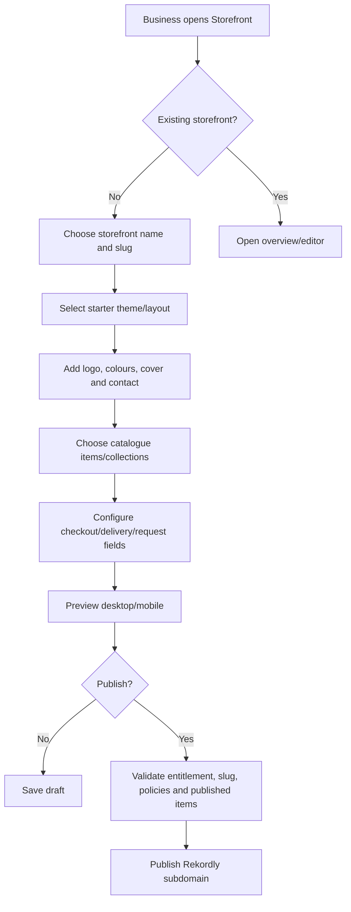
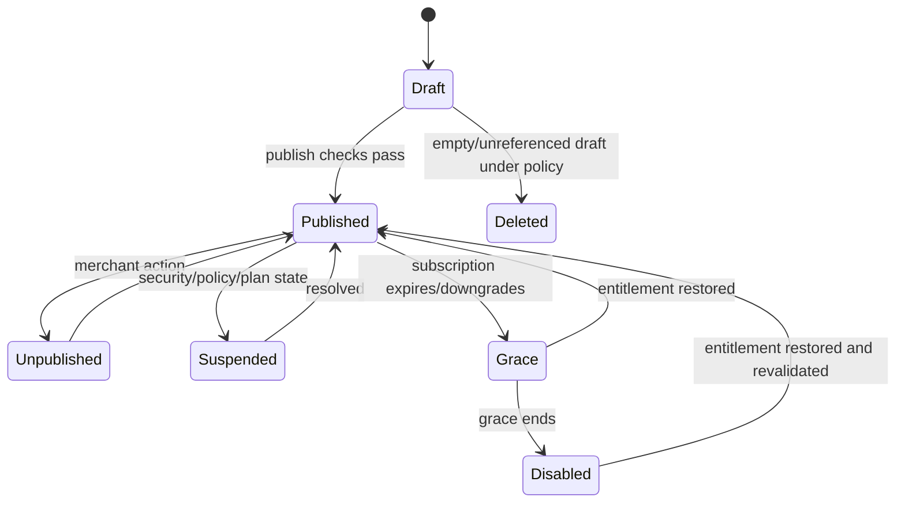
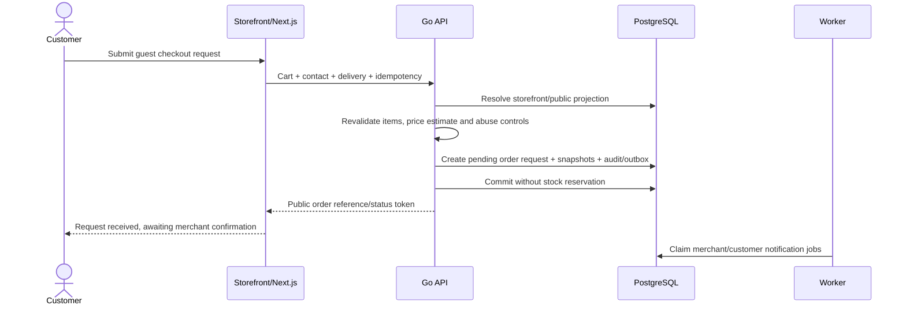
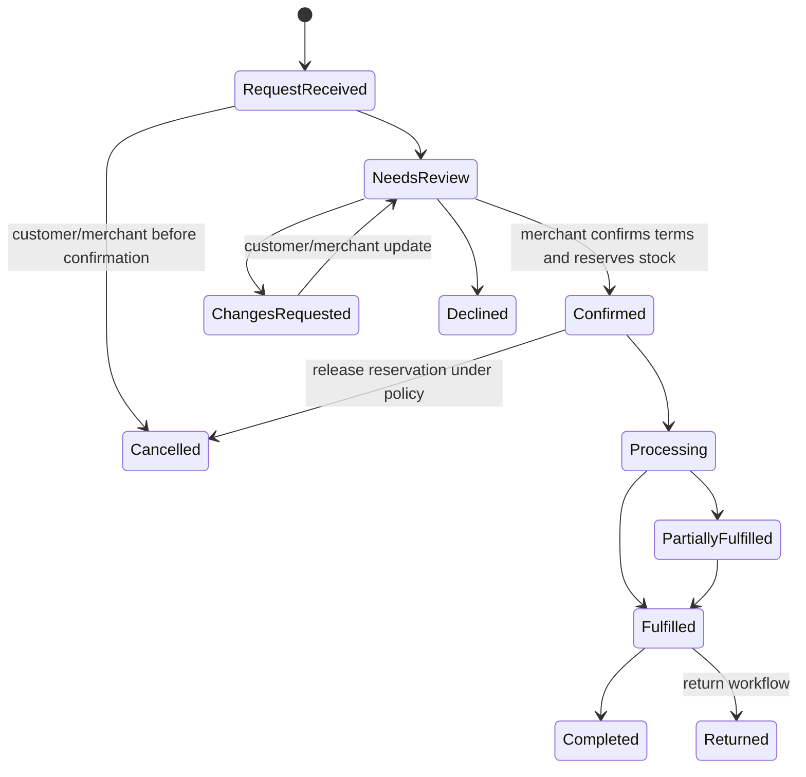
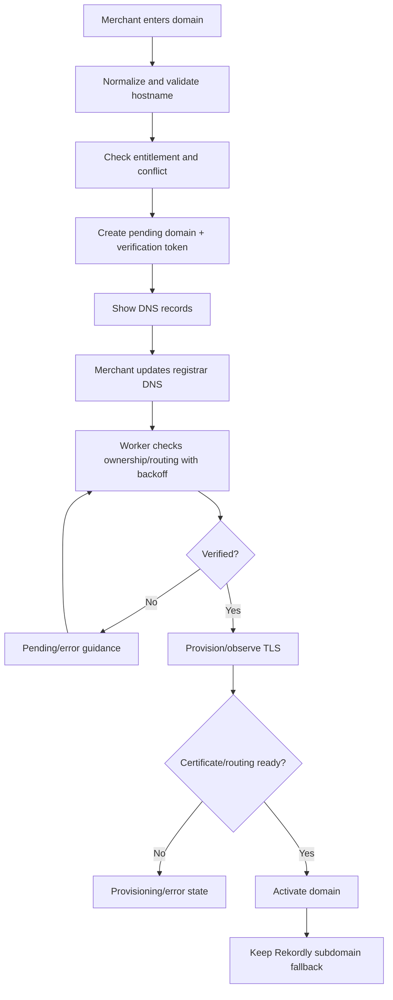

# Storefront, Orders, Domains and Fulfilment Blueprint

**Status:** Complete draft  
**Depends on:** documents 00–08  
**Launch model:** Catalogue + cart + checkout request + merchant confirmation; online payment collection is deferred

## 1. Purpose

This blueprint defines:

- optional Business storefront creation;
- merchant customization and publication;
- public catalogue, search and product pages;
- Rekordly subdomains and connected custom domains;
- guest cart and checkout-request capture;
- customer/contact handling without mandatory accounts;
- merchant order review and price/stock confirmation;
- stock reservation, fulfilment, cancellation and returns;
- order-to-sale/invoice/payment relationships;
- plan/downgrade/domain lifecycle;
- security, SEO, privacy, abuse and operational behavior.

The initial storefront does not collect online payment. A customer submits an order request; the merchant confirms availability, price, delivery and payment arrangements.

## 2. Storefront versus internal business system

The storefront is a public projection of selected Business data, not direct public access to the internal catalogue/database.

Internal catalogue may contain:

- inactive/draft items;
- supplier/cost/margin data;
- internal notes;
- outlet stock details;
- private prices;
- batch/serial information;
- accounting mappings.

Public projection contains only allowlisted published fields. It never exposes cost, margin, supplier, internal stock movement, customer data or accounting information.

## 3. Storefront information architecture

### Merchant admin

- Overview/status
- Appearance
- Catalogue visibility
- Collections/navigation
- Orders
- Contact and policies
- Delivery/checkout settings
- Rekordly subdomain
- Custom domain
- SEO/share preview
- Analytics summary

### Public storefront

- Home
- Browse/all products
- Collection/category pages
- Search
- Product/service detail
- Cart
- Checkout request
- Order-request confirmation/status
- Contact/policies

Customer account/login is not required.

## 4. Storefront creation flow



Creating a storefront does not automatically publish every product.

## 5. Storefront states



Disabling storefront does not delete orders, settings, catalogue mappings or domain records. Admin read/export remains available.

## 6. Customization scope

### Launch customization

- theme/layout template selection;
- business logo/icon;
- primary/accent/background/text colours within accessibility constraints;
- cover/banner image;
- store display name and short description;
- featured products/collections;
- section ordering from an allowlisted set;
- contact details and WhatsApp/contact action;
- delivery/pickup information;
- business hours;
- return/privacy/terms/custom policy text;
- social links;
- SEO title/description/share image;
- subdomain/custom domain.

### Not launch customization

- arbitrary HTML/JavaScript/CSS;
- plugin marketplace;
- custom checkout code;
- theme source editing;
- advanced page builder;
- online-payment/shipping-rate engines;
- coupon/abandoned-cart automation unless later approved.

This provides meaningful customization without allowing unsafe code or a second website-building product.

## 7. Design tokens and accessibility

Merchant settings compile into safe storefront tokens:

- color palette;
- type scale from approved fonts;
- radius/density choices;
- image treatment;
- section variants.

Rules:

- Validate text/background contrast.
- Provide fallback when merchant colors fail accessibility.
- Restrict font choices/weights to performant allowlist.
- Sanitize all text/links.
- Optimize images through Cloudinary.
- Mobile preview is mandatory before publish.
- Checkout/status actions remain visually consistent and accessible across themes.

## 8. Catalogue publication

Internal active catalogue item is not automatically public.

Publication fields:

- storefront visible flag;
- public title/description snapshot or controlled override;
- public images;
- visible variants;
- public price/price list;
- category/collection placement;
- availability display policy;
- featured/order;
- SEO slug/title/description;
- contact/request-only behavior for selected items later.

### Eligibility

An item can publish only when:

- product/service and variant are active;
- public title and valid price/contact behavior exist;
- currency supported by storefront;
- required image/policy fields pass configuration;
- stock policy is valid for tracked items;
- item is not archived/quarantined;
- merchant has publication permission/entitlement.

## 9. Public availability

Options for tracked goods:

- In stock / Out of stock only
- Exact available quantity, optional and generally not default
- Low stock indicator
- Hide when unavailable
- Allow request when unavailable, explicitly labeled and not reserved

Public availability derives from selected fulfilment outlet/pool and `available = on_hand - reserved`, with caching/as-of behavior.

Public display is informative until merchant confirms the order. Cart never guarantees stock.

Services/non-stock items use available/unavailable/manual confirmation settings, not inventory quantity.

## 10. Search and browse

Searchable public fields:

- public title;
- public description;
- SKU only when merchant publishes it;
- categories/collections/tags.

Filters may include category, price range, availability and variant options.

Rules:

- Search only published projection.
- No internal notes/supplier names/cost fields in index.
- Results are scoped by storefront host.
- Pagination is bounded.
- Search terms are privacy-minimized in analytics/logging.
- Empty result suggests browse/contact without leaking hidden products.

## 11. Product page

Displays:

- public images;
- title/description;
- price/currency/tax wording;
- variant selectors;
- availability indicator;
- quantity selector within safe limits;
- collection/category/breadcrumb;
- delivery/request information;
- add-to-cart/contact action;
- merchant public policies.

Variant selection determines public price/availability. Disabled combinations are explained.

Public page does not expose internal outlet quantities unless enabled, cost, margin, supplier, batch, serial or accounting data.

## 12. Cart model

Cart may be:

- signed opaque cookie/local identifier with server cart;
- local cart submitted/validated at checkout;
- hybrid, selected during implementation.

Cart fields:

- storefront;
- lines with variant/service ID, quantity and display snapshot;
- created/updated/expiry;
- optional guest/session context;
- version.

Rules:

- Adding to cart does not reserve stock.
- Cart price is an estimate until checkout validation/merchant confirmation.
- Server revalidates product visibility, price, variant and maximum quantity.
- Expired/unpublished item is flagged for removal.
- Cart belongs to one storefront/currency.
- Cart IDs are unguessable and do not expose customer data.
- Cart expiry cleans transient data under retention policy.

## 13. Cart calculation

1. Load published items for host/storefront.
2. Validate selected variants and quantities.
3. Recompute public price/tax estimate server-side.
4. Apply no unimplemented coupon/shipping assumptions.
5. Return line subtotal/tax/estimated total and availability warnings.
6. Label delivery charge as pending when merchant confirmation is required.

Client-submitted line totals are never trusted.

## 14. Checkout request fields

Required/conditional:

- customer name;
- phone and/or email according to merchant contact policy;
- delivery or pickup choice;
- address when delivery selected;
- requested quantities/variants;
- note/instructions optional;
- preferred contact method;
- acknowledgement of merchant policies;
- idempotent submit token.

Optional:

- organization name;
- landmark;
- preferred delivery time/request;
- existing customer reference through verified link later.

No password/account creation is required.

## 15. Checkout-request validation

- Storefront published/eligible.
- Items still published and active.
- Quantity within configured public limits.
- Price/tax estimate recomputed.
- Contact fields syntactically valid and size-limited.
- Address sanitized and required only for delivery.
- Policy acknowledgement version recorded.
- Abuse/rate limits and bot signals pass.
- Idempotency prevents duplicate order requests from repeated submit.

Stock may be checked for user guidance, but no reservation occurs yet.

## 16. Order-request creation



Effects:

- create order/request and line snapshots;
- optional create/suggest customer party under dedupe policy;
- no stock movement;
- no reservation;
- no receivable/revenue/tax/payment;
- notify merchant and optionally customer.

## 17. Order states

Use separate commercial, fulfilment and payment dimensions.

### Commercial state

- request_received;
- needs_review;
- quote_changes_requested;
- confirmed;
- declined;
- cancelled;
- completed.

### Fulfilment state

- unreserved;
- reserved;
- partially_fulfilled;
- fulfilled;
- returned.

### Payment state

- not_requested;
- unpaid;
- partially_paid;
- paid;
- refunded/partially_refunded.



## 18. Merchant order review

Merchant sees:

- customer/contact/delivery request;
- item/variant/quantity snapshots;
- current product/price/available stock comparison;
- estimated versus merchant-confirmed delivery fee/terms;
- customer note;
- duplicate/suspicious request signals;
- existing customer match suggestions;
- proposed fulfilment outlet;
- payment arrangement.

Actions:

- confirm as submitted;
- edit/confirm permitted price/delivery details with customer-visible change summary;
- request customer clarification;
- decline with optional reason;
- cancel duplicate/spam;
- create/associate customer;
- create invoice/proforma/deposit request according to workflow.

Customer data from checkout is untrusted and does not automatically overwrite an existing party record.

## 19. Order confirmation and reservation

Confirmation is the binding operational event for launch.

Algorithm:

1. Authenticate merchant and require order-confirm permission/outlet scope.
2. Validate order version/state/idempotency.
3. Resolve final lines, prices, tax estimate, delivery terms and fulfilment outlet.
4. Lock stock states for tracked variants in deterministic order.
5. Compute current available quantities.
6. Require all requested tracked quantities available under MVP all-or-nothing policy.
7. Create active reservations.
8. Snapshot confirmed commercial terms/version.
9. Transition order to confirmed/reserved.
10. Optionally create proforma/invoice draft or deposit request; do not silently post unless configured command explicitly includes it.
11. Audit/outbox/idempotency and commit.

If stock changed, return current availability and let merchant revise/decline. Never silently reduce customer quantity.

## 20. Partial availability

MVP merchant options:

- revise order quantities and send change for customer acknowledgement;
- choose alternate variant with explicit customer-visible change;
- decline unavailable lines/order;
- leave request pending until restock without reservation;
- split into confirmed available order plus separate pending request only through explicit action.

Do not create hidden partial reservations while customer/merchant believes full order is confirmed.

## 21. Reservation expiry

Merchant may configure/respect a reservation expiry for unpaid/uncollected orders.

Rules:

- Store expiry timestamp and policy version.
- Worker finds due reservations through bounded jobs.
- Recheck current order/payment/fulfilment state before release.
- Release only unfulfilled quantity.
- Transition order to expired/needs review/cancelled according to policy.
- Notify merchant/customer when appropriate.
- Job is idempotent; repeated run cannot release twice.

Initial launch may use manual cancellation/release if automated expiry adds risk. The state model still supports it.

## 22. From order to invoice/sale

Options:

- Create proforma/deposit request before fulfilment.
- Create invoice at confirmed/delivery event according to accounting policy.
- Confirm direct sale with payment.
- Fulfil first and invoice under approved workflow.

Rules:

- Conversion creates linked source documents with snapshots.
- Revenue/receivable occurs only through invoice/sale recognition command.
- Stock issue/COGS occurs only at fulfilment/direct-sale event.
- Reservation prevents oversell but is not stock issue.
- Payment uses document 04 and never duplicates sale revenue.

## 23. Fulfilment

### Fulfilment fields

- order and lines;
- outlet;
- quantity fulfilled;
- batch/serial picks;
- pickup/delivery method;
- dispatch/pickup date;
- recipient/delivery evidence optional;
- note/status.

### Algorithm

1. Require fulfil permission/outlet scope.
2. Lock order/reservations/stock/cost state.
3. Validate unfulfilled quantity and reservation.
4. Validate batch/serial identity.
5. Create stock issue and consume FIFO/weighted-average cost.
6. Reduce/fulfil reservation.
7. Post COGS/Inventory journal exactly once.
8. Transition fulfilment/order state.
9. Create delivery/status event and notifications.
10. Commit atomically.

Service/non-stock lines complete operationally without stock movement.

## 24. Pickup and delivery

Launch supports merchant-defined simple methods:

- pickup;
- merchant-arranged delivery;
- customer-arranged delivery/contact.

Merchant can set:

- available methods;
- service areas/text guidance;
- estimated/manual delivery fee;
- address/instruction fields;
- public contact/hours.

Automated carrier rates, tracking-provider integrations and complex shipping zones are deferred unless explicitly added.

Delivery status is not financial payment status.

## 25. Cancellation

### Before merchant confirmation

- Cancel request; no stock/financial reversal.

### After reservation, before fulfilment

- Release remaining reservation atomically.
- Cancel linked draft/proforma under its own rules.
- Refund/deposit resolution is separate if money was received.

### After partial fulfilment

- Cancel only unfulfilled remainder.
- Fulfilled quantity requires return/credit/refund workflow.

### After full fulfilment

- Cannot simply cancel; use return/correction.

Reason, actor and customer-visible message are recorded.

## 26. Customer order status portal

Guest receives an opaque public status token/link.

May show:

- merchant identity/contact;
- public order reference;
- requested/confirmed lines and changes;
- commercial/fulfilment/payment summary permitted by policy;
- pickup/delivery information;
- messages/clarification;
- cancel request when allowed;
- related invoice/receipt links when explicitly shared.

Does not show internal stock, cost, notes, staff, fraud flags or other customer/order data.

Registration is optional. Claim/link uses document 05.

## 27. Customer update/acknowledgement

If merchant changes confirmed price, quantity, variant or delivery terms before final confirmation:

- produce a customer-visible change summary;
- require acknowledgement where policy/materiality demands;
- bind acknowledgement to exact order version;
- stale acknowledgement fails and shows current version;
- no stock reservation until final merchant confirmation/acknowledgement sequence completes under selected policy.

## 28. Returns

Order return delegates to documents 06–07:

- reference fulfilled order/sale lines;
- validate eligible quantity;
- record condition and stock routing;
- credit note/customer credit separately;
- refund separately;
- update public return status without exposing internal accounting.

## 29. Rekordly subdomain

Format:

```text
business-slug.rekordly.com
```

### Slug rules

- normalized lowercase ASCII/IDN-safe policy;
- length and character limits;
- global uniqueness;
- reserved words/brands/security terms blocked;
- profanity/abuse policy;
- no misleading Rekordly/system impersonation;
- changes limited/rate-controlled with redirects policy.

### Resolution

1. Edge/frontend receives Host.
2. Normalize host safely.
3. Resolve active verified `storefront_domain` mapping.
4. Require published/entitled storefront.
5. Render public projection.
6. Unknown/inactive host returns safe branded unavailable/not-found page.

Never trust arbitrary Host to select workspace without validated mapping.

## 30. Custom domain connection

Merchant owns/purchases domain elsewhere. Rekordly initially supports connection, not registration/resale.

### Flow



### Supported hostname policy

- apex domain and/or subdomain according to selected edge provider capability;
- no URL paths, protocols or ports in input;
- IDN normalized/punycode with phishing review safeguards;
- one active storefront owner per hostname;
- block Rekordly-owned/internal domains;
- verify before routing.

## 31. Domain states

- pending_dns;
- verifying;
- verified;
- certificate_provisioning;
- active;
- error;
- disconnected;
- grace;
- disabled.

Domain verification job:

- bounded polling/backoff;
- attempt/next-check metadata;
- no tight loop;
- user-triggered recheck with rate limit;
- sanitized DNS result diagnostics;
- idempotent activation.

## 32. Domain security

- Ownership proof through DNS record/challenge required.
- Prevent host-header spoofing by exact normalized active mapping.
- TLS required before activation.
- Protect against subdomain takeover after disconnect/deletion.
- Remove routing/certificate mapping when disabled according to provider process.
- Reverify material DNS changes/expiry as required.
- Do not disclose another merchant's domain ownership details on conflict.
- Store verification tokens safely and rotate on restart where appropriate.

## 33. Domain and storefront downgrade

When Business entitlement expires/downgrades:

1. Start clearly documented grace period.
2. Notify owner before and during grace.
3. Preserve admin data/settings/orders/export access.
4. After grace, disable custom-domain routing/storefront publication according to plan.
5. Keep data; do not delete domain/storefront configuration.
6. Rekordly subdomain behavior follows current plan entitlement.
7. On restoration, revalidate domain/TLS/storefront before republishing.

Visitors see a safe unavailable/contact page, not internal billing details.

## 34. SEO and indexing

- Published storefront/product pages may be indexable under merchant setting/policy.
- Draft, preview, cart, checkout, order-status and token pages are `noindex`.
- Canonical host selected between Rekordly and custom domain.
- Sitemap includes published public pages only.
- Structured data uses public accurate price/availability and does not overpromise confirmed stock.
- Unpublished/disabled products return appropriate status/redirect policy.
- Preview environments and staging are not indexed.

## 35. Abuse and public security

- Rate limit search, cart and checkout submissions.
- Bot/spam protection escalates based on signals.
- Sanitize all merchant/customer text.
- Validate links/social URLs.
- Strict CSP and security headers.
- No arbitrary merchant code.
- CSRF protection for cookie-backed cart/actions where applicable.
- Idempotency on checkout request.
- Minimize public PII and logs.
- Private order-status tokens hashed/scoped/expiring or revocable.
- Do not expose sequential order IDs.
- Attachment/message upload follows private controls.

## 36. Performance and caching

- Server-render public pages where practical.
- Cache public storefront projection by host/version.
- Invalidate on publish/catalogue/price/availability changes.
- Availability cache has short TTL/as-of indicator; confirmation rechecks database.
- Optimize responsive images through Cloudinary.
- Paginate catalogue/search.
- Keep JavaScript payload small for low-bandwidth mobile.
- Cart/checkout APIs have explicit timeouts and graceful retry/idempotency.

Cache never becomes stock authority.

## 37. Analytics

Merchant storefront analytics may include:

- public page/product/collection views;
- search usage with privacy minimization;
- add-to-cart;
- checkout started/submitted;
- order confirmed/declined/cancelled/fulfilled;
- source/referrer class;
- conversion funnel.

Rules:

- No sale of visitor/financial data.
- Avoid raw search/contact/address/note data.
- Consent/cookie requirements follow policy/law.
- Merchant cannot receive visitor identity before the visitor submits it legitimately.
- Analytics outage never blocks ordering.

## 38. Permissions

Representative capabilities:

- `storefront.view`
- `storefront.manage_appearance`
- `storefront.manage_catalogue`
- `storefront.manage_checkout`
- `storefront.publish`
- `storefront.manage_domain`
- `orders.view`
- `orders.review`
- `orders.confirm`
- `orders.fulfil`
- `orders.cancel`
- `orders.export`

Domain and publish permissions are sensitive. Order confirmation/fulfilment obey outlet scope and stock/cost visibility rules.

## 39. Offline behavior

Public storefront requires network; no offline checkout promise.

Merchant PWA may:

- view clearly stale cached order summaries;
- draft internal notes/status intent.

Must be online to:

- confirm/revise order;
- reserve/release stock;
- fulfil/cancel with effects;
- publish storefront/catalogue;
- verify domain;
- send customer message/document.

## 40. Data model

### `storefronts`

- business workspace;
- name/slug/status/theme/version;
- default fulfilment outlet/policy;
- publication/entitlement timestamps.

### `storefront_settings`

- tokenized appearance;
- contact/hours/policies;
- checkout/delivery settings;
- SEO/canonical configuration.

### `storefront_products`, `storefront_collections`

- product/variant visibility;
- public overrides/snapshots;
- price list;
- ordering/feature/SEO fields.

### `storefront_domains`

- normalized host/type;
- verification digest/state;
- TLS/routing state;
- entitlement/grace;
- created/verified/disabled metadata.

### `carts`, `cart_lines`

Transient, expiring visitor state with no reservation.

### `orders`, `order_lines`, `order_versions`

Customer/contact/delivery snapshots, commercial/fulfilment/payment states, source and public status token digest.

### `order_events`, `fulfilments`

Immutable transitions, merchant/customer acknowledgements and stock/source links.

## 41. API outline

### Merchant

| Method/path | Purpose |
|---|---|
| `POST /v1/businesses/{id}/storefront` | Create draft storefront |
| `PATCH /v1/businesses/{id}/storefront/settings` | Versioned settings edit |
| `PUT /v1/businesses/{id}/storefront/catalogue/{variant}` | Publish/configure item |
| `POST /v1/businesses/{id}/storefront/commands/publish` | Validate/publish |
| `POST /v1/businesses/{id}/storefront/commands/unpublish` | Unpublish safely |
| `GET /v1/businesses/{id}/orders` | Scoped order list |
| `POST /v1/businesses/{id}/orders/{order}/commands/request-change` | Create new commercial version |
| `POST /v1/businesses/{id}/orders/{order}/commands/confirm` | Reserve stock/confirm |
| `POST /v1/businesses/{id}/orders/{order}/commands/fulfil` | Issue stock/COGS |
| `POST /v1/businesses/{id}/orders/{order}/commands/cancel` | Release eligible reservation |
| `POST /v1/businesses/{id}/storefront/domains` | Start custom-domain verification |
| `POST /v1/businesses/{id}/storefront/domains/{domain}/commands/recheck` | Rate-limited recheck |
| `POST /v1/businesses/{id}/storefront/domains/{domain}/commands/disconnect` | Disable mapping |

### Public

Conceptual host-scoped APIs:

- storefront projection;
- published catalogue/search/product;
- cart validation;
- idempotent checkout request;
- opaque order-status view/action.

Public endpoints return allowlisted projections only.

## 42. Errors and recovery

Stable errors:

- `STOREFRONT_NOT_PUBLISHED`
- `SLUG_UNAVAILABLE`
- `PRODUCT_NOT_PUBLISHED`
- `CART_ITEM_CHANGED`
- `CHECKOUT_RATE_LIMITED`
- `ORDER_VERSION_CONFLICT`
- `ORDER_ALREADY_HANDLED`
- `INSUFFICIENT_STOCK`
- `RESERVATION_CONFLICT`
- `DOMAIN_INVALID`
- `DOMAIN_ALREADY_CLAIMED`
- `DOMAIN_VERIFICATION_PENDING`
- `DOMAIN_VERIFICATION_FAILED`
- `TLS_PROVISIONING_FAILED`
- `STOREFRONT_ENTITLEMENT_REQUIRED`

Cart/order errors preserve safe customer input and show changed items/terms for review. Duplicate checkout retry returns original order reference.

## 43. Notifications and Review

Merchant:

- new order request;
- clarification/customer acknowledgement;
- stock changed before confirmation;
- reservation nearing expiry;
- order ready/overdue for fulfilment;
- cancellation/return request;
- domain verified/error/TLS active;
- storefront grace/disablement;
- message/delivery failure.

Customer:

- request received;
- merchant requested changes/clarification;
- confirmed/declined/cancelled;
- ready/fulfilled;
- related invoice/receipt shared;
- return/refund status.

Financial/customer notification delivery failure does not roll back a valid order transition.

## 44. Acceptance and edge-case tests

### Store setup/publication

- Storefront is optional and draft by default.
- Publishing only exposes allowlisted selected catalogue fields.
- Cost, margin, supplier, internal notes and accounting never appear publicly.
- Merchant customization cannot inject code or inaccessible colors.
- Unpublished/archived product disappears under defined cache invalidation.

### Cart/checkout

- Add-to-cart creates no reservation.
- Server recalculates price and rejects/flags changed/unpublished variant.
- Checkout requires no Rekordly account.
- Duplicate submit returns same order request.
- Order request creates no stock, revenue, receivable, tax or payment.
- Contact/address input is sanitized and tenant-isolated.

### Confirmation/reservation

- Confirmation rechecks current price/terms/stock.
- All lines reserve atomically under MVP policy.
- Two merchants/orders cannot reserve same last unit.
- Partial availability requires explicit revision; no silent reduction.
- Reservation release is idempotent.

### Fulfilment/cancellation

- Fulfilment issues stock/COGS once and consumes reservation.
- Service/non-stock fulfilment creates no stock movement.
- Cancellation before confirmation has no stock effect.
- Cancellation after reservation releases exact remainder.
- Partial/full fulfilment cannot be simply cancelled; return workflow applies.
- Invoice/sale/payment remain separate and do not double-post.

### Domains

- Slug/domain normalized, unique and reserved terms blocked.
- Unknown Host cannot select arbitrary workspace.
- Custom domain never routes before verification/TLS readiness.
- Domain conflict leaks no owner details.
- Disconnect/grace prevents takeover and preserves admin data.
- Rekordly subdomain remains fallback under policy.

### Security/privacy

- Public order/status IDs are opaque.
- Order token cannot access another order/storefront.
- Rate limit/bot controls stop repeated spam without exposing internals.
- Token/query/contact data is redacted from analytics/logs.
- Staging/draft/cart/status pages are not indexed.

### Downgrade

- Grace is visible and notifications sent.
- Storefront/domain disables after grace without deleting settings/orders.
- Admin read/export continues.
- Restoration revalidates host/TLS/publication.

### Responsive/accessibility

- Browse, variant selection, cart and checkout work on low-width mobile.
- Theme preserves contrast/focus.
- Errors focus correct field and are not color-only.
- Customer can complete checkout/status actions without registration.

## 45. Implementation handoff checklist

- Public storefront is an allowlisted projection, not internal-table exposure.
- Customization uses safe tokens/templates, not arbitrary code.
- Cart and checkout request never reserve stock.
- Merchant confirmation is the reservation boundary.
- Fulfilment is the stock/COGS boundary.
- Sale/invoice/payment remain explicit linked commands.
- Guest checkout/status requires no account.
- Order/contact data is sanitized and privately scoped.
- Subdomain Host resolution uses exact active mapping.
- Custom domains require ownership verification and TLS.
- Downgrade disables publication without deleting business data.
- Public and merchant flows have idempotency/concurrency tests.

