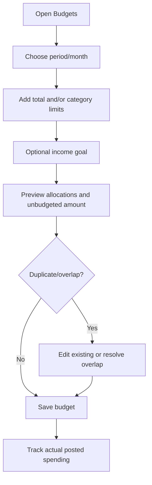
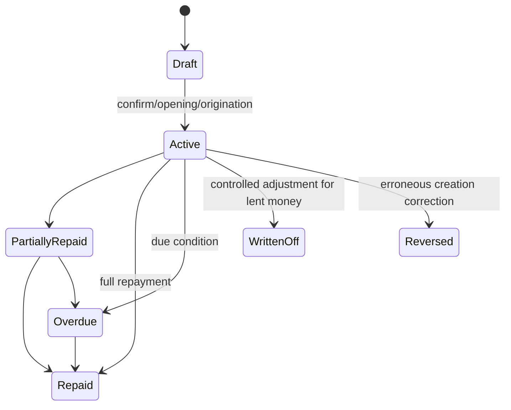
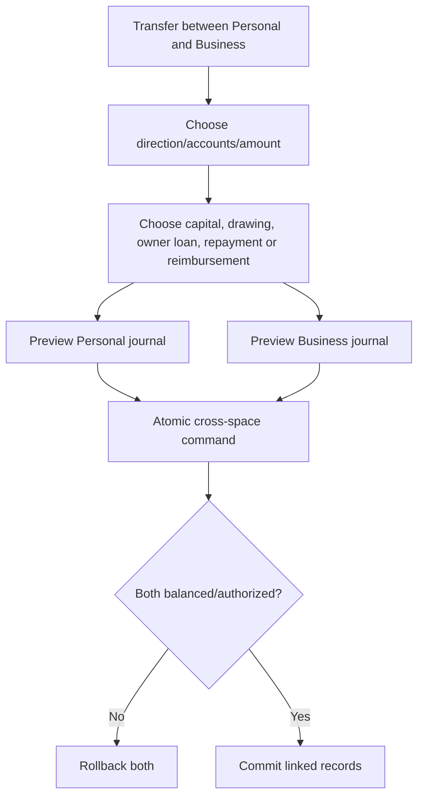

# Personal Finance, Budgets, Loans, Assets and Investments Blueprint

**Status:** Complete draft  
**Depends on:** documents 00–09  
**Core promise:** Show what came in, what went out, what remains and where it went—without judgment or fake precision

## 1. Purpose

This blueprint defines:

- Personal Home and Activity experiences;
- personal money accounts and opening balances;
- categories, tags and lifestyle spending views;
- monthly/category budgets and alerts;
- borrowed and lent money;
- loan repayments, principal and interest;
- investments and manual valuation;
- personal assets and disposals;
- owner transfers between Personal and Business;
- combined owner summaries without merged books;
- corrections, privacy, offline behavior and edge cases.

Savings goals remain deferred unless explicitly added later. Rekordly does not provide regulated investment, lending or credit-scoring services.

## 2. Personal navigation

Primary:

- Home
- Activity
- Budgets
- Accounts
- Reports
- More

More:

- Loans
- Investments
- Assets
- Categories
- Attachments
- Imports
- Settings
- Subscription
- Support

The interface uses plain language by default. Advanced accounting detail is available through source/effect expansion, not forced into everyday entry.

## 3. Personal Home

### Primary period summary

- Came in
- Went out
- Net cash movement/remaining change
- Current account balances

The wording must distinguish:

- period inflow/outflow;
- current account balance;
- income/expense;
- transfers;
- borrowed/loan principal;
- investment/asset movements.

Borrowed money is cash inflow but not income. Transfer between own accounts is neither income nor expense.

### Supporting sections

- spending by category;
- budget progress;
- recent activity;
- upcoming loan due dates;
- unclassified/needs-review records;
- factual insights and comparisons;
- onboarding/activation checklist.

### Tone

- Neutral facts.
- No shame, moral scoring or manipulative warnings.
- Suggestions are optional and explain their basis.
- No unsupported financial advice.

## 4. Personal Home calculation

For a selected period:

```text
cash_inflow = posted money-in movements into Personal money accounts
              excluding transfers between own Personal accounts

cash_outflow = posted money-out movements from Personal money accounts
               excluding transfers between own Personal accounts

income = posted income-category effects
expense = posted expense-category effects

net_cash_movement = cash_inflow - cash_outflow
net_income = income - expense
```

Cash flow and income/expense are presented separately when loans, investments, asset purchases or owner transfers create material differences.

All calculations use posted records/minor units and return as-of time/currency.

## 5. Personal Activity

Filters/tabs:

- All
- Income
- Expenses
- Transfers
- Loans
- Investments
- Assets
- Drafts/needs review

Each row/card shows:

- direction/purpose icon and text;
- amount/currency;
- account;
- category/counterparty;
- effective date;
- status/source/attachment indicator;
- Personal/Business/mixed link where relevant.

Lists use cursor pagination and bounded date defaults. Drafts are visibly excluded from posted totals.

## 6. Personal money accounts

Types:

- cash;
- bank/current/savings;
- mobile wallet;
- credit/card liability when explicitly supported;
- clearing/unclassified account;
- other controlled type.

Fields:

- display name;
- type;
- currency;
- optional institution/masked reference;
- opening balance through separate command;
- active/archived state;
- display order/icon/color.

Rules:

- Creating an account creates no balance.
- Balance derives from posted ledger/money movements.
- Account currency becomes constrained after activity.
- Archive preserves history and excludes new selection.
- Account with nonzero balance can be archived with warning but remains in reports.
- Sensitive full bank credentials/account numbers are not required/stored.

## 7. Opening balances

Opening account balance represents value before Rekordly tracking.

Required:

- account;
- amount and debit/credit direction derived from account type;
- as-of date;
- balancing opening-equity/migration account;
- optional note/evidence.

Rules:

- Not current-period income/expense.
- Idempotent and auditable.
- Correct through reversal/replacement.
- Imported statements after opening date must avoid duplicate history.
- Credit-account opening liability uses correct liability/equity treatment.

## 8. Categories and lifestyle insight

Default Personal categories are editable and may include:

- salary/earned income;
- gifts/support received;
- food/groceries;
- transport/fuel;
- housing/rent;
- utilities/data;
- health;
- education;
- family/support given;
- entertainment;
- clothing/personal care;
- fees/charges;
- unclassified income/expense;
- other.

Rules:

- Category maps to valid accounting behavior.
- Renaming does not rewrite historical journal effects.
- Archive prevents new selection but preserves history.
- Parent/group categories may support reporting.
- Tags provide cross-category context without changing accounting.
- AI suggestions require confirmation.

## 9. Spending insight

Views:

- spending by category;
- merchant/counterparty where data exists;
- account/payment source;
- weekly/monthly trend;
- period comparison;
- recurring-pattern suggestion later;
- necessary/discretionary classification only if user explicitly configures it.

Rules:

- Transfer, loan principal, investment purchase and asset purchase are not ordinary lifestyle expense unless policy/report explicitly chooses cash-outflow view.
- Refunds reduce/offset the correct category through linked correction, not become unrelated income.
- Mixed records use Personal portion only.
- Report states basis and excluded classes.
- Insight text references calculated facts and does not diagnose behavior.

## 10. Budget concepts

### Period budget

A planned limit/target for a calendar month or configured period.

### Category budget

Maximum/target spending for one category/group.

### Income goal

Optional planned income amount; not a receivable or guaranteed result.

### Rollover

Deferred or disabled for initial release unless explicitly configured, because rollover semantics add complexity. Default budgets reset per period while history remains.

## 11. Budget creation flow



### Fields

- workspace/period/timezone;
- category/group;
- limit minor/currency;
- alert thresholds;
- note;
- active/version.

Budget values are plans, not ledger entries.

## 12. Budget actual algorithm

```text
actual_minor = sum(posted eligible Personal expense effects
                   for category descendants
                   whose effective date is within budget period
                   excluding voided/reversed effects)

remaining_minor = budget_limit_minor - actual_minor
usage_percent = actual_minor / budget_limit_minor
```

Rules:

- Use Personal portion of mixed records.
- Refund/reclassification adjusts actual under linked effective-date policy.
- Transfers, loan principal, investment purchases and asset acquisitions are excluded from normal spending categories unless the budget explicitly targets their cash-flow category.
- Unclassified expense appears separately and can be included in total spending budget under policy.
- Multi-currency budgets require supported base-currency conversion or separate currency budgets; never sum currencies raw.

## 13. Budget alerts

Threshold examples:

- 50%
- 80%
- 100%
- over by configured amount/percentage.

Rules:

- Evaluate after confirmed posting/reversal/reclassification.
- Deduplicate alerts per budget/period/threshold crossing.
- If spending falls below then crosses again, policy controls repeat notification.
- Alert states fact and optional action: review activity, adjust budget or disable alert.
- No shaming language.
- Alert failure never affects financial posting.

## 14. Budget state and edits

- Draft/active/completed/archived.
- Editing limit changes plan prospectively/current period with history/version.
- Editing budget does not alter transactions.
- Category deletion/archive keeps historical budget/report context.
- Copy previous period creates a new draft/version.
- Completed period remains viewable.

## 15. Loans overview

Directions:

- Borrowed: user owes lender.
- Lent: another party owes user.

Loan record is a subledger of principal and events, not a manually editable balance.

Fields:

- direction;
- counterparty;
- principal/currency;
- start/effective date;
- due date/term;
- interest arrangement;
- repayment schedule optional;
- linked receiving/paying account;
- notes/evidence;
- status.

Rekordly tracks records; it does not originate/custody regulated loans.

## 16. Borrowed-loan creation

When cash is received:

| Debit | Credit |
|---|---|
| Cash/Bank | Loan Payable |

Borrowed principal is cash inflow but not income.

If recording an existing opening loan without new cash:

- use opening balance/migration command;
- do not create current cash inflow;
- capture outstanding principal as of date.

## 17. Loan repayment

Repayment allocation may include:

- principal;
- interest;
- fees.

Journal:

| Debit | Credit |
|---|---|
| Loan Payable (principal) | Cash/Bank total |
| Interest Expense | |
| Fee Expense | |

Rules:

- Principal allocation cannot exceed outstanding principal.
- Total components equal payment exactly.
- Interest/fee fields use explicit categories/accounts.
- Payment method split follows document 04 where supported.
- Reversal restores principal/interest effects atomically.
- Due/schedule status derives from events.

## 18. Money lent

When money is lent:

| Debit | Credit |
|---|---|
| Loan Receivable | Cash/Bank |

Principal collection:

| Debit | Credit |
|---|---|
| Cash/Bank | Loan Receivable |

Interest received:

| Debit | Credit |
|---|---|
| Cash/Bank | Interest Income |

Principal lent is cash outflow but not an expense. Principal received is cash inflow but not income.

## 19. Loan balance algorithm

Borrowed:

```text
outstanding_principal = originated/opening principal
                        + approved principal increases
                        - active principal repayments
                        - approved principal forgiveness/adjustment
```

Lent uses the corresponding receivable events.

Balance cannot become negative. Overpayment requires correction, advance treatment if explicitly supported, or reduced amount.

## 20. Loan states



Overdue is derived from due date/schedule/outstanding, not a manually arbitrary flag.

## 21. Loan schedule

Optional simple schedule:

- due date;
- expected total/principal/interest;
- status from actual repayments;
- reminder preference.

Initial release need not implement amortization generation unless selected. If provided, schedule calculation must specify rate method, compounding, day count and rounding; otherwise allow manually entered expected instalments without claiming lender-grade calculation.

## 22. Loan reminders

- upcoming due;
- due today;
- overdue;
- repayment recorded;
- loan completed.

Reminder is informational and deduplicated. It never auto-posts a payment.

## 23. Investments

Initial scope is manual tracking, not brokerage connectivity or live market advice.

Investment types may include:

- shares/funds;
- fixed income;
- crypto/manual digital asset;
- cooperative contribution;
- other user-defined investment.

Fields:

- name/type;
- institution/platform optional;
- currency;
- acquisition/contribution events;
- units quantity fixed decimal where applicable;
- cost basis;
- manual valuation/as-of date;
- income/distribution events;
- disposal events;
- notes/evidence.

## 24. Investment events

### Purchase/contribution

| Debit | Credit |
|---|---|
| Investment Asset | Cash/Bank |

Cash outflow, not lifestyle expense by default.

### Income/distribution

| Debit | Credit |
|---|---|
| Cash/Bank or Receivable | Investment Income |

### Manual valuation

- Creates a valuation snapshot/projection by default.
- Does not post unrealized gain/loss unless Rekordly explicitly supports a reviewed accounting policy.
- Displayed as user-provided estimate with as-of date/source.

### Disposal

- Cash proceeds;
- remove cost basis under supported method;
- calculate realized gain/loss only when sufficient reliable inputs exist;
- otherwise show proceeds/cost with limitation and require review.

## 25. Investment valuation

```text
current_manual_value = latest valid valuation snapshot
unrealized_change_display = current_manual_value - remaining cost basis
```

Display is informational and timestamped. Never imply live market value if user entered it manually.

Multi-currency comparison requires explicit base-rate/as-of basis.

## 26. Assets

Examples:

- vehicle;
- property;
- electronics/equipment;
- valuable personal item;
- other asset.

Fields:

- name/type;
- acquisition date;
- acquisition cost/currency;
- linked payment/account;
- evidence;
- ownership/status;
- manual valuation/as-of date;
- disposal details.

Initial scope is tracking. Automatic depreciation/appraisal is deferred unless explicitly added.

## 27. Asset acquisition

Cash purchase:

| Debit | Credit |
|---|---|
| Personal Asset | Cash/Bank |

It is cash outflow but not ordinary expense in accounting view. Lifestyle cash-flow view may show acquisition under a separate asset-purchase class.

Opening existing asset uses opening/migration equity and creates no current cash movement.

## 28. Asset valuation and disposal

### Valuation

- Manual value and as-of date/source.
- Informational projection unless reviewed posting policy exists.
- Does not overwrite acquisition cost/history.

### Disposal

Capture:

- date;
- proceeds and money account;
- disposal costs;
- buyer/counterparty optional;
- evidence;
- asset cost/basis.

Post asset removal and gain/loss only under a defined deterministic policy. Otherwise use a controlled review state rather than guessing.

## 29. Owner transfers between Personal and Business

Personal and Business remain separate books.

### Personal pays money into Business

Possible meanings:

- owner capital contribution;
- owner loan to Business;
- reimbursement/repayment of Business obligation.

### Business pays money to Personal

Possible meanings:

- owner drawing/distribution;
- salary/compensation through valid payroll/expense workflow if supported;
- reimbursement of Business expense paid personally;
- repayment of owner loan.

User must choose meaning. Rekordly never records these automatically as sales revenue or ordinary personal income/Business expense without the correct source.

## 30. Cross-space owner-transfer algorithm

1. Owner initiates transfer and selects Personal/Business accounts.
2. Select economic purpose.
3. Validate ownership/access to both workspaces and account currencies.
4. Compute paired posting templates.
5. Lock both workspace command/idempotency/account states.
6. Post separate balanced journal in each workspace, linked by transfer group.
7. Verify neither side becomes income/expense incorrectly.
8. Commit both or roll back both.
9. Show each book's effect and combined cash movement.



Exact due-to/from-owner account templates require accounting-rulebook sign-off.

## 31. Mixed expense versus owner transfer

Mixed expense:

- one external payment has Personal and Business portions.

Owner transfer/reimbursement:

- one workspace/person pays for another workspace's obligation or moves funds between owned accounts.

The UI asks:

- “Was one purchase partly personal and partly business?” → Mixed allocation.
- “Did Personal pay something entirely for Business?” → Owner reimbursement/contribution/loan workflow.

This distinction prevents treating all Business expenses paid personally as mixed consumption.

## 32. Combined owner summary (`All`)

Available only to an owner with Personal and owned Business workspace(s).

Shows:

- each workspace's balances and period movement;
- Personal spending/budget summary;
- Business cash/sales/expense/receivable/payable summary;
- combined cash-position view where currencies/basis permit;
- owner-transfer eliminations/labels to avoid double-counting movement;
- alerts grouped by workspace;
- source drill-down.

Does not:

- merge ledgers/accounts/categories;
- create consolidated legal financial statements;
- include invited Business workspace private data by default;
- let user post without target selection;
- net Business payable/receivable against Personal values.

## 33. Combined-summary algorithm

1. Resolve owner-authorized workspaces.
2. Query separate workspace summaries under their own rules.
3. Normalize time range/timezone presentation carefully.
4. Keep currency buckets separate or convert using explicit as-of rates with label.
5. Identify linked owner-transfer groups.
6. For combined cash movement, eliminate mirrored internal transfer inflow/outflow when both sides included.
7. Do not eliminate independent income/expense or external payments.
8. Return workspace-attributed totals plus combined derived view and as-of metadata.

Combined projection is rebuildable and never journal authority.

## 34. Reports

Personal reports:

- income versus expense;
- cash movement;
- spending by category;
- account balances/activity;
- budget versus actual;
- loan outstanding/events;
- investment cost/manual value/income;
- asset cost/manual value/disposal;
- period comparison;
- export.

Every report states:

- period/as-of;
- currency/basis;
- included/excluded transaction classes;
- stale/manual valuation status;
- source drill-down.

## 35. Corrections

- Drafts editable/deletable.
- Posted money/loan/investment/asset events immutable.
- Correct through reversal/replacement/reclassification.
- Loan principal repayment reversal restores outstanding.
- Investment/asset valuation snapshot may be superseded but history remains.
- Budget edit changes plan only, not transactions.
- Locked periods use permitted open-period adjustment.

## 36. Permissions and privacy

Personal workspace MVP is owner-only.

Rules:

- Business members cannot access Personal data.
- External recipients cannot access Personal workspace.
- Support/admin access requires explicit audited policy and least privilege.
- Product analytics excludes amounts, categories, account names, loan counterparties and asset/investment details.
- Sensitive local caches clear on logout.
- Export is always available to owner under plan promise.

## 37. Offline behavior

Allowed under document 15:

- manual Personal income/expense/transfer drafts;
- budget drafts/edits queued safely;
- loan/investment/asset draft capture;
- cached stale dashboard/activity.

Requires online/current validation:

- AI parsing;
- cross-space owner transfer;
- loan repayment where outstanding may change;
- final complex investment/asset disposal;
- imports/exports;
- confirmation against locked periods/changed permissions.

Queued items remain pending, not included in posted balances.

## 38. Data model

### `budgets`, `budget_lines`, `budget_alert_events`

Period/category limits, versions and threshold delivery state.

### `loans`, `loan_events`, `loan_schedule_items`

Direction/counterparty/currency/principal, origination/opening, principal/interest/fee/adjustment events and schedule.

### `investments`, `investment_events`, `investment_valuations`

Cost/contribution, quantity, income, disposal and manual valuation snapshots.

### `assets`, `asset_events`, `asset_valuations`

Acquisition/opening, disposal and manual valuation history.

### `owner_transfer_groups`

Links separate Personal/Business source records and journals without merging workspaces.

## 39. API outline

| Method/path | Purpose |
|---|---|
| `GET /v1/personal/{id}/dashboard` | Personal summary/as-of |
| `GET /v1/personal/{id}/activity` | Cursor/filter activity |
| `POST /v1/personal/{id}/budgets` | Create budget |
| `PATCH /v1/personal/{id}/budgets/{budget}` | Versioned plan edit |
| `POST /v1/personal/{id}/commands/open-borrowed-loan` | Loan origination/opening |
| `POST /v1/personal/{id}/commands/record-loan-repayment` | Principal/interest/fees |
| `POST /v1/personal/{id}/commands/lend-money` | Create loan receivable/cash outflow |
| `POST /v1/personal/{id}/investments` | Create investment shell/draft |
| `POST /v1/personal/{id}/commands/record-investment-event` | Purchase/income/disposal |
| `POST /v1/personal/{id}/investments/{investment}/valuations` | Manual valuation snapshot |
| `POST /v1/personal/{id}/assets` | Create asset shell/draft |
| `POST /v1/personal/{id}/commands/acquire-asset` | Acquisition/opening |
| `POST /v1/personal/{id}/commands/dispose-asset` | Controlled disposal |
| `POST /v1/owner/commands/transfer-between-spaces` | Atomic Personal/Business transfer |
| `GET /v1/owner/all-summary` | Authorized combined projection |

Every financial mutation requires idempotency and uses minor-unit/fixed-decimal rules.

## 40. Errors and recovery

Stable errors:

- `BUDGET_PERIOD_CONFLICT`
- `BUDGET_CURRENCY_MISMATCH`
- `LOAN_BALANCE_INSUFFICIENT`
- `LOAN_EVENT_COMPONENTS_MISMATCH`
- `VALUATION_DATE_INVALID`
- `ASSET_ALREADY_DISPOSED`
- `CROSS_SPACE_ACCESS_REQUIRED`
- `OWNER_TRANSFER_PURPOSE_REQUIRED`
- `OWNER_TRANSFER_CURRENCY_UNSUPPORTED`
- `PERIOD_LOCKED`
- `VERSION_CONFLICT`

Preserve draft values and reload current balances/state. Never silently reduce repayment or change owner-transfer purpose.

## 41. Notifications and Review

Review:

- unclassified Personal record;
- budget category changes/reclassification impact;
- loan repayment mismatch;
- stale/manual valuation;
- asset/investment disposal requiring details;
- cross-space owner-transfer classification;
- offline conflict.

Notifications:

- budget threshold;
- upcoming/overdue loan due;
- loan repaid;
- manual valuation stale reminder optional;
- owner transfer completed/failed;
- import/export ready.

## 42. Analytics

Safe events:

- `personal_dashboard_viewed`
- `budget_created/threshold_crossed`
- `loan_created/repayment_recorded/completed`
- `investment_event_recorded`
- `asset_created/disposed`
- `owner_transfer_confirmed`
- `all_summary_viewed`

Exclude amounts, account/category/party/asset/investment names and notes.

## 43. Acceptance and edge-case tests

### Dashboard/activity

- Income/expense and cash inflow/outflow differ correctly for loans, investments and transfers.
- Own-account transfer affects neither income nor expense.
- Draft/offline pending records do not affect totals.
- Mixed record contributes only Personal portion.
- Refund/reversal changes correct category/period under policy.

### Budgets

- Budget creates no journal.
- Actual uses posted eligible Personal expense only.
- Category hierarchy does not double-count.
- Refund/reclassification updates actual correctly.
- Threshold alert deduplicates.
- Currency mismatch is separated/converted explicitly.

### Loans

- Borrowed principal is liability, not income.
- Lent principal is receivable, not expense.
- Principal/interest/fees sum exactly to repayment.
- Repayment cannot make principal negative.
- Concurrent repayments cannot overpay.
- Opening loan creates no current cash movement.
- Reversal restores balance exactly.

### Investments/assets

- Investment/asset purchase is cash outflow but not ordinary expense.
- Manual valuation is timestamped/informational and does not overwrite cost.
- Disposal cannot repeat after disposed state.
- Gain/loss is not invented without sufficient basis.
- Opening asset creates no current cash movement.

### Owner transfers/All

- Personal→Business requires capital/loan/reimbursement purpose.
- Business→Personal does not become sales revenue automatically.
- Both workspace journals commit or both roll back.
- All summary eliminates mirrored owner transfer from combined cash flow without merging books.
- Invited Business data does not enter private All summary.
- Posting from All requires explicit target.

### Security/offline

- Business member cannot access Personal API/data.
- Cross-user Personal IDs fail.
- Offline pending items remain excluded from balances.
- Logout clears sensitive cached Personal data.

### Responsive/accessibility

- Dashboard, budget, loan and owner-transfer forms work on mobile.
- Charts have textual/table alternatives.
- Alerts are factual and not color-only.
- Manual valuation clearly states date/source.

## 44. Implementation handoff checklist

- Personal cash-flow and income/expense views are separately defined.
- Account creation cannot invent balance.
- Budget actual rules exclude transfers/principal/assets/investments appropriately.
- Loan principal, interest and fees are distinct.
- Investment/asset valuation is manual and labeled, not false live data.
- Owner transfers require purpose and paired atomic journals.
- Mixed expense and owner reimbursement are distinct workflows.
- All summary is a projection with transfer elimination, not merged ledger.
- Personal privacy boundary is tested against every Business role.
- Every financial event is immutable, idempotent and reversible through controlled commands.

