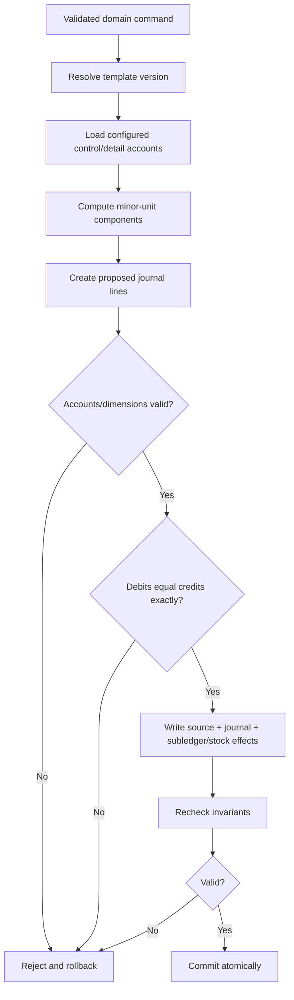
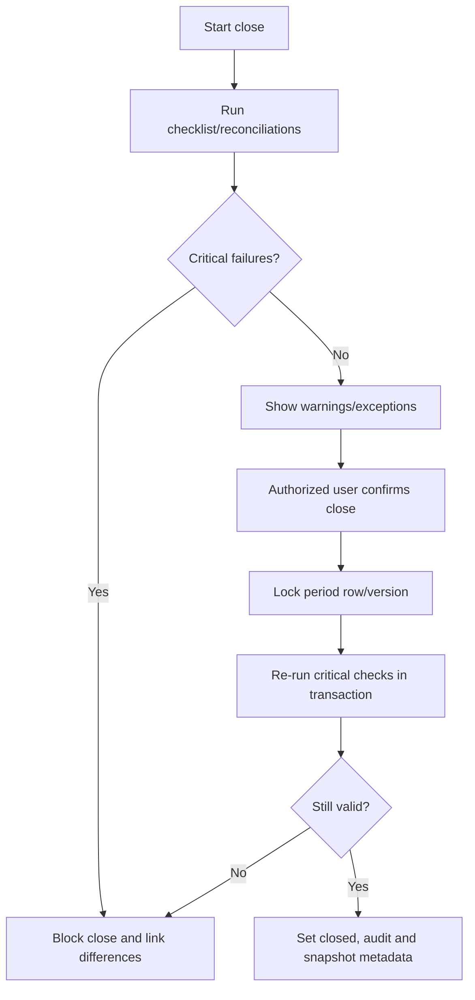
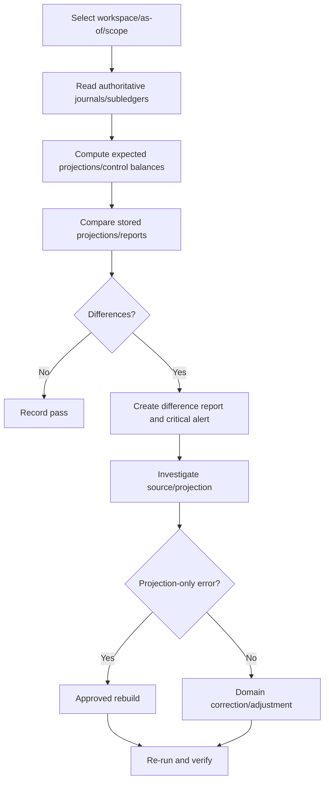

# Ledger, Reports, Tax and Period Close Blueprint

**Status:** Complete draft  
**Depends on:** documents 00–10  
**Authority rule:** Posted journals and immutable operational movements are financial truth; dashboards and reports are derived/rebuildable views

## 1. Purpose

This blueprint defines:

- chart of accounts and control accounts;
- deterministic posting templates;
- journal-entry and line invariants;
- source-to-ledger traceability;
- receivable, payable, deposit, advance, loan and inventory subledgers;
- trial balance, Profit and Loss, Balance Sheet and Cash Flow;
- cash-movement, aging, inventory-value and tax schedules;
- report drill-down and export;
- reconciliation and projection rebuild;
- accounting periods, close, lock and adjustments;
- opening balances, corrections and audit.

It does not replace professional tax/legal review. Rekordly records and reports from configured data; it does not promise automatic tax filing or audit certification.

## 2. Ledger principles

1. Every financial write produces a balanced journal.
2. Debit and credit totals are exact minor-unit integers per journal currency/base basis.
3. Journal lines are server-created from reviewed posting templates.
4. The frontend and AI never submit authoritative journal lines.
5. Posted journals are immutable; corrections use reversal/adjustment.
6. Every journal has a source type/ID and actor/system reason.
7. Control-account balances reconcile to their subledgers.
8. Drafts and unconfirmed AI/import records do not enter the ledger.
9. Reports identify period, basis, currency, filters and as-of time.
10. Projections can be rebuilt from authoritative sources.

## 3. Account classes

Top-level classes:

- Assets
- Liabilities
- Equity
- Revenue/Income
- Expenses

Representative subtypes:

### Assets

- Cash and bank
- Accounts Receivable
- Customer/other receivables
- Inventory
- Supplier advances
- Prepayments
- Loans receivable
- Investments
- Property/assets
- Tax recoverable
- Clearing/suspense where accounting policy places it

### Liabilities

- Accounts Payable
- Customer deposits
- Loans payable
- Tax/VAT/WHT payable
- GRNI/accrued purchases
- Accrued expenses
- Unidentified receipts

### Equity

- Owner capital
- Owner drawings/distributions
- Opening balance equity
- Retained earnings/current-year result projections

### Revenue

- Product sales
- Service revenue
- Other operating income
- Interest/investment income

### Expenses

- Cost of Goods Sold
- Operating expense categories
- Processing/bank fees
- Interest expense
- Inventory loss/adjustment
- Depreciation later if supported
- Tax/other expenses under valid policy

## 4. Chart of accounts

### System accounts

Protected accounts required by enabled modules, such as AR, AP, Inventory, COGS, GRNI, customer deposits, supplier advances and suspense.

Rules:

- Cannot be deleted while required/referenced.
- Type/control behavior cannot be changed arbitrarily.
- User-facing name/code may be configurable within constraints.
- One or more control accounts may exist by currency/outlet/policy, but mappings are explicit.

### User accounts

Permitted users can create valid detail accounts under approved types.

Fields:

- code/name;
- type/subtype;
- parent/report group;
- currency restriction where applicable;
- active/archived;
- control/system flags;
- description.

### Account validation

- Code unique within workspace policy.
- Parent/child types compatible.
- Cannot create cycles.
- Cannot convert an account to incompatible class after postings.
- Archive preserves journal history.
- Control-account direct manual posting is restricted.

## 5. Default chart templates

On workspace creation:

- create definitions only, no balances;
- Personal chart is simpler and hidden behind plain categories;
- Business chart supports accrual modules;
- enabled modules determine required control accounts;
- template version is stored;
- future template updates add/migrate safely without rewriting user history.

Default category mappings are reviewed separately from account definitions.

## 6. Journal model

### Journal entry

- workspace;
- source type/ID/version;
- entry type/template version;
- effective date and posted timestamp;
- transaction/base currency and exchange rate where relevant;
- description/reference;
- status: posted/reversed;
- reversal-of/reversed-by;
- idempotency/correlation/actor;
- accounting period.

### Journal line

- journal entry;
- account;
- debit minor and credit minor, exactly one positive side;
- transaction/base values where multi-currency applies;
- dimensions: party, outlet, product/variant, tax code, document, project later;
- description/source-line reference.

## 7. Journal invariants

For every posted entry:

```text
for each line:
    debit_minor >= 0
    credit_minor >= 0
    exactly one of debit_minor, credit_minor is > 0

sum(debit_minor) == sum(credit_minor)
sum(debit_minor) > 0
all accounts belong to workspace
all dimensions belong to workspace and permitted source
effective date belongs to open/allowed period
source is valid and idempotently linked
```

Database constraints enforce what they can. Application posting engine verifies complete balance/invariants before commit.

## 8. Posting-template registry

Each financial command maps to a versioned deterministic template, for example:

- `personal_expense.v1`
- `business_cash_sale.v1`
- `issue_service_invoice.v1`
- `collect_invoice.v1`
- `customer_deposit.v1`
- `goods_receipt_grni.v1`
- `approve_supplier_bill.v1`
- `supplier_bill_payment.v1`
- `inventory_sale_cogs.v1`
- `stock_adjustment_loss.v1`
- `owner_capital.v1`
- `loan_borrowed.v1`

Template resolves:

- eligible source/state;
- required accounts/dimensions;
- amount components;
- debit/credit rules;
- subledger/stock effects;
- validation messages;
- reversal template.

Changing a template creates a new version. Historical entries retain the version used.

## 9. Posting engine algorithm



The engine returns proposed effects for preview and finalized effects for posting using the same rules. Preview has no write authority.

## 10. Representative posting templates

### Business cash expense

| Debit | Credit |
|---|---|
| Expense/asset/tax recoverable | Cash/Bank |

### Service invoice

| Debit | Credit |
|---|---|
| Accounts Receivable | Revenue |
| | Tax payable where applicable |

### Invoice collection

| Debit | Credit |
|---|---|
| Cash/Bank | Accounts Receivable |

### Customer deposit

| Debit | Credit |
|---|---|
| Cash/Bank | Customer Deposits liability |

### Deposit application

| Debit | Credit |
|---|---|
| Customer Deposits liability | Accounts Receivable |

### Goods receipt before bill

| Debit | Credit |
|---|---|
| Inventory | GRNI |

### Matched supplier bill

| Debit | Credit |
|---|---|
| GRNI plus approved variance/tax effects | Accounts Payable |

### Supplier bill payment

| Debit | Credit |
|---|---|
| Accounts Payable | Cash/Bank |

### Inventory sale/fulfilment

Revenue side:

| Debit | Credit |
|---|---|
| Cash/AR | Sales revenue and tax payable |

Cost side:

| Debit | Credit |
|---|---|
| Cost of Goods Sold | Inventory |

## 11. Source-to-ledger drill-down

Every report/journal line supports:

```text
Report total
  → report row/account/category
    → journal entries
      → journal lines
        → source document/payment/stock movement
          → audit/reversal/related records
```

Rules:

- Authorization rechecked at every detail route.
- Users without cost/private-note permissions receive restricted source projections.
- Voids/reversals remain linked.
- No report total is an unexplained client-calculated number.

## 12. Subledgers

### Receivables

Sources:

- invoices/debit notes/opening AR;
- credits/returns;
- payment allocations;
- write-offs/adjustments.

Must reconcile to Accounts Receivable control account.

### Payables

Sources:

- supplier bills/opening AP;
- supplier credits;
- payment allocations;
- adjustments.

Must reconcile to Accounts Payable.

### Customer deposits

Deposits, applications, refunds and reversals reconcile to Customer Deposits liability.

### Supplier advances

Advances, applications, refunds and reversals reconcile to Supplier Advances asset.

### Inventory

Movements/cost layers/average state reconcile to Inventory and COGS.

### Loans

Principal events reconcile to loan receivable/payable accounts; interest/fees remain separate.

## 13. Reconciliation invariant

For every control account/as-of period:

```text
control account GL balance
== sum corresponding subledger balances
```

Differences are critical failures. Repair cannot be a direct balance edit; trace the missing/duplicate/incorrect source or post a controlled adjustment with reason and approval.

## 14. Trial balance

Inputs:

- workspace;
- as-of date/period;
- posted basis;
- currency/base currency;
- optional outlet/dimensions;
- include zero-balance accounts.

Rows:

- account code/name/type;
- opening debit/credit;
- period debit/credit;
- closing debit/credit.

Invariant:

```text
total closing debits == total closing credits
```

Trial-balance imbalance blocks trusted reporting/public launch and triggers critical alert.

## 15. Profit and Loss

For selected period:

- revenue;
- sales returns/allowances;
- net revenue;
- COGS;
- gross profit;
- operating expenses;
- other income/expense;
- net profit/loss.

Rules:

- Accrual basis uses revenue/expense recognition, not cash collection/payment.
- Cash movement report is separate.
- Voided/reversed entries net according to effective date/policy.
- Comparative periods use same mapping/basis.
- Drill-down to source.
- Personal workspace may use a simpler Income versus Expense report rather than formal P&L wording.

## 16. Balance Sheet

As-of report:

- assets;
- liabilities;
- equity.

Invariant:

```text
Assets == Liabilities + Equity
```

Current-period result is included in equity projection without requiring unsafe manual closing journal during open period.

Balance-sheet imbalance blocks trusted release and generates critical investigation.

## 17. Cash Flow Statement

Initial method: indirect or direct method must be selected explicitly. A simpler cash-movement report may ship before a formal statement if classification coverage is incomplete.

### Direct cash movement

Groups posted cash/bank movements into:

- operating;
- investing;
- financing;
- transfers excluded/eliminated;
- unclassified.

### Formal cash flow

Requires reliable account/activity mappings and reconciliation from opening to closing cash.

Invariant:

```text
opening cash + net cash movement == closing cash
```

Do not label a partial/inaccurate cash summary as a formal cash-flow statement.

## 18. Cash-movement report

Plain-language report:

- money in;
- money out;
- transfers;
- loan principal;
- investment/asset purchases/proceeds;
- owner capital/drawings;
- opening/closing cash/account balances.

This report answers cash behavior even when accrual P&L differs. It states included/excluded classes.

## 19. Receivable and payable aging

Buckets configurable/default:

- current/not due;
- 1–30 days;
- 31–60;
- 61–90;
- 90+.

For each open item:

```text
age_basis = as_of_date - due_date
outstanding = posted total - active credits - active allocations
```

Rules:

- Partial payments reduce outstanding.
- Customer deposits/supplier advances remain separate unless applied.
- Currency separated or converted explicitly.
- Credit balances shown separately.
- Drill-down to document/payment.

## 20. Inventory valuation and COGS reports

Inventory valuation:

- quantity by outlet/variant;
- FIFO remaining layers or weighted-average state;
- value/currency/base;
- as-of date;
- batch/expiry where permitted;
- GL reconciliation difference.

COGS report:

- sales/fulfilment source;
- issued quantity;
- FIFO layer/average cost;
- return/adjustment effects;
- GL COGS reconciliation.

Cost reports require `inventory.view_cost`/accounting permission.

## 21. Sales and purchase reports

Sales:

- gross/net sales;
- discounts;
- tax;
- returns/credits;
- collected versus outstanding;
- product/service/customer/outlet views;
- cash versus accrual distinction.

Purchasing:

- ordered/received/billed/paid;
- GRNI/unbilled receipts;
- supplier bills/payments/advances;
- price/quantity/tax variance;
- supplier returns/credits.

Reports must not sum PO commitments into expense/payable as if posted.

## 22. VAT schedule

Depending on configuration and legal review:

- output VAT from issued taxable sales/credit adjustments;
- input VAT from approved eligible purchases/bills/credits;
- taxable, zero-rated, exempt/out-of-scope bases;
- period totals;
- source document/customer/supplier references under permission;
- adjustments/reversals;
- net payable/recoverable indication.

Rules:

- Tax code/rate/basis snapshotted on source.
- Report reflects configured transaction data and limitations.
- Filing/payment remain explicit external/manual workflows unless a supported integration exists.
- Do not claim legal correctness without Nigerian accountant/tax review.

## 23. WHT schedule

Withholding tax may involve:

- customer withholding from payment;
- supplier withholding by business;
- receivable/payable tax certificates;
- payment/application timing.

It must not be modeled as arbitrary discount or processing fee.

Schedule includes:

- counterparty;
- source document/payment;
- tax type/rate/base/amount;
- certificate/reference/status;
- period;
- payable/receivable account effect.

Exact Nigerian WHT workflows/rates require current professional review before production claims.

## 24. Tax payment

Tax schedule/liability does not mean paid.

Tax payment command:

- select tax type/period/liability;
- money account/amount/date/reference;
- allocate to liability;
- post Cash/Bank reduction and tax payable reduction;
- retain evidence.

Over/underpayment remains explicit tax receivable/payable/advance under reviewed policy.

## 25. Report engine architecture

Inputs:

- workspace and authorized scope;
- report type/version;
- period/as-of;
- currency/basis;
- dimensions/filters;
- comparison;
- include/exclude options.

Engine:

1. Validate permission/filter/date bounds.
2. Resolve account/report mappings and report version.
3. Query posted journals/subledgers with workspace scope.
4. Aggregate in PostgreSQL where practical.
5. Apply deterministic report formulas.
6. Run report-specific balance/reconciliation checks.
7. Return rows/totals, as-of metadata, warnings and drill-down tokens/filters.
8. Cache only under workspace/filter/version key and invalidate on affected posting/period changes.

The same result feeds web, CSV and PDF.

## 26. Report state and warnings

Possible warnings:

- unclassified/suspense balances;
- unreconciled bank account;
- subledger/control difference;
- inventory/GL difference;
- stale/manual FX rate;
- incomplete tax setup;
- open/late imports;
- draft records excluded;
- report under accountant review/not tax filing advice.

Warnings are visible and exported. Do not hide them to make reports look complete.

## 27. Drill-down algorithm

1. User selects report row/amount.
2. Client sends original report filter context plus row key.
3. Server revalidates workspace/permission.
4. Server resolves row mapping to accounts/dimensions.
5. Return paginated journal/source entries that sum to row under same basis.
6. User opens source detail under source-specific permission.

Drill-down totals must reconcile to displayed row, accounting for pagination through returned aggregate metadata.

## 28. Export

Formats:

- CSV for detailed machine-readable data;
- PDF for formatted report/document;
- optional XLSX later if selected.

Rules:

- Export always available to owner under product promise; member export requires permission.
- Export records exact filters/as-of/report version.
- Large export uses async job and private signed download.
- File has expiry/lifecycle.
- Worker streams/batches data; no unbounded memory load.
- Audit export generation/download where appropriate.
- Export contains warnings and currency/basis metadata.
- Expired subscription preserves owned read/export access.

## 29. Period model

States:

- open;
- soft-closed/reviewed optional;
- closed;
- locked.

Definitions:

- Open: normal permitted posting/correction.
- Closed: ordinary posting blocked; authorized reopen/adjustment policy applies.
- Locked: stronger protection; original period not modified through ordinary operation.

Fields:

- start/end;
- status;
- close/lock actor/time;
- close checklist/version;
- reopen reason/approval;
- reporting currency/context.

## 30. Period-close checklist

Before close:

- all intended imports reviewed;
- bank/cash reconciliation complete or exceptions documented;
- AR/AP aging reviewed;
- customer deposits/supplier advances reviewed;
- GRNI/unmatched receipts/bills reviewed;
- inventory count/reconciliation complete;
- stock subledger equals GL;
- trial balance balanced;
- suspense/unclassified balances reviewed;
- tax schedules reviewed;
- failed posting/export jobs resolved;
- backup/restore policy current.

Checklist can record exceptions but critical imbalance gates cannot be waived casually.

## 31. Close-period algorithm



Closing does not delete or aggregate away source journals.

## 32. Locked-period correction

If an error is discovered:

1. Original remains immutable.
2. Authorized user opens correction workflow and reason.
3. System determines earliest permitted open period/effective adjustment date.
4. Create reversal/adjustment referencing original.
5. Update open-period reports and provide prior-period adjustment disclosure.
6. Audit actor/reason/approval.

Reopening a closed period requires elevated permission, reason and rerun of reports/reconciliation. Locked period may be non-reopenable through ordinary UI.

## 33. Year-end/result handling

During open year, current-year result is derived.

Formal year-end closing/retained-earnings journal may be deferred or implemented through a reviewed command. It must not duplicate P&L reset or erase journal history.

If not implemented, reports still calculate period/year results dynamically and clearly state behavior.

## 34. Opening balances and migration

Opening/migration records include:

- accounts;
- cash/bank;
- AR/AP party details;
- customer deposits/supplier advances;
- loans;
- inventory quantity/value;
- assets/investments;
- equity balancing.

Migration process:

1. Select cutover/as-of date.
2. Import/enter detail subledgers.
3. Reconcile subledger totals to proposed control accounts.
4. Validate trial balance.
5. Post one controlled batch or linked batches.
6. Lock import batch and retain source evidence.

Do not use one unexplained plug balance to conceal missing subledger details without documented limitation.

## 35. Reversal model

Reversal entry:

- references original;
- duplicates lines with debit/credit swapped;
- uses permitted effective date/period;
- includes reason/actor;
- is idempotent;
- reverses linked operational effects through the domain command, not ledger-only action.

Direct journal reversal cannot be used alone when stock, AR/AP, deposits or loans also require subledger reversal.

## 36. Manual journals

Manual journal entry is advanced and restricted.

Allowed use:

- accountant-approved adjustments;
- accruals/reclassifications;
- opening/migration corrections;
- period-end entries.

Rules:

- balanced minor units;
- valid accounts/dimensions;
- no direct posting to protected control accounts unless specialized permission/workflow and subledger reconciliation exists;
- description/reference/evidence required;
- approval threshold/separation;
- reversal, not edit/delete;
- cannot bypass inventory/AR/AP/loan modules.

## 37. Projection rebuild

Projections include:

- account balances;
- dashboard totals;
- document paid/outstanding;
- party balances;
- inventory balances/value;
- budget actuals;
- report caches/search indexes.

Rebuild requirements:

- workspace-scoped;
- deterministic and versioned;
- resumable/batched;
- compares before applying;
- observable progress/failure;
- does not mutate authoritative journals/sources;
- reconciles result after completion.

## 38. Reconciliation job



## 39. Multi-currency

For every foreign-currency journal/report:

- preserve transaction-currency amounts;
- preserve fixed-decimal rate/direction/source;
- store base-currency minor amounts;
- balance transaction/base values under policy;
- report by transaction currency or converted base with basis/as-of;
- realized/unrealized FX handling requires explicit templates.

If reliable FX accounting is incomplete, restrict unsupported flows rather than emitting misleading reports.

## 40. Permissions

Representative capabilities:

- `ledger.view`
- `ledger.view_detail`
- `journal.create_manual`
- `journal.approve_manual`
- `journal.reverse`
- `reports.view_basic`
- `reports.view_accounting`
- `reports.view_tax`
- `reports.export`
- `reconciliation.view/run/repair`
- `period.close`
- `period.lock`
- `period.reopen`
- `chart.manage`

Cost, tax, GL detail, manual journal, period close and export are distinct permissions.

## 41. Data model

### Core

- `accounts`
- `account_mappings`
- `posting_template_versions`
- `journal_entries`
- `journal_lines`
- `accounting_periods`
- `period_close_runs/checks`

### Reporting/reconciliation

- `report_definitions/versions`
- `report_mapping_rules`
- `report_exports`
- `reconciliation_runs`
- `reconciliation_differences`
- `projection_versions/rebuild_runs`
- `tax_codes`, `tax_periods`, `tax_schedule_items`

Journal and source tables remain authoritative over caches.

## 42. API outline

| Method/path | Purpose |
|---|---|
| `GET /v1/workspaces/{id}/chart-of-accounts` | Permitted chart view |
| `POST /v1/businesses/{id}/accounts` | Create safe detail account |
| `GET /v1/workspaces/{id}/journals` | Cursor/date/filter journal list |
| `GET /v1/workspaces/{id}/journals/{journal}` | Lines/source/reversal detail |
| `POST /v1/businesses/{id}/manual-journal-drafts` | Advanced draft |
| `POST /v1/businesses/{id}/commands/post-manual-journal` | Approved balanced posting |
| `POST /v1/businesses/{id}/journals/{journal}/commands/reverse` | Controlled reversal |
| `GET /v1/workspaces/{id}/reports/{report}` | Server report result |
| `POST /v1/workspaces/{id}/report-exports` | Async/private export |
| `POST /v1/businesses/{id}/reconciliations` | Run reconciliation |
| `POST /v1/businesses/{id}/projection-rebuilds` | Approved rebuild job |
| `POST /v1/businesses/{id}/periods/{period}/commands/close` | Close with checks |
| `POST /v1/businesses/{id}/periods/{period}/commands/lock` | Strong lock |
| `POST /v1/businesses/{id}/periods/{period}/commands/reopen` | Elevated reviewed reopen |

## 43. Errors and recovery

Stable errors:

- `JOURNAL_UNBALANCED`
- `ACCOUNT_MAPPING_MISSING`
- `ACCOUNT_TYPE_INVALID`
- `CONTROL_ACCOUNT_POSTING_FORBIDDEN`
- `SUBLEDGER_RECONCILIATION_FAILED`
- `TRIAL_BALANCE_FAILED`
- `BALANCE_SHEET_FAILED`
- `INVENTORY_GL_RECONCILIATION_FAILED`
- `REPORT_FILTER_INVALID`
- `REPORT_TOO_LARGE_SYNC`
- `PERIOD_CLOSED`
- `PERIOD_LOCKED`
- `PERIOD_CLOSE_CHECK_FAILED`
- `PROJECTION_REBUILD_CONFLICT`
- `FX_POLICY_UNSUPPORTED`

Financial command failure rolls back. Report failure never returns zero/empty as though valid. It shows safe error/warning and correlation ID.

## 44. Notifications and Review

Critical:

- unbalanced posting attempt;
- trial balance/balance sheet failure;
- subledger/control difference;
- inventory/GL difference;
- period-close failure;
- projection rebuild failure;
- restore/reconciliation failure.

Review:

- manual journal approval;
- suspense/unclassified balances;
- aged GRNI;
- bank/cash reconciliation;
- period-close checklist;
- tax schedule exceptions;
- opening-balance migration difference.

## 45. Analytics and audit

Product analytics may record report type, use, export format and failure class without amounts/filter terms/source IDs.

Immutable audit includes:

- journal/manual adjustment/reversal;
- account mapping/chart changes;
- period close/lock/reopen;
- reconciliation/rebuild/repair;
- report export generation/download where policy requires;
- tax configuration changes.

## 46. Acceptance and edge-case tests

### Journal engine

- Every posting template balances in minor units.
- One-sided/zero/negative-invalid lines fail.
- Cross-workspace account/dimension fails.
- Frontend/AI cannot submit authoritative lines.
- Same idempotency key cannot duplicate journal/source.
- Reversal is exact and linked.

### Subledgers

- AR/AP equal their document/allocation subledgers.
- Customer deposits/supplier advances cannot go negative and reconcile.
- Loan principal reconciles separately from interest/fees.
- Inventory value/COGS reconcile to movements/costing/GL.
- Projection rebuild reproduces same balances.

### Reports

- Trial balance debit equals credit.
- Balance Sheet equation holds.
- P&L matches mapped revenue/expense journals.
- Cash report reconciles opening/movement/closing cash.
- Aging uses current outstanding after allocations/credits.
- Drafts excluded and void/reversal behavior correct.
- Drill-down sources sum to report row.
- Multi-currency is separated/labeled correctly.

### Tax

- Inclusive/exclusive tax sources appear correctly.
- Credit/reversal adjusts schedule.
- Tax payment reduces liability without changing original tax source.
- WHT is not treated as arbitrary discount.
- Reports show configuration/professional-review limitations.

### Periods

- Critical reconciliation failure blocks close.
- Closed/locked period blocks ordinary posting/backdate.
- Authorized correction posts in allowed open period and references original.
- Reopen requires permission/reason and reruns checks.
- Concurrent posting/close cannot race into inconsistent state.

### Exports/security

- Export uses same report result/filters and includes warnings/as-of.
- Large export is async/private/expiring.
- Expired subscription preserves owner read/export.
- Member without permission cannot view GL/cost/tax/export.
- Cross-workspace report/journal/export IDs fail.

### Reliability

- Report query failure is not shown as zero balance.
- Rebuild is resumable/idempotent and cannot mutate journals.
- Rounding residuals are deterministic.
- Restored database reproduces reports/reconciliations.

## 47. Implementation handoff checklist

- Chart/account mapping supports every selected domain template.
- Minor-unit journal value type/constraints are implemented.
- Posting registry is versioned and shared by preview/post.
- Every source has journal/subledger traceability.
- Control-account direct posting is protected.
- Trial balance, Balance Sheet and subledger reconciliations are launch gates.
- Cash movement is not mislabeled as P&L/cash-flow statement.
- Tax schedules carry limitations and require professional review.
- Period close/lock/correction rules are enforced transactionally.
- Report web/CSV/PDF share one server result.
- Projection rebuild never edits authoritative journals.
- Property/integration/concurrency tests cover every template and invariant.

