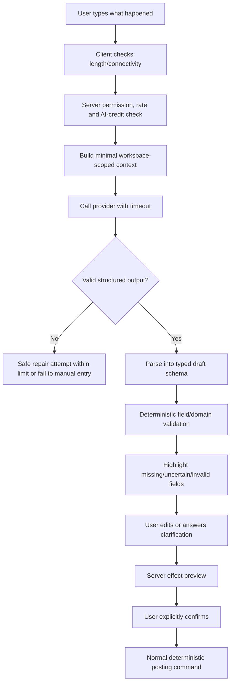
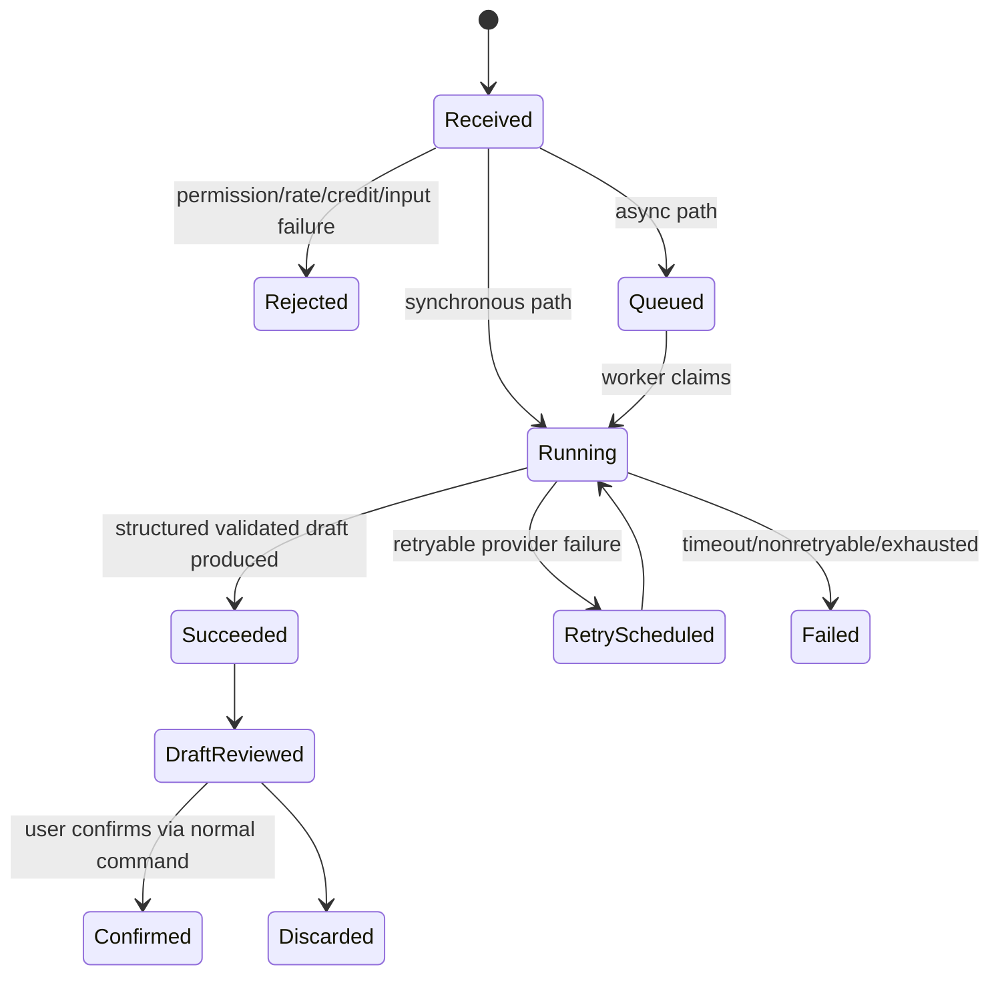
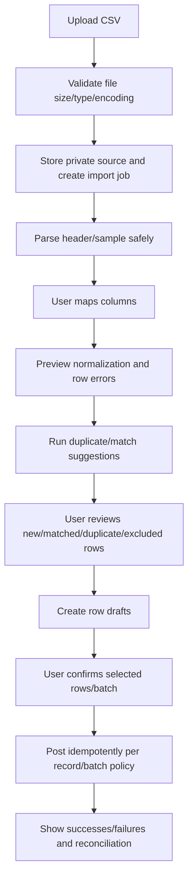
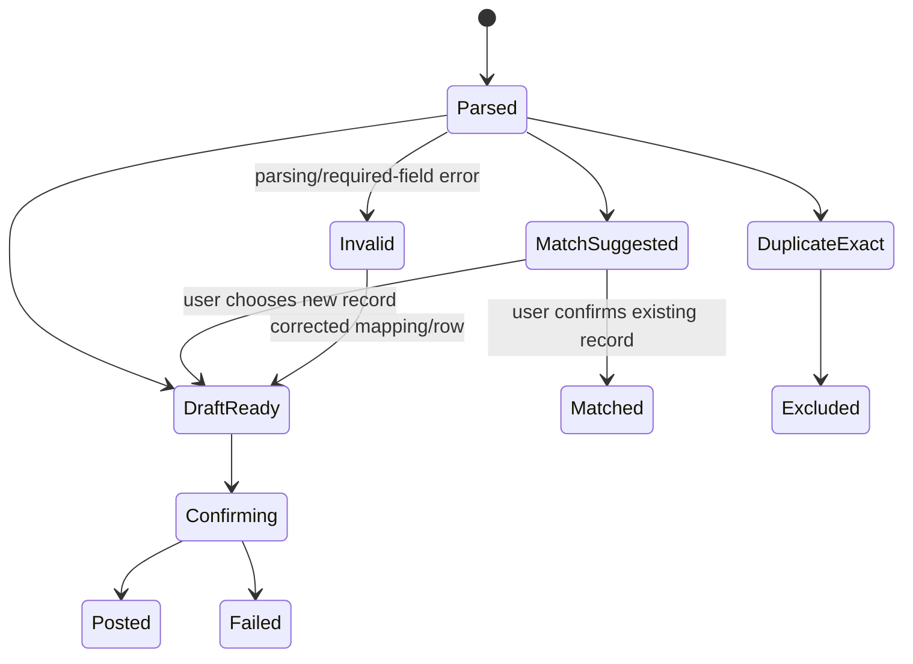

# AI Assistant, Imports and Automation Blueprint

**Status:** Complete draft  
**Depends on:** documents 00–11  
**Core rule:** AI and imports create untrusted drafts; only explicit user confirmation plus deterministic Go validation can create financial truth

## 1. Purpose

This blueprint defines:

- plain-language transaction capture;
- typed AI draft schemas and confidence/uncertainty;
- clarification and review experiences;
- provider abstraction, timeouts, retries and cost controls;
- AI credit/rate-limit enforcement;
- prompt-injection and privacy controls;
- CSV import upload, mapping, normalization and validation;
- exact/probable duplicate detection;
- batch review, partial failure and idempotency;
- background jobs, dead-letter handling and observability;
- safe deterministic automations and explicit exclusions.

## 2. Authority boundaries

### AI may

- interpret user narration;
- suggest workspace/scope, direction, purpose, amount, date, account, category and counterparty;
- identify missing/ambiguous fields;
- produce one or more typed drafts;
- explain a proposed classification in plain language;
- suggest matches/categories under constrained context.

### AI must not

- write directly to financial tables;
- create authoritative journal lines;
- confirm, issue, pay, refund, reverse or void records;
- bypass permissions, plans, locked periods, stock, wallet, loan, allocation or tax rules;
- retry itself in a loop;
- call tools/providers based on model-generated instructions without server allowlists;
- treat attachment/document text as trusted instruction;
- expose one workspace's data to another.

### Imports may

- create validated row drafts and match suggestions;
- preserve source evidence and row failures.

Imports must not auto-post unreviewed financial truth in the December release.

## 3. AI entry points

- Universal Add → Type what happened.
- Personal Home quick capture.
- Business Money quick capture.
- WhatsApp workflow later, using the same server draft contract.
- Receipt/document extraction later under the same untrusted-draft boundary.

Manual entry is always available, including when AI credits/provider/network are unavailable.

## 4. Plain-language capture flow



## 5. Input contract

Fields:

- target context if known;
- narration text;
- client locale/timezone;
- optional attachment references already uploaded privately;
- explicit user-selected hints, such as Personal/Business or money in/out;
- request/client command ID.

Limits:

- hard maximum characters/tokens;
- request-body size;
- attachment count/type/size;
- no arbitrary full transaction history;
- no secrets/provider keys;
- no raw HTML execution.

When over limit, ask user to shorten/split. Do not silently truncate financial amounts/dates unless the UI clearly shows truncation and requires resubmission.

## 6. Minimal AI context

Allowed, workspace-scoped context:

- active workspace kind/name only when needed;
- base currency/timezone/current date;
- allowed direction/purpose/scope enums;
- recent/frequent category labels and IDs through opaque aliases;
- recent/frequent money-account labels/aliases;
- likely counterparties under bounded search/context;
- open document candidates only when user explicitly requests allocation and context is safely bounded;
- output JSON schema and examples.

Avoid:

- full financial history;
- unrelated documents/customers;
- other workspaces/users;
- bank credentials/tax IDs/full PII;
- private notes;
- long raw files.

The server resolves aliases back to authorized IDs after output validation.

## 7. Typed draft schema

Representative response:

```json
{
  "schema_version": "money-draft.v1",
  "records": [
    {
      "scope": "business",
      "direction": "money_out",
      "purpose": "business_direct_expense",
      "amount_major": "8500",
      "currency": "NGN",
      "effective_date": "2026-11-07",
      "account_alias": "business_bank_1",
      "category_alias": "transport",
      "counterparty_alias": null,
      "description": "Fuel",
      "fields": {
        "amount": {"confidence": "high", "source": "explicit"},
        "category": {"confidence": "medium", "source": "inferred"},
        "account": {"confidence": "medium", "source": "inferred"}
      },
      "missing_fields": [],
      "warnings": []
    }
  ]
}
```

The model returns aliases/enum values, not arbitrary internal IDs or authoritative minor units/journals.

## 8. Supported draft types

Initial:

- Personal income/expense;
- Business money in/out with simple purpose/category;
- same-workspace transfer;
- multiple simple records from one narration when clearly separable;
- unresolved draft requiring user selection.

Requires extra review or manual specialized flow:

- invoice/bill allocation;
- customer deposit/supplier advance;
- loan repayment principal/interest split;
- mixed Personal/Business allocation;
- inventory sale/purchase/receipt;
- returns/refunds;
- tax/WHT;
- opening balances;
- foreign currency;
- reversal/correction.

AI may recognize intent and route the user to the specialized form, but does not fabricate its required details.

## 9. Multiple-record parsing

Example:

> I received ₦50,000 from Ada for design and spent ₦8,000 on data today.

Rules:

- Return two independent drafts with a shared parse-request reference.
- User reviews each independently.
- “Confirm all” still sends separate idempotent posting commands or a reviewed atomic batch policy; one invalid record cannot disappear silently.
- Show total counts and which drafts remain unconfirmed.
- Do not net income and expense into one record.
- Ambiguous pronouns/currencies/accounts remain missing fields.

## 10. Confidence model

Use qualitative levels derived from explicit rules/provider signals:

- `explicit`: directly stated and valid;
- `high`: strong deterministic/context match;
- `medium`: plausible suggestion needing visible review;
- `low`: weak/ambiguous and must be selected;
- `missing`: no value.

Confidence is not a probability claim unless calibrated by measured evaluation.

UI:

- explicit/high may be prefilled but remains editable;
- medium is highlighted as suggested;
- low/missing blocks confirmation;
- invalid server-resolved value is cleared/flagged regardless of model confidence.

## 11. Deterministic draft validation

After model output:

1. Parse strict JSON/schema; reject extra/unknown dangerous structure under policy.
2. Validate schema version and record-count limit.
3. Validate enums.
4. Parse major amount string through document 03 minor-unit algorithm.
5. Validate currency metadata.
6. Validate date bounds/timezone.
7. Resolve aliases only within authorized workspace.
8. Validate category/account/purpose compatibility.
9. Validate counterparty/document candidates under tenant scope.
10. Remove/flag any unauthorized/inactive value.
11. Record uncertainty/errors.
12. Persist draft only, never post.

## 12. Clarification

Prefer form-based clarification over repeated expensive chat loops.

Examples:

- “Was this Personal or Business?”
- “Which account did you pay from?”
- “Was this payment for an invoice, a customer deposit, or other income?”
- “How much of this was Personal versus Business?”
- “Which Ada/customer did you mean?”

Rules:

- Deterministic selectable options come from server.
- One clarification answer does not automatically trigger another model call unless necessary and explicitly submitted.
- User may switch to full manual form at any time.
- Draft retains original suggestion and changed-field audit metadata without storing unnecessary raw prompt long term.

## 13. AI review screen

For each draft:

- proposed plain-language summary;
- amount/currency/date;
- workspace/scope/direction/purpose;
- account/category/counterparty;
- linked-document intent;
- uncertain/missing fields;
- warnings;
- source indicator `AI-assisted`;
- edit/delete/save draft;
- deterministic accounting-effect preview;
- Confirm button only when valid.

The effect preview is produced by normal Go posting rules, not by the model.

## 14. AI request lifecycle



AI success means a draft exists, not a financial record was posted.

## 15. Sync versus async AI

Synchronous path:

- small plain-text request;
- hard provider/request timeout;
- return draft or safe failure.

Async path:

- document/receipt extraction;
- large/multi-record import enrichment;
- workloads likely to exceed request timeout.

Async UI polls known job with backoff/stop condition. WebSockets are not required.

## 16. Provider abstraction

Go interface concept:

```text
ParseMoneyDraft(ctx, request) -> StructuredDraftResponse
```

Provider adapter owns:

- request translation;
- structured-output configuration;
- timeouts;
- response/usage metadata;
- provider-error classification;
- safe model/version identifier.

Domain layer owns:

- permissions/credits;
- minimal context;
- schemas;
- validation;
- draft persistence;
- confirmation/posting.

Provider cannot receive database repository access.

## 17. Timeouts and retries

- Every provider HTTP call uses context timeout, initially around 60 seconds maximum for standard parsing and usually lower after measurement.
- Cancellation releases connection/goroutine/resources.
- Retry only network/429/selected 5xx classifications.
- Maximum three attempts through job policy, with bounded exponential backoff such as 1, 5 and 15 minutes for async jobs.
- Synchronous UI does not wait through long background retry; offer manual entry/job status.
- Invalid structured output may receive at most one bounded schema-repair attempt if cost policy permits.
- Never feed model output back indefinitely.
- Exhausted job enters failed/dead-letter visibility.

## 18. AI credit and rate-limit enforcement

Credits are plan usage, not money/accounting values.

### Reservation model

1. Authenticate user/workspace.
2. Check plan/feature entitlement.
3. Atomically reserve one request credit or estimated usage allowance.
4. Call/queue provider.
5. On eligible provider success, consume reservation.
6. On pre-provider rejection/provider failure under policy, release/refund reservation.
7. Record usage exactly once using idempotency key.

Prevents concurrent calls exceeding limit.

Track:

- calls/credits;
- input/output tokens where available;
- provider/model;
- latency;
- success/failure class;
- estimated/actual cost;
- user/workspace/plan under privacy-safe IDs.

Manual entry remains available at zero credits.

## 19. AI privacy and retention

- Send minimum data required.
- Mask/alias internal IDs and unnecessary PII.
- Do not include other customers/workspaces.
- Store provider/model, latency, tokens, result status and redacted/truncated summary/hash as policy allows.
- Avoid storing full raw prompt/response by default.
- If temporary debugging retention is enabled, define encryption, access, expiry and user disclosure.
- Provider contract/data-retention/training terms require review before launch.
- User can identify AI-assisted records in audit/source.

## 20. Prompt injection and hostile content

Treat user text and extracted attachments as data, not trusted instructions.

Controls:

- fixed system/developer schema instructions;
- structured output only;
- no arbitrary tools/function execution;
- allowlisted enum/alias resolution;
- hard input/context/output limits;
- strip/neutralize unsupported markup;
- server validation after output;
- never expose secrets/system prompts;
- never obey content asking to bypass confirmation/permissions;
- attachments processed in isolated/bounded path.

Model output remains untrusted even when schema-valid.

## 21. AI evaluation set

Before launch, maintain sanitized fixtures covering:

- Nigerian English and common phrasing;
- Naira symbols/formatting;
- Personal versus Business ambiguity;
- money in/out;
- transfer versus expense/income;
- invoice payment versus new sale;
- customer deposit/supplier advance;
- loan principal versus income/expense;
- dates such as today/yesterday with timezone;
- multi-record narration;
- mixed use;
- missing amount/account/date;
- adversarial/prompt-injection text;
- unsupported request routing.

Metrics:

- schema validity;
- exact amount/currency/date extraction;
- scope/direction/purpose accuracy;
- missing-field precision/recall;
- unsafe auto-prefill rate;
- user edit rate;
- confirmation/abandon rate;
- latency/cost/error rate.

No model change ships solely on anecdotal success.

## 22. CSV import scope

Initial supported import:

- Personal/Business account transactions;
- income/expense/transfer candidates;
- optional customer/supplier/category suggestions;
- bank-statement reconciliation evidence.

Separate specialized importers may later support:

- catalogue/products;
- opening balances;
- customers/suppliers;
- invoices/bills;
- stock.

Never pass one file through a generic importer that guesses incompatible domain semantics.

## 23. CSV upload flow



## 24. File validation

- Allow `.csv`/documented MIME; inspect content, not extension only.
- Configured maximum bytes/rows/columns/cell length.
- Detect UTF-8/BOM and supported encodings; reject/ask rather than corrupt text.
- Detect delimiter among allowlisted options with preview.
- Protect against zip bombs by not accepting arbitrary compressed files initially.
- Store source privately with lifecycle/expiry.
- Sanitize filename and never execute formulas/macros.
- CSV export/import protects against spreadsheet formula injection for cells beginning with `=`, `+`, `-`, `@` under safe export policy.

## 25. Column mapping

Required transaction mappings:

- date;
- description/reference;
- amount model:
  - one signed amount column, or
  - separate debit/credit columns;
- currency/default;
- target account/import account.

Optional:

- balance;
- category;
- counterparty;
- transaction ID/reference;
- type/direction;
- tags;
- cheque/provider fields.

Rules:

- One source column maps to compatible target fields only.
- Mapping profile can be saved per workspace/import source without raw sensitive rows.
- Preview demonstrates date/number normalization.
- User chooses debit/credit sign convention explicitly when ambiguous.

## 26. CSV value parsing

### Dates

- User selects/validates format when ambiguous (`DD/MM/YYYY` versus `MM/DD/YYYY`).
- Apply workspace timezone/effective date.
- Reject impossible/future dates under selected import policy.

### Amounts

- Parse strings exactly to minor units using currency exponent.
- Normalize configured decimal/group separators through an explicit locale choice.
- Reject ambiguous mixed formats.
- Debit/credit both populated on one row requires rule/error review.
- Zero amount rejected unless supported non-financial statement line.

### Text

- Trim/normalize without losing meaningful reference.
- Enforce length.
- Do not interpret formulas/scripts.
- Store source description separately from normalized suggestion.

## 27. Row state model



## 28. Duplicate detection

Exact signals:

- external transaction ID within account;
- import batch/row fingerprint already processed;
- account + stable reference + date + amount/currency exact;
- file hash plus row identity.

Probable signals:

- same account/currency/amount near date;
- description/reference similarity;
- compatible existing Rekordly payment/transaction;
- running-balance context.

Classes:

- exact duplicate: exclude by default;
- likely existing match: user confirms link;
- possible duplicate: review;
- new draft.

Matching imported statement evidence to an existing payment creates no second cash movement.

## 29. Import suggestions

Deterministic/rule-based first:

- saved mapping/category rules;
- exact known counterparty/reference;
- exact prior user-confirmed pattern;
- transfer pair detection;
- existing payment/document match.

AI may suggest unresolved category/counterparty under credit/privacy limits, but:

- suggestion is labeled AI;
- user confirms;
- import can complete manually without AI;
- no row auto-posts solely from AI confidence.

## 30. Batch review UI

Summary:

- total rows;
- valid drafts;
- exact duplicates;
- match suggestions;
- invalid rows;
- excluded rows;
- total debit/credit/currency buckets;
- source account/date range.

Views:

- All
- Needs review
- New
- Matches
- Duplicates/excluded
- Invalid

Bulk actions:

- set category/account/counterparty for selected compatible rows;
- exclude/include;
- accept exact safe mapping suggestions;
- confirm selected drafts.

Bulk action never overrides incompatible currencies/purposes silently.

## 31. Import posting strategy

Prefer idempotent per-record posting with batch orchestration:

- Each row draft has stable import row ID/client command ID.
- Confirmation job posts rows using normal deterministic command/template.
- One row failure does not roll back already valid independent rows unless user explicitly selected an atomic small batch and policy supports it.
- Batch records successes/failures/IDs.
- Retrying failed rows does not duplicate successes.
- Progress is observable.
- User can export failure report.

Transfers requiring paired rows are grouped and posted atomically as one transfer command.

## 32. Import reconciliation

After posting/matching:

- source row count equals posted + matched + duplicate/excluded + failed/unresolved;
- signed amounts reconcile by currency/account to source under selected treatment;
- optional statement opening/closing balance difference shown;
- unresolved rows remain visible;
- batch can be closed only under defined completion policy.

Deleting import source does not delete posted transactions. Undoing an import requires controlled reversal of posted records and unlinking matches, subject to dependencies/periods.

## 33. Import correction/undo

### Before posting

- Edit mapping, row drafts or exclude/delete batch.

### After posting

- Source rows and posted records immutable.
- “Undo import” previews records, dependencies and periods.
- Eligible records reverse through domain commands.
- Existing matches unlink only when safe.
- Ineligible dependent/locked records require targeted correction.
- Never mass-delete finalized financial records.

## 34. Deterministic automation

Safe initial automations:

- budget threshold notification;
- invoice/bill due reminders;
- low-stock/expiry alerts;
- reservation expiry under explicit policy;
- recurring export/backup operational jobs later;
- saved import categorization suggestion rules;
- document delivery retries;
- domain verification polling.

Rules:

- Automation triggers are explicit/versioned.
- Financial mutation still requires user confirmation unless a later narrowly approved deterministic rule is designed.
- Every job is idempotent, bounded and auditable.
- User can disable optional automations.
- No AI-generated automation executes arbitrary commands.

## 35. Background job model

Job fields:

- ID/type/schema version;
- workspace/user/source references;
- small payload of IDs/options;
- state;
- priority/available time;
- attempt/max attempts;
- timeout/deadline;
- lock owner/expiry;
- last safe error class;
- created/started/finished timestamps;
- idempotency/dedupe key.

States:

- queued;
- running;
- retry_scheduled;
- succeeded;
- failed/dead_letter;
- cancelled.

## 36. Worker claim algorithm

```text
begin transaction
select eligible queued job
for update skip locked
order by priority, available_at, id
limit 1
mark running with lease/worker/attempt
commit

execute with context timeout

if success:
    mark succeeded idempotently
else if retryable and attempts remain:
    mark retry_scheduled with bounded backoff
else:
    mark failed/dead_letter
```

Worker pool is bounded, initially 3–5 concurrent jobs per container after measurement. Empty queue polling sleeps/backs off at least several seconds.

## 37. Job idempotency

Every handler defines its completion evidence:

- AI parse: one request ID → one draft result/version;
- import row: one row command → one posted/matched result;
- email: delivery attempt/provider id and safe retry policy;
- PDF: document version → artifact version;
- projection: event/version applied once;
- domain verification: current state transition once.

Worker crash after side effect but before marking success must not duplicate the effect on retry.

## 38. Dead-letter operations

Failed jobs show:

- type/source/workspace-safe reference;
- attempts/timestamps;
- safe error class;
- retry/cancel/investigate action by permission;
- user-facing source status where relevant.

Manual retry:

- revalidates current source state;
- creates audited retry request;
- cannot rerun obsolete/revoked operation;
- remains bounded.

No job is dropped silently.

## 39. Observability and cost control

Metrics:

- queue depth/oldest age;
- running/retry/dead-letter counts;
- job latency by type;
- AI calls/tokens/cost/error/timeout/schema-failure;
- import rows/sec and failure classes;
- provider latency/rate limit;
- user/workspace/plan credit use;
- PDF/email/domain job outcomes.

Alerts:

- queue stuck/age threshold;
- repeated provider failure;
- AI spend threshold;
- schema-validity regression;
- import/reconciliation anomaly;
- dead-letter growth.

## 40. Permissions

Representative capabilities:

- `ai.use`
- `ai.view_usage`
- `imports.create`
- `imports.review`
- `imports.confirm`
- `imports.undo`
- `automation.manage`
- `jobs.view_failures`
- `jobs.retry`

AI permission does not imply financial confirmation. Import creation does not imply confirm/post. Job operations do not expose raw prompts/files/provider secrets.

## 41. Offline behavior

- AI requires network and server-side credit/privacy enforcement.
- CSV upload/import processing requires network.
- User can type/save a local plain-language note as a draft, but it is not parsed until online.
- Manual entry remains available offline under document 15.
- Queued AI/import status is never shown as posted financial truth.

## 42. Data model

### AI

- `ai_requests`
- `ai_usage_reservations`
- `ai_drafts`
- `ai_draft_fields/validation` or typed JSON schema with strict versioning
- `ai_evaluation_runs/results` using sanitized fixtures

### Imports

- `import_batches`
- `import_files`
- `import_mapping_profiles`
- `import_rows`
- `import_row_matches`
- `import_row_results`
- `import_reconciliations`

### Jobs

- `jobs`
- `job_attempts`
- `failed_jobs/dead_letter`
- `outbox_events`
- `event_consumptions` or handler idempotency evidence

Large files and raw data live in private object storage with lifecycle; database stores bounded metadata/references.

## 43. API outline

| Method/path | Purpose |
|---|---|
| `POST /v1/workspaces/{id}/ai/money-drafts` | Synchronous/queued typed parse request |
| `GET /v1/workspaces/{id}/ai/requests/{request}` | Authorized status/result |
| `GET /v1/workspaces/{id}/ai/usage` | Plan/usage summary |
| `POST /v1/workspaces/{id}/imports` | Create private upload/import batch |
| `POST /v1/workspaces/{id}/imports/{batch}/commands/set-mapping` | Validate mapping/preview |
| `POST /v1/workspaces/{id}/imports/{batch}/commands/analyze` | Parse/duplicate/match job |
| `GET /v1/workspaces/{id}/imports/{batch}/rows` | Paginated row review |
| `POST /v1/workspaces/{id}/imports/{batch}/commands/confirm` | Post selected drafts idempotently |
| `POST /v1/workspaces/{id}/imports/{batch}/commands/undo` | Controlled reversal preview/command |
| `GET /v1/workspaces/{id}/jobs/{job}` | Known job status |
| `POST /v1/workspaces/{id}/failed-jobs/{job}/commands/retry` | Authorized bounded retry |

Financial confirmation still uses domain endpoints from documents 03–11.

## 44. Errors and recovery

Stable errors:

- `AI_NOT_ENTITLED`
- `AI_CREDIT_LIMIT_REACHED`
- `AI_RATE_LIMITED`
- `AI_INPUT_TOO_LARGE`
- `AI_PROVIDER_TIMEOUT`
- `AI_STRUCTURED_OUTPUT_INVALID`
- `AI_DRAFT_REQUIRES_REVIEW`
- `IMPORT_FILE_UNSUPPORTED`
- `IMPORT_LIMIT_EXCEEDED`
- `IMPORT_ENCODING_UNSUPPORTED`
- `IMPORT_MAPPING_INVALID`
- `IMPORT_ROW_INVALID`
- `IMPORT_DUPLICATE_DETECTED`
- `IMPORT_RECONCILIATION_FAILED`
- `JOB_RETRY_EXHAUSTED`

Recovery always offers manual entry/exported row-error detail where applicable. Provider errors are sanitized.

## 45. Notifications and Review

Review:

- AI missing/low-confidence fields;
- multi-record draft selection;
- import invalid/match/duplicate rows;
- transfer-pair suggestion;
- import reconciliation difference;
- undo dependencies;
- failed/dead-letter jobs.

Notifications:

- AI async draft ready/failed;
- import analysis/confirmation complete;
- export/failure report ready;
- credit nearing limit;
- provider degradation only when user-impacting.

## 46. Analytics

Safe events:

- `ai_capture_started`
- `ai_draft_created`
- `ai_missing_field_class`
- `ai_draft_edited_field_class`
- `ai_draft_confirmed/discarded`
- `ai_provider_failure_class`
- `import_uploaded/mapped/analyzed`
- `import_duplicate_or_match_class`
- `import_rows_confirmed/failed_count_bucket`
- `import_undo_started/completed`

Never send prompt text, row descriptions, amounts, account/category/counterparty names, filenames or attachment contents.

## 47. Acceptance and edge-case tests

### AI authority

- AI response creates draft only.
- Confirmation uses deterministic domain command.
- AI-proposed internal/cross-workspace ID is rejected.
- AI cannot issue/refund/reverse/post journal.
- Manual path works when credits/provider unavailable.

### Parsing/validation

- Amount/date/currency use exact server validation.
- Low/missing required field blocks confirm.
- Multiple narration creates separate drafts, not net record.
- Invoice-payment intent routes to allocation review and cannot duplicate revenue.
- Loan/transfer/deposit intent is not forced into income/expense.
- Hostile prompt cannot expose secrets/bypass confirmation.

### Credits/provider

- Concurrent AI requests cannot exceed credit limit.
- Provider failure releases/charges credit according to one defined policy exactly once.
- Timeout cancels resources.
- Retry is bounded and no feedback loop exists.
- Duplicate request/idempotency cannot double-charge or duplicate draft.

### CSV

- Ambiguous date/number format requires explicit mapping.
- Leading-zero and minor-unit parsing remains exact.
- Unsupported/oversized/invalid file fails safely.
- Exact duplicate excluded with evidence.
- Probable match requires review.
- Existing payment match creates no duplicate transaction.
- Transfer pair posts atomically.
- Row retry cannot duplicate successful rows.
- Batch totals/results reconcile to every source row.

### Undo/corrections

- Pre-post draft can be removed without ledger effect.
- Post-import undo reverses eligible records, never hard-deletes.
- Dependent/locked records block unsafe bulk undo.
- Source file deletion does not delete financial history.

### Jobs

- Two workers cannot claim same job concurrently.
- Crash/retry does not duplicate side effect.
- Empty queue sleeps/backs off.
- Attempts/timeouts/max retries enforced.
- Exhausted job visible in dead-letter state.

### Security/privacy

- AI/import context/files are workspace-scoped.
- Raw prompts/files/provider payloads are not logged.
- Private import source/attachments use signed access/expiry.
- Formula injection is neutralized in exports.
- Member import/AI/confirm permissions remain distinct.

### UX/accessibility

- AI uncertainty is labeled with text, not color only.
- User can edit every proposed field and switch to manual.
- Import table/cards expose row errors and bulk-selection state accessibly.
- Long job has durable status and safe retry, not endless spinner.

## 48. Implementation handoff checklist

- AI typed schemas/aliases/enums are versioned.
- Minimal context builder is workspace-scoped and bounded.
- AI credit reservation/consumption is atomic/idempotent.
- Provider calls have timeouts and bounded retry.
- Prompt/output retention policy is approved.
- Sanitized evaluation fixtures and acceptance thresholds exist.
- CSV parser has strict size/encoding/row/cell limits.
- Mapping/date/number conventions are explicit.
- Duplicate/match suggestions never auto-create duplicate money.
- Import rows post through normal domain commands.
- Worker claims use safe locking, leases, timeouts and DLQ.
- No AI/import/automation path bypasses human confirmation for financial truth.

