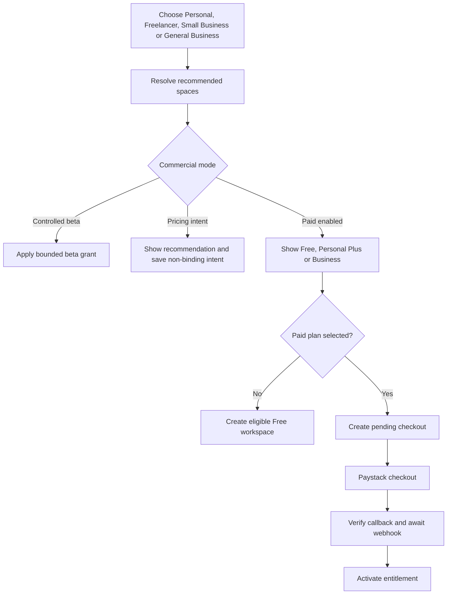
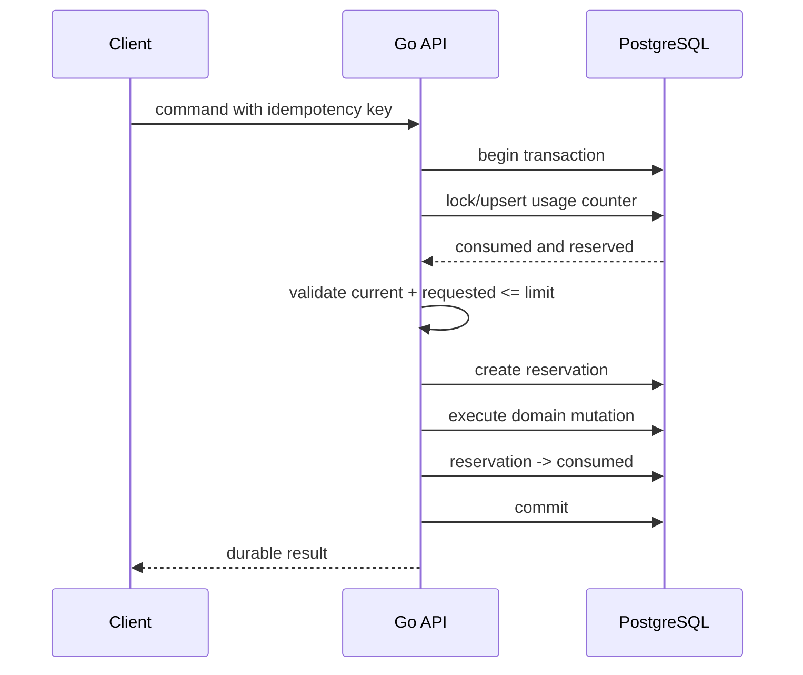
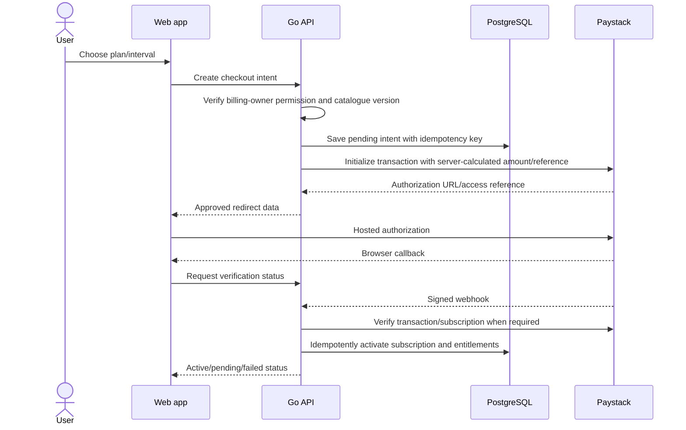
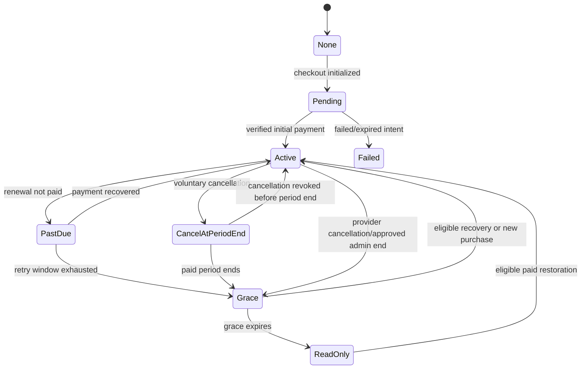
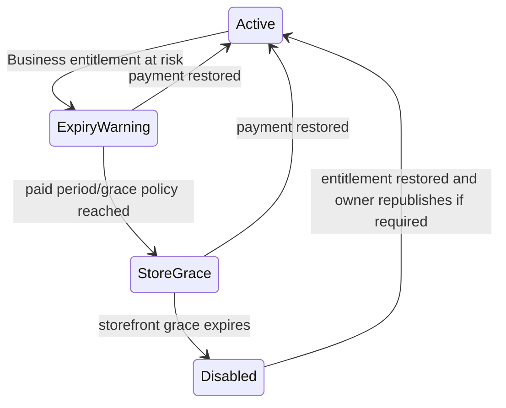

# Plans, Billing, Entitlements and Downgrades Blueprint

**Status:** Complete draft  
**Depends on:** documents 00–12  
**Commercial authority:** `planning/final-v2-plan/07-pricing-validation-and-metrics.md`  
**Core rule:** a plan may stop new consumption, but it must never erase, hide or corrupt a user's owned financial records

## 1. Purpose

This blueprint defines how Rekordly turns commercial packaging into predictable product behaviour. It covers:

- the free December beta and later paid-plan activation;
- Free, Personal Plus and Business plan hypotheses;
- Personal, Business and combined-owner access;
- feature flags, quantitative limits and add-ons;
- Paystack checkout, renewal and webhook processing;
- trials, founding offers and beta overrides;
- upgrades, downgrades, cancellation and payment failure;
- storefront and custom-domain grace behaviour;
- usage reservation under concurrency;
- read, write, export and deletion rights after expiry;
- support, refunds, taxes and billing auditability.

This document specifies an entitlement engine, not a promise that paid billing must be enabled on 1 December 2026. The public beta launches free and bounded. Paid conversion starts only after the validation and operational gates in the authoritative pricing plan pass.

## 2. Locked commercial principles

1. The December public beta is free and controlled.
2. Current post-beta prices are hypotheses, not permanent promises.
3. There are no advertisements in financial workflows.
4. Rekordly does not sell financial data.
5. Basic read access and a usable export of owned data cannot be paywalled.
6. Subscription expiry is not an account-deletion request.
7. Limits are disclosed before they are reached.
8. The server enforces every material entitlement.
9. A frontend plan name is never authorization.
10. Provider state is evidence, not the only source of truth; verified webhooks are mapped into Rekordly's own subscription state machine.
11. A failed payment never rewrites or deletes accounting history.
12. “Unlimited” must not be advertised where technical, safety or fair-use limits exist.

## 3. Commercial modes

Rekordly has an explicit `commercial_mode` configuration:

| Mode | Meaning | Checkout |
|---|---|---|
| `controlled_beta` | Approved beta participants use bounded beta entitlements | Disabled |
| `pricing_intent` | Users may compare plans and record intent, without charge | Disabled |
| `paid_pilot` | Selected cohorts may buy approved plans | Cohort-gated |
| `public_paid` | Approved plan catalogue is generally purchasable | Enabled |
| `billing_paused` | Incident control; existing grants continue under declared policy | Disabled |

The API MUST return the current mode and allowed actions. Hiding checkout in the frontend is insufficient.

## 4. Plan hypotheses

### 4.1 Free — ₦0

Job: establish a consistent money-recording habit.

Initial test limits:

| Capability | Hypothesis |
|---|---:|
| Confirmed records | 100 per calendar month |
| Visible in-app history | Most recent 12 months |
| Money accounts | 3 active |
| Custom categories | 10 active |
| Budgets | 2 active |
| AI drafts | Configurable small monthly allowance |
| Attachments/storage | Configurable small allowance |
| Summary | Basic monthly summary |
| Full export | Limited frequency, never permanently unavailable |
| Offline | Cached read-only |

“Visible history” affects ordinary screens only. Older owned records remain preserved and exportable. A user may also be given a deliberately slower archive retrieval flow; they MUST NOT be told the data no longer exists.

### 4.2 Personal Plus — price hypothesis

- ₦1,500 monthly;
- ₦15,000 yearly;
- complete Personal workspace under documented fair-use limits;
- increased records, accounts, categories, budgets, storage and AI;
- CSV import and offline draft/sync;
- loans, assets and investments;
- lifestyle insights, alerts and full exports.

### 4.3 Business — price hypothesis

- ₦5,000 monthly;
- ₦50,000 yearly;
- one owned Business workspace;
- optional owner Personal workspace and combined summary;
- owner plus two ordinary staff;
- one accountant seat;
- two outlets;
- customers, suppliers, invoicing, purchasing, catalogue and inventory;
- accounting reports and tax-readiness exports;
- one storefront with a Rekordly subdomain;
- increased AI and storage allowances.

### 4.4 Proposed add-ons

| Add-on | Price hypothesis | Grant |
|---|---:|---|
| Additional staff | ₦1,000/month | +1 staff seat |
| Additional outlet | ₦1,500/month | +1 active outlet |
| Additional Business | ₦3,000/month | +1 owned Business workspace |
| Custom domain | ₦1,000/month or ₦10,000/year | +1 active domain connection |
| AI draft pack | ₦1,000 once | +100 expiring/non-expiring credits per published terms |
| Storage pack | ₦1,000/month | +10 GB |

Assisted setup, migration, catalogue setup and bookkeeping support are service purchases. They do not silently grant software access unless the order explicitly includes an entitlement.

## 5. Workspace and billing ownership

Entitlements are resolved for a **subject**, not merely a user.

| Subject | Billing owner | Typical plan |
|---|---|---|
| Personal workspace | Its owner user | Free or Personal Plus |
| Business workspace | Business owner/billing account | Business |
| Invited member | None for that workspace | Inherits workspace grants, constrained by role |
| Combined owner view | Owner user | Derived from accessible Personal and owned Business spaces |

Rules:

- A Business subscription belongs to the Business billing subject, even if its owner also has Personal Plus.
- An invited staff member's own Free plan MUST NOT reduce the Business features granted inside the employer's workspace.
- A user's Personal Plus MUST NOT unlock Business operations.
- Combined view is a presentation entitlement; it does not merge books or allowances.
- Ownership transfer must transfer billing responsibility through a deliberate flow, never by changing a membership row alone.

## 6. Onboarding and plan selection

Onboarding asks for role and desired spaces before asking for payment.



The product SHOULD let a user experience initial value before aggressive upgrade prompts. A beta plan-intent choice is analytics/research data and MUST NOT be represented as a paid subscription.

## 7. Entitlement model

An entitlement is a resolved grant for one subject, feature and time range.

### 7.1 Grant types

| Type | Example | Resolution |
|---|---|---|
| Boolean | `csv_import.enabled` | any valid allow grant, unless a higher-priority safety deny |
| Integer limit | `staff.active.max = 3` | base plus additive add-ons, bounded by safety ceiling |
| Metered allowance | `ai.draft.monthly = 50` | recurring allowance plus eligible packs |
| Enum | `offline.mode = read_only` | most capable permitted value |
| Time window | trial or beta access | only while effective |
| Feature configuration | export cooldown | resolved scalar/config object |

### 7.2 Sources

Entitlements may come from:

1. system safety policy;
2. incident override;
3. approved beta/founding override;
4. active subscription plan version;
5. active recurring add-on;
6. valid one-time credit pack;
7. temporary support remediation.

Priority is explicit. Support staff cannot override security controls, tenant isolation or accounting invariants.

### 7.3 Resolution result

Every checked action returns a structured decision:

```json
{
  "allowed": false,
  "feature": "staff.active",
  "reason_code": "LIMIT_REACHED",
  "plan_code": "business_v1",
  "current": "3",
  "limit": "3",
  "reset_at": null,
  "grace_ends_at": null,
  "upgrade_options": ["addon_staff_v1"],
  "decision_version": "ent_01J..."
}
```

Raw billing-provider payloads are never returned to product clients.

## 8. Feature-key catalogue

Feature keys are stable machine contracts. Marketing labels may change without changing them.

### 8.1 Shared keys

- `records.confirmed.monthly`
- `history.interactive.months`
- `accounts.active.max`
- `categories.custom.active.max`
- `attachments.storage.bytes`
- `ai.draft.monthly`
- `ai.draft.pack_balance`
- `csv.import.enabled`
- `exports.full.cooldown_days`
- `offline.mode`
- `budgets.active.max`
- `reports.personal.advanced`

### 8.2 Personal keys

- `personal.loans.enabled`
- `personal.assets.enabled`
- `personal.investments.enabled`
- `personal.insights.enabled`
- `personal.alerts.enabled`
- `personal.mixed_split.enabled`

### 8.3 Business keys

- `business.owned.max`
- `business.staff.active.max`
- `business.accountant.active.max`
- `business.outlets.active.max`
- `business.inventory.enabled`
- `business.procurement.enabled`
- `business.reports.financial`
- `business.tax_readiness.enabled`
- `business.storefront.enabled`
- `business.storefront.active.max`
- `business.custom_domain.active.max`
- `business.ai_document_draft.enabled`

Every API route maps to one or more stable keys in code. Ad hoc string checks scattered through handlers are forbidden.

## 9. Enforcement layers

Entitlements are enforced in four places for different reasons:

1. **Navigation/presentation:** explains availability and shows usage.
2. **Command authorization:** authoritative allow/deny before mutation.
3. **Database transaction:** reserves or consumes scarce allowance atomically.
4. **Worker/provider boundary:** rechecks time-sensitive grants before external cost or delayed work.

The client may optimistically disable a button, but the API repeats the check. A queued job does not retain unlimited authority: the worker validates the reservation or grant before execution.

## 10. Entitlement decision algorithm

```text
authorize(subject, actor, action, requestedUnits, now):
  1. Authenticate actor and resolve workspace membership.
  2. Authorize role/permission for action.
  3. Resolve commercial mode and safety overrides.
  4. Load active plan version, add-ons and temporary grants for subject.
  5. Resolve the action's feature key and effective limit.
  6. If feature is unavailable, deny with stable reason and upgrade options.
  7. If quantitative:
       a. select the usage counter for its defined period;
       b. calculate consumed + reserved + requestedUnits;
       c. atomically reserve only if result <= effective limit.
  8. Return decision ID and reservation ID where applicable.
  9. On successful mutation/provider call, consume reservation.
 10. On failure/cancellation, release reservation idempotently.
```

Role authorization occurs before revealing plan details. This prevents a user without permission from inferring sensitive workspace configuration.

## 11. Usage periods and counters

Each metric declares its period model:

| Model | Example | Reset behaviour |
|---|---|---|
| Calendar month | confirmed records | workspace timezone boundary stored as UTC instant |
| Subscription cycle | recurring AI allowance | provider-independent entitlement period |
| Lifetime active count | accounts/outlets/staff | decreases only when safely archived/deactivated |
| Rolling window | abuse/rate limits | independent of paid allowance |
| Stored balance | AI packs | decremented; expiry per pack terms |
| Storage snapshot | attachment bytes | decreases after actual deletion and retention cleanup |

`consumed`, `reserved` and manual `adjustment` are recorded separately. A support adjustment requires reason, actor and audit reference.

## 12. Concurrent limit reservation

Two devices must not both consume the last available unit.



If provider work must occur outside the database transaction, the reservation receives an expiry. A sweeper releases abandoned reservations after confirming no completed provider operation exists.

## 13. Limit-warning experience

The UI SHOULD warn at configurable thresholds such as 70%, 90% and 100%, without using fear or hiding existing data.

Every meter states:

- what is counted;
- current usage and limit;
- when it resets, if applicable;
- which workspace the limit belongs to;
- what happens at the limit;
- available plan/add-on options;
- how archived records affect active-count limits.

At 100%, the blocked action retains the user's entered draft locally when safe and offers export, archive or upgrade choices. It must not discard form work.

## 14. Active-count limits

For accounts, categories, budgets, staff, outlets, businesses and domains:

- historical references prevent destructive deletion solely to fit a plan;
- archive/deactivate is preferred;
- an archived item remains readable in historical records;
- reactivation performs a fresh entitlement check;
- system accounts/categories do not count unless the plan definition explicitly says so;
- pending invitations count against staff capacity once accepted, not when merely drafted; abuse controls may cap pending invites separately;
- the owner seat does not count as ordinary staff;
- the included accountant seat is separate from ordinary staff.

## 15. Monthly confirmed-record limit

A “confirmed record” is defined once in the plan-version metadata. The recommended definition counts user-confirmed primary financial records, not every generated journal line.

Rules:

- drafts do not count;
- failed confirmations do not count;
- a reversal does not refund the original unit, because real work occurred;
- an idempotent retry does not count twice;
- import rows count when individually confirmed/posted;
- system-generated follow-on journals do not add units;
- moving a record between categories does not add a unit;
- abuse controls are separate and cannot be purchased away.

Before paid launch, wording must specify exactly which record types count.

## 16. History restriction

Free history limitation applies to interactive browsing and advanced reports, not ownership.

When a date range exceeds the allowance:

1. show the available range;
2. explain that older records are safely retained;
3. allow a compliant full export subject to cooldown;
4. offer upgrade for interactive access;
5. never return a misleading zero balance caused by hidden opening history.

Reports whose correctness depends on older transactions MUST either include brought-forward balances or clearly reject the range. They MUST NOT calculate from a truncated dataset as if it were complete.

## 17. AI allowances

AI credit enforcement follows document 12.

- check feature eligibility, rate limit and credit before provider invocation;
- reserve a credit before the call;
- consume according to published policy, normally on a valid provider response;
- release on provider failure where no usable result was delivered;
- never charge again for an idempotent replay;
- show recurring and purchased balances separately;
- consume expiring credits before non-expiring credits unless published terms say otherwise;
- a paid AI pack does not unlock an otherwise unavailable AI feature;
- deterministic manual entry remains available when AI credits are exhausted, subject to ordinary record limits.

## 18. Storage allowance

Storage usage includes retained original file bytes plus documented derived assets if they create material cost. The definition must remain stable within a plan version.

- reject new uploads before accepting bytes when known size exceeds allowance;
- reconcile provider-reported and database-recorded storage asynchronously;
- quarantined or failed uploads follow a declared accounting rule;
- replacing a file reserves new capacity before old capacity is released;
- downgrading below current storage blocks new uploads but preserves existing files;
- users may download existing files and remove eligible files;
- accounting evidence attached to locked/posted records may require archive rather than immediate physical deletion.

## 19. Export entitlement

Every user retains a route to export owned data.

Free export may have a cooldown to manage cost, but:

- a recently completed export remains downloadable until expiry;
- deletion flow may bypass the normal cooldown to provide a final export;
- support can issue a documented remediation export;
- export jobs cannot omit older history merely because ordinary UI history is limited;
- exports clearly identify scope, generated time and limitations;
- paid “professional” formats may be gated, while a usable machine-readable ownership export remains available.

## 20. Beta grants

Controlled-beta access is represented as a versioned grant, not hard-coded `if beta_user` behaviour.

Minimum fields:

- subject;
- grant template/version;
- effective and expiry times;
- cohort/source;
- limits;
- issued by and reason;
- replacement/founding terms, if any.

Before expiry, users receive clear notice of what changes. No payment method is charged merely because a beta grant ends.

## 21. Trials

Trials are deferred until explicitly activated. When used:

- trial length and included features are displayed before start;
- whether a card is required is explicit;
- automatic paid conversion requires informed consent;
- one trial per eligible subject is the default, with auditable overrides;
- trial end time is an exact UTC instant;
- reminders are sent before conversion or expiry;
- cancellation during trial prevents future charge;
- trial expiry follows downgrade preservation rules;
- trial abuse checks must not expose sensitive matching data.

## 22. Plan catalogue and versioning

A plan version is immutable after sale.

Example identity:

```text
plan_code: business
version: 2027-01
billing_interval: monthly
currency: NGN
price_minor: 500000
tax_behavior: exclusive_or_inclusive_as_published
effective_from: ...
available_for_new_purchase: true
```

Changing limits or price creates a new version. Existing subscribers retain their assigned version until a disclosed migration, renewal rule or grandfathering term applies.

The public catalogue is cached, but checkout re-resolves the authoritative version on the server.

## 23. Price representation

- All prices are stored as `BIGINT` minor units and ISO currency.
- JSON minor-unit values are strings.
- Taxes, discounts and provider fees use deterministic fixed-precision calculations.
- The checkout summary shows billing interval, subtotal, applicable tax, total due now and future renewal amount.
- “Per month” equivalents for annual plans cannot replace the actual amount charged.
- A zero-decimal or non-NGN currency uses currency exponent metadata; no hard-coded division by 100.

## 24. Paystack responsibilities

Paystack is the first intended subscription payment provider. Rekordly owns:

- product/plan eligibility;
- internal checkout intent;
- subscription and entitlement state;
- invoices/receipts shown in Rekordly;
- refund and support policy;
- reconciliation and audit.

Paystack owns provider authorization, token handling and payment execution according to its service. Rekordly MUST NOT store raw card data, CVV or reusable secrets outside the provider's approved mechanism.

## 25. Checkout flow



The browser callback is never sufficient proof of payment. The success page may show “confirming payment” until verified server evidence is committed.

## 26. Checkout intent rules

The checkout intent stores:

- internal opaque ID and provider reference;
- billing subject and initiating actor;
- immutable plan/version/interval/currency;
- server-calculated subtotal, tax and total;
- intended add-ons;
- status and expiry;
- idempotency key;
- provider initialization reference;
- attribution/offer code where valid;
- terms version accepted.

Client-supplied price, plan benefits or provider reference are never trusted. Reusing an idempotency key with different commercial parameters returns `IDEMPOTENCY_CONFLICT`.

## 27. Webhook security and processing

Webhook handling MUST:

1. read the bounded raw request body;
2. verify the current provider signature using constant-time comparison;
3. reject unsupported content, oversized payloads and invalid signatures;
4. store a redacted event envelope with a unique provider event/reference key;
5. acknowledge duplicates safely;
6. process state transitions idempotently;
7. verify important ambiguous events with Paystack's server API;
8. never trust customer email alone to select a billing subject;
9. record before/after internal states and audit reference;
10. retry transient processing failures through a bounded queue.

Secrets are rotated through a documented dual-secret window where supported. Webhook logs must redact authorization codes, personal details and unnecessary payload fields.

## 28. Subscription state machine



`ReadOnly` is commercial shorthand. It does not mean every command is blocked: export, deletion, security changes, correcting billing identity, downloading existing files and other ownership/safety actions remain available.

## 29. Internal versus provider status

Internal state is derived from verified facts and policy:

| Provider evidence | Possible internal state |
|---|---|
| Initialization only | `pending` |
| Verified successful initial charge | `active` |
| Renewal failure | `past_due` |
| Provider subscription disabled after paid-through date | `grace` |
| Refund | depends on scope and policy; not automatically deletion |
| Chargeback | restricted review state; never silent data destruction |

Out-of-order webhooks are compared using event facts, paid-through periods and processed-event history. An older event cannot regress a newer valid subscription state.

## 30. Renewal

Before renewal, the product SHOULD notify the billing owner of amount/date where required or useful. On renewal:

- verified success extends the paid-through period once;
- duplicate success events do not extend twice;
- amount/currency/plan mismatches enter billing review;
- renewal receipts are generated only from verified transactions;
- renewal failure enters `past_due`, not immediate deletion or permanent lock;
- staff see only appropriate workspace-impact messaging, not private billing instruments.

## 31. Payment failure and grace policy

Exact durations remain configurable and must be published before paid launch. Recommended initial policy:

| Stage | Suggested duration | Behaviour |
|---|---:|---|
| `past_due` | 7 days | Paid features continue; reminders and retry/update-payment actions |
| `grace` | additional 7 days | Existing operations remain visible; new paid-only consumption progressively blocked |
| `read_only` | after grace | Preserve read/export; block paid-only writes and public paid surfaces |

The policy is versioned so changing it does not rewrite history. A billing incident may extend grace globally or for affected cohorts.

## 32. Voluntary cancellation

Cancellation defaults to end of current paid period.

Flow:

1. billing owner opens Subscription;
2. product shows paid-through date and exact consequences;
3. optional reason is collected without blocking cancellation;
4. recent reauthentication is required;
5. provider cancellation is requested idempotently;
6. internal state becomes `cancel_at_period_end` only after a durable result;
7. user can revoke cancellation before the cutoff where provider rules permit;
8. expiry starts commercial grace, not deletion.

Immediate cancellation is reserved for refunds, fraud, legal requirements or explicit support policy and must be audited.

## 33. Upgrade behaviour

An upgrade may take effect immediately when the payable amount and proration policy are clearly shown.

- create an immutable change quote;
- do not trust client calculations;
- require billing-owner confirmation;
- activate additional entitlements only after verified payment, unless a declared credit policy allows otherwise;
- preserve usage already consumed in the current period;
- newly increased limits take effect atomically;
- queued jobs blocked solely by the old plan may be retried only with user intent or a safe documented rule;
- an upgrade does not alter roles or automatically invite users.

## 34. Downgrade scheduling

Downgrades normally apply at the end of the paid period.

Before confirmation, show an impact preview:

- active staff versus new capacity;
- active outlets versus new capacity;
- storage used versus allowance;
- owned businesses versus allowance;
- domains/storefronts affected;
- advanced features becoming unavailable;
- AI recurring allowance change;
- offline mode change;
- history/report range change.

The user is not forced to delete financial history. They may choose which excess active resources to deactivate before the effective date.

## 35. Downgrade resolution algorithm

```text
applyDowngrade(subject, targetPlan, effectiveAt):
  1. Lock subscription transition for subject.
  2. Resolve target entitlement snapshot.
  3. Preserve every owned record, journal, attachment and audit event.
  4. For each active-count limit:
       a. retain explicitly selected resources up to capacity;
       b. otherwise apply published deterministic ordering;
       c. mark excess resources restricted, never delete them.
  5. Block new consumption where usage is already above target limit.
  6. Move paid public surfaces through their grace state.
  7. Retain read/export/download routes.
  8. Revoke paid offline-write tokens and force entitlement refresh.
  9. Record immutable before/after entitlement snapshots.
 10. Notify billing owner and affected administrators.
```

Deterministic fallback ordering SHOULD prefer resources selected by the owner, then oldest continuously active resources. It must never arbitrarily deactivate the only outlet holding stock without a safe operational restriction state.

## 36. Excess-resource states

When downgraded below current usage:

| Resource | Preservation behaviour | New actions |
|---|---|---|
| Money account/category/budget | Remains visible in history; may be restricted/archived | Cannot reactivate/create above limit |
| Staff | Selected excess memberships become `billing_restricted` | Cannot sign into workspace; ownership records remain |
| Accountant | Loses workspace access if seat no longer granted | Prior audit authorship remains |
| Outlet | Becomes restricted, not deleted | No new operational posting; stock/history remain reportable |
| Extra Business | Becomes owner read/export mode | No new operational writes |
| Storage | Existing files remain downloadable | New uploads/replacements blocked above limit |
| AI credits | Recurring grant ends; valid purchased packs follow their terms | Manual workflow remains |
| Advanced reports | Previously exported files remain until expiry | New gated generation blocked |

If restricting an outlet would create ambiguous fulfilment or stock operations, open transactions are resolved/cancelled through explicit workflows before the restriction fully applies.

## 37. Storefront expiry

Business storefront behaviour is separate from admin record access.



During storefront grace:

- storefront may remain public with clearly defined order policy;
- the safer default is to stop accepting new checkout requests before full disablement if the merchant cannot manage them;
- existing orders remain in Business admin history;
- reserved stock follows normal order rules, not subscription deletion;
- after disablement, public routes show a neutral unavailable page without exposing billing status;
- the Rekordly subdomain mapping is retained for a documented recovery window.

Exact grace and order-acceptance behaviour must be shown before paid purchase.

## 38. Custom-domain expiry

Custom domain is an add-on/higher entitlement.

- warn before add-on expiry;
- retain the Rekordly subdomain as fallback;
- after grace, stop serving the custom host and remove/disable its certificate/routing safely;
- never claim ownership of a domain purchased elsewhere;
- retain verification metadata for a bounded recovery period;
- do not delete the storefront catalogue or orders;
- provide DNS removal guidance;
- reactivation re-verifies routing and ownership as necessary.

## 39. Business owner Personal space

Business includes an optional owner Personal space under the published Business package. This grant:

- belongs to the active Business subscription relationship;
- is private from staff and accountants unless separately shared by a future feature;
- remains a separate ledger;
- does not let Business funds pay personal entries automatically;
- may transition to Free Personal rules after Business expiry;
- preserves all Personal records and export access;
- can be upgraded independently to Personal Plus if supported by catalogue policy.

If an owner has multiple Business subscriptions, the same Personal space must not receive duplicate irreversible grants. Resolution selects the best valid grant.

## 40. Combined-owner view

Combined view eligibility requires the user to own/access the relevant spaces. On downgrade:

- summaries may reduce to the ranges/features supported by each underlying space;
- the view must label different plan states;
- no cross-workspace limit pool is assumed;
- loss of one Business entitlement does not hide its historical summary/export link;
- invited Business spaces are not included as owned wealth unless a future explicit rule allows it.

## 41. Plan-change concurrency

Plan changes, webhooks and paid-feature commands may race.

Controls:

- subject-scoped advisory/row lock for subscription transitions;
- monotonically increasing entitlement revision;
- command decision records the revision it used;
- short operations may complete under a valid reservation created before expiry;
- long/expensive external jobs revalidate before spend;
- offline clients receive `ENTITLEMENT_STALE` and refresh instead of blindly replaying;
- duplicate plan-change requests return the existing result.

## 42. Offline behaviour

Entitlement snapshots may be cached for presentation, but offline authority is bounded.

- Free: cached read-only per current hypothesis;
- Personal Plus/Business: offline draft/sync only within issued capability and expiry;
- the client stores entitlement revision and expiry;
- server rechecks every synced command;
- commands created while entitled but synced after downgrade follow the documented reservation/token policy;
- financial drafts rejected for plan reasons remain exportable/copyable so user work is not silently lost;
- revocation/security controls override paid offline capability.

Document 15 defines the full sync contract.

## 43. Refunds

Refund rules require published terms and an internal case record.

- provider refund execution requires authorized support/admin permission;
- partial and full refund amounts use minor units;
- refund status is reconciled with provider evidence;
- entitlement effect is explicit and not inferred solely from the refund event;
- a duplicate refund command is idempotent;
- total refunds cannot exceed captured payment;
- taxes/fees are handled according to law/provider policy;
- refund does not erase invoices, receipts or subscription audit history;
- user receives a durable outcome and reference.

## 44. Chargebacks and fraud review

A chargeback creates a restricted billing-review state, not automatic account destruction.

- preserve access to owned-data export unless law/security prevents it;
- restrict new paid-cost actions where justified;
- do not expose fraud signals to ordinary workspace members;
- require audited admin resolution;
- record provider dispute deadlines and evidence status;
- restoring access is idempotent;
- financial bookkeeping inside the user's workspace is not rewritten because Rekordly's subscription charge was disputed.

## 45. Taxes and billing documents

Before paid launch, Rekordly must define:

- legal seller identity and address;
- whether displayed prices include applicable taxes;
- tax registration details where required;
- invoice/receipt numbering;
- customer billing-name/address fields;
- service period;
- line items, subtotal, tax and total;
- currency and payment status;
- refund/credit-note relationship;
- retention and download policy.

Subscription billing documents are Rekordly commercial records. They are separate from invoices created by a Business for its own customers.

## 46. Billing permissions

| Action | Personal owner | Business owner/billing admin | Business staff | Accountant |
|---|---:|---:|---:|---:|
| View own plan/usage | Yes | Yes | Limited workspace allowance view | Limited if needed |
| View billing instruments/receipts | Yes | Yes | No | No by default |
| Purchase/change/cancel | Yes | Yes | No | No |
| Purchase add-on | Yes if applicable | Yes | No | No |
| Export owned workspace data | Yes | Yes | Role-dependent operational export | Role-dependent |
| Request account deletion | Yes | Owner only | No | No |

Sensitive billing actions require recent authentication. Ownership transfer and billing-admin changes require stronger confirmation and notifications.

## 47. Data model

### `plan_versions`

- `id`, stable `plan_code`, version;
- display metadata;
- commercial availability/mode;
- interval, currency, `price_minor`;
- tax behaviour;
- effective window;
- immutable benefit snapshot.

### `plan_entitlement_definitions`

- plan version;
- feature key;
- grant type/value;
- period model;
- counting definition/version.

### `billing_subjects`

- subject type and owner reference;
- provider customer reference;
- billing identity;
- status.

### `subscriptions`

- billing subject;
- plan version;
- internal lifecycle state;
- interval;
- start, paid-through, renewal, cancel and grace instants;
- provider subscription/customer references (encrypted or access-controlled as needed);
- entitlement revision;
- state reason.

### `subscription_changes`

- source and target plan versions;
- quote snapshot;
- requested/effective/completed instants;
- actor and status;
- idempotency/audit references.

### `add_on_instances`

- subject, add-on version and quantity;
- recurring/one-time;
- effective/expiry periods;
- provider references and state.

### `entitlement_overrides`

- subject and feature key/template;
- allow/deny/value;
- priority, reason and issuer;
- effective/expiry times.

### `usage_counters`

- subject, metric and definition version;
- period start/end;
- consumed, reserved and adjustment values;
- revision and timestamps.

### `usage_reservations`

- counter, command/job and idempotency reference;
- units;
- reserved/expiry/consumed/released instants;
- terminal reason.

### `checkout_intents`, `billing_transactions`, `provider_events`

Store immutable commercial snapshots, verified provider facts, processing state and redacted audit evidence. Unique constraints prevent duplicate application.

## 48. API outline

### Catalogue and current state

- `GET /v1/commercial-mode`
- `GET /v1/plans?subject_type=personal|business`
- `GET /v1/billing-subjects/{id}/subscription`
- `GET /v1/billing-subjects/{id}/entitlements`
- `GET /v1/billing-subjects/{id}/usage`
- `GET /v1/billing-subjects/{id}/downgrade-impact?target_plan_version=...`

### Checkout and changes

- `POST /v1/billing-subjects/{id}/checkout-intents`
- `GET /v1/checkout-intents/{id}`
- `POST /v1/billing-subjects/{id}/subscription-change-quotes`
- `POST /v1/billing-subjects/{id}/commands/change-plan`
- `POST /v1/billing-subjects/{id}/commands/cancel-subscription`
- `POST /v1/billing-subjects/{id}/commands/resume-subscription`
- `POST /v1/billing-subjects/{id}/commands/purchase-addon`

### Billing records

- `GET /v1/billing-subjects/{id}/transactions`
- `GET /v1/billing-subjects/{id}/billing-documents`
- `GET /v1/billing-documents/{id}/download`

### Provider boundary

- `POST /v1/webhooks/paystack`

The provider webhook endpoint uses provider authentication, not user sessions. All user endpoints resolve billing-subject ownership server-side.

## 49. Error contract

| Code | Meaning | Client action |
|---|---|---|
| `FEATURE_NOT_INCLUDED` | Plan lacks feature | Explain and show eligible options |
| `PLAN_LIMIT_REACHED` | Quantitative capacity exhausted | Preserve draft; show meter/options |
| `ENTITLEMENT_STALE` | Client revision expired | Refresh and re-evaluate |
| `SUBSCRIPTION_PAST_DUE` | Billing recovery required | Billing owner updates payment |
| `CHECKOUT_NOT_AVAILABLE` | Commercial mode/cohort disallows charge | Save intent or return later |
| `PLAN_VERSION_UNAVAILABLE` | Stale/retired offer | Refresh catalogue |
| `BILLING_PERMISSION_REQUIRED` | Actor cannot manage billing | Contact owner/admin |
| `PAYMENT_CONFIRMATION_PENDING` | Provider result not verified | Poll bounded status; do not retry charge blindly |
| `PROVIDER_TEMPORARILY_UNAVAILABLE` | Paystack/API issue | Safe retry with same idempotency key |
| `DOWNGRADE_REQUIRES_SELECTION` | Excess active resources need choice | Open impact-resolution flow |

No error should falsely imply the user's historical data was deleted.

## 50. Subscription screens

### 50.1 Current plan

Shows:

- plan/version label and commercial mode;
- price, interval and next renewal/paid-through date;
- lifecycle state and consequences;
- usage meters;
- active add-ons;
- billing owner;
- receipts/documents;
- upgrade, downgrade and cancellation actions.

### 50.2 Plan comparison

- user-relevant recommendation based on selected workspace kind;
- actual charged monthly/annual amount;
- explicit included quantities;
- “fair use” link where applicable;
- taxes/fees disclosure;
- no preselected expensive option or false countdown;
- contact/support path.

### 50.3 Billing recovery

- non-alarming explanation;
- last failed attempt date without exposing sensitive instrument data;
- paid features and exact grace deadline;
- update/retry path;
- export access reminder;
- support reference.

### 50.4 Downgrade impact

Lists every excess resource and allows an owner to choose what remains active. It separates “will be restricted” from “will be deleted”; downgrade itself deletes nothing.

## 51. Notifications

Events that may notify the billing owner:

- checkout verified or failed;
- trial/beta ending;
- renewal upcoming;
- renewal success;
- payment failure and retry;
- past-due/grace thresholds;
- cancellation scheduled/revoked;
- plan/add-on change;
- storefront/custom-domain disablement warning;
- refund completion;
- suspicious billing change;
- receipt available.

Messages include workspace, consequence, effective date and safe in-app link. Email/WhatsApp messages never contain full financial details or secret payment data.

## 52. Background jobs

- verify ambiguous pending checkouts;
- process provider events;
- retry transient subscription transitions;
- send renewal/grace notifications;
- apply scheduled plan changes;
- expire beta/trial/temporary grants;
- release expired usage reservations;
- reconcile provider subscriptions and transactions;
- reconcile storage usage;
- disable expired storefront/domain routing;
- detect counters needing repair.

Every job is idempotent, bounded, observable and dead-lettered after its retry budget.

## 53. Reconciliation

At least daily in paid mode, reconcile:

- internal active subscriptions against Paystack status;
- successful provider transactions against internal billing transactions;
- paid-through periods and amounts;
- refunds/chargebacks;
- active add-ons;
- usage reservation leaks;
- entitlement snapshots against active sources.

Mismatches create an internal operations case. Automated repair is allowed only for unambiguous transitions and records its evidence.

## 54. Security and privacy

- Encrypt or tightly restrict provider customer/subscription references.
- Never log raw authorization tokens, card details or webhook secrets.
- Require recent auth for purchase, cancellation, refund request and billing-admin changes.
- Apply CSRF protection to browser session mutations.
- Rate-limit checkout initialization, verification and coupon/offer attempts.
- Use server-generated unpredictable references.
- Validate webhook signatures on the raw body.
- Separate operational admin access from ordinary support access.
- Audit every override and subscription transition.
- Analytics exclude prices tied to identifiable sensitive financial behaviour unless needed under the privacy contract.

## 55. Analytics

Permitted events include:

- `pricing_viewed`;
- `plan_intent_selected`;
- `checkout_started`;
- `checkout_verified`;
- `checkout_failed`;
- `subscription_activated`;
- `subscription_change_requested`;
- `subscription_cancelled`;
- `renewal_succeeded`;
- `renewal_failed`;
- `limit_warning_shown`;
- `limit_reached`;
- `upgrade_viewed`;
- `downgrade_impact_viewed`;
- `addon_purchased`.

Properties may include plan code/version, interval, workspace kind, cohort, feature key and failure class. Do not send raw provider payloads, contact/payment data, record amounts or financial contents.

## 56. Support and administrative controls

Restricted internal tools may:

- view redacted subscription timeline;
- re-run safe reconciliation;
- extend grace for a documented reason;
- issue a temporary entitlement override with expiry;
- initiate an authorized refund;
- resend a billing document/notification;
- correct a provider-reference link through a reviewed process.

They MUST NOT:

- edit posted user financial records to solve subscription issues;
- permanently grant access without an owner/reason/expiry where required;
- impersonate a workspace user silently;
- mark payment successful without verified evidence;
- delete data because a payment failed.

## 57. Acceptance and edge-case tests

### 57.1 Catalogue and calculation

- [ ] Client-supplied price is ignored.
- [ ] Monthly and annual totals use minor units and correct currency exponent.
- [ ] Retired plan version cannot be newly purchased.
- [ ] Existing subscriber remains on its immutable version until valid migration.
- [ ] Taxes and amount due are displayed consistently with the captured amount.

### 57.2 Entitlement enforcement

- [ ] Direct API bypass of a locked frontend action is denied.
- [ ] Role denial happens even when plan includes the feature.
- [ ] Invited staff uses Business grants, not their personal plan.
- [ ] Personal Plus does not unlock Business operations.
- [ ] Duplicate idempotent command consumes usage once.
- [ ] Two concurrent final-unit requests allow only one.
- [ ] Provider call is not made after AI/storage entitlement denial.
- [ ] Archived active-count resources no longer count only where policy permits.

### 57.3 Free/history/export

- [ ] 101st monthly confirmed record is blocked under the 100-record hypothesis.
- [ ] Existing 100 records remain readable.
- [ ] Older-than-12-month data is not silently used as zero/missing in reports.
- [ ] Full ownership export includes older retained history.
- [ ] Export remains available after downgrade and expiry.

### 57.4 Checkout/webhooks

- [ ] Browser callback without verified payment does not activate access.
- [ ] Invalid webhook signature is rejected.
- [ ] Duplicate webhook has one state effect.
- [ ] Out-of-order older webhook cannot regress active paid-through state.
- [ ] Amount/currency mismatch enters review instead of activation.
- [ ] Pending verification can recover after transient provider failure.
- [ ] Same idempotency key cannot initialize two different purchases.

### 57.5 Renewal/cancellation

- [ ] Renewal success extends period once.
- [ ] Renewal failure enters past due, not deletion.
- [ ] Cancel-at-period-end preserves access through paid-through date.
- [ ] Resuming before cutoff cancels scheduled expiry where permitted.
- [ ] Trial end never charges without the required prior consent.
- [ ] Beta expiry never charges automatically.

### 57.6 Downgrade

- [ ] Downgrade impact enumerates all excess resources.
- [ ] Historical records, journals and attachments survive.
- [ ] Existing files remain downloadable when storage exceeds new limit.
- [ ] New uploads are blocked while above allowance.
- [ ] Excess staff cannot access but audit authorship remains.
- [ ] Restricted outlet stock/history remains reportable.
- [ ] Business expiry never starts the 60-day deletion clock.
- [ ] Owner can reactivate after payment without duplicate data.

### 57.7 Storefront/domain

- [ ] Storefront receives configured warning/grace.
- [ ] New-order acceptance follows the published grace rule.
- [ ] Existing orders remain accessible after storefront disablement.
- [ ] Custom domain disables without deleting storefront data.
- [ ] Rekordly subdomain remains the documented fallback.
- [ ] Public unavailable page does not disclose merchant billing trouble.

### 57.8 Offline and concurrency

- [ ] Stale offline entitlement refreshes before sync.
- [ ] Rejected offline draft is not silently lost.
- [ ] Plan change racing a command produces one explainable outcome.
- [ ] Expired usage reservations are released exactly once.
- [ ] Worker rechecks entitlement before costly external work.

### 57.9 Security/support

- [ ] Billing actions require correct owner permission and recent auth.
- [ ] Staff cannot view payment instruments/receipts.
- [ ] Secrets and raw provider payloads are absent from logs.
- [ ] Admin override records actor, reason, scope and expiry.
- [ ] Refund cannot exceed captured total or run twice.

## 58. Paid-launch gates

Paid mode MUST remain disabled until:

1. founder approves evidence-backed prices and limits;
2. legal seller, terms, privacy, tax and refund policy are published;
3. Paystack production account and webhook secrets are secured;
4. checkout/webhook/idempotency tests pass;
5. subscription reconciliation and alerting operate;
6. downgrade/read/export behaviour passes;
7. storefront/domain grace behaviour passes;
8. support can resolve payment, refund and access cases;
9. billing documents are correct;
10. backup/restore and incident procedures are rehearsed.

## 59. Deferred decisions

The implementation must keep these configurable because beta evidence is still required:

- final prices and annual discount;
- exact Free AI/storage/export limits;
- exact Personal Plus and Business fair-use ceilings;
- whether custom domain belongs in annual Business;
- trial existence, duration and card requirement;
- past-due and grace durations;
- proration method;
- purchased AI-credit expiry;
- storefront order acceptance during grace;
- freelancer-specific paid package;
- WhatsApp accounting and online-payment monetization.

Configurability does not mean runtime randomness: every subscriber receives a recorded plan/policy version.

## 60. Implementation handoff checklist

- [ ] Define typed feature-key registry and counting definitions.
- [ ] Seed immutable beta and plan versions.
- [ ] Implement subject-aware entitlement resolver.
- [ ] Implement atomic usage reservation/consumption/release.
- [ ] Add middleware/use-case checks without coupling domain logic to Paystack.
- [ ] Implement checkout intent and Paystack adapter.
- [ ] Implement raw-body webhook verification and event inbox.
- [ ] Implement internal subscription state machine.
- [ ] Implement plan-change quote and impact preview.
- [ ] Implement downgrade restrictions without deletion.
- [ ] Implement storefront/domain expiry jobs.
- [ ] Implement usage, subscription and receipt screens.
- [ ] Implement reconciliation, alerts and admin cases.
- [ ] Add analytics under the safe contract.
- [ ] Pass the acceptance matrix before enabling paid mode.

