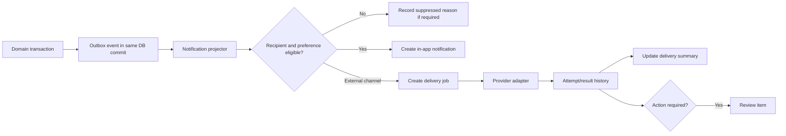
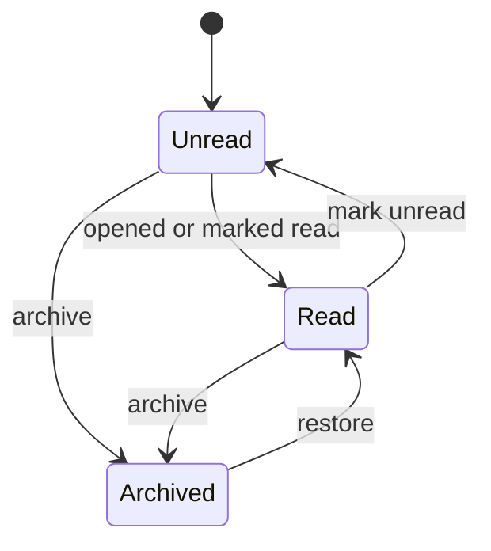
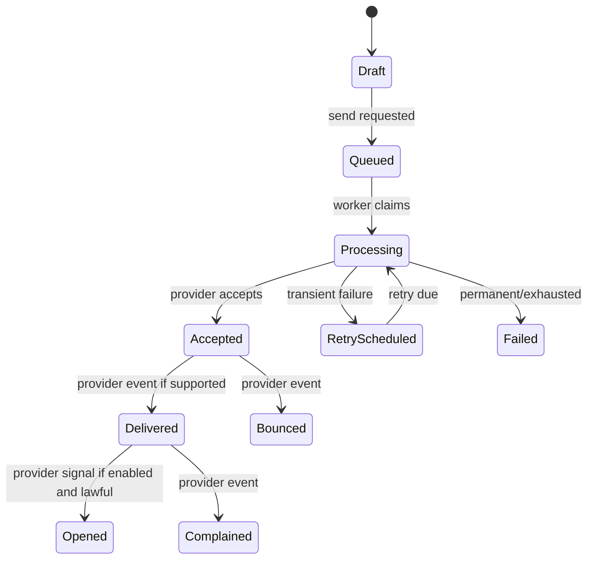
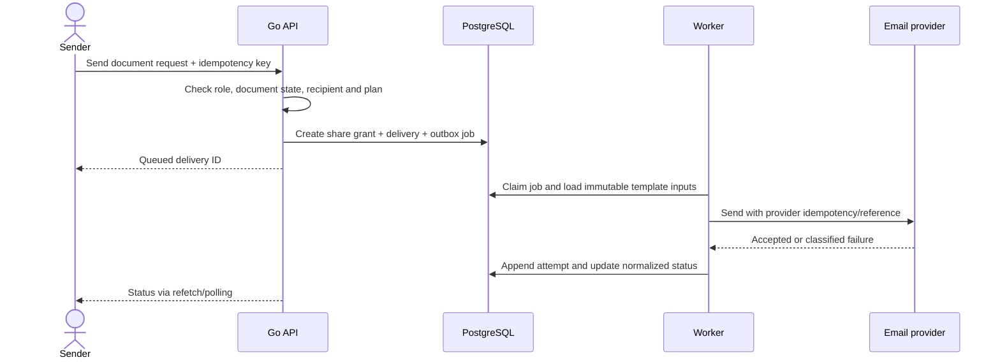
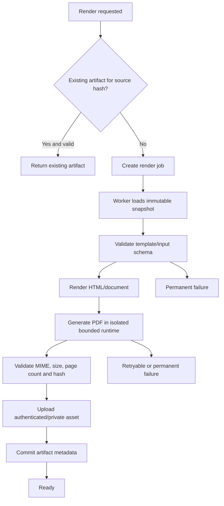
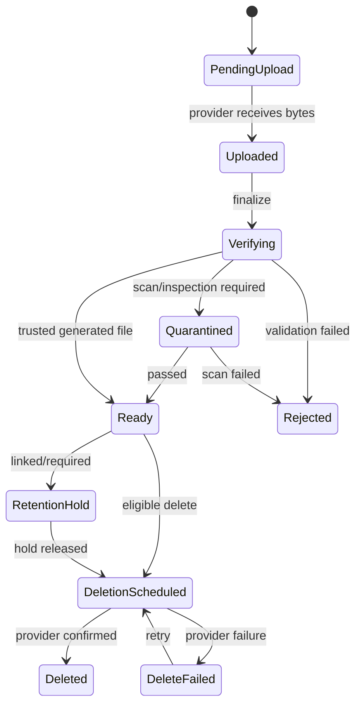
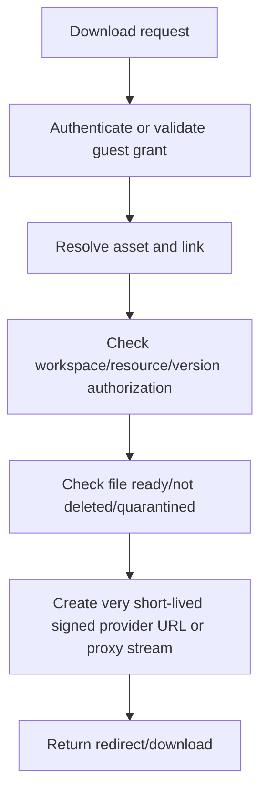
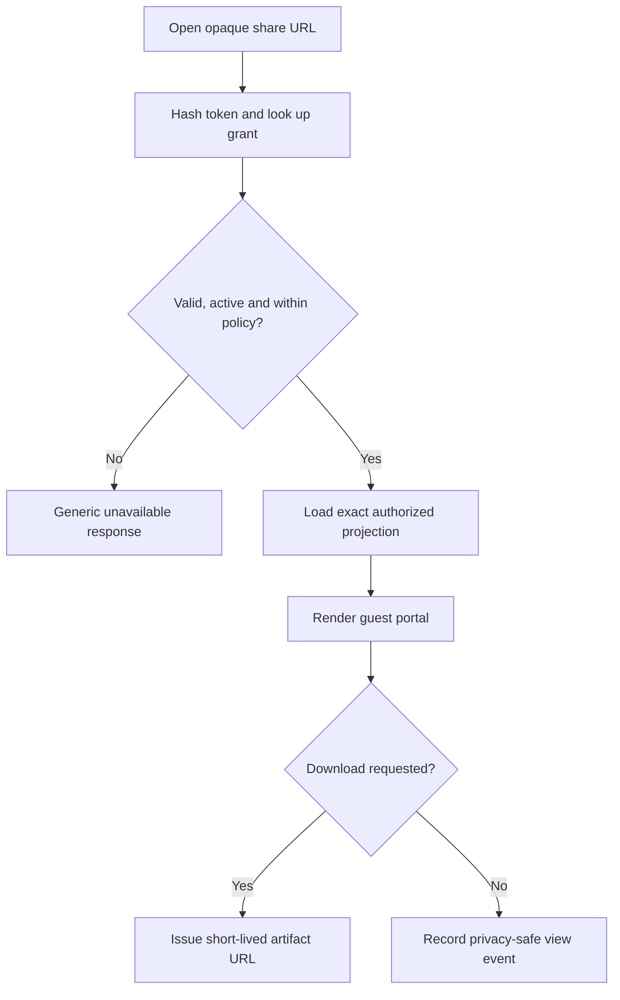

# Notifications, Documents, Files and Sharing Blueprint

**Status:** Complete draft  
**Depends on:** documents 00–13  
**Core rule:** creating or posting a financial record is independent from generating, sharing or delivering its representation

## 1. Purpose

This blueprint defines the cross-product infrastructure for:

- in-app notifications and action-required review items;
- email delivery through an HTTPS provider;
- user-initiated WhatsApp sharing;
- financial and operational PDF generation;
- public guest-document links;
- uploads, attachments and public media;
- Cloudinary public and authenticated delivery;
- delivery attempts, receipts, views and failures;
- versioning, retention, download and deletion;
- retry, idempotency, observability and provider replacement.

It applies to sales documents, purchase documents, receipts, statements, reports, exports, billing documents, attachments, storefront assets and system notifications.

## 2. Locked boundaries

1. Financial posting success MUST NOT depend on PDF, email or messaging-provider success.
2. A share link always resolves one authorized resource/version and no wider history.
3. A recipient does not need a Rekordly account to view an explicitly shared guest document.
4. Contact information is not proof of platform identity.
5. Sensitive files MUST NOT use Cloudinary's ordinary public `upload` delivery.
6. Financial file access uses authenticated/private delivery and short-lived signed URLs.
7. PostgreSQL stores asset identity, metadata, authorization and lifecycle; it does not store provider URLs as permanent authority.
8. WhatsApp MVP means preparing a user-initiated message/link, not an autonomous WhatsApp accounting bot.
9. “Queued,” “sent,” “delivered,” “opened” and “viewed” are distinct claims.
10. A failed notification never reverses the business event that caused it.
11. No WebSocket is required for MVP; load/refetch and bounded polling are sufficient.
12. Provider adapters must be replaceable without changing financial domain logic.

## 3. Concepts that must remain separate

| Concept | Meaning |
|---|---|
| Domain event | Durable business fact such as `invoice_issued` |
| Notification | User-facing information about a fact |
| Review item | Work requiring a decision or correction |
| Render request | Request to create a PDF/image/export artifact |
| Artifact | Immutable generated file tied to a version/input snapshot |
| Share grant | Authorization to access a narrow resource externally |
| Delivery | Attempt to send a notification or link through a channel |
| View event | Valid portal/artifact access observation |
| Attachment | User-supplied evidence or media linked to a record |
| Public media | Intentionally public storefront/business visual asset |

One domain event may create several notifications and deliveries. A notification may exist without an external delivery. A delivery may point to a portal instead of attaching the PDF.

## 4. Notification versus Review

Notifications inform. Review items require action.

Examples:

| Event | Notification | Review item |
|---|---:|---:|
| Invoice email accepted by provider | Optional | No |
| Invoice email permanently failed | Yes | Yes for sender/admin |
| Stock below reorder level | Yes | Optional, depending on workflow |
| AI draft needs clarification | Optional | Yes |
| Import contains invalid rows | Yes | Yes |
| Payment received | Yes | No unless allocation is unresolved |
| Bank/suspense record unresolved | Yes | Yes |
| Domain verification failed | Yes | Yes |
| Subscription renewal succeeded | Yes to billing owner | No |

Dismissing a notification does not resolve the underlying review item. Resolving the work may automatically close its review item.

## 5. Actors and authorization

| Actor | Capabilities |
|---|---|
| Workspace owner/admin | Configure permitted notification defaults, generate/share documents, manage files within role |
| Staff/cashier | Generate/share only documents allowed by role and outlet scope |
| Accountant | View/download accounting evidence and reports within granted scope; external sharing requires explicit permission |
| Personal owner | Manage own attachments, exports and personal notifications |
| Guest recipient | Access only the exact share grant and enabled actions |
| Worker | Render, store and deliver bounded jobs under service authority |
| System admin | Diagnose redacted provider/job state; cannot browse user documents casually |

Every click from a notification and every artifact download rechecks current authorization. A stale notification is never a capability token.

## 6. Channels in MVP

| Channel | MVP support | Notes |
|---|---|---|
| In-app | Yes | Durable notification inbox |
| Email | Yes | HTTPS API preferred; SMTP only on permitted host with domain authentication |
| WhatsApp handoff | Yes | User opens WhatsApp with prepared text and guest-safe URL |
| Copy link | Yes | Explicit share grant |
| Browser push | Deferred | Requires permission/lifecycle design |
| SMS | Deferred | OTP may use separate auth provider; not general notification channel |
| Autonomous WhatsApp API send | Deferred | Requires provider, templates, consent, cost and webhook design |

## 7. Event-to-notification pipeline



The outbox row is committed atomically with the domain fact. External delivery occurs after commit.

## 8. Notification categories

- `security`: OTP/session/password/contact/account warnings;
- `financial_document`: invoice, receipt, bill, payment and statement status;
- `operations`: order, stock, procurement and fulfilment events;
- `review_required`: import, reconciliation, ambiguity and approval;
- `delivery`: PDF, email, share and export status;
- `billing`: plan, usage, renewal and payment status;
- `system`: maintenance, incident and policy notices;
- `insight`: budget/limit/lifestyle information where enabled.

Security and legally required notices cannot be disabled. Marketing communication, if introduced, remains a separate consent category.

## 9. Recipient resolution

Internal recipient resolution uses user/workspace identity and role rules. External recipient resolution uses a contact snapshot supplied for the delivery.

Rules:

- do not assume a customer email belongs to a Rekordly user;
- do not merge customers across workspaces;
- snapshot the chosen destination for each send attempt;
- changing a party email later does not rewrite past delivery history;
- validate syntax but do not claim ownership verification unless separately performed;
- role/outlet restrictions filter internal recipients;
- a removed member receives no new workspace notification after removal;
- security notices go to the affected identity even if workspace preferences suppress ordinary messages.

## 10. Preference resolution

Effective preference is resolved in this order:

1. mandatory security/legal policy;
2. recipient-level opt-out/consent;
3. user channel/category preference;
4. workspace default where applicable;
5. event default;
6. provider/incident override.

A workspace owner cannot subscribe a staff member to optional personal email without the staff member's permitted consent. A customer email entered for an invoice permits transaction-related delivery for that document, not general marketing.

## 11. In-app notification states



Notification read state is per user, not browser. Bulk mark-read is idempotent and bounded by an explicit filter/cutoff.

## 12. In-app notification payload

Store only the information required to render and navigate safely:

```json
{
  "category": "delivery",
  "template_key": "invoice_email_failed",
  "template_version": 2,
  "workspace_id": "...",
  "resource_type": "sales_document",
  "resource_id": "...",
  "severity": "warning",
  "action_key": "open_delivery_detail",
  "created_at": "..."
}
```

The API resolves display text and verifies access. Notification metadata MUST NOT duplicate raw document contents, full contact data, narration or secrets.

## 13. Notification inbox experience

The inbox supports:

- all/unread/category filters;
- workspace/space label;
- newest-first cursor pagination;
- mark read/unread;
- archive/restore;
- direct safe action;
- delivery status when relevant;
- empty/loading/error/offline states.

The badge count is a server-derived unread count. Bounded polling may run while the shell/inbox is visible, with backoff on background tabs or errors.

## 14. Notification deduplication and aggregation

Avoid floods without hiding important facts.

- unique notification key may include recipient, event, template and resource;
- duplicate outbox delivery produces one notification;
- repeated low-stock events may aggregate by outlet and bounded time window;
- security, payment and irreversible-operation notices are not broadly aggregated;
- an aggregate stores count and latest occurrence while retaining source-event references;
- resolving one source does not falsely resolve unrelated items;
- rate limits suppress external delivery only under documented policy, not the durable event.

## 15. Email provider decision

Use a provider abstraction with an HTTPS email API as the initial production path. Resend is the leading option because Render Free blocks common outbound SMTP ports.

Existing SMTP MAY be used only when:

- the deployment host permits the required outbound port;
- TLS verification is enforced;
- credentials are secret-managed;
- SPF, DKIM and DMARC are configured;
- bounce/complaint handling is available or otherwise operationally covered;
- timeouts and retry classification are implemented.

The provider choice and paid allowance must be verified before public launch.

## 16. Email identities and authentication

Before sending production email:

- verify the sending domain;
- publish SPF and DKIM records;
- publish and monitor DMARC;
- configure a human-monitored reply/support path;
- separate transactional and future marketing streams where practical;
- define friendly From names without spoofing a merchant's domain;
- avoid using customer-provided From addresses;
- use Reply-To only after validation and policy review.

Merchant documents may display the merchant's contact details inside the content, while the transport sender remains an authenticated Rekordly domain.

## 17. Email composition

An email is rendered from a versioned template plus bounded structured variables.

Required parts:

- plain-text body;
- responsive HTML body;
- clear sender/business identity;
- purpose and document type;
- safe portal action;
- expiry/limitations where applicable;
- support/report-abuse path;
- no unnecessary sensitive details in subject or preview text.

User-supplied names, notes and text are escaped. They are data, never template/HTML instructions.

## 18. Email attachments versus secure links

Default to a secure guest portal link instead of attaching sensitive PDFs.

Reasons:

- share revocation remains possible;
- corrected/superseded versions can be communicated explicitly;
- provider/mailbox size exposure is reduced;
- access and view events are observable;
- short-lived artifact URLs remain server-controlled.

If PDF attachment is enabled for a document type:

- attach the exact immutable artifact version;
- enforce size and malware/content checks;
- disclose that email attachments cannot be revoked after delivery;
- never fetch the attachment from an untrusted client URL;
- avoid attaching internal evidence or cost data to customer-facing messages.

## 19. Email delivery states

Rekordly uses normalized states:



Terminology:

- `accepted` means the provider accepted responsibility, not that the recipient received/read it;
- `delivered` means provider-reported delivery, not human reading;
- `opened` is an unreliable privacy-sensitive tracking signal and must not be described as proof of reading;
- guest portal `viewed` is separate from email opening.

## 20. Send flow



The send request does not re-issue the invoice or re-post accounting.

## 21. Email retry policy

Retry only transient failures:

- timeout before known acceptance;
- provider 429 with bounded `Retry-After`;
- provider 5xx/transient network errors;
- temporary mailbox/provider response where classified safely.

Do not automatically retry:

- invalid address;
- suppressed/complained recipient;
- policy rejection;
- message too large;
- unauthorized provider credential;
- invalid template input.

When acceptance outcome is ambiguous, query provider status using the stored reference before sending again. Every attempt has its own ID; one delivery has a stable idempotency identity.

## 22. Bounce, complaint and suppression

- hard bounce suppresses future ordinary email to that exact normalized destination until corrected/reviewed;
- soft bounces follow bounded retry/provider guidance;
- complaints immediately suppress non-mandatory delivery;
- security/legal delivery follows applicable policy but must not repeatedly abuse a failing address;
- suppression reason and source are access-controlled;
- staff see actionable wording without provider internals;
- changing a contact destination creates a new destination identity rather than erasing history;
- unsubscribe applies to its category/scope, not transactional documents the recipient requested.

## 23. Provider webhooks

Email-provider webhooks follow the same security discipline as payment webhooks:

1. verify signature on the raw bounded body;
2. store a redacted unique event envelope;
3. map provider event to internal delivery/attempt;
4. process idempotently;
5. reject unknown references without leaking data;
6. tolerate duplicates and out-of-order events;
7. never regress a terminal state incorrectly;
8. alert on sustained signature or mapping failures.

## 24. WhatsApp sharing scope

MVP WhatsApp sharing is a client-side handoff:

1. authorized user chooses Share → WhatsApp;
2. server creates/reuses a suitable guest share grant;
3. client receives prepared message text and URL;
4. client opens a WhatsApp deep link/share target;
5. user chooses recipient and explicitly sends;
6. Rekordly records `handoff_opened`, not `message_sent` or `delivered`.

Rekordly cannot truthfully claim delivery without an integrated WhatsApp provider callback.

## 25. Prepared WhatsApp message

The prepared message SHOULD contain:

- merchant/business name;
- document type and public-facing number where appropriate;
- short neutral context;
- guest-safe HTTPS link;
- expiry wording where applicable.

Avoid including full financial detail, customer address, account details or internal notes in the message body. URL text is encoded once and tested across supported browsers/devices.

## 26. WhatsApp handoff security

- never place an authenticated API bearer token in the WhatsApp URL;
- use the opaque guest token route;
- do not include secret file-provider URLs;
- allow copy-message/copy-link fallback if app handoff fails;
- warn that messages sent through WhatsApp leave Rekordly's controlled environment;
- revoking a share grant disables the portal link but cannot delete a message or downloaded PDF already received;
- do not record the chosen WhatsApp recipient in MVP because Rekordly does not observe it reliably.

## 27. Future WhatsApp Business API boundary

Autonomous sending/accounting is deferred until the following are selected:

- approved provider and account ownership;
- user/customer consent model;
- template approval and session-window rules;
- inbound identity verification;
- cost/credit accounting;
- delivery/read webhook normalization;
- opt-out and abuse handling;
- media retention;
- human escalation;
- AI safety and draft confirmation.

The current delivery model is designed to add such an adapter later without pretending it exists now.

## 28. Generated artifact types

- estimate/proforma PDF;
- invoice PDF;
- payment receipt PDF;
- credit/debit note PDF;
- customer/supplier statement PDF;
- purchase order/remittance document PDF;
- goods receipt/waybill where enabled;
- financial/tax-readiness report PDF;
- ownership/data export archives;
- subscription billing invoice/receipt;
- storefront image derivatives.

Each type declares whether it is public-shareable, private-only, regenerable, legally immutable, plan-gated and retention-sensitive.

## 29. Immutable rendering input

A financial PDF renders from an immutable source snapshot/version, not mutable live tables.

The render input includes:

- document type and version;
- public number/date/status;
- sender identity snapshot;
- recipient identity/address snapshot as permitted;
- line/total/tax/currency snapshots;
- payment/allocation status as-of the declared time;
- branding/template version;
- terms/notes intended for recipient;
- disclosure/limitation text;
- locale and timezone;
- render schema version.

Catalogue, party, logo or template edits do not silently rewrite an issued historical artifact.

## 30. PDF generation flow



Render idempotency uses artifact type, source version/hash, template version, locale and relevant options.

## 31. PDF correctness requirements

- totals match the stored authoritative snapshot exactly;
- minor-unit/fixed-decimal formatting follows currency metadata;
- page breaks do not detach headers/totals misleadingly;
- fonts support expected names and symbols;
- long line descriptions wrap without overlap;
- logos preserve aspect ratio and have safe size limits;
- tax/discount/payment labels are unambiguous;
- draft/proforma watermarks are clear where needed;
- cancelled/voided/corrected artifacts show status;
- QR/barcode, if used, encodes only approved portal/reference data;
- accessibility metadata and selectable text are preferred;
- generated PDF is visually regression-tested on representative fixtures.

## 32. PDF version and correction rules

- issued version gets a stable artifact identity;
- regenerating identical input may reuse exact bytes/artifact;
- changing presentation without changing business facts creates a new render version linked to the same source version;
- changing issued business facts requires the correction/supersession workflow from the domain document;
- an old shared artifact remains auditable and may be marked superseded;
- portal shows the exact shared version and, where safe, that a newer version exists;
- do not silently replace a file behind an immutable audit reference.

## 33. Report export parity

CSV and PDF generated for the same report request must share:

- workspace and authorization scope;
- filters;
- accounting basis;
- as-of/timezone;
- currency;
- source query snapshot or consistency marker;
- totals and limitations.

Different presentation rounding may be displayed only if underlying totals remain reconcilable and the format explains it.

## 34. File classification

| Class | Examples | Delivery |
|---|---|---|
| Public media | storefront product image, approved logo/cover | Cloudinary public delivery with controlled transforms |
| Authenticated financial artifact | invoice PDF, receipt, report | authenticated/private asset + short-lived signed download |
| Private evidence | receipt upload, supplier bill, identity/support evidence | authenticated/private; strict authorization |
| Temporary processing file | import CSV, render intermediate | private temporary storage; short retention |
| Export archive | ownership/export ZIP/CSV | private, expiring download |

Classification is server-selected from purpose. The client cannot mark an arbitrary financial attachment as public.

## 35. Cloudinary initial use

Use the existing Cloudinary account for:

- public business logos and storefront catalogue media;
- approved image transformations/derivatives;
- sensitive assets only when authenticated/private delivery, signed upload/download, deletion, retention, export, cost and location controls are verified.

For invoices, receipts and financial attachments:

- never use default public `upload` delivery;
- prefer `authenticated` delivery or carefully verified private delivery;
- store provider public ID/asset ID, resource type, delivery type, version, bytes, format and checksum;
- issue short-lived signed access server-side;
- verify authorization before every signature;
- keep a migration path to private S3-compatible storage.

## 36. Storage provider abstraction

Domain code operates on a file service port:

```text
CreateUploadIntent(purpose, owner, constraints)
FinalizeUpload(providerEvidence)
OpenAuthorizedDownload(asset, actor, disposition)
StoreGeneratedArtifact(stream, metadata)
DeleteOrSchedule(asset, policy)
GetVerifiedMetadata(asset)
```

The port returns internal asset IDs. Cloudinary identifiers remain adapter details outside authorized storage/file modules.

## 37. Direct upload flow

```mermaid
sequenceDiagram
    actor U as User
    participant A as Go API
    participant C as Cloudinary
    participant D as PostgreSQL
    U->>A: Request upload intent with purpose/filename/size/MIME
    A->>A: Check role, plan, purpose and allowance
    A->>D: Reserve storage and create pending file
    A-->>U: Narrow signed upload parameters
    U->>C: Upload bytes directly
    U->>A: Finalize with provider evidence
    A->>C: Verify asset metadata server-side
    A->>A: Validate type, bytes, delivery type and ownership tag
    A->>D: Mark quarantined/scanning or ready; consume reservation
```

A client callback alone cannot finalize a file. The server verifies provider metadata and expected signed parameters.

## 38. Upload validation

Validate:

- allowed purpose for actor/resource;
- declared and detected MIME/type;
- file extension only as a hint;
- byte size and storage entitlement;
- image dimensions/pixel count;
- page count where inspectable;
- archive structure and compression limits;
- checksum where available;
- malware/content scan for risky file types;
- provider delivery/access type;
- asset tag/folder ownership metadata;
- filename sanitization for display and download.

Rejected/quarantined files are never exposed to other users or passed to AI/rendering.

## 39. Allowed file policy

Initial policy SHOULD be purpose-specific:

- storefront images: JPEG, PNG, WebP; SVG only after a safe sanitization decision;
- receipt/evidence: JPEG, PNG, PDF;
- CSV import: UTF-8/recognized text CSV within row/byte limits;
- generated documents: PDF created by trusted renderer;
- export archive: trusted server-created formats.

Executable, HTML/script, macro-enabled office documents and arbitrary archives are rejected unless a later workflow has isolated processing controls.

## 40. Image transformations

Public media may use allowlisted transformations:

- fit/crop to known display sizes;
- format/quality auto-selection within quality baseline;
- metadata stripping where privacy requires;
- placeholder/thumbnail generation;
- maximum dimensions and pixel count.

Do not accept arbitrary transformation strings from clients if they can create cost amplification or unexpected disclosure. Sensitive source assets remain authenticated even when a derivative is requested.

## 41. File lifecycle states



Database metadata remains as a tombstone/audit record where required after provider deletion.

## 42. Attachment linking

- upload/file finalization and record linking are separate auditable operations;
- an attachment belongs to one workspace/Personal subject;
- linking cross-workspace asset IDs is rejected;
- one asset may be linked to multiple records only under an explicit supported policy;
- link role declares `receipt`, `supplier_bill`, `contract`, `product_image`, `logo`, `other`;
- user-facing description is distinct from filename;
- removing a link does not immediately delete a shared/retained asset;
- issued document PDFs are artifacts, not mutable user attachments.

## 43. Private download flow



The signed URL TTL is bounded and shorter for sensitive artifacts. Response uses safe content type and disposition filename. A provider URL is not stored in notifications or long-lived share messages.

## 44. Public guest share grants

A share grant contains:

- internal ID;
- hash of a high-entropy random token;
- workspace/resource type/resource ID;
- exact source/artifact version policy;
- permitted actions: view, download, print, accept where supported;
- effective/expiry times;
- revocation state/reason;
- creator and purpose;
- optional recipient hint/binding policy;
- view/download counters and abuse state.

Only the raw token in the URL grants guest access. Store only its hash. Sequential resource IDs never authorize access.

## 45. Guest-link creation

1. authorize sender and document state;
2. choose exact version and permitted actions;
3. apply plan/policy and expiry bounds;
4. generate at least 128 bits of cryptographically secure entropy;
5. store token hash and share metadata;
6. return raw token URL once to authorized caller;
7. create audit event;
8. optionally queue channel delivery.

Repeated share can either reuse an active compatible grant or create a new grant according to purpose. The API makes this choice explicit; accidental duplicate links are avoided with idempotency keys.

## 46. Guest portal access

Guest access flow:



Invalid, expired, revoked and nonexistent tokens SHOULD return similarly neutral responses to limit enumeration.

## 47. Guest portal content boundary

Public projection may include:

- business/sender identity intended for recipient;
- public document number/type/status;
- recipient-facing snapshot;
- lines, totals, taxes, due/payment state;
- terms, notes and payment instructions explicitly approved;
- download/print and optional acceptance actions;
- account-creation invitation.

It MUST exclude:

- internal notes;
- cost/margin and inventory valuation;
- staff/private audit detail;
- unrelated party documents/history;
- internal account/journal identifiers;
- raw attachment storage URLs;
- other customer contact information;
- provider secrets.

## 48. View and download events

Normalize portal observations carefully:

- `portal_opened`: valid grant rendered;
- `artifact_download_requested`: authorized download URL issued;
- `artifact_download_confirmed`: only if reliably observed/proxied/provider-supported;
- `document_action_completed`: explicit acceptance/action command;
- `link_blocked`: invalid/expired/revoked/rate-limited, stored without unsafe raw token.

Automated email-security scanners may open links. Therefore `portal_opened` is not guaranteed proof that the human recipient read the document. UI wording uses “link opened” or “portal viewed,” with limitations.

## 49. Share revocation and expiry

- authorized sender/admin may revoke a grant;
- document correction may revoke or mark old links superseded according to policy;
- expiry is checked on every portal/download request;
- existing short-lived provider URLs expire naturally and are kept very short;
- revocation cannot recall already downloaded files or messages;
- audit preserves who revoked, when and why;
- creating a replacement does not resurrect the old token;
- account deletion/retention processes revoke relevant external access before final data deletion.

## 50. Optional recipient account conversion

The portal may say: “Want all invoices from businesses using Rekordly in one place? Create a free account.”

Claim flow follows document 05:

- registration is optional;
- verify email/phone independently;
- require proof linking identity to the party/contact;
- recipient identity never merges business-owned party records;
- only eligible shared documents appear;
- an existing guest token alone is insufficient to claim all past/future documents for a contact.

## 51. Document/send status model

Sales or purchase documents expose separate dimensions:

| Dimension | Examples |
|---|---|
| Business state | draft, issued, paid, cancelled |
| Artifact state | not_requested, queued, rendering, ready, failed |
| Share state | none, active, expired, revoked |
| Delivery state | not_requested, queued, accepted, delivered, failed, bounced |
| Portal state | never_opened, opened, downloaded/actioned where reliable |

Never collapse these into one ambiguous `sent` boolean.

## 52. Delivery summary algorithm

For a document with several deliveries:

```text
summary(document):
  attempts = authorized delivery records for current/specified version
  if none: not_sent
  if any processing/queued and no later terminal success: sending
  if any delivered: delivered
  else if any accepted: accepted
  else if any handoff_opened: shared_externally_unverified
  else if all terminal failures: failed
  else: mixed
```

The detail screen always shows per-recipient/channel attempts. A summary never hides that one recipient failed while another succeeded.

## 53. Resend and duplicate protection

User can resend after reviewing destination and version.

- an accidental double click with the same idempotency key creates one delivery;
- deliberate resend creates a new delivery linked to the previous one;
- default resend uses current approved version, but warns if previous recipient saw an older version;
- permanent bounce requires correction before resend;
- retry uses the same delivery; resend is a new user intent;
- rate limits prevent abuse;
- financial document is not re-issued or renumbered.

## 54. Notification and delivery APIs

### Internal notification

- `GET /v1/me/notifications`
- `GET /v1/me/notifications/unread-count`
- `POST /v1/me/notifications/{id}/commands/mark-read`
- `POST /v1/me/notifications/{id}/commands/mark-unread`
- `POST /v1/me/notifications/{id}/commands/archive`
- `POST /v1/me/notifications/commands/mark-read-bulk`
- `GET /v1/me/notification-preferences`
- `PUT /v1/me/notification-preferences`

### Rendering/artifacts

- `POST /v1/{scope}/{id}/documents/{document}/commands/render`
- `GET /v1/render-jobs/{id}`
- `GET /v1/artifacts/{id}`
- `POST /v1/artifacts/{id}/commands/create-download`

### Sharing/delivery

- `POST /v1/{scope}/{id}/documents/{document}/share-grants`
- `GET /v1/{scope}/{id}/documents/{document}/share-grants`
- `POST /v1/share-grants/{id}/commands/revoke`
- `POST /v1/{scope}/{id}/documents/{document}/deliveries`
- `GET /v1/deliveries/{id}`
- `POST /v1/deliveries/{id}/commands/retry`
- `POST /v1/deliveries/{id}/commands/resend`
- `POST /v1/{scope}/{id}/documents/{document}/whatsapp-handoff`

### Guest

- `GET /s/{opaque_token}`
- `POST /s/{opaque_token}/commands/create-download`
- document-specific guest action commands where explicitly supported.

Raw token paths must be redacted from application logs and analytics.

## 55. File APIs

- `POST /v1/{scope}/{id}/files/upload-intents`
- `POST /v1/files/{id}/commands/finalize-upload`
- `GET /v1/files/{id}`
- `POST /v1/files/{id}/commands/create-download`
- `POST /v1/files/{id}/commands/link`
- `POST /v1/file-links/{id}/commands/unlink`
- `POST /v1/files/{id}/commands/request-deletion`
- `GET /v1/{scope}/{id}/files?resource_type=...&resource_id=...`

All scope IDs are verified against authenticated membership; arbitrary body-supplied workspace ownership is rejected.

## 56. Data model

### `notifications`, `notification_user_states`

- recipient user;
- source event and dedupe key;
- workspace/resource references;
- category, severity, template/version and action key;
- created/expiry time;
- per-user read/archive timestamps.

### `notification_preferences`

- user, category and channel;
- enabled/disabled or schedule;
- source and updated time;
- mandatory-policy exception represented separately.

### `document_artifacts`

- source type/ID/version/hash;
- artifact type/schema/template/version/locale;
- status, MIME, bytes, pages and checksum;
- internal file/asset ID;
- created by/job/error class;
- supersession/retention metadata.

### `files`

- owning subject/workspace;
- purpose/classification;
- original display filename and normalized extension;
- declared/detected MIME;
- bytes/checksum/dimensions/pages;
- storage provider and provider asset identifiers;
- delivery/resource type/version;
- lifecycle/scan/retention state;
- uploader and timestamps.

### `file_links`

- file and typed resource;
- link role/visibility;
- creator and timestamps;
- active/unlinked state.

### `share_grants`

- token hash;
- typed exact resource/version;
- permissions;
- effective/expiry/revocation state;
- creator/purpose;
- abuse counters and last access metadata.

### `deliveries`, `delivery_attempts`

- source resource/version;
- channel and destination snapshot/tokenized reference;
- normalized status;
- template/version;
- share grant/artifact references;
- user intent/idempotency key;
- provider reference;
- attempt timestamps, classification and redacted response metadata.

### `share_access_events`

- share grant;
- normalized action;
- timestamp;
- coarse abuse/security metadata;
- optional safe user-agent/device class;
- never raw token.

## 57. Job model

Job types include:

- `project_notification`;
- `render_pdf`;
- `store_artifact`;
- `send_email`;
- `process_email_webhook`;
- `scan_upload`;
- `verify_upload`;
- `delete_asset`;
- `expire_share_grant`;
- `expire_export`;
- `reconcile_storage`;
- `reconcile_delivery`.

Each job has bounded attempts, next-attempt time, lease owner/expiry, idempotency key, last safe error code and dead-letter visibility.

## 58. Worker claiming algorithm

```text
claimJobs(worker, types, limit, now):
  begin transaction
  select eligible jobs
    where status in (queued, retry_scheduled)
      and next_attempt_at <= now
      and type in allowed types
    order by priority, created_at
    for update skip locked
    limit bounded_limit
  mark processing with worker and lease expiry
  commit
  process each outside claim transaction
  finalize idempotently
```

Long rendering/upload/provider calls never hold database locks. Lease recovery checks whether the external side effect already occurred before repeating it.

## 59. Error classification

| Class | Example | Behaviour |
|---|---|---|
| Validation permanent | unsupported file/template input | fail; user action |
| Authorization permanent | sender lost permission before queued share | cancel/fail safely |
| Provider transient | timeout/429/5xx | bounded retry |
| Provider permanent | rejected address/policy | fail/suppress as appropriate |
| Ambiguous external outcome | timeout after send | query/reconcile before retry |
| Storage integrity | checksum/metadata mismatch | quarantine and alert |
| Renderer defect | invariant/page generation failure | dead-letter after bounded attempts |
| Security | invalid webhook/signature/token abuse | reject, rate-limit, alert as threshold requires |

User messages remain actionable and do not expose provider secrets or stack traces.

## 60. Retention

Retention is purpose-specific:

- issued financial artifacts follow business/legal retention policy;
- user evidence follows linked-record and deletion policy;
- temporary render/import files expire quickly;
- export archives expire after a short published download window;
- share grants may expire before underlying artifacts;
- provider delivery events retain only necessary redacted evidence;
- deleted-link assets are removed only when no active link/hold/retention requirement remains;
- explicit account deletion follows the 60-day process in document 16 and lawful retention exceptions.

Subscription expiry does not trigger file deletion.

## 61. File deletion algorithm

```text
requestFileDeletion(actor, file):
  1. Authorize actor and subject.
  2. Load active links, issued artifacts, legal/audit holds and share grants.
  3. If evidence must remain, remove permitted visibility/link only and explain retention.
  4. Revoke relevant share grants immediately.
  5. Mark deletion_scheduled with policy date.
  6. Worker deletes provider asset using exact provider ID/type/version rules.
  7. Verify not found/deleted result idempotently.
  8. Tombstone metadata and release storage usage when deletion is confirmed.
  9. Preserve required audit fields without retaining unnecessary content.
```

A database row must not be hard-deleted before provider cleanup and required audit/retention decisions are durable.

## 62. Backup, restore and portability

Database backup alone is not a file backup.

Before production:

- inventory all provider assets from PostgreSQL metadata;
- define whether Cloudinary originals/versions can be exported/restored;
- keep checksums and provider-independent metadata;
- rehearse restoring database plus representative private/public assets into an isolated environment;
- detect missing/orphaned assets;
- document migration to alternative object storage;
- avoid templates containing provider-specific permanent URLs;
- include files/artifacts in user ownership exports where appropriate.

Cloudinary suitability as the permanent sensitive-document store remains an explicit launch dependency.

## 63. Security controls

- high-entropy hashed guest tokens;
- short-lived signed private downloads;
- raw token/query/path redaction in logs;
- authorization before URL signing;
- CSP, safe content disposition and MIME-sniffing protection on portals/downloads;
- no user HTML execution in templates or PDFs;
- isolated renderer with no arbitrary network/file access;
- upload allowlists, byte/pixel/page limits and scanning;
- SSRF protection: workers never fetch arbitrary user URLs;
- signature verification for provider webhooks;
- rate limits per account, workspace, destination, IP/token and operation;
- secrets only in managed environment configuration;
- provider dashboard MFA and least-privilege keys;
- audit for share creation/revocation/download, sensitive file access and admin actions.

## 64. Guest portal web controls

- no indexing: `noindex, nofollow` and appropriate headers;
- no sensitive data in HTML title/Open Graph previews beyond approved safe identity;
- restrictive referrer policy;
- HTTPS only;
- avoid third-party analytics/scripts that receive token URLs;
- do not embed raw provider private URLs;
- CSRF protection or token-bound idempotency for guest mutation actions;
- neutral errors and rate limiting;
- cache policy prevents shared-device/browser leakage;
- token removed/redacted from client telemetry.

## 65. Observability

Monitor:

- outbox lag and oldest event;
- notification projection failures;
- email queue depth/latency/acceptance/failure/bounce/complaint rates;
- renderer queue/latency/failure/page/byte distribution;
- upload finalize and quarantine failure rates;
- storage bytes and growth by safe class/plan bucket;
- signed-download creation failures;
- share invalid/expired/rate-limit rates;
- orphaned database/provider assets;
- deletion backlog;
- provider cost/allowance usage.

Metrics use IDs/classes/counts, not filenames, recipient addresses, document text, raw tokens or financial amounts.

## 66. Analytics events

Allowed product events include:

- `notification_opened`;
- `notification_preference_changed`;
- `document_render_requested`;
- `document_render_completed`;
- `document_render_failed`;
- `share_grant_created`;
- `share_grant_revoked`;
- `email_delivery_requested`;
- `email_delivery_status_changed`;
- `whatsapp_handoff_opened`;
- `guest_portal_opened`;
- `guest_download_requested`;
- `file_upload_started`;
- `file_upload_finalized`;
- `file_upload_rejected`.

Properties may include module, document type, channel, status/error class, file class, size bucket, template version, device class and workspace kind. Exclude names, emails, phone numbers, filenames, document numbers, amounts, notes, raw URLs/tokens and contents.

## 67. Offline behaviour

- cached notifications may be displayed as stale with last refresh time;
- mark-read may queue idempotently if document 15 permits;
- new external delivery, share-grant creation, signed download and upload finalization require online server authority;
- offline document creation can create a local pending render request, but cannot claim PDF/email success;
- WhatsApp handoff requires an already-valid share URL; otherwise it waits for connectivity;
- locally selected attachment bytes remain local until upload succeeds and must not appear as server-backed evidence prematurely.

## 68. Plan and usage enforcement

Document 13 controls:

- storage reservation;
- attachment/file count if introduced;
- PDF/report availability;
- email/message allowances if introduced;
- export cooldown;
- custom branding;
- history range.

Existing artifacts/files remain readable/downloadable after downgrade under ownership/retention rules. New upload/render/send may be blocked at a limit without rolling back the source financial record.

## 69. UI states

Every file/render/delivery surface defines:

- initial/empty;
- validating/uploading/rendering/queued;
- ready/accepted/delivered where supported;
- retry scheduled;
- failed with safe reason and next action;
- quarantined;
- expired/revoked/superseded;
- offline/stale;
- permission denied;
- plan limit;
- provider incident.

Financial issue screens say, for example: “Invoice issued. PDF is still being prepared,” rather than showing an ambiguous spinner over the whole transaction.

## 70. Acceptance and edge-case tests

### 70.1 Domain independence

- [ ] Invoice posts successfully while PDF provider is unavailable.
- [ ] PDF/email failure does not reverse journals, receivable, stock or document number.
- [ ] Retrying delivery does not reissue or duplicate the financial document.
- [ ] Outbox event and domain fact are committed atomically.

### 70.2 PDF correctness

- [ ] PDF totals match immutable document snapshot exactly.
- [ ] Long names, lines, tax combinations and multi-page documents render without overlap.
- [ ] Zero/large/minor-unit-decimal currency fixtures format correctly.
- [ ] Historical PDF does not change after customer/product/logo edits.
- [ ] Corrected document creates traceable version/supersession.
- [ ] CSV/PDF report filters/as-of/basis/totals reconcile.
- [ ] Duplicate render request reuses or creates one valid artifact.

### 70.3 Email

- [ ] Invalid email is rejected before provider call.
- [ ] Provider acceptance is not labelled delivered.
- [ ] Timeout after possible acceptance reconciles before retry.
- [ ] Duplicate send idempotency key sends once.
- [ ] Deliberate resend is distinct and audited.
- [ ] Hard bounce suppresses unsafe repeated sends.
- [ ] Complaint suppresses optional delivery.
- [ ] Invalid webhook signature has no state effect.
- [ ] Duplicate/out-of-order webhook is safe.
- [ ] Email failure creates review item where action is needed.

### 70.4 WhatsApp handoff

- [ ] Prepared message contains guest-safe URL, not API/provider token.
- [ ] Opening handoff is not recorded as sent/delivered/read.
- [ ] URL/text encode correctly with spaces, ampersands and Unicode.
- [ ] Copy-link fallback works when WhatsApp is unavailable.
- [ ] Revoked portal link stops future access.
- [ ] UI explains downloaded/copied content cannot be recalled.

### 70.5 Guest sharing

- [ ] Non-member views exact shared document without registration.
- [ ] Token grants no unrelated history or internal fields.
- [ ] Guessed/sequential IDs grant nothing.
- [ ] Invalid, expired and revoked tokens return neutral responses.
- [ ] Portal excludes internal notes, costs and staff audit details.
- [ ] Download requires a fresh short-lived signed URL.
- [ ] Link scanner/open event is not claimed as proven human reading.
- [ ] Old version behaviour is explicit after correction.
- [ ] Claiming an account requires independent verified identity.

### 70.6 Upload/storage

- [ ] Client cannot choose public delivery for financial evidence.
- [ ] Oversized/disallowed/polyglot file is rejected/quarantined.
- [ ] Filename cannot inject headers/HTML/path traversal.
- [ ] Direct upload finalization verifies provider metadata server-side.
- [ ] Cross-workspace file/link IDs are rejected.
- [ ] Storage reservation prevents concurrent limit overrun.
- [ ] Failed upload releases reservation safely.
- [ ] Replacing file reserves capacity before releasing old bytes.
- [ ] Quarantined file cannot be downloaded or sent to AI.
- [ ] Arbitrary transformation parameters are rejected.

### 70.7 Deletion/retention

- [ ] Unlinking evidence does not delete asset still linked elsewhere/on hold.
- [ ] Share grants revoke before eligible physical deletion.
- [ ] Provider deletion failure remains visible/retryable.
- [ ] Storage counter releases only after confirmed deletion policy point.
- [ ] Subscription expiry deletes nothing.
- [ ] Account deletion integrates with 60-day recovery and lawful retention.
- [ ] Restore rehearsal recovers representative metadata and assets.

### 70.8 Authorization/privacy

- [ ] Removed member cannot open old notification/resource.
- [ ] Cashier cannot share out-of-scope document.
- [ ] Staff cannot view private billing/security notifications.
- [ ] Raw guest tokens/private URLs/email addresses never enter analytics.
- [ ] Signed URL cannot be issued without current authorization.
- [ ] Guest page does not leak token to referrer/third-party scripts.

## 71. Launch gates

Before public beta:

1. verify Cloudinary public and authenticated/private configurations separately;
2. confirm whether Cloudinary meets sensitive-document retention/export/location/cost requirements;
3. select and configure HTTPS email provider;
4. configure SPF, DKIM and DMARC;
5. implement immutable PDF fixtures and visual regression checks;
6. verify guest-token entropy, hashing, expiry, revocation and log redaction;
7. implement upload validation/quarantine policy;
8. rehearse provider failure and idempotent retry;
9. rehearse database-plus-asset restore/export;
10. publish user-facing share, privacy and retention limitations.

If permanent private-file controls are not satisfactory, use Cloudinary only for public media and move sensitive documents to private S3-compatible object storage before broad public use.

## 72. Implementation handoff checklist

- [ ] Define notification categories/templates/preferences.
- [ ] Implement transactional outbox notification projection.
- [ ] Implement in-app inbox and unread count polling.
- [ ] Implement email provider port and HTTPS adapter.
- [ ] Implement email webhook inbox and normalized delivery states.
- [ ] Implement immutable render-input schemas and PDF worker.
- [ ] Add artifact hash/idempotency and visual fixtures.
- [ ] Implement file classification and storage provider port.
- [ ] Configure Cloudinary public and authenticated/private presets.
- [ ] Implement signed direct uploads and server verification.
- [ ] Add quarantine/scanning and purpose-specific validation.
- [ ] Implement private signed download authorization.
- [ ] Implement hashed guest grants and portal projection.
- [ ] Implement WhatsApp prepared-message handoff.
- [ ] Implement delivery detail/retry/resend/review UI.
- [ ] Implement retention, deletion and orphan reconciliation jobs.
- [ ] Add security, observability and acceptance tests.

