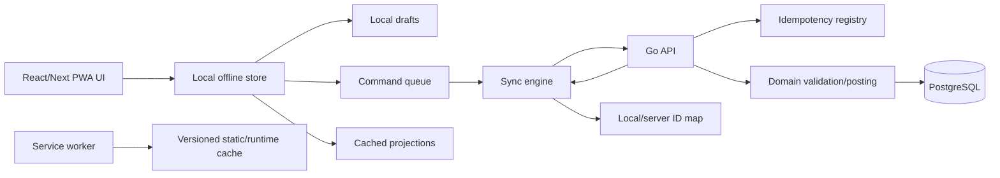
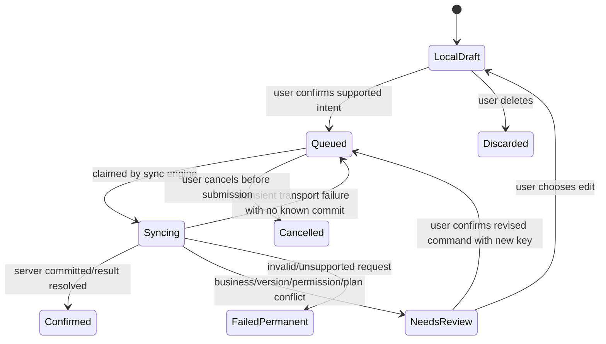
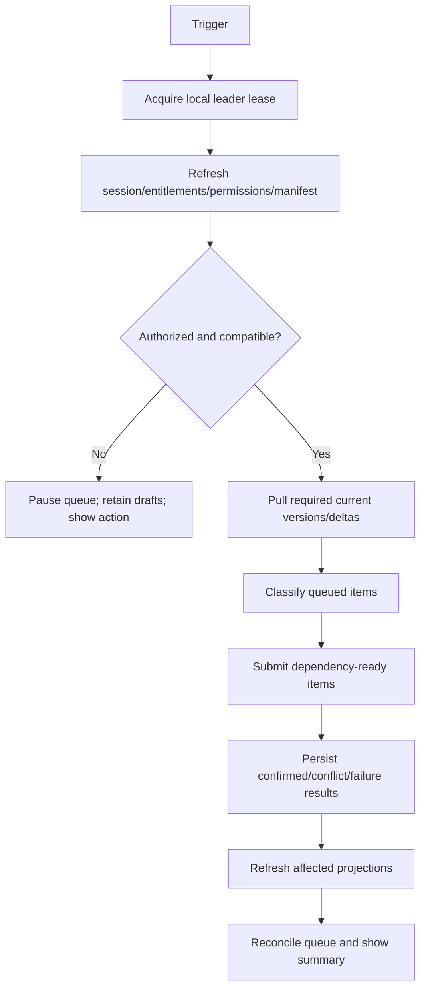
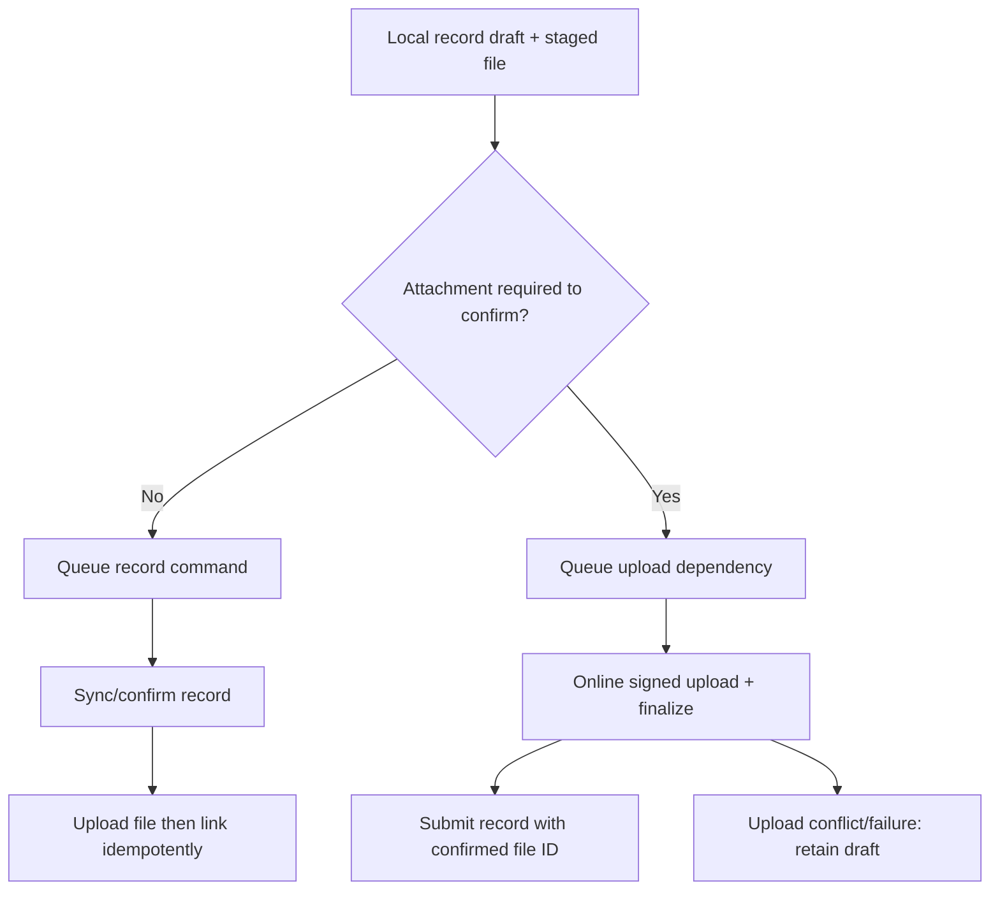

# Offline Sync, Conflicts and Recovery Blueprint

**Status:** Complete draft  
**Depends on:** documents 00–14  
**Core rule:** offline work may capture user intent, but only current server validation and a committed Go command can create financial, stock or entitlement truth

## 1. Purpose

This blueprint defines Rekordly's PWA and intermittent-connectivity behaviour:

- installable shell and safe caching;
- plan-dependent offline capability;
- local drafts and bounded command queue;
- stable client IDs and idempotency keys;
- dependency ordering and local-to-server ID mapping;
- reconnect, upload and server result reconciliation;
- stale state, version and business conflicts;
- multi-tab/device concurrency;
- attachments and temporary receipts;
- permission, plan and session changes while offline;
- queue recovery, export and support diagnostics;
- acceptance tests for duplicate prevention and data preservation.

This is not a general “offline-first database replication” design. Rekordly remains server-authoritative and selectively supports offline capture where risks can be explained and bounded.

## 2. Locked principles

1. Free currently receives cached read-only offline access.
2. Eligible Personal Plus and Business plans may create bounded offline drafts/commands.
3. A local queued item is never labelled posted, paid, issued, received, fulfilled or synced.
4. Finalized financial records are not silently edited offline.
5. Every offline mutation has a client-generated command ID and idempotency key.
6. The server rechecks identity, membership, permission, plan, limits, period, balances, stock and current versions at sync time.
7. The same key and payload returns the original durable result.
8. The same key with different payload returns an idempotency conflict.
9. Stale stock, allocation, wallet, loan, approval or closed-period commands are never blindly posted.
10. Conflict handling preserves the user's draft and explains what changed.
11. Offline pending items do not affect posted dashboards, accounting balances, receivables/payables or stock.
12. Queue size, byte size and age are bounded.
13. Logout, account switch and membership removal cannot expose cached data across identities.
14. No background sync claim is made on browsers that do not reliably support it.

## 3. Terminology

| Term | Meaning |
|---|---|
| Cached projection | Read-only server response stored for offline display |
| Local draft | Editable client-only representation not submitted as a command |
| Queued command | Frozen user-confirmed intent awaiting server submission |
| Client command ID | UUID/ULID identifying one client-side intent |
| Idempotency key | Stable key used by server to deduplicate one mutation |
| Base version | Server resource version/revision observed when editing began |
| Sync session | Bounded exchange between one installation and server |
| Conflict | Server cannot apply intent safely without review or changed input |
| Confirmed | Server durably committed command and returned its canonical result |
| Installation ID | Random per app installation/browser profile; not authentication |
| Local ID | Client-generated identifier used until a server resource ID is known |

## 4. Capability modes

The entitlement `offline.mode` resolves to one of:

| Mode | Cached read | Local drafts | Queue supported writes | Background attempt |
|---|---:|---:|---:|---:|
| `none` | Minimal shell only | No | No | No |
| `read_only` | Yes | Optional unsaved/local form policy | No | No |
| `draft_only` | Yes | Yes | Draft upload only | If supported |
| `queued_commands` | Yes | Yes | Allowlisted commands | If supported |

Security, session expiry and incident policy can reduce capability below the plan grant.

## 5. Why selective offline, not full replication

Financial and operational commands depend on shared current state:

- an invoice may already be paid;
- stock may be sold by another device;
- a period may be locked;
- a member's permission may be revoked;
- a plan limit may be reached;
- a customer deposit may be allocated elsewhere;
- an order/PO may change state;
- a document number may be assigned concurrently.

Therefore Rekordly caches projections and queues explicit commands; it does not merge arbitrary local database rows into PostgreSQL.

## 6. High-level architecture



The service worker caches transport resources. The app's local store owns structured user data and queue state. A service-worker cache is not used as the authoritative mutation queue.

## 7. PWA shell

The PWA provides:

- web app manifest with stable name/icons/theme;
- HTTPS-only service worker;
- installable shell where browser criteria allow;
- versioned static assets;
- offline fallback page/shell;
- visible update-available state;
- safe activation/rollback behaviour;
- no assumption that installation equals notification permission or background execution.

The application remains fully usable in supported browsers without installation when online.

## 8. Service-worker caching policy

| Resource | Strategy | Offline behaviour |
|---|---|---|
| Hashed JS/CSS/fonts | Cache-first, versioned | App shell loads |
| HTML/navigation | Network-first with safe fallback | Avoid stale auth-sensitive document pages |
| Public storefront media | Bounded stale-while-revalidate | Public catalogue remains viewable where cached |
| Authenticated API GET | App-managed structured cache, not blind shared HTTP cache | Permission/scope-aware stale display |
| Guest-token pages | Do not persist broadly | Network required or tightly controlled response |
| Signed private URLs/files | No durable generic cache | Reauthorize online |
| Mutation responses | Never cache as replay authority | Idempotency lookup from server |

`Cache-Control`, service-worker rules and app storage must agree. Sensitive API responses should not leak through shared browser/HTTP caches.

## 9. Cached projection envelope

Every cached projection includes:

```json
{
  "cache_schema_version": 1,
  "subject_id": "...",
  "workspace_id": "...",
  "resource_type": "dashboard_summary",
  "resource_version": "...",
  "server_as_of": "2026-11-07T12:00:00Z",
  "cached_at": "2026-11-07T12:00:03Z",
  "entitlement_revision": "...",
  "permission_revision": "...",
  "payload": {}
}
```

The UI shows the `server_as_of`/last-sync state. It never presents cached totals as current without a stale/offline indicator.

## 10. Local data partitioning

Local keys are partitioned by:

- app/environment;
- authenticated user ID;
- subject/workspace ID;
- local schema version;
- resource/queue type.

Workspace switching cannot read another workspace partition accidentally. A user identity change closes open stores/views before the new identity loads.

## 11. Sensitive local storage

Browser storage can be inspected on a compromised or shared device. HTTPS does not make IndexedDB secret at rest.

Controls:

- cache the minimum data needed;
- avoid secrets, OTPs, session tokens in queue payloads;
- avoid durable copies of private file-provider URLs;
- use non-exportable platform/browser mechanisms where feasible, but do not promise perfect device encryption;
- clear sensitive state on logout/account removal according to policy;
- allow user to clear offline data from Settings;
- bound retention and purge old projections/drafts;
- warn users on shared devices;
- use OS/device protections as an additional, not sole, control.

If local encryption is implemented, key lifecycle and logout destruction must be designed explicitly; storing the encryption key beside ciphertext provides limited protection.

## 12. Offline status model

Connectivity is not a simple browser boolean.

| State | Meaning |
|---|---|
| `online_healthy` | API health/revalidation succeeds |
| `online_degraded` | Network exists but API/provider/path has repeated failure |
| `offline_confirmed` | Browser/API checks indicate no usable connection |
| `checking` | State transition/retry in progress |
| `captive_or_blocked` | Network exists but API cannot be authenticated/reached |

`navigator.onLine` is only a hint. The sync engine uses bounded API health/auth results and backoff.

## 13. Global UI indicators

The shell shows:

- persistent offline/degraded banner;
- last successful server sync time;
- queue count by pending/needs-review/failed;
- active sync progress;
- cache-staleness labels;
- queue capacity warning;
- plan/permission/session restriction;
- “Update available” state when a new app version waits.

Indicators include text/icons, not colour alone.

## 14. Local draft versus queued command

### Local draft

- remains editable;
- may be incomplete;
- has not been confirmed for server posting;
- can be deleted locally;
- does not reserve a server number, stock, limit or money balance.

### Queued command

- created only after an explicit offline review/confirm action;
- payload is frozen for idempotency;
- carries base versions and dependency references;
- editing it creates a replacement command or returns it to draft before submission;
- is shown as pending server confirmation.

## 15. Offline queue state machine



A command whose request may have reached the server cannot be cancelled as if it never ran until idempotency status is resolved.

## 16. Queue item schema

```json
{
  "client_command_id": "01J...",
  "idempotency_key": "off_...",
  "command_type": "money_entry.confirm",
  "schema_version": 1,
  "user_id": "...",
  "workspace_id": "...",
  "created_at_local": "...",
  "confirmed_at_local": "...",
  "base_versions": {},
  "permission_revision": "...",
  "entitlement_revision": "...",
  "dependencies": [],
  "payload_hash": "sha256:...",
  "payload": {},
  "state": "queued",
  "attempt_count": 0,
  "next_attempt_at": null,
  "last_safe_error": null
}
```

The idempotency key remains stable across transport retries. A revised business intent receives a new key and links to the superseded local command.

## 17. Client IDs and server IDs

Offline-created drafts/resources use globally unique client-generated IDs. The server may:

- adopt the client ID as the resource ID where the model permits; or
- create a canonical server ID and return a mapping.

The sync engine records mappings atomically before submitting dependent commands. Local IDs never become human-facing invoice numbers or sequential legal identifiers.

## 18. Idempotency contract

Every queued mutation sends:

- `Idempotency-Key` header;
- client command ID;
- command/schema version;
- canonical payload hash;
- authenticated subject context.

Server behaviour:

```text
if no record for subject + key:
  lock/create processing idempotency row
  execute command transaction
  persist response status/body/resource references
  return result
else if stored payload hash differs:
  return IDEMPOTENCY_CONFLICT
else if completed:
  return original result
else:
  return known processing/recovery state
```

Keys are scoped so another workspace/user cannot retrieve a result by guessing a key.

## 19. Lost-response recovery

```mermaid
sequenceDiagram
    participant C as Client sync engine
    participant A as Go API
    participant D as PostgreSQL
    C->>A: Command K + hash H
    A->>D: Commit domain result and idempotency result
    A--xC: Response lost
    C->>A: Query/retry K + H
    A->>D: Load completed K
    A-->>C: Original result; no duplicate effect
    C->>C: Mark confirmed and store ID mapping
```

The UI does not advise the user to create another command merely because the network timed out.

## 20. Queue limits

Limits are configurable per plan/device and include:

- maximum active queue items;
- maximum aggregate payload bytes;
- maximum attachment staging bytes;
- maximum item age;
- maximum dependency depth;
- maximum attempts/backoff horizon;
- maximum supported offline duration before forced review.

At capacity, new queued confirmation is blocked clearly while local draft/export/copy remains available. Existing queue items are not silently evicted.

## 21. Supported offline actions

### Generally safe

- read previously cached projections;
- create/edit local money-entry drafts;
- create/edit Personal budget drafts;
- draft customer/supplier/product details using local IDs;
- draft estimates/invoices/POs without issuing/approving;
- stage attachment references/bytes within quota;
- mark cached notifications read for later idempotent sync;
- queue simple Personal income/expense confirmation where no shared balance constraint is involved, subject to policy;
- queue other explicitly allowlisted simple commands.

### Intent may be captured but must reopen review

- payment allocation to invoice/bill;
- customer/supplier advance or wallet use;
- loan repayment affecting outstanding principal;
- stock sale/receipt/transfer/count adjustment;
- invoice issue with stock/number/tax/period dependencies;
- goods receipt/bill matching;
- approval/acceptance actions;
- order confirm/fulfil/cancel;
- period close/reopen;
- refund/reversal;
- account/role/plan/security changes.

### Online-only

- authentication/OTP/session security;
- AI provider calls and CSV server import;
- guest share creation and external sending;
- signed private download/upload finalization;
- Paystack checkout/refund;
- custom-domain verification;
- destructive deletion initiation/finalization;
- any operation explicitly disabled by current incident policy.

## 22. Command allowlist

Offline capability is a versioned server-delivered manifest, cached with expiry:

```json
{
  "manifest_version": "2026-12-01.1",
  "entitlement_revision": "...",
  "expires_at": "...",
  "commands": {
    "money_entry.confirm": {
      "mode": "queue",
      "schema_versions": [1],
      "max_age_hours": 72
    },
    "payment.allocate": {
      "mode": "draft_review_only"
    }
  }
}
```

The client never infers safety merely because an online endpoint exists.

## 23. Temporary local receipts

If an eligible offline POS/simple-sale policy is later enabled, any local receipt must state:

- “Pending sync — not yet confirmed by Rekordly”;
- temporary local reference, not final invoice/receipt number;
- device-local time and timezone;
- no guarantee of stock, tax, posting or final acceptance;
- a verification path after sync where available.

It MUST NOT imitate a final issued receipt. If the command conflicts, the merchant resolves it and sends the final document.

## 24. Queue dependency graph

Commands may depend on other offline-created resources, for example:

1. create local customer;
2. create invoice draft for that customer;
3. request invoice issue.

Dependencies form a directed acyclic graph (DAG).

- cycles are rejected locally;
- a command submits only after all required dependencies are confirmed/mapped;
- failed dependency moves dependants to `blocked_by_dependency`/Needs Review;
- cancellation warns about dependants;
- topological ordering is deterministic;
- unrelated commands may sync concurrently within a bounded pool;
- financial commands touching the same aggregate are serialized or left to server conflict controls.

## 25. Dependency synchronization algorithm

```text
syncReady(queue):
  1. Acquire single sync leadership for installation.
  2. Select queued items whose retry time has arrived.
  3. Exclude items with unresolved/failed dependencies.
  4. Topologically order remaining graph.
  5. Group conservatively by workspace/aggregate.
  6. For each bounded concurrent slot:
       a. substitute only confirmed local-to-server ID mappings;
       b. recompute canonical transport body without changing intent;
       c. submit stable idempotency key/hash contract;
       d. persist result and mappings transactionally in local store;
       e. wake newly unblocked dependants.
  7. Stop/back off on auth, global outage or repeated rate limiting.
```

Substitution cannot change financial values or user decisions.

## 26. Sync trigger

Sync may begin when:

- app opens or resumes;
- API connectivity becomes healthy;
- user presses Sync now;
- queue item becomes ready;
- supported background sync event runs;
- periodic foreground timer runs while app is active.

Browser scheduling is opportunistic. The UI must not promise a background completion time.

## 27. Sync session flow



Pulling state before push reduces obvious conflicts but never replaces server transaction validation.

## 28. Batch sync protocol

A bounded batch endpoint MAY reduce round trips, but each command keeps independent identity/result.

Request:

```json
{
  "installation_id": "...",
  "sync_session_id": "...",
  "commands": [
    {
      "client_command_id": "...",
      "idempotency_key": "...",
      "command_type": "...",
      "payload_hash": "...",
      "payload": {}
    }
  ]
}
```

Response returns per-command `confirmed`, `needs_review`, `failed`, `processing` or `dependency_blocked`. A server failure halfway through does not make the client guess which commands committed; idempotency resolves every item.

## 29. Pull synchronization

MVP can use targeted re-fetch instead of a complete change-feed:

- after a command confirms, invalidate/refetch affected resource lists/details/summaries;
- shell/app resume refreshes high-value projections;
- cached cursors/ETags/version tokens avoid unnecessary bytes;
- server returns `not_modified` where appropriate;
- deletion/archive tombstones prevent stale items reappearing;
- paginated collections retain server cursor semantics.

A future delta feed may be added only with authorization filtering, tombstones and cursor recovery designed explicitly.

## 30. Conflict taxonomy

| Conflict | Example | Automatic merge? |
|---|---|---:|
| Transport ambiguity | response lost after commit | Yes, through idempotency lookup |
| Duplicate command | same key/payload | Yes, return original |
| Idempotency misuse | same key/different payload | No |
| Version conflict | draft/customer changed | Only non-overlapping safe fields, if explicitly defined |
| Business invariant | invoice now paid, insufficient stock | No |
| Permission | member removed/outlet scope changed | No |
| Entitlement | plan expired/limit reached | No; upgrade/archive/review |
| Period/accounting | period locked/account archived | No |
| Referential | dependency deleted/merged | Usually manual remap |
| Schema/app version | queued payload no longer understood | Migration or export/re-entry |
| Time policy | command too old/exchange/tax rule changed | Review |

## 31. Conflict response contract

```json
{
  "code": "STOCK_STATE_CHANGED",
  "client_command_id": "...",
  "resource_type": "sale",
  "safe_message": "Available stock changed while you were offline.",
  "conflict_fields": ["lines[0].quantity"],
  "base_version": "12",
  "current_version": "15",
  "current_snapshot": {},
  "allowed_resolutions": ["edit_and_resubmit", "save_draft", "discard_local_intent"],
  "server_time": "..."
}
```

Snapshots contain only data the actor is currently authorized to see. A conflict response never leaks another outlet/user's private detail.

## 32. Conflict-resolution screen

The screen shows:

- what the user intended;
- current server state;
- fields/state that changed;
- effect of each resolution;
- links to relevant current record;
- Save as draft, Edit and resubmit, or Discard local intent;
- export/copy option if permission is no longer available;
- stable support reference for unexpected failures.

It never offers a generic “force overwrite” for posted finance, stock, allocation, approval or locked-period state.

## 33. Automatic merge policy

Automatic merge is opt-in per resource/field, not default.

Potential safe example:

- local customer draft changes `note`;
- server changes `phone`;
- both fields are independently editable and no downstream invariant depends on them;
- merge result is shown/audited according to policy.

Never automatically merge:

- amount, currency, category/purpose;
- invoice/bill lines/taxes/discounts after material server change;
- payment allocations;
- stock quantities, batches, serials or costing;
- approval state;
- loan principal/repayment split;
- journal/posting date in locked periods;
- user/role/permission/security state.

## 34. Revision and replacement

When resolving a conflict:

1. original queued command remains as immutable local diagnostic history until retention cleanup;
2. user edits a new local draft based on current server state;
3. revised confirmation gets a new client command ID/idempotency key;
4. `supersedes_client_command_id` links it to the failed intent;
5. server sees only the new explicit intent;
6. UI groups the chain to avoid clutter.

Reusing the original key with changed data is forbidden.

## 35. Permissions changed while offline

At sync:

- removed membership: commands are denied; cached workspace is locked and scheduled for purge;
- reduced role: denied commands remain exportable/copyable if safe, but not submitted under another user's authority;
- outlet scope change: affected commands require remap/review;
- owner/admin change: no automatic privilege inheritance;
- session reauthentication requirement: queue pauses without losing drafts;
- compromised/revoked session: local sensitive access is blocked/purged according to security policy.

A different authorized user cannot submit someone else's queue by signing in on the same device.

## 36. Plan changed while offline

- Free/read-only downgrade pauses queued writes not already validly confirmed;
- server returns current entitlement and allowed actions;
- local drafts remain viewable/exportable to their creator under safe identity access;
- upgrading may enable resubmission after a fresh review, not automatic hidden replay;
- usage limit is evaluated at server commit time;
- an old cached entitlement revision never guarantees provider spend or posting;
- purchased plan does not bypass security/business conflicts.

## 37. Session expiry and reauthentication

The sync engine distinguishes:

- transient access-token expiry with a valid refresh path;
- recent-auth requirement for sensitive action;
- complete session revocation;
- account disabled/deletion pending;
- network failure mistaken for auth failure.

It pauses before repeated unauthorized requests. Reauthentication resumes only queues owned by the same verified user and subject.

## 38. Multi-tab coordination

Only one browser context leads sync for an installation at a time.

Use an available coordination mechanism such as Web Locks, BroadcastChannel plus lease, or IndexedDB lease with expiry.

- leader heartbeats lease;
- followers observe queue updates;
- crashed leader lease expires;
- server idempotency remains the final duplicate defense;
- UI edits use record/local-draft revisions;
- one tab cannot silently overwrite a draft edited in another tab.

## 39. Multiple devices

Devices have independent local queues and installation IDs. They coordinate only through the server.

- same human action on two devices may create two different idempotency keys; domain duplicate detection/version/constraints remain necessary;
- server version conflicts expose current state;
- confirmed data refreshes both devices when online;
- revoking a session/device invalidates future sync authority;
- local data on a lost device is addressed through session revocation and documented cache controls, not guaranteed remote wipe.

## 40. Clock and timezone

Client time is untrusted metadata.

- server assigns `created_at`/posted/audit time;
- user-entered effective transaction/document date is validated separately;
- client captures local timezone/offset for explanation;
- queue ordering uses local monotonic/sequence metadata but server does not trust it for legal order;
- extreme clock skew produces warning/review;
- period lock and entitlement expiry use server time;
- document numbers are assigned by server.

## 41. Money-entry sync

Simple offline money flow:

1. user enters major-unit decimal string;
2. client validates syntax for UX but preserves raw reviewed values;
3. user selects Personal/Business purpose/category/account as available;
4. offline review labels result pending;
5. command stores stable canonical minor-unit string where currency exponent is known;
6. on sync, Go repeats all parsing, permission, plan, duplicate and posting validation;
7. confirmed result returns canonical record/journal IDs;
8. local pending projection is removed/replaced, not added on top of server balance;
9. conflict retains the intent.

## 42. Pending projection rule

Pending items appear in a separate section and may display an optional “including pending” estimate, clearly labelled.

They MUST NOT change:

- posted account balance;
- General Ledger/Trial Balance/P&L/Balance Sheet;
- invoice/bill outstanding amount;
- customer/supplier advance balance;
- loan outstanding principal;
- inventory on-hand/available/reserved;
- tax schedules;
- confirmed budget actuals;
- plan usage until server commits, except a separately described local capacity warning.

## 43. Sales and invoice offline rules

Offline may create/edit draft sales documents using cached customer/catalogue data. Default final issue remains online/review-at-sync because:

- document number is server-controlled;
- price/tax/product/customer may change;
- stock/negative-stock policy may change;
- period may close;
- duplicate issue must be prevented.

If a narrowly defined simple cash-sale command is enabled, it follows the temporary receipt and strict server conflict rules; inventory stock sale remains unsafe without an explicit offline stock allocation model.

## 44. Payment/allocation offline rules

The user may capture:

- payer/payee;
- total amount/method/reference/date;
- intended invoices/bills and amounts based on cached state;
- unresolved/deposit intent.

The command MUST reopen review when outstanding balances/allocations changed. Server never silently reduces an allocation or changes remainder treatment. A queued payment is not “paid” until payment, allocations and journals commit atomically.

## 45. Inventory/procurement offline rules

Draft capture is allowed under plan/manifest:

- PO draft;
- count observation draft;
- intended receipt/transfer quantities;
- batch/expiry/serial input;
- supplier bill draft.

Final receiving, transfer, adjustment, count approval, supplier return, fulfilment and COGS posting require current server validation. Conflicts never silently change quantities, costing or identifiers.

## 46. Personal-finance offline rules

Eligible plans may queue:

- simple income/expense;
- transfer intent where both accounts are simple and policy permits;
- budget draft/edits;
- loan/investment/asset draft observations.

Loan repayment, valuation, investment disposal, transfer and mixed Personal/Business confirmation revalidate current related state. Pending entries remain excluded from posted summaries.

## 47. Attachments offline

Selected files may be staged locally only within browser/storage limits.

- queue stores a local blob reference, not an object URL string as durable identity;
- show local-only/pending-upload status;
- validate size/type locally for UX, then repeat server/provider validation;
- upload obtains a fresh signed intent after reconnect;
- final financial command either waits for required evidence or posts with a separately pending optional attachment according to workflow;
- attachment upload failure does not duplicate the financial record;
- logout/user switch purges inaccessible staged blobs;
- browser eviction is possible and must be disclosed for unsynced files.

## 48. Attachment dependency flow



Required-evidence policy must be explicit per command. Never pretend a local blob is durable cloud evidence.

## 49. App/schema upgrades

Queued data survives ordinary application upgrades through versioned migrations.

- every local record and command has schema version;
- migration is transactional where storage permits;
- backup/export queue payload before risky migration where feasible;
- unsupported old commands move to Needs Review rather than being discarded;
- server accepts only declared compatible versions;
- force-refresh does not run while unsynced data would be lost;
- service-worker activation coordinates with open tabs and local schema readiness.

## 50. Deployment compatibility window

Backend deployments maintain a declared queue schema compatibility window long enough for normal offline duration.

- additive API evolution is preferred;
- removed command versions return migration guidance;
- emergency security removal may reject old commands but preserves client payload/export;
- feature flags/manifest can stop creation of unsafe new offline commands;
- rollback retains idempotency/result compatibility;
- version metrics reveal old clients/queues without collecting sensitive payloads.

## 51. Retry and backoff

Transport retry uses bounded exponential backoff with jitter, for example:

- immediate foreground retry only when safe/user-requested;
- then approximately 5s, 15s, 1m, 5m, 15m, capped;
- honor safe `Retry-After`;
- pause on auth/permission/plan/business conflict;
- stop at permanent validation failure;
- reduce/stop activity when tab is hidden, device save-data/power policy applies, or API is incident-blocked;
- user can Sync now without resetting attempt history irresponsibly.

No retry changes the idempotency key.

## 52. Failure classification

| Failure | State | Recovery |
|---|---|---|
| Offline/timeout before known response | queued | retry same key |
| Ambiguous timeout | syncing/reconciling | query/retry same key |
| 429/5xx | queued with backoff | automatic bounded retry |
| Validation error | needs review/failed | edit new draft |
| Version/business conflict | needs review | compare current state |
| Permission removed | needs review/blocked | export/copy/contact owner |
| Plan limit | needs review/blocked | wait reset/archive/upgrade |
| Session expired | paused | reauthenticate same user |
| Schema unsupported | needs review | migrate/export/re-enter |
| Server result corrupt/unparseable | paused safety failure | retain item and support reference |

## 53. Queue recovery centre

The Sync centre groups:

- syncing now;
- queued;
- waiting for dependency;
- needs review;
- permanently failed;
- confirmed recently;
- local drafts not queued.

Per item actions:

- inspect safe summary;
- retry when eligible;
- edit into a new draft;
- resolve conflict;
- cancel if definitely unsubmitted;
- discard local copy after confirmation;
- copy/export data;
- open confirmed server resource;
- share diagnostic reference with support.

Bulk actions never silently discard financial drafts.

## 54. Local export/recovery

If a command cannot be submitted because permission, plan, schema or prolonged outage changed, the user can export/copy a human-readable representation of their own input where safe.

Exports:

- identify it as unposted local intent;
- include client command reference/time/type;
- exclude session tokens, raw storage keys and internal secrets;
- do not claim accounting validity;
- preserve decimal text and relevant field labels;
- may be disabled only for a documented security/legal reason.

This does not grant access to cached workspace data after membership removal; it applies to the user's own local draft payload as policy permits.

## 55. Logout and account switching

Before logout, if unsynced items exist:

1. show counts and consequences;
2. offer Sync now when online;
3. offer safe local export where applicable;
4. require explicit acknowledgement before clearing/locking unsynced data;
5. revoke/clear session credentials;
6. purge or cryptographically lock cached sensitive partitions per policy;
7. unregister background work for that identity;
8. ensure next user cannot see prior content.

Security-driven forced logout may prioritize protection over convenience but must not submit commands under a new identity.

## 56. Browser storage pressure and eviction

Browser storage is not guaranteed durable.

- request persistent storage where supported and explain no guarantee;
- monitor quota estimates without collecting private data;
- bound cached projections/media first;
- never evict queued commands/local drafts silently;
- warn at thresholds;
- let user remove old cached read data separately from unsynced work;
- handle quota write failure transactionally;
- staged file blobs receive stronger warnings because they are large and evictable;
- server-confirmed data can be re-fetched; unsynced data cannot.

## 57. Local transaction integrity

Writing a queue item requires one local transaction that persists:

- frozen payload;
- payload hash;
- idempotency/client IDs;
- dependency edges;
- queue state;
- local draft linkage/revision.

If the local transaction fails, the UI must not show “queued.” Corrupted/missing fields move the item to a safety failure and preserve recoverable raw input if possible.

## 58. Server transaction integrity

For each financial command, the server transaction owns:

- idempotency record/lock;
- domain aggregate locks/version checks;
- permissions/entitlement current decision;
- source document/payment/stock/journal mutations;
- usage consumption;
- audit/outbox;
- durable command result.

Asynchronous PDFs/notifications remain outside this financial commit, as defined in document 14.

## 59. API outline

### Capability and sync

- `GET /v1/offline/capabilities`
- `POST /v1/sync/sessions`
- `POST /v1/sync/commands:batch`
- `GET /v1/sync/commands/{client_command_id}`
- `GET /v1/idempotency/{key}` under authenticated/scoped lookup policy
- `POST /v1/sync/sessions/{id}/commands/complete`

### Projection revalidation

- ordinary resource GET endpoints with ETag/version/as-of metadata;
- targeted `GET /v1/workspaces/{id}/sync-summary?since=...` MAY be added;
- no generic endpoint that exposes cross-workspace change data.

Individual domain endpoints remain valid sync targets and enforce the same contracts.

## 60. Sync response statuses

| Status | Meaning |
|---|---|
| `confirmed` | durable server result exists |
| `processing` | accepted but terminal result not yet resolved; poll/retry same key |
| `needs_review` | current state prevents safe apply |
| `failed_permanent` | payload/command invalid and cannot be retried unchanged |
| `retry_later` | transient server/rate incident |
| `dependency_blocked` | required mapped resource not confirmed |
| `unsupported_version` | client must migrate/review |

HTTP batch success does not mean every command succeeded; clients inspect each typed result.

## 61. Server-side data model

### `idempotency_records`

- subject/workspace/user scope;
- key and canonical payload hash;
- command type/version;
- state (`processing`, `completed`, `failed_known`);
- response status/body/resource references;
- owner/lease/recovery metadata where needed;
- created/completed/retention times.

### `client_commands`

Optional durable diagnostic/command receipt projection:

- client command and installation IDs;
- actor/subject;
- command type/schema;
- received/result timestamps;
- normalized outcome/conflict class;
- idempotency reference;
- no unnecessary duplicate sensitive payload.

### `resource_versions`

Domain resources use explicit revision/version columns or immutable state transitions suitable for optimistic concurrency and conflict reporting.

## 62. Client-side stores

- `local_drafts`;
- `queued_commands`;
- `command_dependencies`;
- `sync_results`;
- `id_mappings`;
- `cached_projections`;
- `staged_files`;
- `offline_capability_manifest`;
- `installation_metadata`;
- `local_migration_state`.

Stores are implementation details but require schema versions, transactional updates and identity/workspace partitions.

## 63. Error codes

- `OFFLINE_COMMAND_NOT_ALLOWED`
- `OFFLINE_QUEUE_LIMIT_REACHED`
- `OFFLINE_MANIFEST_EXPIRED`
- `IDEMPOTENCY_CONFLICT`
- `COMMAND_ALREADY_COMPLETED`
- `RESOURCE_VERSION_CONFLICT`
- `ENTITLEMENT_STALE`
- `PERMISSION_CHANGED`
- `PERIOD_LOCKED`
- `BALANCE_CHANGED`
- `STOCK_STATE_CHANGED`
- `ALLOCATION_STATE_CHANGED`
- `DEPENDENCY_UNRESOLVED`
- `COMMAND_SCHEMA_UNSUPPORTED`
- `SYNC_SESSION_EXPIRED`
- `LOCAL_STORAGE_UNAVAILABLE`
- `LOCAL_QUOTA_EXCEEDED`

Errors include safe recovery actions and current version/state where authorized.

## 64. Security controls

- strict subject/user/workspace binding for every queue command;
- session/auth revalidation on sync;
- permission and entitlement revision refresh;
- payload size/type/schema validation;
- no executable content in local payloads;
- XSS protection because an XSS can read browser offline data;
- CSP and dependency hygiene;
- service-worker scope restricted to intended app path/origin;
- no caching of OTPs, raw private signed URLs or provider secrets;
- forced cache/schema invalidation for critical security releases;
- device/session revocation blocks server sync immediately;
- local diagnostic exports redact secrets;
- audit records source as offline/client command without trusting device claims.

## 65. Privacy controls

- offline mode is disclosed during setup/settings;
- user can see storage usage and clear cached data;
- minimize cached customer/supplier contact fields;
- no analytics payload contains queued financial content;
- crash reports exclude IndexedDB payloads and URLs with sensitive data;
- retention/purge jobs run locally on app start/resume;
- shared-device logout removes prior user's accessible data;
- portal/guest tokens are not stored as general offline history.

## 66. Observability

Server metrics:

- sync commands received/confirmed/conflicted by safe type/class;
- idempotent replay and conflict rates;
- batch size/latency;
- stale permission/entitlement/version rates;
- duplicate-prevention outcomes;
- unsupported schema versions;
- oldest unresolved `processing` idempotency record.

Privacy-safe client analytics:

- offline banner shown;
- queue item created;
- sync started/completed;
- conflict shown/resolved;
- local quota warning;
- queue-cap reached;
- draft exported/recovered.

Never collect amounts, narration, party names, full payloads, filenames, contact details or local storage contents.

## 67. Operational recovery

### API outage

- app enters degraded/offline state;
- read cached data;
- bound queue creation according to manifest;
- back off sync;
- retain all items;
- status page/support messaging may be shown when reachable.

### Bad deployment

- rollback/forward-fix API while preserving command/idempotency schema;
- do not clear queues as a remediation;
- inspect conflicts/idempotency backlog;
- activate incident manifest to disable unsafe new offline commands.

### Client bug

- stop sync by command/schema version if necessary;
- preserve/export affected drafts;
- release fixed app migration;
- reconcile any possibly submitted keys server-side;
- notify affected users without exposing cross-tenant information.

## 68. Support diagnostics

The user can generate a redacted sync diagnostic containing:

- app/build/local schema version;
- installation diagnostic ID;
- workspace/subject opaque IDs;
- queue counts/states;
- client command IDs;
- command types/schema versions;
- error codes and timestamps;
- last successful sync time;
- entitlement/permission revision IDs;
- connectivity class.

It excludes command payloads, amounts, names, emails, tokens and staged file contents unless the user separately and knowingly provides specific information.

## 69. Accessibility and usability

- status is conveyed with text and screen-reader announcements;
- sync progress does not trap focus;
- conflicts focus the first changed field and summarize all issues;
- keyboard users can inspect/retry/edit/export items;
- timestamps include timezone/relative explanation;
- buttons use precise verbs: “Save offline draft,” “Queue for sync,” “Retry sync,” “Review conflict”;
- “Synced” appears only after server confirmation;
- mobile layouts keep queue/recovery actions reachable.

## 70. Acceptance and edge-case tests

### 70.1 Shell/cache

- [ ] App shell loads after a previously successful online visit.
- [ ] Cached data visibly shows last server time and stale/offline state.
- [ ] Private signed URLs and guest token pages are not broadly cached.
- [ ] New service worker does not discard unsynced data.
- [ ] Asset/app rollback remains compatible with local queue schema.
- [ ] Different logged-in user cannot view prior user's cache.

### 70.2 Plan/capability

- [ ] Free user can read eligible cached data but cannot queue paid offline writes.
- [ ] Eligible paid user can queue only allowlisted command/schema versions.
- [ ] Expired manifest blocks new unsafe confirmations while retaining drafts.
- [ ] Downgrade while offline causes server denial/Needs Review, not hidden post.
- [ ] Upgrade requires fresh review before previously blocked items submit.

### 70.3 Idempotency

- [ ] Same key/payload after lost response returns original result.
- [ ] Same key/different payload returns `IDEMPOTENCY_CONFLICT`.
- [ ] Rapid reconnect and multi-tab retries produce one financial effect.
- [ ] Batch partially failing still yields resolvable result per command.
- [ ] Client crash after server commit resolves without duplicate.
- [ ] Confirmed result maps local IDs exactly once.

### 70.4 Queue/dependencies

- [ ] Queue cap blocks new confirmation without deleting drafts.
- [ ] Aggregate byte cap includes staged files/payloads as defined.
- [ ] Dependency DAG rejects cycles.
- [ ] Dependant waits for canonical ID mapping.
- [ ] Failed/cancelled dependency blocks dependants visibly.
- [ ] Unrelated commands sync in bounded parallel without corrupting order.
- [ ] Same-aggregate commands produce deterministic server outcomes.

### 70.5 Conflicts

- [ ] Permission removed while offline denies sync and preserves safe draft recovery.
- [ ] Stock changed rejects/needs review; quantity is not silently reduced.
- [ ] Invoice already paid rejects stale allocation.
- [ ] Period locked rejects posting and preserves intent.
- [ ] Plan limit reached gives current usage/options.
- [ ] Current snapshot contains no unauthorized data.
- [ ] Revised intent uses a new key linked to original.
- [ ] No force-overwrite exists for financial/stock/approval conflicts.

### 70.6 Financial truth

- [ ] Pending entry never changes ledger or posted account balance.
- [ ] Pending payment never marks invoice paid.
- [ ] Pending stock receipt/sale never changes on-hand/available/COGS.
- [ ] Pending loan repayment never changes principal.
- [ ] Pending budget actual is not counted as posted.
- [ ] Server-confirmed command replaces local pending display without double count.

### 70.7 Sales/payments/inventory

- [ ] Offline invoice draft does not reserve final document number.
- [ ] Temporary receipt is visibly pending and cannot be mistaken for final.
- [ ] Stale allocation is never automatically resized/reassigned.
- [ ] Inventory receipt/transfer/adjustment rechecks batches/serials/stock.
- [ ] Goods receipt/bill match conflict retains captured details.
- [ ] Order fulfilment cannot finalize from stale cached order/stock state.

### 70.8 Attachments

- [ ] Local blob is marked local-only until verified upload.
- [ ] Finalization repeats server/provider validation.
- [ ] Optional attachment failure does not duplicate confirmed record.
- [ ] Required attachment blocks command until upload confirms.
- [ ] Logout/user switch purges inaccessible staged blobs.
- [ ] Browser quota failure does not show false queued/uploaded state.

### 70.9 Session/device

- [ ] Expired token refreshes or pauses once without a retry storm.
- [ ] Revoked device cannot sync queued commands.
- [ ] Reauth as different user cannot submit old user's queue.
- [ ] Multi-tab leader failure is recovered after lease expiry.
- [ ] Device clock skew cannot bypass period/entitlement rules.
- [ ] Local time is not used as authoritative audit/posting time.

### 70.10 Recovery/upgrade

- [ ] Unsupported old schema moves to review/export rather than deletion.
- [ ] Local migration is atomic or safely recoverable.
- [ ] User can copy/export unposted intent without secrets.
- [ ] Clear cached data distinguishes re-fetchable cache from unsynced work.
- [ ] API outage/backoff retains items across restarts.
- [ ] Bad deployment rollback preserves idempotency lookup/results.

## 71. Launch gates

Before enabling queued offline writes:

1. prove lost-response idempotency for every allowlisted financial command;
2. implement plan-delivered offline command manifest;
3. implement bounded queue and dependency handling;
4. implement permission/entitlement/version revalidation;
5. build Sync centre with conflict recovery/export;
6. test multi-tab leadership and crash recovery;
7. test schema/service-worker upgrades with unsynced data;
8. test logout/user-switch cache isolation;
9. test browser quota/eviction behaviour on target mobile browsers;
10. pass module-specific stale stock/balance/period tests.

If these gates are not complete, ship cached read-only plus local drafts that require explicit online confirmation, rather than unsafe automatic replay.

## 72. Implementation handoff checklist

- [ ] Define offline modes and entitlement/incident overrides.
- [ ] Create versioned command allowlist manifest.
- [ ] Implement partitioned local stores and migrations.
- [ ] Implement service-worker cache matrix and update UX.
- [ ] Implement local draft/queue state machine.
- [ ] Implement stable IDs, payload hashing and idempotency contract.
- [ ] Implement queue caps, dependency DAG and local transactions.
- [ ] Implement single-leader sync engine and bounded retry.
- [ ] Implement batch/individual server sync results.
- [ ] Implement current-state pull/invalidation.
- [ ] Implement conflict taxonomy and resolution screens.
- [ ] Implement plan, permission, session and schema pause states.
- [ ] Implement attachment staging/upload dependencies.
- [ ] Implement Sync centre, local export and diagnostics.
- [ ] Add privacy-safe metrics and operational stop controls.
- [ ] Run full acceptance matrix before enabling queued commands.

