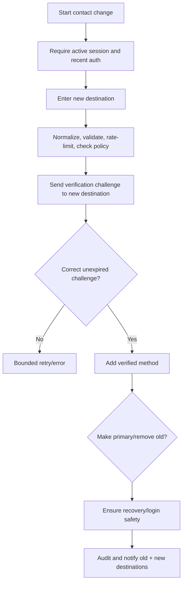
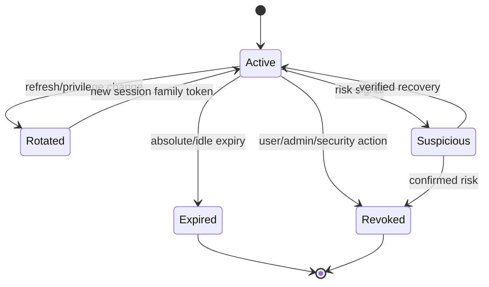
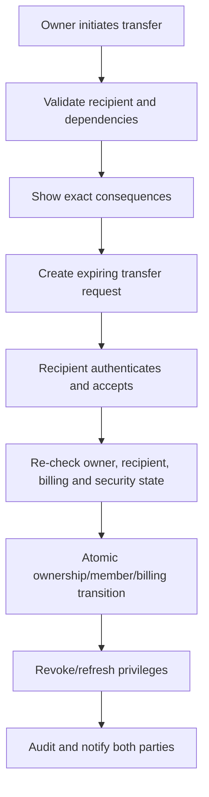
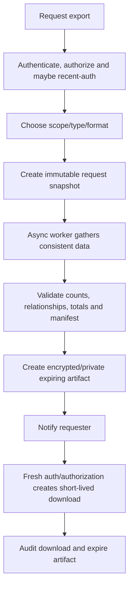
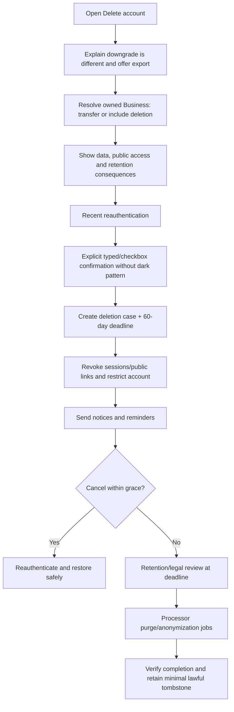
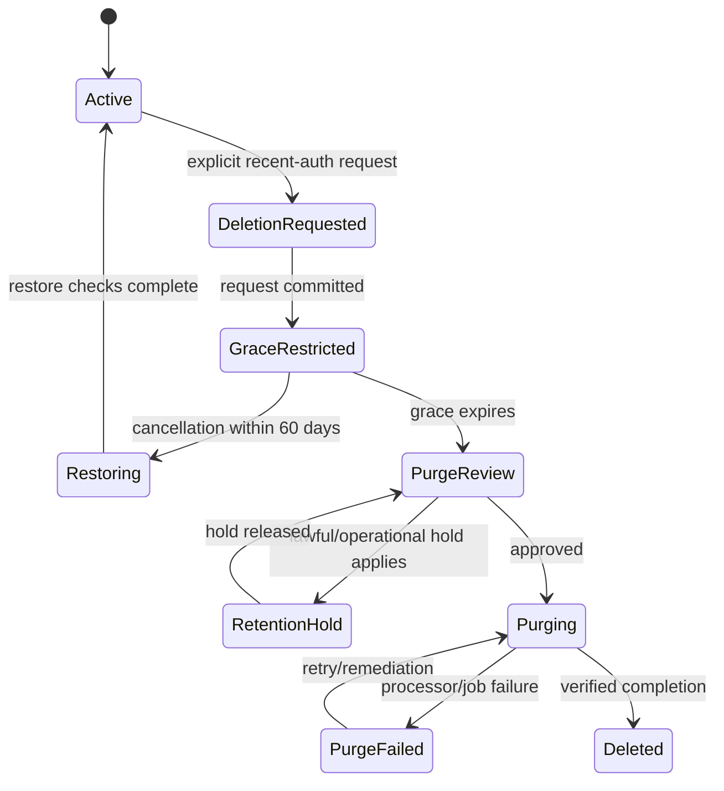
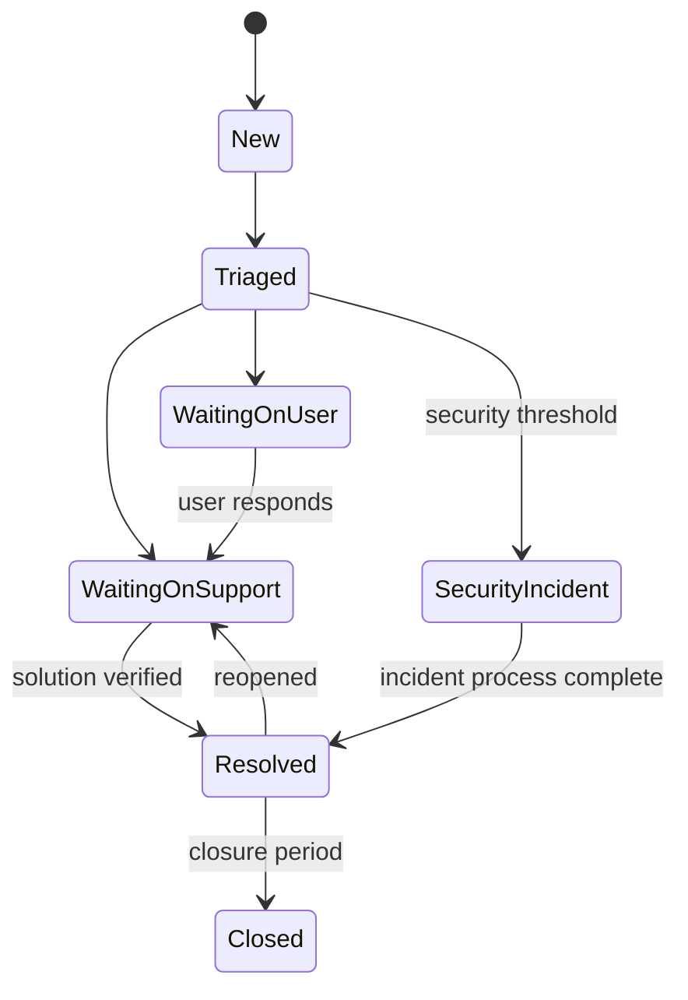

# Settings, Security, Privacy, Deletion and Support Blueprint

**Status:** Complete draft  
**Depends on:** documents 00–15  
**Core rule:** subscription expiry restricts new usage; only a separately authenticated, explicit deletion request starts the 60-day recoverable deletion process

## 1. Purpose

This blueprint defines:

- Personal, Business and account settings;
- profile and verified contact changes;
- authentication, sessions and device management;
- workspace membership and ownership changes;
- security history and audit visibility;
- privacy choices and data-subject requests;
- complete ownership exports;
- recoverable account/workspace deletion;
- legal and financial retention boundaries;
- support intake, severity, identity verification and access;
- safe operational correction without silent database editing.

This document provides a product and engineering contract. Final privacy, retention, tax and legal wording requires qualified Nigerian and any other applicable jurisdictional review before public launch.

## 2. Locked principles

1. Personal and Business settings remain scoped to their separate spaces.
2. Business staff cannot see or change an owner's Personal settings/data.
3. Sensitive account/security/billing/deletion actions require recent reauthentication.
4. Changing email/phone requires independent verification of the new destination.
5. Removing a login/contact method cannot leave an account without an approved recovery path.
6. Users can view and revoke active sessions.
7. Support never asks for OTPs, passwords, private keys or full card details.
8. Support access is least-privilege, reason-bound, time-bound and audited.
9. Silent impersonation is forbidden.
10. Routine support must not browse production database rows.
11. Posted financial/stock records are corrected through domain reversals/adjustments, not direct edits/deletes.
12. Owned data remains readable/exportable after downgrade or expiry.
13. Explicit deletion has a 60-day recoverable period.
14. Subscription expiry/cancellation never starts deletion.
15. Deletion revokes public access early, but permanent purge occurs only after grace and retention review.
16. Backups and external processors are included in the deletion/retention design.

## 3. Settings information architecture

### 3.1 Account settings

- Profile
- Login and verified contacts
- Security and sessions
- Notification preferences
- Appearance, locale and accessibility
- Personal defaults
- Connected workspaces
- Subscription/billing subjects
- Privacy and data
- Support
- Delete account

### 3.2 Personal workspace settings

- Name/label
- Default currency (restricted after posted activity)
- Financial/account/category defaults
- Budget and alert preferences
- Export
- Offline data
- Archive/delete Personal workspace

### 3.3 Business settings

- Business profile and legal/contact identity
- Accounting start, currency, timezone and fiscal defaults
- Tax and document settings
- Number sequences
- Payment methods/accounts
- Inventory/costing/negative-stock policy
- Outlets
- Members, roles and invitations
- Storefront, branding, subdomain/domain
- Notifications and approvals
- Subscription/add-ons/usage
- Audit and export
- Ownership transfer
- Archive/delete Business

Module-specific validation remains governed by documents 02–14.

## 4. Scope header and safety

Every workspace setting page shows:

- Personal or Business badge;
- workspace/business name;
- current actor role;
- save status;
- last significant change where useful;
- locked/irreversible consequence warning.

Switching workspace with unsaved settings prompts before discarding. The server resolves the workspace from authorized route/session context, never an arbitrary body value.

## 5. Setting classes

| Class | Examples | Change behaviour |
|---|---|---|
| Cosmetic | theme, density | immediate/reversible |
| Preference | notifications, default landing page | versioned save |
| Operational | invoice terms, reorder threshold | affects future operations |
| Accounting-sensitive | currency, costing method, start date | often locked after first posting |
| Security-sensitive | email, sessions, ownership | recent auth + notification |
| Destructive | delete account/workspace | recent auth + explicit staged flow |

The UI must distinguish “applies to future records” from “rewrites existing records.” Existing issued/posted snapshots are never silently rewritten.

## 6. Settings update contract

Each mutable settings resource uses optimistic concurrency:

```json
{
  "expected_version": "7",
  "changes": {
    "timezone": "Africa/Lagos"
  }
}
```

Server:

1. authenticates and authorizes actor;
2. checks recent-auth requirement;
3. checks expected version;
4. validates field dependencies and locked state;
5. applies transaction atomically;
6. increments revision;
7. writes audit/outbox;
8. returns canonical settings.

Stale clients receive current values and a conflict explanation; no last-write-wins for security/accounting-sensitive settings.

## 7. Profile settings

Initial fields:

- display name;
- profile image/avatar;
- preferred locale;
- timezone;
- date/time display preferences;
- currency display preference where it does not alter workspace accounting currency;
- accessibility/display settings;
- optional occupation/role for product defaults, not authorization.

Display name changes do not rewrite immutable historical actor snapshots where retention/audit requires the original identity reference.

## 8. Verified contact methods

An account may have verified email and/or phone login/contact methods.

Each method stores:

- normalized value;
- verification state/time;
- primary/login/recovery flags;
- notification eligibility;
- added/last-used times;
- masked display form.

Email/phone values are unique or shared only under an explicit identity policy. Party/customer contact records remain separate from account contacts.

## 9. Add or change email/phone



The old destination receives a security notification where safe. Verification failure does not replace the old method.

## 10. Remove contact method

Removal is blocked when it would:

- remove the last supported login/recovery method;
- break an active high-risk recovery investigation;
- remove a required billing/legal destination without replacement;
- violate a pending contact-change cooling period policy.

Removal requires recent auth, audit and notifications to remaining verified methods.

## 11. Authentication model

Initial authentication uses verified email/phone OTP as selected in document 01. The architecture remains MFA-ready.

Security controls:

- OTP challenge bound to purpose and destination;
- short expiry and one-time use;
- hashed or equivalently protected server storage;
- attempt/resend/rate limits by destination, IP, device/session and account risk;
- generic responses that do not enumerate accounts;
- session rotation after authentication/security changes;
- replay prevention;
- auditable challenge outcome without storing plaintext OTP.

## 12. Recent reauthentication

Require recent verified authentication for:

- adding/removing primary login method;
- revoking all other sessions;
- changing Business ownership/billing admin;
- subscription purchase/cancellation/refund-sensitive actions;
- generating certain complete exports;
- initiating/cancelling deletion;
- viewing/revealing any future API/integration secret;
- changing recovery/MFA controls.

The recent-auth window is risk-based and configurable, commonly minutes rather than days. Sensitive action reauth is purpose-bound.

## 13. Session lifecycle



Server sessions are the authority. Client cookies/tokens alone cannot restore a revoked session.

## 14. Session representation

Store:

- session/family ID;
- user ID;
- created, last-seen, idle/absolute expiry;
- authentication method/strength;
- hashed refresh/session secret where applicable;
- rotation/parent/revocation state;
- coarse device/browser description;
- coarse IP/geography risk metadata as policy permits;
- current session indicator;
- last workspace context, not authorization.

Do not store raw long-lived tokens in logs or audit payloads.

## 15. Session and device screen

Show:

- current session;
- other active sessions;
- approximate browser/device/platform;
- approximate location only when reliable and privacy-approved;
- created/last active times;
- revoke action;
- “sign out all other sessions” action;
- security-help path for unfamiliar activity.

Do not falsely identify a browser profile as a physical device with certainty.

## 16. Session revocation

- revoke one other session idempotently;
- revoke all other sessions while preserving current recent-auth session when chosen;
- rotate current credentials after sensitive contact/security change;
- revoke every session on confirmed account compromise/deletion start as policy requires;
- queued offline commands from revoked sessions fail current authorization;
- service-worker/background activity cannot bypass revocation;
- notify user of material revocation/security actions.

## 17. Suspicious activity and account lock

Potential signals:

- repeated OTP abuse;
- impossible/rapid session change patterns, used cautiously;
- contact/security change followed by destructive action;
- unusual export/deletion attempts;
- leaked credential/provider warning;
- support report of takeover.

Response can require reauthentication, revoke sessions, pause high-risk actions or require support verification. It MUST NOT silently block access indefinitely without recovery instructions.

## 18. Account recovery

Recovery must be strong enough not to become the easiest takeover path.

Preferred order:

1. use another already verified login/recovery method;
2. regain control through the relevant email/phone provider;
3. use pre-established MFA/recovery codes when introduced;
4. manual support recovery only under documented identity evidence and approval.

Knowledge of financial data, recent amounts, customer names or a guest link is not sufficient identity proof.

## 19. Manual recovery safeguards

Manual recovery:

- opens a high-risk support case;
- collects minimum necessary evidence through a secure channel;
- requires dual review where feasible for ownership/contact replacement;
- records evidence type, decision and approver, not unnecessary copies forever;
- applies a cooling period/notifications where risk warrants;
- revokes old sessions on approval;
- never reveals whether another person's account contains specific data;
- has an appeal/escalation path.

Government ID collection is not assumed for MVP; if introduced, storage/processor/legal requirements must be designed first.

## 20. MFA readiness

MVP may ship without mandatory MFA, but models must allow:

- TOTP authenticator enrollment;
- recovery codes;
- WebAuthn/passkeys;
- step-up factors;
- member/workspace enforcement policy;
- verified factor removal and recovery;
- authentication-strength audit.

SMS OTP must not be mislabelled as strong phishing-resistant MFA.

## 21. Security history

User-visible security events include:

- sign-in success and significant failed/risk events;
- new session;
- session revocation;
- contact method added/removed/primary changed;
- recovery/MFA change;
- export requested/downloaded;
- deletion requested/cancelled/completed;
- Business ownership transfer;
- support access grant/use, where policy allows.

Display safe time/device/context. Do not expose internal risk scores, full IPs or security-detection logic unnecessarily.

## 22. Business membership settings

Members screen supports:

- active/pending/restricted/former filters;
- role and outlet scope;
- invitation destination/status/expiry;
- last active indicator where privacy-approved;
- resend/revoke invite;
- change role/scope;
- suspend/remove;
- ownership/billing-admin labels;
- seat/plan usage.

Customer/supplier party records never appear as members merely because their contact matches a user.

## 23. Invitation security

- high-entropy invitation token stored hashed;
- expiry and single-use acceptance;
- exact Business/role/outlet preview before acceptance;
- authenticated accepting identity verification;
- sender may revoke before use;
- destination mismatch follows deliberate verified policy, not silent acceptance;
- accepting does not expose owner Personal data;
- invitation acceptance rechecks seat entitlement and inviter authority;
- duplicate/replayed acceptance is idempotent.

## 24. Role or outlet change

Sensitive permission change flow:

1. authorize actor cannot grant above their authority;
2. show before/after access summary;
3. require reason for high-risk roles if policy enabled;
4. apply atomically with permission revision increment;
5. revoke/refresh affected cached/offline authority;
6. audit and notify affected member/owner;
7. preserve historical authorship.

Changing role never rewrites who performed past actions.

## 25. Member suspension/removal

Suspension blocks new access while preserving membership/audit history. Removal:

- revokes workspace sessions/capabilities immediately at server boundary;
- invalidates pending invitations and offline sync authority as applicable;
- preserves document/audit authorship;
- does not delete records the member created for the Business;
- handles assigned approvals/tasks through reassignment/review;
- does not remove the user's independent Rekordly account;
- does not expose the owner's Personal workspace.

## 26. Business ownership transfer

Ownership transfer is high risk and distinct from role change.

Prerequisites:

- current owner recent-authenticated;
- recipient is a verified active member or completes verified acceptance;
- recipient explicitly accepts responsibilities;
- billing/subscription responsibility is resolved;
- no pending deletion/critical security hold;
- legal/business requirements satisfied;
- transfer does not leave Personal data accessible.



Personal workspace ownership never transfers with Business ownership.

## 27. Sole-owner protections

- owner cannot remove/suspend themselves while still sole owner;
- deletion/leave requires transfer or Business deletion flow;
- last full administrator warning prevents operational lockout;
- role changes cannot remove all actors capable of required security/billing administration without confirmation/policy;
- support cannot appoint a new owner casually; disputed ownership uses documented recovery/escalation.

## 28. Business profile settings

Fields may include:

- display/legal/trading name;
- business type/industry;
- public contact/address;
- logo/branding;
- tax identifiers/settings;
- default terms/policies;
- timezone/fiscal year;
- currency;
- accounting start;
- numbering prefixes;
- receipt/invoice footer;
- storefront contact/public policy.

Public, document-snapshot and internal fields are labelled separately. Historical issued documents retain snapshots.

## 29. Locked accounting settings

Examples:

- default currency cannot casually change after posted activity;
- FIFO/weighted-average costing locks after first posted stock movement except controlled migration;
- accounting start/opening balances use explicit adjustment workflow;
- document-number sequences cannot be reset to collide;
- tax settings affect future documents, not existing issued snapshots;
- timezone change must explain period/date consequences;
- period locks require controlled reopen reason/permission.

The UI links to the required migration/correction workflow rather than exposing an unsafe toggle.

## 30. Notification preferences

Per user/category/channel controls follow document 14. Settings distinguish:

- mandatory security/legal;
- transactional workspace;
- action/review required;
- insights/reminders;
- billing-owner notifications;
- future marketing consent.

Disabling email does not hide the durable in-app fact where safety/operations require it.

## 31. Appearance and accessibility

- light/dark/system theme;
- density where supported;
- reduced motion;
- text/number/date display preferences;
- default landing page;
- locale/timezone;
- high-contrast/accessibility options where implemented.

Preferences sync to user account when safe and may cache locally. They never alter financial calculation semantics.

## 32. Privacy dashboard

Shows:

- plain-language data categories and purposes;
- spaces/workspaces the user owns or participates in;
- connected processors/integrations at a meaningful level;
- analytics/optional-consent controls;
- notification/marketing controls;
- exports and previous request status;
- support cases/access grants;
- deletion/archive actions;
- privacy policy/terms versions accepted;
- contact for privacy/security requests.

Do not use dark patterns to discourage export or deletion.

## 33. Privacy roles and boundaries

Depending on context, Rekordly handles:

- account holder/user data;
- Business workspace records controlled by the Business owner/organization;
- customer/supplier/recipient data entered by a Business;
- public storefront visitor/order-request data;
- provider/security/operations metadata.

A staff member cannot demand deletion of Business records they created as if those were their Personal data. A Business must still have tools/processes to address legitimate customer/supplier privacy requests without corrupting legal accounting records.

## 34. Data minimization

- collect only fields needed for product/legal/security purpose;
- optional fields are labelled;
- analytics excludes financial contents and direct identifiers;
- logs avoid raw requests/bodies/tokens;
- support attachments/evidence have bounded retention;
- AI prompts/outputs follow document 12 retention/minimization;
- public portals expose only recipient projection;
- provider metadata is retained only as necessary;
- avoid collecting government IDs until required controls exist.

## 35. Consent and policy versions

Store:

- policy/terms type and version;
- content hash/published URL;
- user/subject;
- acceptance/withdrawal time;
- source/context;
- required versus optional status;
- locale.

Optional consent withdrawal affects future processing; it does not rewrite lawful historical activity. Material required-policy updates receive clear notice and a compliant acceptance/blocking policy.

## 36. Analytics choices

Core operational/security logging necessary to run and protect the product is separate from optional analytics/marketing.

- explain categories clearly;
- honor opt-out/consent as required;
- never sell financial data;
- never include amounts, narrations, party/contact data or document contents in product analytics;
- do not use consent denial to break core bookkeeping;
- consent state syncs server-side and reaches analytics adapters promptly;
- deletion/DSR propagates according to processor capability and lawful retention.

## 37. User data correction

Profile/contact inaccuracies can be changed directly with verification. Financial corrections use controlled domain flows:

- draft: edit/delete according to workflow;
- issued/posted: reverse, credit/debit note, supersede or adjustment;
- audit event: append correction/explanation, do not rewrite history;
- party/contact: correct future/current identity while preserving required document snapshots;
- security log: cannot be edited by user; disputes can add a support case/result.

Privacy correction rights do not justify corrupting double-entry or legal evidence.

## 38. Export types

### 38.1 Operational/export by module

- transactions/journals;
- reports;
- customers/suppliers;
- invoices/bills/payments;
- catalogue/inventory/procurement;
- storefront/orders;
- attachments/artifacts as allowed.

### 38.2 Ownership/portability export

A broader package for the owner/account containing:

- account/profile and verified-contact metadata;
- owned Personal data;
- each owned Business data set;
- memberships/invitations as appropriate;
- source financial/operational records and relationships;
- documents/files with manifest/checksums where applicable;
- settings and safe audit/history;
- subscription/billing documents;
- machine-readable schemas/readme.

### 38.3 Privacy request export

Prepared under legal/policy review and may differ from ordinary ownership export because third-party rights, security secrets, privileged material and retention exceptions apply.

## 39. Export flow



Export failure never starts deletion. The user can retry with the same request/idempotency contract.

## 40. Export security

- owner/member permission enforced per workspace;
- complete exports require recent auth;
- private async artifact and short-lived signed download;
- no export link sent as a permanent public URL;
- notification email contains safe link to authenticate, not attachment;
- ZIP/CSV formula-injection controls;
- manifest records scope, schema, counts, time range, as-of and warnings;
- large export rate/cooldown cannot permanently block ownership access;
- downloaded file responsibility is explained;
- export jobs/artifacts have bounded retention.

## 41. Export consistency and verification

Use an appropriate database snapshot/as-of strategy. Export includes:

- generation and source as-of times;
- workspace/timezone/currency/basis;
- row counts and file checksums;
- relationships/IDs sufficient to reconstruct;
- posted debit/credit reconciliation;
- receivable/payable/document reconciliation where supported;
- inventory movement/valuation warning state;
- missing/retained/excluded file report;
- schema/readme version.

An export is not marked ready if required reconciliation invariants fail; create an operations alert instead.

## 42. Account deletion versus workspace deletion

These are separate:

| Action | Scope | Key prerequisite |
|---|---|---|
| Delete Personal workspace | One Personal space | owner reauth/export warning |
| Delete Business | One owned Business and its operational data | sole ownership, members, legal/retention, storefront/domain handling |
| Leave Business | Remove user's membership only | cannot be sole owner |
| Delete account | User identity plus owned spaces selected/resolved | transfer/delete every owned Business |
| Remove member | Business access only | authorized Business admin |

Deleting an account cannot silently delete a Business with other members/customers/history without explicit ownership resolution.

## 43. Deletion eligibility check

Before accepting deletion, server evaluates:

- recent authentication;
- owned Personal/Business spaces;
- sole-owner responsibilities;
- active members/invitations;
- subscription/billing state;
- pending payouts/refunds/disputes if applicable;
- open export requests;
- deletion/security/legal holds;
- public storefront/domain/share links;
- queued offline commands and imports/jobs;
- retention requirements;
- identity claim dependencies.

The result is an explainable checklist, not a generic failure.

## 44. Account deletion request flow



## 45. Deletion state machine



The 60-day deadline uses an exact stored UTC instant derived from request time. The UI also shows the user's timezone date/time.

## 46. Grace-restricted behaviour

Immediately after deletion request:

- terminate/revoke normal sessions except a narrowly scoped recovery mechanism;
- stop new financial/operational writes;
- disable storefront/order acceptance;
- disconnect or disable custom-domain/public routes safely;
- revoke guest share grants and expiring private downloads;
- stop ordinary notifications/marketing, retaining deletion/security notices;
- pause/cancel future subscription renewal according to verified provider policy;
- stop nonessential AI/provider processing;
- mark owned spaces pending deletion;
- preserve data for recovery and required operations;
- provide secure deletion-status/cancel path.

The product must not continue charging unknowingly after deletion request; billing cancellation outcome is explicit and reconciled.

## 47. Deletion reminders

Send to remaining verified destination(s), when safe:

- immediate confirmation with deadline;
- reminder around 30 days remaining;
- reminder around 7 days remaining;
- final reminder around 24–48 hours where deliverable;
- cancellation/restoration confirmation;
- final completion notice if policy permits.

Messages contain no sensitive financial details and warn users not to share recovery links/codes.

## 48. Cancel deletion and restore

Cancellation requires:

- same account identity through verified authentication;
- recent step-up;
- request before purge begins/deadline;
- security review if compromise caused deletion;
- idempotent restore command.

Restore re-enables account/workspace access but:

- does not automatically restart a cancelled paid subscription;
- re-verifies custom domains and public publishing before reactivation;
- does not resurrect revoked share links silently;
- refreshes session/permission/entitlement revisions;
- reconciles jobs/files/provider states;
- reports anything that cannot be restored.

## 49. Business deletion specifics

Before Business deletion:

- owner sees member/customer/supplier/order/document/stock/accounting scope;
- export is offered;
- storefront and domain consequences are explicit;
- members are notified according to policy;
- open orders/financial obligations are addressed or explicitly retained;
- subscription/add-ons are cancelled separately and verified;
- party recipients' guest access is revoked;
- ownership transfer is offered when deletion is not intended for the organization;
- accounting/legal retention is evaluated.

Other users' independent accounts and their other workspaces are never deleted.

## 50. Personal workspace deletion specifics

- affects only the owner's Personal space;
- Business spaces/memberships remain;
- combined view updates without merging/removing Business data;
- Personal exports are offered;
- Personal attachments/share links are handled under retention;
- any Business-linked owner movements remain in Business books as their own records;
- deletion cannot remove Business journals merely because a corresponding Personal record existed.

## 51. Posted financial data and deletion

Deletion does not mean silently erasing individual confirmed transactions inside an active book.

- draft/unreferenced transient content may be deleted under policy;
- posted entries use reversal/correction;
- when an entire workspace reaches permanent deletion and no retention duty applies, data is purged/anonymized through the deletion job;
- where retention applies, access is restricted and data retained only for the required purpose/duration;
- personal identifiers may be minimized/anonymized where compatible with obligations;
- retained data is not available for ordinary product use/marketing.

## 52. Retention holds

Possible holds include:

- legal/regulatory requirement;
- tax/accounting retention;
- active dispute/chargeback/fraud investigation;
- security incident preservation;
- unresolved payment/refund obligation;
- court/law-enforcement requirement reviewed through proper process;
- backup lifecycle delay.

Holds are scoped, reasoned, authorized, time-bounded/reviewed and auditable. “We might need it someday” is not a valid indefinite hold.

## 53. Retention schedule registry

Maintain a versioned registry per data class:

- purpose;
- lawful/business basis approved by counsel;
- active retention period;
- deletion/anonymization action;
- backup treatment;
- processor/system locations;
- hold exceptions;
- owner/reviewer;
- policy version/effective date.

Do not scatter undocumented retention numbers through code. The 60-day user recovery grace is separate from any required post-grace retention.

## 54. Processor deletion

Deletion orchestration covers:

- PostgreSQL primary/read replicas;
- Cloudinary or replacement object storage;
- email provider contact/suppression/event data as applicable;
- AI provider retained content under contract/settings;
- analytics/monitoring/error tools;
- Paystack customer/subscription/transaction records subject to financial/legal constraints;
- support/helpdesk/WhatsApp support records;
- search/cache/CDN artifacts;
- backups.

Each processor has a documented delete/anonymize API/manual procedure, evidence and retry path. Provider failure does not falsely mark deletion complete.

## 55. Backup deletion

Immutable/rotating backups may not support per-user immediate physical deletion.

- publish the backup retention window accurately;
- deleted data disappears through backup expiry rotation;
- restored backups must replay deletion tombstones/cases before returning to production;
- backups remain access-controlled and used only for recovery;
- deletion cases/tombstones are stored in a protected way sufficient to prevent resurrection;
- restore rehearsals test this behaviour.

## 56. Permanent purge algorithm

```text
purgeDeletionCase(case, now):
  1. Lock case; verify grace deadline passed and no cancellation.
  2. Re-evaluate holds, ownership, billing and security state.
  3. Create versioned purge manifest of subjects/resources/processors.
  4. Revoke remaining sessions, grants, domains and public routes.
  5. Mark data inaccessible to product queries.
  6. Run dependency-ordered provider/file/data purge or anonymization jobs.
  7. Verify each job through provider/database evidence.
  8. Reconcile storage, search, cache and analytics deletions.
  9. Record backup-expiry/tombstone obligations.
 10. Mark completed only when mandatory manifest items are verified.
 11. Retain minimal non-reversible proof allowed by policy.
```

Partial failure remains visible to operations and retries idempotently.

## 57. Minimal deletion tombstone

Where policy permits/needs it, retain only what is necessary to:

- prevent accidental resurrection;
- prevent duplicate abuse where lawfully justified;
- prove request/completion;
- reconcile provider/legal obligations.

Use irreversible hashes/pseudonymous identifiers where appropriate. Do not retain full profiles or financial content under the label “tombstone.”

## 58. Privacy/data-subject request workflow

Request types may include:

- access;
- correction;
- deletion/erasure;
- restriction/objection;
- portability;
- consent withdrawal;
- inquiry/complaint.

Flow:

1. intake and identity verification proportional to risk;
2. classify role/scope/jurisdiction;
3. discover data across systems/processors;
4. evaluate third-party rights/retention exceptions;
5. fulfill securely;
6. record decision, response and deadline;
7. provide appeal/contact path.

Do not disclose Business or third-party data merely because the requester knows a contact value.

## 59. Support channels

Launch channels:

- public support email;
- WhatsApp support during published hours;
- in-app support/request form;
- emergency/security contact path.

Publish:

- support hours and Africa/Lagos timezone;
- expected response targets, not guaranteed resolution times;
- data users must not send;
- security escalation path;
- beta limitations/status link where relevant.

Do not promise 24/7 support as a solo founder.

## 60. Support response targets

Initial targets during published hours:

| Type | Acknowledgement target |
|---|---:|
| Critical access/data/security issue | Within 2 support hours |
| Core workflow blocker | Within 8 support hours |
| Ordinary question/feedback | Published best-effort target |

Targets may change but must be displayed honestly. Security incidents follow the incident plan rather than ordinary ticket order.

## 61. Support intake form

Fields:

- issue category;
- affected space/workspace selected from authorized list;
- safe summary;
- affected module/action;
- approximate time/timezone;
- safe reference IDs/error reference;
- severity impact;
- consent to attach diagnostic bundle;
- attachment under file/security policy;
- preferred reply channel.

The form warns users not to send OTPs, passwords, full card/account credentials or unnecessary customer financial data.

## 62. Ticket states



Closing a support ticket does not alter unresolved domain records. Product review items remain separate.

## 63. Support severity

- **SEV-0:** cross-tenant/security exposure, confirmed data loss, widespread corrupt journals/stock;
- **SEV-1:** posting, login, export or restore failure affecting multiple users;
- **SEV-2:** core workflow blocked for one/small cohort with no reasonable workaround;
- **SEV-3:** minor defect/question/feature request.

Support classification can escalate into incident response. Severity is based on impact/integrity, not customer plan alone.

## 64. Support identity verification

Before account-specific disclosure/action:

- prefer an authenticated in-app request;
- otherwise reply through already verified account contact after safe checks;
- step up for contact, ownership, export or deletion actions;
- do not rely on caller-ID/WhatsApp display name alone;
- do not ask for OTP/password;
- do not disclose existence/details of an account to an unverified requester;
- record verification method and scope.

## 65. Support data access model

Support begins with metadata-only diagnostics:

- user-provided reference/error ID;
- normalized error/job state;
- safe audit event names/times;
- provider/job status;
- workspace/plan/permission class;
- reconciliation/invariant state without contents.

Content access requires a justified escalation, least-privilege tool and audit. Direct production SQL browsing is not the normal support workflow.

## 66. No silent impersonation

Support/admin MUST NOT log in as the user invisibly.

Preferred alternatives:

- user-guided screenshots/screen share with redaction guidance;
- metadata diagnostic tools;
- user-generated support bundle;
- explicit time-bound support access grant;
- restricted read-only admin projection;
- reproducible test workspace.

If a future impersonation capability is unavoidable, it requires explicit user notice/consent where possible, highly restricted roles, persistent banner, no sensitive actions by default, full audit and short expiry.

## 67. User-granted support access

Optional future support access grant includes:

- workspace/resource scope;
- read-only or named diagnostic actions;
- support case;
- reason;
- named support/admin actor or restricted team;
- issue/expiry times;
- user revocation;
- visible active-grant indicator;
- complete access/action audit.

It never includes Personal data when the case concerns Business unless separately granted.

## 68. Financial correction through support

Support may diagnose and guide, but must not directly edit posted rows.

Correction options:

- guide user through reversal/credit/adjustment;
- issue a controlled admin recovery command only when product bug prevents normal resolution;
- require incident/case, reviewed calculation, dry-run/preview, idempotency and audit;
- reconcile journals/stock/documents after execution;
- notify affected owner;
- preserve original event and correction relationship.

Never “fix the total” by manually changing ledger balances in production.

## 69. Support attachments and retention

- use private authenticated storage;
- allowlisted types/sizes and malware scanning;
- warn user to redact unnecessary personal/financial details;
- access limited to case personnel;
- track downloads/access;
- delete after documented support retention unless held for incident/legal reason;
- do not attach raw database dumps, secrets or full production logs;
- deletion/privacy requests include support systems/processors.

## 70. Audit log model

Audit event contains:

- event ID and server timestamp;
- actor type/user/admin/service;
- effective workspace/subject;
- action and typed resource/reference;
- result;
- reason/case/reference;
- safe changed-field names and state transition;
- session/device/request/correlation references;
- privileged/support access context;
- immutable append-only integrity controls.

Avoid duplicating full documents, amounts, OTPs, tokens, private file URLs or sensitive before/after values unnecessarily.

## 71. User-visible audit versus internal security audit

Workspace owners/admins may see operational audit relevant to their Business. Users see their account security history. Internal security/operations audit may contain protected detection/infrastructure metadata.

- visibility is permission-scoped;
- Personal audit is never visible to Business staff;
- audit export follows privacy/third-party/security review;
- absence from user view does not mean absence from internal audit;
- support cannot alter audit events;
- corrections append events.

## 72. Administrative actions

Restricted admin tools may:

- inspect safe account/workspace/job/provider state;
- revoke sessions after verified security case;
- apply time-bound entitlement/support remediation;
- re-run idempotent jobs/reconciliation;
- execute reviewed recovery commands;
- place/release documented retention/security holds;
- process deletion/DSR cases.

They MUST NOT:

- create successful payment/posting evidence without proof;
- browse user content for curiosity;
- silently grant themselves membership;
- delete audit history;
- bypass tenant scope;
- permanently override without reason/owner/review;
- reveal another user's/workspace's data to a requester.

## 73. Settings and privacy APIs

### Account/profile/security

- `GET /v1/me/profile`
- `PATCH /v1/me/profile`
- `GET /v1/me/contact-methods`
- `POST /v1/me/contact-methods`
- `POST /v1/me/contact-methods/{id}/commands/verify`
- `POST /v1/me/contact-methods/{id}/commands/make-primary`
- `DELETE /v1/me/contact-methods/{id}`
- `GET /v1/me/sessions`
- `POST /v1/me/sessions/{id}/commands/revoke`
- `POST /v1/me/sessions/commands/revoke-others`
- `GET /v1/me/security-events`

### Workspace/settings/members

- `GET/PATCH /v1/personal-spaces/{id}/settings`
- `GET/PATCH /v1/businesses/{id}/settings/{section}`
- `GET /v1/businesses/{id}/members`
- `POST /v1/businesses/{id}/invitations`
- `POST /v1/businesses/{id}/members/{member}/commands/change-access`
- `POST /v1/businesses/{id}/members/{member}/commands/suspend`
- `POST /v1/businesses/{id}/members/{member}/commands/remove`
- `POST /v1/businesses/{id}/ownership-transfers`
- `POST /v1/ownership-transfers/{id}/commands/accept`

### Privacy/export/deletion/support

- `POST /v1/me/exports`
- `GET /v1/me/exports/{id}`
- `POST /v1/privacy-requests`
- `GET /v1/privacy-requests/{id}`
- `POST /v1/deletion-cases/preview`
- `POST /v1/deletion-cases`
- `GET /v1/deletion-cases/{id}`
- `POST /v1/deletion-cases/{id}/commands/cancel`
- `POST /v1/support-cases`
- `GET /v1/support-cases/{id}`
- `POST /v1/support-cases/{id}/messages`
- `POST /v1/support-access-grants`
- `POST /v1/support-access-grants/{id}/commands/revoke`

All sensitive mutations require idempotency and declared recent-auth context.

## 74. Data model

### Identity/security

- `user_profiles`
- `contact_methods`
- `verification_challenges`
- `sessions`, `session_families`
- future `mfa_factors`, `recovery_codes`, `webauthn_credentials`
- `security_events`

### Settings/membership

- versioned user/personal/business settings tables or typed sections;
- `memberships`, `roles`, `outlet_scopes`;
- `invitations`;
- `ownership_transfer_requests`;
- `policy_acceptances`, `consent_preferences`.

### Privacy/export/deletion

- `export_requests`, `export_artifacts`;
- `privacy_requests`;
- `deletion_cases`;
- `deletion_case_subjects`;
- `deletion_tasks`/processor tasks;
- `retention_holds`;
- `deletion_tombstones`;
- versioned `retention_policies`.

### Support/admin

- `support_cases`, `support_messages`;
- `support_access_grants`, `support_access_events`;
- `admin_actions`;
- shared append-only `audit_events` and outbox/jobs.

## 75. Error codes

- `RECENT_AUTH_REQUIRED`
- `CONTACT_ALREADY_IN_USE`
- `CONTACT_VERIFICATION_REQUIRED`
- `LAST_LOGIN_METHOD`
- `SESSION_ALREADY_REVOKED`
- `SETTINGS_VERSION_CONFLICT`
- `SETTING_LOCKED_AFTER_POSTING`
- `LAST_OWNER_REQUIRED`
- `OWNERSHIP_TRANSFER_PENDING`
- `INVITATION_EXPIRED`
- `EXPORT_NOT_READY`
- `EXPORT_RECONCILIATION_FAILED`
- `DELETION_DEPENDENCY_UNRESOLVED`
- `DELETION_ALREADY_REQUESTED`
- `DELETION_GRACE_EXPIRED`
- `DELETION_PURGE_STARTED`
- `RETENTION_HOLD_ACTIVE`
- `SUPPORT_VERIFICATION_REQUIRED`
- `SUPPORT_ACCESS_EXPIRED`

Errors disclose only the affected actor's authorized context.

## 76. Jobs and automation

- expire verification challenges/invitations/transfers;
- purge expired/revoked sessions;
- deliver security notifications;
- generate/verify/export packages;
- expire export artifacts;
- send deletion reminders;
- apply grace restrictions;
- run processor deletion tasks;
- review/expire retention holds;
- verify purge manifests;
- purge expired support attachments/access grants;
- reconcile provider cancellations/deletions;
- enforce retention schedules;
- detect stuck privacy/deletion/support SLAs.

Jobs are idempotent, bounded, observable and dead-lettered with safe error metadata.

## 77. Analytics

Privacy-safe product events may include:

- `settings_section_viewed`;
- `settings_updated` with safe section/key class;
- `session_revoked`;
- `security_history_viewed`;
- `member_invited`/`member_access_changed`;
- `export_requested`/`export_completed`/`export_failed`;
- `privacy_request_submitted`;
- `deletion_preview_viewed`;
- `deletion_requested`/`deletion_cancelled`;
- `support_requested`;
- `support_diagnostic_shared`.

Exclude contact values, support text, financial data, filenames, deletion reason free text, IDs that unnecessarily identify a person and raw security metadata.

## 78. Acceptance and edge-case tests

### 78.1 Profile/contact

- [ ] Profile change cannot alter workspace ownership/authorization.
- [ ] New email/phone is not active until independently verified.
- [ ] Failed verification leaves old contact unchanged.
- [ ] Last login/recovery method cannot be removed unsafely.
- [ ] Old and new destinations receive safe change notification.
- [ ] Party/customer email matching does not link account identity automatically.

### 78.2 Sessions/security

- [ ] Session list distinguishes current/other safely.
- [ ] Revoked session immediately loses server authority.
- [ ] Revoke-all-other is idempotent and preserves chosen current session.
- [ ] Offline queue from revoked session cannot sync.
- [ ] Sensitive action requires recent purpose-appropriate auth.
- [ ] OTP cannot be replayed and is never logged plaintext.
- [ ] Account enumeration is prevented in auth/recovery responses.
- [ ] Different user on shared device sees no prior cached data.

### 78.3 Membership/ownership

- [ ] Invitation acceptance rechecks role, inviter and seat entitlement.
- [ ] Revoked/expired invite cannot be replayed.
- [ ] Role/outlet change invalidates old offline permission revision.
- [ ] Removed member loses access but authorship remains.
- [ ] Owner cannot remove self as sole owner.
- [ ] Ownership transfer requires recipient acceptance and atomic billing/member transition.
- [ ] Business transfer exposes no Personal data.

### 78.4 Settings

- [ ] Stale settings version cannot overwrite current change.
- [ ] Currency/costing/number settings lock according to posted dependencies.
- [ ] Future tax/branding change does not rewrite issued documents.
- [ ] Cross-workspace settings IDs are rejected.
- [ ] Notification/security mandatory categories cannot be disabled improperly.

### 78.5 Export

- [ ] Downgraded/expired owner can request usable ownership export.
- [ ] Complete export requires recent auth and authorized scope.
- [ ] Export includes manifest, as-of, counts, checksums and warnings.
- [ ] Financial debit/credit totals reconcile before ready.
- [ ] Missing file is reported; export is not falsely complete.
- [ ] Download uses fresh short-lived private URL.
- [ ] Expired artifact does not delete source records or request history.
- [ ] Spreadsheet formula injection is neutralized.

### 78.6 Deletion separation

- [ ] Subscription cancellation/expiry creates no deletion case.
- [ ] Removing a member deletes neither account nor Business records.
- [ ] Deleting Personal leaves Business records/owner movements intact.
- [ ] Account deletion cannot silently delete/transmit a Business without ownership resolution.
- [ ] Other members' independent accounts remain untouched.

### 78.7 Deletion request/grace

- [ ] Deletion requires explicit recent-auth request.
- [ ] Exact 60-day deadline is stored and displayed with timezone.
- [ ] Public storefront/domain/share access disables safely.
- [ ] Ordinary writes and provider spending stop.
- [ ] Subscription cancellation is reconciled rather than assumed.
- [ ] Export failure does not trigger/accelerate deletion.
- [ ] Reminders use safe verified channels.
- [ ] Cancellation before purge restores access idempotently.
- [ ] Restored account does not silently restart billing/public links.

### 78.8 Permanent purge/retention

- [ ] Grace expiry rechecks holds and ownership before purge.
- [ ] Partial processor failure leaves case incomplete/retryable.
- [ ] Files, search/cache, analytics and support processors are in manifest.
- [ ] Backups expire deleted data and restore replays tombstones.
- [ ] Retention hold is scoped, reasoned, authorized and reviewed.
- [ ] Retained data is unavailable for ordinary product/marketing use.
- [ ] Completion cannot be marked while mandatory tasks are unverified.
- [ ] Tombstone contains no unnecessary full profile/financial content.

### 78.9 Support

- [ ] Unauthenticated requester receives no account-specific disclosure.
- [ ] Support never requests/accepts OTP/password as verification.
- [ ] Routine diagnostics work without content/database browsing.
- [ ] Support access grant is scoped, visible, expiring and revocable.
- [ ] No silent impersonation path exists.
- [ ] Support cannot directly edit posted journal/stock rows.
- [ ] Recovery command is reviewed, idempotent, audited and reconciled.
- [ ] Support attachment is private, scanned and retention-bound.

### 78.10 Privacy/audit

- [ ] Business staff cannot view owner Personal audit/settings/export.
- [ ] User-visible audit omits protected detection/secrets.
- [ ] Audit event cannot be edited/deleted by ordinary/admin user.
- [ ] Optional analytics withdrawal reaches adapters.
- [ ] Privacy request verifies identity and protects third-party data.
- [ ] Financial correction appends controlled events rather than rewriting history.

## 79. Launch gates

Before public beta:

1. publish privacy policy, terms, beta/financial/AI limitations and support contact;
2. define verified email/phone recovery and session-revocation flow;
3. implement read/export after downgrade;
4. implement complete export integrity checks;
5. implement explicit 60-day deletion state machine and cancellation;
6. inventory processors and document deletion/retention procedures;
7. define backup retention and deletion-tombstone replay after restore;
8. implement support identity/access/audit policy;
9. prohibit/directly test no silent impersonation or posted-row editing;
10. obtain appropriate privacy/retention/legal review before broad public launch.

## 80. Implementation handoff checklist

- [ ] Build scoped settings navigation and versioned update contracts.
- [ ] Implement verified contact add/change/remove flows.
- [ ] Implement session families, rotation, list and revocation.
- [ ] Add recent-auth/step-up middleware.
- [ ] Implement security history and notifications.
- [ ] Implement invitations, member changes and ownership transfer.
- [ ] Lock accounting-sensitive settings after dependencies.
- [ ] Build privacy dashboard and consent/policy-version registry.
- [ ] Implement ownership/privacy export jobs and reconciliation.
- [ ] Implement deletion preview, 60-day case and grace restrictions.
- [ ] Implement restore/cancel, purge manifest and processor tasks.
- [ ] Implement retention schedule/holds/tombstones/backups behaviour.
- [ ] Build support intake, diagnostics and severity workflow.
- [ ] Implement scoped support access without silent impersonation.
- [ ] Add admin recovery commands, audit and reconciliation.
- [ ] Pass acceptance matrix and legal/operational launch gates.

