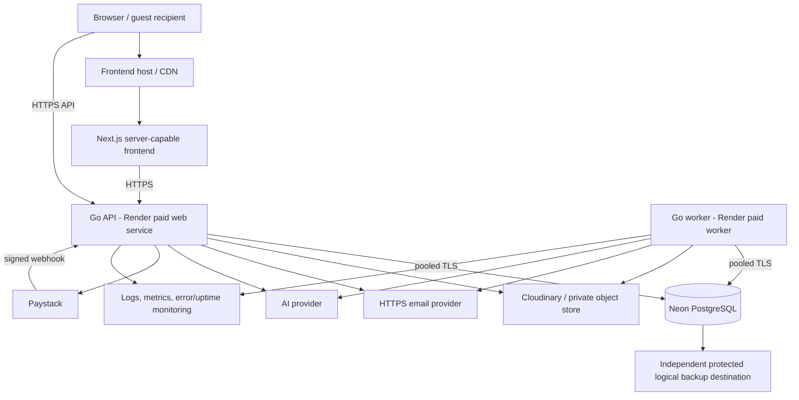
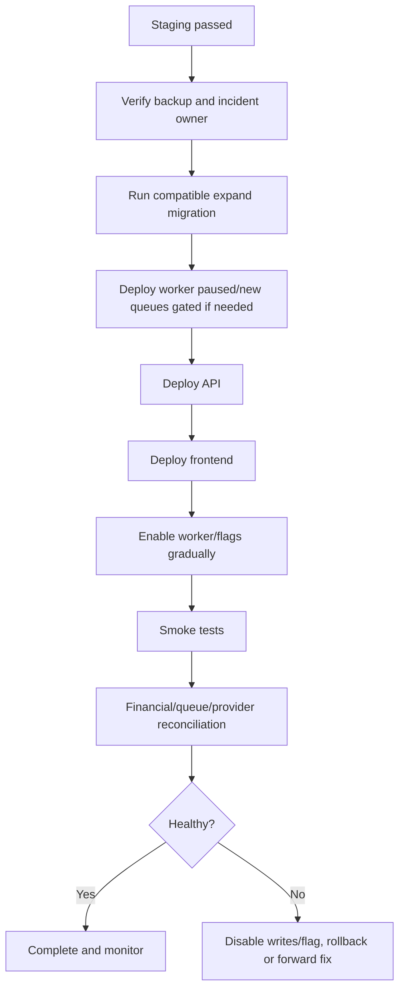
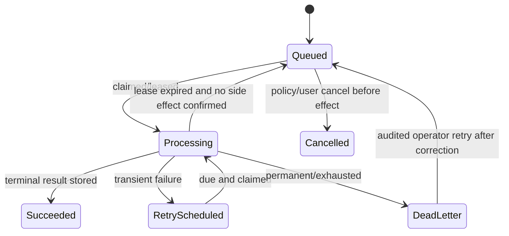
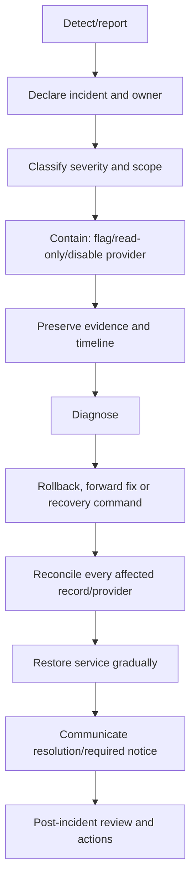
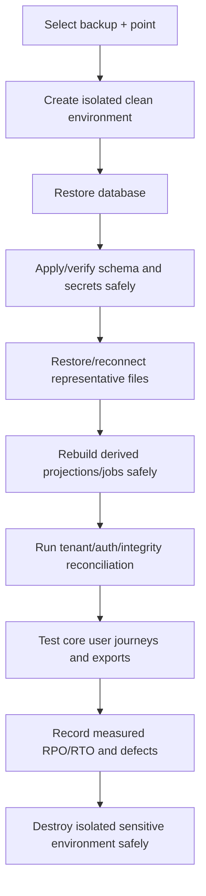

# Admin, Operations, Observability and Deployment Blueprint

**Status:** Complete draft  
**Depends on:** documents 00–16  
**Core rule:** production operations may pause, reconcile or recover financial workflows, but must never bypass tenant boundaries, fabricate success or silently edit posted truth

## 1. Purpose

This blueprint defines how Rekordly v2 is built, deployed, operated and recovered:

- local, staging and production separation;
- Next.js frontend plus Go API and worker topology;
- Render and Neon operating contracts;
- Cloudinary, email, AI and Paystack boundaries;
- configuration and secret management;
- CI/CD, migrations, releases and rollback;
- health, metrics, logs, traces and alerts;
- PostgreSQL job/outbox operations;
- safe internal admin tools;
- database/file backups and restore rehearsals;
- incident response and financial reconciliation;
- capacity, performance and cost controls;
- launch day and first-30-day operations.

This document does not set permanent SLO promises. Initial thresholds are operational hypotheses that must be measured before being published externally.

## 2. Locked infrastructure decisions

| Concern | Decision |
|---|---|
| Backend | Go modular monolith |
| SQL/data access | PostgreSQL, `pgxpool`, explicit SQL/`sqlc` |
| Financial transaction authority | Go API/domain/application layer |
| Jobs/outbox | PostgreSQL-backed, separate Go worker in production |
| API host | Render Go web service |
| Public-beta API tier | Paid always-on tier required |
| Worker host | Separate paid Render worker before public beta |
| Database | Neon PostgreSQL initially; production tier chosen by measurement |
| Frontend | Server-capable Next.js; host still to be measured/selected |
| Public media | Existing Cloudinary account |
| Private financial files | Cloudinary only if authenticated/private controls pass; otherwise private S3-compatible storage |
| Email | HTTPS provider such as Resend preferred |
| Payments | Paystack first intended billing provider |
| Realtime | No WebSocket dependency for MVP |
| Cache/broker | No Redis/Kafka required initially |
| Monthly infrastructure/AI ceiling | Under ₦50,000 during initial beta, with explicit cost review |

## 3. Production topology



Next.js is not a second financial backend. Durable financial commands, provider webhooks, imports, AI orchestration, PDFs, exports and domain checks belong to Go API/worker.

## 4. Service boundaries

### Frontend

- authenticated and public UI;
- SSR/metadata for storefront/guest pages;
- calls Go API;
- caches presentation data under document 15;
- holds no independent ledger/business authority;
- no long-running durable jobs.

### Go API

- authentication/session and authorization;
- synchronous validation/commands/queries;
- financial/stock database transactions;
- idempotency;
- webhook ingestion;
- upload/checkout intent creation;
- health/readiness endpoints.

### Go worker

- claims PostgreSQL jobs/outbox;
- PDF/export/import/AI/email/domain/deletion/reconciliation work;
- bounded concurrency/retries;
- no public request surface unless an authenticated internal health mechanism is required;
- uses the same application/domain packages where appropriate, not duplicated financial logic.

## 5. Environment separation

Required environments:

| Environment | Purpose | Data |
|---|---|---|
| Local | Development and tests | Synthetic/local fixtures only |
| CI | Automated checks | Ephemeral synthetic database/services |
| Staging | Release verification and demos | Synthetic/anonymized approved data; never copied production by default |
| Production | Real users | Production credentials/data only |

Every environment has separate database/project or branch, storage namespace/cloud, keys, email mode, Paystack mode, AI budget and domains.

## 6. Environment safety rules

- production secrets never enter local/CI/staging;
- staging cannot send to arbitrary real customer email/WhatsApp destinations;
- staging Paystack uses test credentials;
- staging storefronts and emails are visibly labelled;
- Cloudinary folders/clouds/presets are environment-separated;
- production data is not cloned to developer devices;
- any approved anonymized fixture is irreversibly scrubbed and documented;
- destructive scripts require explicit environment checks and target identity output;
- local development cannot resolve production service hostnames through default config.

## 7. Domain and DNS inventory

Expected production names:

- `rekordly.com` and `www.rekordly.com`;
- `app.rekordly.com` if application is separated;
- `api.rekordly.com`;
- wildcard storefront `*.rekordly.com` under the selected routing pattern;
- verified merchant custom domains;
- staging equivalents such as `staging.rekordly.com` and `staging-api.rekordly.com`.

Registrar/DNS account ownership, MFA and recovery contacts are documented outside Git. Reserved storefront slugs prevent collisions with system/subdomain names.

## 8. TLS and headers

- HTTPS enforced everywhere;
- HSTS introduced after verifying all required subdomains/custom-domain implications;
- secure, HttpOnly, SameSite session cookies as architecture requires;
- Content Security Policy tuned for frontend/providers;
- frame-ancestors/clickjacking protection;
- MIME sniffing and referrer protections;
- CORS allowlist specific to actual frontend origins;
- guest/custom-domain pages receive safe origin/cookie isolation;
- certificate provisioning/renewal/failure monitoring for platform and custom domains.

## 9. Configuration model

Configuration is typed and validated at process start.

Categories:

- environment/service identity;
- HTTP/listen/timeouts/body limits;
- database URL/pool/timeouts;
- session/auth/OTP policy;
- feature flags/commercial mode;
- worker concurrency/poll/lease/retry;
- storage/email/AI/Paystack adapter settings;
- public origins/domains;
- logging/metrics/error reporting;
- retention/deletion/backups;
- plan/usage safety ceilings.

Invalid required production configuration fails startup before readiness.

## 10. Secret management

Secrets include:

- database credentials;
- session/signing/encryption keys;
- email/AI/Paystack/Cloudinary credentials;
- webhook verification secrets;
- monitoring tokens;
- backup-destination credentials;
- DNS/registrar/provider credentials where automation requires them.

Rules:

- store in provider secret management/environment controls, never Markdown/Git/client bundles;
- scope per environment and service;
- least privilege;
- record owner, purpose, creation/rotation date and recovery path without recording value;
- avoid printing environment on startup;
- redact from errors, traces, job payloads and support bundles;
- rotate after exposure/personnel/provider change and on schedule according to risk.

## 11. Secret rotation

Rotation runbook:

1. identify consumers and downtime constraints;
2. create new secret/version;
3. support overlap/dual verification where protocol permits;
4. deploy consumers with new value;
5. verify health and provider interactions;
6. revoke old value;
7. verify old value fails safely;
8. update inventory/audit;
9. monitor anomalies.

For session/signing keys, preserve a bounded verification window or deliberately revoke all sessions; never strand unverifiable tokens unpredictably.

## 12. Source control and branch policy

- production source is version-controlled;
- main branch protected where available;
- changes use reviewed pull requests or a documented solo-founder review checklist;
- required tests/lint/build/migration checks pass;
- no secrets or production exports committed;
- releases use immutable commit/build identifiers;
- database migrations are reviewed like code;
- emergency fixes receive post-deploy review and test completion.

## 13. Build artifacts

Build once per commit where possible and promote the same immutable artifact/config-independent image.

Go:

- pinned Go version;
- reproducible module resolution/checksums;
- static analysis/tests;
- minimal container/non-root runtime where supported;
- API and worker commands from same versioned image/binary set;
- build/version metadata exposed safely.

Frontend:

- lockfile-enforced install;
- typed/lint/test/build;
- environment-specific public values injected intentionally;
- secrets never embedded in browser assets;
- source maps protected according to error-tool policy.

## 14. CI pipeline

Minimum stages:


External-provider contract tests use test/sandbox accounts and deterministic mocks where necessary.

## 15. Test layers

- pure money/decimal/posting/costing unit tests;
- domain state-machine/property/invariant tests;
- PostgreSQL repository/transaction/locking tests;
- API auth/permission/idempotency tests;
- provider adapter/webhook signature/retry tests;
- worker lease/retry/dead-letter tests;
- frontend component/accessibility tests;
- end-to-end persona journeys;
- migration/restore/reconciliation tests;
- load/capacity tests for hot routes/jobs;
- security abuse/cross-tenant tests.

Financial golden fixtures are deterministic and reviewed.

## 16. Feature flags

Flags may:

- hide incomplete modules;
- limit cohort/workspace access;
- disable dangerous new writes during an incident;
- switch provider adapters/modes;
- control offline/AI/import/commerce availability;
- select read-only/degraded behaviour.

Flags MUST NOT:

- change historical accounting semantics silently;
- bypass permission/plan checks;
- serve as the only protection for unfinished security boundaries;
- produce divergent write logic without tests/audit;
- be removed before old data/state compatibility is resolved.

## 17. Flag metadata

Each flag records:

- stable key and description;
- owner;
- default per environment;
- scope (global/cohort/workspace/user);
- expiry/review date;
- safe enable/disable effect;
- dependencies;
- incident kill-switch status;
- audit history.

Financial kill switches preferably stop new commands while retaining read/export and clear user messaging.

## 18. Release preparation

Before production release:

- release commit/build identified;
- schema compatibility reviewed;
- migrations rehearsed on representative staging data;
- backup/checkpoint verified;
- feature-flag defaults recorded;
- provider/webhook compatibility checked;
- rollback/forward-fix plan written;
- owner available to monitor;
- known issues and user communication prepared;
- database/file/financial reconciliation queries ready.

## 19. Database migration strategy

Use ordered, immutable migrations. Prefer expand/migrate/contract:

1. expand schema compatibly;
2. deploy code that reads/writes compatible forms;
3. backfill in bounded resumable batches;
4. validate counts/invariants;
5. switch reads/flags;
6. remove old use only after compatibility window;
7. contract schema in later release.

Avoid long blocking table rewrites during live traffic. Estimate locks/time/disk and test on representative scale.

## 20. Migration execution

- one migration runner obtains an advisory lock;
- use Neon connection mode appropriate for migrations, not transaction-pooled assumptions that break tooling;
- migration has timeout/statement controls;
- application readiness remains false until required schema exists;
- failed migration stops deploy and preserves logs/evidence;
- non-transactional steps have explicit recovery;
- data migrations are idempotent/resumable;
- no migration silently recalculates posted money without reviewed reconciliation.

## 21. Financial data migrations

Any migration touching journals, allocations, inventory layers, document totals or usage/billing:

- uses deterministic reviewed algorithm;
- records source/target schema/version;
- runs dry-run counts/totals;
- validates debit equals credit per journal;
- validates document outstanding/payment allocation totals;
- validates stock movement/valuation invariants;
- preserves source backup/rollback or correction path;
- writes migration audit evidence;
- receives explicit go/no approval.

Direct “fix-up SQL” is not an acceptable unreviewed migration process.

## 22. Deployment sequence



Actual order depends on compatibility design; the release record states it explicitly.

## 23. Rollback versus forward fix

Rollback is safe only when old code understands the current schema/state. Otherwise:

- disable affected new writes;
- keep compatible reads/export;
- forward-fix code/schema;
- use reviewed recovery command for affected records;
- reconcile every possibly affected operation.

Never roll back a database to an earlier backup merely to undo an application release while discarding legitimate later user transactions.

## 24. Zero/low-downtime requirements

- API handles rolling process overlap between compatible versions;
- schema and event/job payloads retain version compatibility;
- readiness removes instance before shutdown;
- graceful shutdown stops accepting requests, finishes/cancels within deadline and releases DB connections;
- worker stops claiming, finishes or safely releases leased jobs;
- migrations avoid broad locks;
- frontend/API version mismatch returns clear refresh/retry rather than corrupting commands;
- idempotency protects retry across deploys.

## 25. API runtime configuration

Configure explicit:

- request header/body limits;
- read-header/read/write/idle timeouts;
- graceful shutdown deadline;
- per-route/provider deadlines;
- panic recovery with request correlation;
- CORS/CSRF/session policy;
- rate limits;
- small `pgxpool` min/max/acquire/lifetime settings;
- structured logging;
- health/readiness;
- maximum concurrency where required.

No unbounded request body, goroutine fan-out or provider wait.

## 26. Worker runtime configuration

- allowed job types/queues;
- global and per-type concurrency;
- poll interval/backoff;
- lease duration/heartbeat;
- attempt/retry schedule;
- per-job timeout;
- memory/file-size/temp-disk limits;
- graceful drain deadline;
- dead-letter threshold;
- provider rate/spend limits;
- DB pool smaller than API unless measurement shows otherwise.

CPU/memory-heavy PDF/import jobs may receive separate concurrency even in one worker process.

## 27. Database connection budgeting

Total possible connections must remain below Neon/provider limits with safety margin.

```text
total = API_instances * API_pool_max
      + worker_instances * worker_pool_max
      + migration/admin/reserved_connections
```

- use pooled connection string for normal traffic;
- assign small explicit pools;
- set acquire/query/transaction deadlines;
- monitor waiting/acquire latency and saturation;
- avoid opening per-request connections;
- reserve emergency/migration capacity;
- scale pools only from measured contention, not guesswork.

## 28. Transaction runtime rules

- transactions are short and contain database work only;
- no email/AI/Cloudinary/Paystack calls while holding financial locks;
- deterministic lock order for related aggregates;
- retry serialization/deadlock only under explicit safe command/idempotency policy;
- every financial mutation verifies balanced journals before commit;
- context cancellation propagates;
- connection returned on every path;
- slow/blocked transaction diagnostics do not log sensitive parameters.

## 29. Health endpoints

### Liveness

Answers whether process/event loop is alive. It must not fail because a downstream provider has a transient outage, or Render may restart healthy processes repeatedly.

### Readiness

Answers whether instance can safely receive its intended traffic:

- required config valid;
- database reachable within short deadline;
- required schema/migration compatible;
- process not draining;
- critical local initialization complete.

### Detailed diagnostics

Authenticated/internal only. Public health response exposes no versions/secrets/topology beyond necessary status.

## 30. Dependency degradation

| Dependency down | Expected behaviour |
|---|---|
| Neon/PostgreSQL | New authoritative writes/queries fail safely; no fake success; cached client read only |
| Cloudinary/object store | Financial post may succeed; file/render/upload actions fail/retry separately |
| Email | Domain action succeeds; delivery queues/retries/review |
| AI provider | Manual entry remains; AI request fails/queues within policy |
| Paystack | Existing app continues; checkout/refund verification pauses safely |
| DNS/domain provider | Storefront on Rekordly subdomain continues where possible; verification queues |
| Monitoring vendor | Application continues; local/provider logs retained and secondary uptime signal preferred |

## 31. Job/outbox architecture

Domain transaction writes outbox/job intent in PostgreSQL atomically with state. Worker claims using `FOR UPDATE SKIP LOCKED` or equivalent safe pattern.

Job fields:

- ID/type/version/priority;
- subject/workspace/resource;
- payload or typed reference;
- dedupe/idempotency key;
- status/attempt/max attempts;
- scheduled/next attempt;
- lease owner/expiry/heartbeat;
- safe error class/message;
- created/started/completed timestamps;
- trace/correlation reference.

## 32. Job state machine



An expired lease does not automatically mean external side effect did not happen; provider reconciliation/idempotency runs before repeating.

## 33. Worker claiming

```text
begin
select eligible job
  where status in (queued, retry_scheduled)
    and next_attempt_at <= now()
  order by priority desc, created_at
  for update skip locked
  limit bounded_batch
mark processing, lease_owner, lease_expires_at
commit

process outside claim transaction
finalize idempotently in short transaction
```

Empty polling backs off/sleeps; it must not hammer Neon or keep a free service artificially awake.

## 34. Job idempotency

- stable job/dedupe identity;
- check existing artifact/provider result before external repeat;
- provider-specific idempotency/reference used where available;
- financial posting never occurs only in an untracked external job;
- finalizer safe under duplicate worker execution;
- email/PDF/import/deletion tasks store checkpoints where appropriate;
- manual retry creates audited retry request and does not reset evidence;
- poison payload cannot loop forever.

## 35. Dead-letter operations

Admin view shows:

- job type/version;
- workspace-safe opaque reference;
- age/attempts;
- safe error classification;
- dependency/provider state;
- linked incident/support case;
- retry, cancel or supersede actions permitted by job type.

Bulk replay is disabled or tightly bounded. A code/config fix and impact analysis precede broad replay.

## 36. Scheduled jobs

Examples:

- subscription/usage period transitions;
- overdue/notification scans;
- share/export/session/invite expiry;
- deletion reminders/purge tasks;
- domain verification/TLS checks;
- reconciliation and storage checks;
- logical backups and restore verification;
- retention cleanup;
- usage/cost aggregation;
- health canaries.

Scheduler creates idempotent jobs with a unique schedule occurrence key. Multiple scheduler instances cannot duplicate effects.

## 37. Internal admin surface

Initial admin capabilities are narrow:

- environment/build/feature-flag status;
- user/workspace lookup by exact authorized reference for a case;
- session/security action summary;
- subscription/provider reconciliation;
- job/outbox/dead-letter inspection;
- export/PDF/email/storage/domain status;
- deletion/privacy/support cases;
- financial/stock reconciliation alerts;
- audited recovery commands;
- incident banners/kill switches.

It is an operations console, not a generic CRUD database UI.

## 38. Admin authentication and authorization

- separate restricted admin role/account;
- MFA mandatory when provider/product supports it;
- least privilege by function;
- recent auth for high-risk actions;
- allowlist/VPN/device controls if feasible and proportionate;
- short sessions and revocation;
- no shared admin accounts;
- every view/action audited;
- production access removed promptly when no longer required.

## 39. Admin tenant lookup

- require case/incident/reason before content-sensitive lookup;
- exact email/reference lookup returns minimal identity/workspace metadata;
- avoid broad browsing/listing of users/financial records;
- default views redact contact/payment/content data;
- cross-tenant comparison uses aggregates without identifiable content;
- support access grants govern deeper views as document 16 defines;
- Personal and Business boundaries remain explicit.

## 40. Admin mutation safety

Every admin mutation:

1. checks high-risk permission/recent auth;
2. names target environment/tenant/resource;
3. shows preview/effects;
4. requires reason/case;
5. uses typed command and idempotency key;
6. executes domain validation/transaction;
7. writes immutable admin/audit/outbox events;
8. returns reconciliation result;
9. supports review/notification where required.

Generic “edit row” and arbitrary browser SQL are forbidden.

## 41. Financial/stock operations dashboard

Monitor invariant failures and unresolved states:

- unbalanced journal attempts (committed unbalanced must remain zero);
- orphaned/mismatched source-journal references;
- payment allocation sum mismatch;
- negative/out-of-policy receivable/payable/wallet/loan state;
- stock movement versus on-hand projection mismatch;
- inventory layer quantity/value mismatch;
- duplicate document numbers/provider references;
- unresolved suspense/GRNI/returns;
- report/export reconciliation failures.

The dashboard links to typed diagnostic evidence, not direct editing.

## 42. Reconciliation jobs

Run on schedule and after high-risk release/incident:

- journals debit/credit equality;
- source document totals/outstanding versus allocations;
- customer/supplier advance balances;
- inventory movement, on-hand, reservations, costing layers and valuation;
- orders versus reservations/fulfilment;
- subscriptions/transactions versus Paystack;
- assets/files versus Cloudinary/object store;
- email/provider delivery references;
- entitlement usage reservations;
- deletion/export job manifests.

Any discrepancy creates an alert/case with scope and first-seen time.

## 43. Observability principles

- operational telemetry is not financial truth;
- structured and privacy-minimized;
- environment/service/build/request/job correlation;
- metrics for rates/latency/saturation/errors;
- logs for bounded diagnostic events;
- traces where cost/value justifies them;
- errors grouped with safe context;
- audit kept separately from product analytics/logs;
- alert only on actionable conditions with runbook/owner.

## 44. Correlation identifiers

Use:

- request ID;
- trace ID where tracing enabled;
- user/session opaque ID where policy permits;
- workspace/subject opaque ID;
- command/idempotency/client command ID;
- job/outbox ID;
- provider reference (redacted/hashed where needed);
- incident/support case ID.

Never use raw email, phone, guest token, signed URL or narration as a log correlation key.

## 45. Structured logging

Standard fields:

- timestamp/severity/environment/service/build;
- event name/message code;
- request/trace/job references;
- route template/method/status/latency;
- error class and retryability;
- DB/provider operation class and duration;
- safe workspace/actor identifiers;
- deployment/release marker.

Do not log:

- OTPs/session tokens/secrets;
- authorization/cookie headers;
- raw webhook bodies by default;
- raw AI prompts/responses;
- filenames/private URLs/guest tokens;
- financial narrations/contact data;
- full SQL parameters/request/response bodies.

## 46. Log retention and access

- retention is documented by environment/class;
- production access is role-restricted/audited where possible;
- staging/local logs use synthetic data;
- security/incident holds are scoped;
- cost controls drop noisy low-value logs before high-value integrity/security logs;
- sampling never removes all error/invariant evidence;
- exports/support bundles redact telemetry;
- deletion/privacy policies include log systems and lawful exceptions.

## 47. Core metrics

### Traffic/API

- request rate by route template/status class;
- latency percentiles;
- timeout/cancellation/panic rate;
- rate-limit/validation/auth failures;
- active instances/concurrency.

### Database

- pool used/idle/wait/acquire time;
- query/transaction latency and timeouts;
- deadlocks/serialization retries;
- storage/growth and connection limit;
- migration/backfill progress.

### Worker/jobs

- queue depth and oldest age by type;
- processing/retry/dead-letter rate;
- job duration;
- lease expiries;
- provider calls/cost/failures.

### Integrity

- journal imbalance commit count (must be zero);
- reconciliation discrepancies;
- idempotency replay/conflict rate;
- duplicate prevention;
- export/report reconciliation failure;
- stock/inventory mismatch.

## 48. Product/provider metrics

- OTP delivery/failure/rate-limiting;
- AI latency/failure/token/cost/credit rejection;
- PDF/render latency/failure;
- email acceptance/bounce/complaint;
- storage upload/download/delete failure and bytes;
- Paystack checkout/webhook/reconciliation mismatch;
- domain verification/certificate status;
- storefront order-request errors;
- offline sync/conflict rate;
- deletion/export SLA/backlog.

Properties remain privacy-safe and exclude raw financial/user content.

## 49. Tracing

Initial tracing may be limited by budget. If enabled:

- sample ordinary successful requests;
- retain higher rate for errors/slow requests/integrity flows;
- propagate across API → DB/job/provider where safe;
- exclude payloads/SQL parameters/secrets;
- financial command span names use command type, not record content;
- link asynchronous job through trace/correlation ID;
- control cost/retention.

Metrics/log correlation remains sufficient if full tracing is deferred.

## 50. Error reporting

- capture panics/unhandled frontend/backend errors;
- environment/build/release tagging;
- source maps/symbolization protected;
- scrub cookies, headers, URL tokens, request bodies and local offline data;
- group by stable error class/site;
- assign owner/status;
- link critical issues to incident/support cases;
- test scrubbing with realistic sensitive fixtures before production.

## 51. Uptime and synthetic checks

External checks SHOULD cover:

- frontend public landing/app shell;
- API liveness/readiness separately;
- authenticated synthetic canary with dedicated non-production-like production tenant where safe;
- core read and reversible/controlled financial proof flow on a canary workspace;
- public storefront/guest link;
- worker heartbeat/oldest job;
- backup freshness.

Canaries never operate on real customer data and clean up through normal domain commands.

## 52. Initial SLI/SLO targets

Internal beta objectives, not public guarantees:

| SLI | Initial operational objective |
|---|---|
| API availability for core authenticated routes | Measure; target at least 99.5% monthly after paid always-on deployment |
| Core API p95 latency excluding intentional async/provider work | Measure; target under 1 second for normal operations |
| Financial committed journal imbalance | Exactly zero |
| Cross-tenant unauthorized access/data loss | Exactly zero |
| Critical queue oldest age | Type-specific, generally minutes not hours |
| Backup freshness | Within selected RPO schedule |
| Restore verification | Scheduled and latest drill passing |

Do not publish uptime/RPO/RTO promises until provider tiers and rehearsals prove them.

## 53. Alert design

Every alert defines:

- condition and duration;
- severity;
- owner and channels;
- user/integrity impact;
- first diagnostic links;
- runbook;
- automatic mitigation if safe;
- resolution/silence policy;
- post-incident threshold.

Avoid alerting on every individual 4xx/user validation error. Alert on rate shifts, sustained failures, invariant breach and backlog age.

## 54. Critical alert matrix

| Condition | Severity | Immediate action |
|---|---|---|
| Cross-tenant exposure suspicion | SEV-0 | Disable affected surface/writes, preserve evidence, scope |
| Committed unbalanced journal | SEV-0 | Stop affected posting path, reconcile all impacted commands |
| Confirmed data loss/corrupt stock | SEV-0 | Stop unsafe writes, preserve evidence, restore/recovery plan |
| Database unavailable/saturation | SEV-1 | Fail writes safely, inspect provider/pools, communicate |
| Payment/webhook mismatch spike | SEV-1 | Pause activation/refund automation, reconcile |
| Critical queue oldest age above threshold | SEV-1/2 | Inspect worker/provider, scale or pause producer |
| Backup stale/failed | SEV-1 | Repair backup before risky releases; assess RPO |
| Export/login/posting failure spike | SEV-1 | Flag/rollback/forward fix |
| AI/email/PDF provider failure | SEV-2 unless cascading | Disable/degrade feature, preserve core workflow |
| Cost threshold exceeded | SEV-2 | Disable noncritical spend, investigate abuse/config |

Critical alerts go to at least two reliable founder channels where possible.

## 55. Incident severity

- **SEV-0:** cross-tenant/security exposure, data loss or widespread corrupt financial/stock truth;
- **SEV-1:** core posting/login/export/restore or major provider failure affecting multiple users;
- **SEV-2:** important workflow blocked/degraded with limited scope or workaround;
- **SEV-3:** minor issue/cosmetic/question.

Severity may rise as scope/evidence changes. Paid status does not reduce integrity priority for Free users.

## 56. Incident lifecycle



Containment favours stopping unsafe new writes while preserving read/export and unaffected modules.

## 57. Incident roles for solo-founder beta

Founder may hold several roles but names them explicitly:

- incident commander/decision owner;
- technical investigator/recovery operator;
- communications/support owner;
- evidence/timeline recorder.

For SEV-0/high-risk recovery, seek a second qualified reviewer where possible before destructive or broad corrective action. Procedures and contacts live outside the affected production system.

## 58. Incident evidence

Preserve:

- release/build/config/flag timeline;
- alert/log/trace/audit references;
- affected tenant/resource/command IDs;
- provider events;
- database snapshots/backups where appropriate;
- reconciliation queries/results;
- user reports;
- containment/recovery commands;
- communications and decisions.

Minimize copying sensitive content. Evidence access and retention are restricted/audited.

## 59. Financial incident recovery

Never update balances/journal lines directly as the first fix.

Recovery sequence:

1. stop affected command type;
2. identify exact commands/resources/versions;
3. confirm source of truth and invariant breach;
4. create deterministic recovery algorithm;
5. preview/dry-run per affected record;
6. review totals and accounting/stock effects;
7. execute idempotent typed recovery command;
8. append correction/reversal/audit/outbox;
9. run complete reconciliation;
10. notify affected users/reviewer as required.

## 60. Communications

- factual, scoped and timestamped;
- distinguish investigation from confirmed impact;
- state affected features and safe workaround;
- avoid speculation/blame/secrets;
- update on meaningful changes or published cadence;
- notify affected users/authorities where policy/law requires;
- resolution includes data/integrity status, not only “service restored”;
- status channel must not expose tenant-specific data.

## 61. Post-incident review

Within a reasonable period, record:

- summary/impact/duration;
- detection and response timeline;
- technical/organizational root and contributing factors;
- what limited/worsened impact;
- reconciliation and user-notification evidence;
- corrective/preventive actions with owner/date;
- test/runbook/alert/design changes;
- whether launch scope/feature remains enabled.

Focus on system improvement, not blame.

## 62. Database backup strategy

Before beta, use multiple layers:

- Neon/provider-managed backups/PITR according to selected paid tier;
- automated independent logical backups to a separate protected destination/account where feasible;
- schema/migration/version metadata;
- encryption in transit/at rest through provider controls;
- retention schedule and expiry;
- monitoring of backup completion, size and freshness;
- periodic restore, not merely successful upload.

Free-tier retention is insufficient unless measured launch requirements are still met and explicitly accepted for invite-only scope.

## 63. Logical backup process

1. obtain least-privilege backup credential/path;
2. run consistent PostgreSQL logical backup using supported tooling/version;
3. capture schema/extensions/roles necessary for restore without leaking provider superuser details;
4. compress/encrypt appropriately;
5. upload to independent protected destination;
6. record checksum/size/database/schema/build/time;
7. verify artifact readability/checksum;
8. apply retention lifecycle;
9. emit success/failure/freshness metric;
10. periodically restore into isolated environment.

Backup logs never contain database contents/credentials.

## 64. File/object backup and inventory

PostgreSQL backup does not contain Cloudinary/object bytes.

- maintain asset metadata/checksums/provider IDs;
- confirm provider versioning/backup/export guarantees;
- create independent protected copy/export for critical private originals if required;
- inventory public/private assets against DB;
- detect missing/orphaned assets;
- retain template/source version needed to regenerate artifacts;
- include file migration/export procedure;
- test restore/download authorization after recovery.

If Cloudinary cannot satisfy private-document recovery/retention requirements, sensitive files move to private object storage before broad launch.

## 65. Recovery objectives

RPO and RTO remain unpromised until measured.

Define per capability:

| Tier | Example | Required decision |
|---|---|---|
| Tier 0 | ledger, documents, payments, stock, identity | shortest feasible RPO/RTO; no silent loss |
| Tier 1 | files/artifacts, subscriptions, jobs/audit | restore/reconcile with Tier 0 |
| Tier 2 | derived reports/search/cache/analytics | rebuildable with longer RTO |

After provider/tier tests, record numerical internal objectives, evidence and owner. Public claims must not exceed evidence.

## 66. Restore rehearsal



Never validate restore by overwriting production.

## 67. Restore verification checklist

- users/sessions handled safely; production tokens not usable in rehearsal;
- tenant boundaries preserved;
- journal debit/credit and source links reconcile;
- receivables/payables/allocations reconcile;
- stock movements/on-hand/reservations/layers reconcile;
- invoices/bills/payments/orders readable;
- attachments/artifacts accessible and authorized;
- jobs/outbox do not duplicate old external effects;
- deletion tombstones/cases replay to prevent resurrection;
- subscription/provider state reconciles before billing actions;
- exports/reports match fixtures;
- checksum/count/timing recorded.

## 68. Point-in-time disaster recovery

After a production restore:

- keep service restricted/read-only until integrity review;
- identify gap between recovery point and incident time;
- reconcile Paystack/email/Cloudinary/provider events that occurred after DB point;
- use idempotency/provider references to recover facts without duplicating effects;
- reprocess outbox/jobs carefully;
- replay deletion/security revocations/tombstones;
- communicate potential data window honestly;
- reopen writes only after reconciliation sign-off.

## 69. Backup security

- separate account/bucket/project where practical;
- MFA and recovery contacts;
- least-privilege writer/reader/delete roles;
- encryption and key recovery;
- object lock/immutability where useful and compatible with retention/deletion law;
- no public access;
- restore access audited;
- deletion/retention schedule documented;
- backup secrets rotated;
- regular access review.

## 70. Capacity and load testing

Measure with representative fixtures:

- concurrent sign-in/OTP limits;
- dashboard/list/report queries;
- money/sale/payment posting contention;
- invoice numbers/idempotency;
- inventory sale/receipt/transfer locks;
- storefront browse/order requests;
- large CSV import/export/PDF;
- worker queues/provider throttling;
- DB pool saturation/cold start;
- file uploads;
- offline reconnect bursts.

Tests use synthetic data and enforce provider test/spend bounds.

## 71. Initial performance budgets

Set internal budgets after baseline, including:

- frontend JS/CSS/image payload by route;
- server-render time for public pages;
- API p50/p95/p99 by route class;
- database query count/time;
- maximum request/body/file/import size;
- synchronous command deadline;
- report/export/PDF job duration;
- queue wait age;
- memory/CPU/container startup;
- Neon cold/pooled connection latency.

Slow provider operations become asynchronous where user workflow permits.

## 72. Scale triggers

Stay modular-monolith until evidence requires change. Triggers include:

- API CPU/memory saturation after query/pool optimization;
- worker workload starving request service;
- queue age exceeding objectives;
- one job type needing independent scaling/isolation;
- DB contention requiring partition/query/index redesign;
- realtime need proven;
- provider limit/cost pressure.

Likely first steps: scale API/worker instances, split worker queues/process types, tune indexes/queries/pools—not microservices/Kafka by default.

## 73. Cost model

Track monthly estimates and actuals for:

- frontend hosting/CDN;
- Render API and worker;
- Neon compute/storage/backup/egress;
- Cloudinary/object storage/transformation/egress;
- email;
- AI tokens/models;
- monitoring/logging/error tracking;
- Paystack fees (commercial cost, not infrastructure);
- domains/DNS/certificates;
- independent backups;
- taxes/VAT/FX and card/payment overhead.

Provider selection records current currency assumptions and date; pricing changes are rechecked before purchase/launch.

## 74. Cost controls

- provider budget alerts/hard caps where safe;
- plan AI credits and token/input/output limits;
- worker concurrency and retry bounds;
- storage/file/transform limits;
- log/trace retention/sampling;
- report/export cooldowns;
- database pool/compute/storage monitoring;
- cache/CDN optimization for public media;
- weekly cost per active/activated user;
- disable noncritical expensive automation before ceiling breach.

Cost control MUST NOT delete owned records, corrupt truth or remove basic export access.

## 75. Abuse controls

- auth/OTP rate limits;
- guest/storefront/share token/IP limits;
- AI credits and abuse moderation;
- upload/import/export/PDF size/rate limits;
- email/delivery destination/rate suppression;
- checkout/webhook signature/idempotency;
- domain verification limits;
- queue/user/workspace concurrency caps;
- anomaly alerts for sudden cost/provider usage.

Abuse decisions are distinct from paid entitlement; buying a plan cannot remove security ceilings.

## 76. Provider readiness register

For every provider record outside secrets:

- service/purpose/environment;
- account owner/recovery contacts/MFA;
- billing method/renewal/currency/tax;
- tier/limits/region/data location;
- SLA/status/support links;
- credentials/rotation inventory reference;
- webhooks/domains/IP restrictions;
- backup/export/deletion capability;
- spend alerts;
- incident fallback;
- contract/privacy review status.

## 77. Render operations

- Free service only for development/demo/early invite test;
- paid always-on API before public beta;
- separate paid worker before public beta;
- health/readiness/graceful shutdown configured;
- environment secrets separate;
- deploy/build logs redacted;
- instance size selected by measured memory/CPU/cold/warm tests;
- background worker not simulated by keeping a free web service awake;
- SMTP ports limitation reinforces HTTPS email API;
- scaling/restart/deploy runbook tested.

## 78. Neon operations

- separate projects/branches/credentials by environment;
- pooled connection for API/worker normal use;
- migration-compatible connection mode;
- explicit pool budgets;
- TLS verification;
- backups/PITR tier verified;
- independent logical backup;
- cold-start/scale-to-zero behaviour measured;
- storage/compute/connection alerts;
- schema branches used carefully without copying production-sensitive data casually;
- failover/status/support runbook documented.

## 79. Cloudinary/object-storage operations

- public and authenticated/private upload presets separated;
- unsigned arbitrary sensitive uploads forbidden;
- credentials scoped/rotated;
- transformations allowlisted/cost-controlled;
- signed upload/download tested;
- asset reconciliation/deletion backlog monitored;
- private retention/export/location/cost verified;
- backups/migration plan;
- provider outage leaves financial record posting independent;
- switch sensitive assets to private S3-compatible storage if gates fail.

## 80. Email operations

- select HTTPS provider/tier;
- SPF/DKIM/DMARC configured/monitored;
- verified sending identity;
- webhook signatures and normalized delivery status;
- bounce/complaint/suppression operations;
- test/staging recipient restrictions;
- queue/retry/idempotency;
- spend/rate/allowance alert;
- provider outage runbook;
- support/reply mailbox ownership and published hours.

## 81. AI operations

- provider key/organization/environment isolation;
- per-user/workspace/plan rate and credit limits;
- model/version/config registry;
- request/output size/timeouts;
- cost/token/latency/failure metrics;
- prompt/content privacy/retention policy;
- kill switch/manual-entry fallback;
- evaluation set and regression gate;
- no provider output directly posts finance;
- budget alerts and cheaper-safe fallback only if quality evaluation supports it.

## 82. Paystack operations

- test/live keys and webhook secrets separated;
- signature verification/raw-body handling;
- unique references/idempotency;
- daily transaction/subscription reconciliation;
- mismatch/refund/chargeback operations queue;
- production account/legal/bank readiness;
- billing/support permissions;
- provider outage blocks confirmation, not fabricates success;
- receipts/tax/refund terms published before charging;
- key rotation and dashboard MFA.

## 83. Frontend hosting decision gate

Select host after measuring:

- Next.js server/SSR compatibility;
- wildcard/custom domain needs and certificates;
- environment/secrets/preview isolation;
- CDN/cache controls;
- build/runtime/egress/log costs;
- region/latency to users/API;
- rollback and immutable deploys;
- status/support/recovery;
- spending in NGN-equivalent budget.

Do not force static export merely to fit a host; public storefront/guest pages benefit from server capability.

## 84. Security operations

- MFA on source/provider/registrar/admin accounts;
- least privilege and periodic access review;
- secret inventory/rotation/revocation;
- dependency/container/security advisories;
- secure headers/CSP/CSRF/CORS/rate limits;
- session revocation and security history;
- vulnerability reporting contact;
- audit/support-access review;
- no routine production DB browsing;
- incident evidence/notification procedure;
- backups protected/tested.

## 85. Dependency and vulnerability management

- pin/lock dependencies;
- automated alerts/scans;
- prioritize exploited/critical internet-facing issues;
- assess reachability, not score alone;
- test patches in staging;
- emergency release path;
- record accepted temporary risk with owner/expiry;
- remove unused packages/images/tools;
- track Go/Node/runtime end-of-support;
- never auto-deploy breaking security updates to production without verification.

## 86. Access review

At launch and periodically review:

- Git/repository/CI;
- Render/Neon/frontend host;
- Cloudinary/storage;
- email/AI/Paystack;
- DNS/registrar;
- monitoring/error/status;
- backup destination;
- admin/support console;
- recovery emails/phones/payment cards.

Remove stale access, verify MFA/recovery and document single-founder concentration risk.

## 87. Operational runbooks

Minimum runbooks:

- deploy/rollback/forward fix;
- migration/backfill;
- API/worker restart/scale;
- database saturation/outage;
- queue stuck/dead-letter replay;
- journal/stock reconciliation failure;
- Paystack mismatch/webhook outage;
- email/AI/storage provider outage;
- domain/TLS failure;
- backup failure/restore;
- secret exposure/rotation;
- account takeover/session revoke;
- deletion/export stuck;
- SEV-0 incident and communications.

Runbooks live in a protected but available location outside the system they recover.

## 88. Operational change record

Every production change records:

- date/time/owner;
- commit/build/release;
- migrations/config/flags;
- provider changes;
- expected effect/risk;
- backup/rollback/forward plan;
- approvals/check evidence;
- result/smoke/reconciliation;
- incident/issues/follow-up.

Manual provider-dashboard changes are included, not treated as invisible.

## 89. Maintenance mode

Modes:

- full normal;
- degraded feature-specific;
- read-only for selected/all write paths;
- scheduled maintenance;
- emergency security lock.

Maintenance response:

- clear scope/time/status message;
- reads/exports remain when safe;
- mutations reject before partial work;
- offline commands remain queued and revalidate later;
- webhooks are durably accepted if safe or provider retries are understood;
- worker behaviour is explicitly paused/drained;
- no fake success.

## 90. Beta cohort operations

Maintain a secure cohort register outside public docs:

- participant/segment/use case;
- beta terms/consent;
- enabled modules/flags;
- onboarding and activation;
- support/known limitations;
- retention/feedback status;
- plan intent without charging in controlled beta.

Target Personal users, freelancers, service businesses, inventory businesses, multi-outlet candidate and accountant/bookkeeper reviewers.

## 91. Accountant review operations

Before broad professional-report claims:

- recruit at least one, target two Nigerian SME accountants/bookkeepers;
- use deterministic anonymized fixtures, not user data;
- review chart, journals, VAT/WHT, statements, inventory/GRNI and corrections;
- record disagreements and decisions;
- update fixtures/tests/docs;
- keep reports beta-labelled/limited if review is incomplete.

## 92. Launch freeze and go/no

Current planning targets a 26 November code freeze except critical fixes and a 1 December controlled beta decision.

Go/no inputs:

- G0/G1 acceptance evidence;
- enabled-module list/flags;
- financial/stock reconciliation;
- restore proof and backup freshness;
- security/permission tests;
- policies/support readiness;
- provider paid-tier/readiness/cost;
- known issues/workarounds;
- cohort capacity;
- accountant-review status;
- monitoring/alerts/runbooks.

Output: controlled public beta, invite-only beta with named scope, or delay—recorded with build/time/reasons.

## 93. Invite-only fallback

If public gates fail:

- explicit invite list/cohort cap;
- only proven modules enabled;
- exact limitations communicated;
- no paid promise for hidden/incomplete features;
- support load capped;
- read/export/deletion remain;
- production data still receives security/backup/tenant protections;
- weekly evidence-based reassessment;
- do not call an unsafe environment “beta” to excuse integrity failures.

## 94. First 72 hours

- founder actively monitors alerts, support, provider dashboards and reconciliation;
- no major new deployment except critical fixes;
- daily backup freshness check;
- daily core financial/stock reconciliation;
- daily cohort issue/activation summary;
- AI/email/storage/DB cost and error review;
- provider/webhook/queue backlog review;
- pause affected module immediately on integrity/security signal;
- keep factual known-issues/status communication.

## 95. First 30 days

- weekly retention/activation review;
- weekly cost per active user/provider forecast;
- weekly known-issue/scope/flag review;
- weekly backup/restore evidence review, with scheduled restore cadence;
- accountant feedback incorporation;
- pricing interviews after value;
- security/access/dead-letter review;
- decide broaden, remain invite-only or revise roadmap;
- remove/renew expired flags/runbook actions.

## 96. Operations APIs/endpoints

Public/service:

- `GET /health/live`
- `GET /health/ready`
- safe build/version endpoint if needed

Restricted admin examples:

- `GET /internal/admin/jobs`
- `POST /internal/admin/jobs/{id}/commands/retry`
- `GET /internal/admin/reconciliation`
- `POST /internal/admin/reconciliation/{case}/commands/rerun`
- `GET/PATCH /internal/admin/feature-flags/{key}`
- `GET /internal/admin/providers/status`
- `GET /internal/admin/deployments`
- typed recovery/session/entitlement/deletion actions from documents 13–16.

Internal endpoints are not protected merely by obscurity; require strong admin auth/authorization/audit and appropriate network exposure.

## 97. Operational data model

- `jobs`, `job_attempts`, `job_dead_letters`;
- `outbox_events`, `event_consumptions`;
- `feature_flags`, `feature_flag_overrides`, change audit;
- `reconciliation_runs`, `reconciliation_findings`;
- `admin_actions`, `support_access_events`;
- `incidents`, `incident_events`, `incident_actions`;
- `deployments`, `migration_runs`, `backfill_runs`;
- `provider_events`, `provider_reconciliation_cases`;
- `backup_runs`, `restore_drills`;
- `cost_usage_snapshots`, `capacity_snapshots`;
- shared audit/security/deletion/support structures.

Operations tables contain safe references, not duplicated full financial documents.

## 98. Acceptance and edge-case tests

### 98.1 Environment/secrets

- [ ] Staging cannot use production DB/storage/Paystack/AI/email credentials.
- [ ] Staging email cannot reach arbitrary real recipients.
- [ ] Missing/invalid critical production config fails readiness/startup safely.
- [ ] Secrets absent from source, images, client bundle, logs and errors.
- [ ] Secret rotation overlap/revocation procedure is tested.
- [ ] Provider/admin/source accounts have MFA/recovery ownership.

### 98.2 Deployment/migrations

- [ ] Immutable build/commit is recorded per deploy.
- [ ] Migration advisory lock prevents concurrent runners.
- [ ] Expand/migrate/contract supports version overlap.
- [ ] Failed migration stops deploy without partial hidden success.
- [ ] Financial migration dry-run/reconciliation catches imbalance.
- [ ] Rollback is refused when old code is schema-incompatible.
- [ ] Graceful API/worker shutdown preserves requests/job leases safely.
- [ ] Idempotent retry across deploy creates one effect.

### 98.3 Database/runtime

- [ ] Sum of pool maxima stays below provider budget with reserve.
- [ ] Pool saturation is visible and bounded by deadlines.
- [ ] External provider calls do not occur inside financial DB transaction.
- [ ] Deadlock/serialization retry is command-safe/idempotent.
- [ ] Readiness fails on incompatible schema but liveness remains appropriate.
- [ ] Neon cold-start/pooled connection behaviour is measured.

### 98.4 Jobs

- [ ] Two workers cannot both finalize one non-idempotent effect.
- [ ] Expired lease checks provider/existing result before repeat.
- [ ] Retry schedule is bounded with jitter/rate limits.
- [ ] Poison job reaches visible dead letter.
- [ ] Manual retry requires reason and preserves attempts.
- [ ] Scheduler occurrence key prevents duplicate scheduled effect.
- [ ] Worker drain stops claims and safely completes/releases jobs.

### 98.5 Admin/security

- [ ] Ordinary user cannot reach internal endpoints.
- [ ] Admin roles cannot exceed named permissions.
- [ ] Every lookup/content access/action is audited with case/reason.
- [ ] No generic row-edit/SQL-browser recovery path exists.
- [ ] Cross-tenant admin target is explicit and previewed.
- [ ] Recovery command is idempotent and reconciled.
- [ ] Personal data not exposed during Business support case.

### 98.6 Observability/privacy

- [ ] OTPs/tokens/headers/bodies/private URLs are scrubbed from logs/errors/traces.
- [ ] Route templates, not raw token URLs, label metrics.
- [ ] Integrity breach alerts immediately and is not sampled away.
- [ ] Monitoring outage does not crash product.
- [ ] Alert includes owner/runbook/action and avoids noisy user errors.
- [ ] Support diagnostic uses safe IDs/error codes only.

### 98.7 Incident/reconciliation

- [ ] Kill switch blocks new affected writes while preserving safe reads/export.
- [ ] SEV-0 workflow preserves evidence and scopes tenants.
- [ ] Recovery never directly edits posted balances/stock.
- [ ] Typed correction/reversal reconciles every affected record.
- [ ] Provider and internal states reconcile before reopening.
- [ ] Resolution communication includes integrity/data status.
- [ ] Post-incident actions receive owner/date.

### 98.8 Backup/restore

- [ ] Automated backup failure/freshness alerts.
- [ ] Backup checksum/metadata/retention are verified.
- [ ] Restore occurs into isolated clean environment.
- [ ] Tenant boundaries and core records restore.
- [ ] Journals, allocations, inventory and reports reconcile.
- [ ] Representative private/public assets restore and authorize correctly.
- [ ] Old jobs/webhooks do not duplicate external effects after restore.
- [ ] Deletion tombstones/revocations prevent resurrection.
- [ ] Measured RPO/RTO and defects are recorded.
- [ ] Drill environment is safely destroyed.

### 98.9 Provider degradation

- [ ] Email/PDF/storage/AI outage does not roll back posted finance.
- [ ] Paystack callback/webhook ambiguity never fabricates payment success.
- [ ] DB outage produces no client fake success.
- [ ] Domain failure retains Rekordly fallback/admin data where possible.
- [ ] Provider retry respects idempotency and spend limits.
- [ ] Cloudinary private-document controls and migration fallback pass.

### 98.10 Cost/capacity

- [ ] Provider hard/soft alerts fire before budget ceiling.
- [ ] AI/storage/log/worker abuse limits block cost amplification.
- [ ] Cost response preserves owned records/export.
- [ ] Load test identifies API/DB/worker bottleneck and safe capacity.
- [ ] Offline reconnect burst does not overwhelm DB/provider.
- [ ] Scaling decision follows measurements, not premature microservices.

## 99. Public-beta launch gates

Before controlled public beta:

1. Render paid always-on API and separate worker are active;
2. Neon tier, pool and cold-start/availability are measured and accepted;
3. automated provider plus independent backup exists;
4. isolated restore passes full financial/file reconciliation;
5. health, uptime, error, queue, integrity, backup and cost alerts work;
6. secrets/provider/source accounts use MFA and recovery controls;
7. deployment/migration/rollback/runbooks are rehearsed;
8. internal admin has no generic unsafe mutation or silent impersonation;
9. Cloudinary/private-file and email provider gates pass;
10. Paystack production readiness passes before any paid mode;
11. policies/support/security/incident communications are published;
12. December go/no evidence is recorded.

## 100. Implementation handoff checklist

- [ ] Create environment/config/secret inventory and validators.
- [ ] Containerize/version Go API and worker; configure graceful shutdown.
- [ ] Configure Render staging/production API and worker services.
- [ ] Configure Neon environment isolation, pools and migration path.
- [ ] Implement CI gates, immutable builds and release records.
- [ ] Implement expand/migrate/contract tooling and reconciliation checks.
- [ ] Implement health/readiness and dependency degradation.
- [ ] Implement PostgreSQL outbox/jobs, leases, retries and dead letters.
- [ ] Build restricted audited admin console and typed recovery commands.
- [ ] Add structured logging, metrics, error scrubbing and alerts.
- [ ] Add financial/stock/provider reconciliation jobs.
- [ ] Configure independent backups and asset inventory/protection.
- [ ] Run/document isolated restore rehearsal and measured RPO/RTO.
- [ ] Create incident, deployment, database, provider and backup runbooks.
- [ ] Configure provider budgets/limits/MFA/recovery.
- [ ] Run capacity, failure-injection and acceptance tests.
- [ ] Complete go/no record before enabling public beta.

