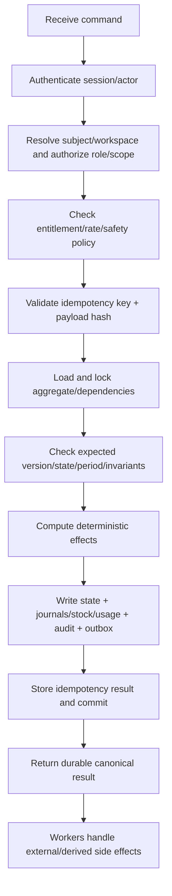

# Complete State, Command and Event Catalogue

**Status:** Complete draft  
**Depends on:** documents 00–17  
**Purpose:** one implementation reference for cross-module states, commands, events, reviews, notifications and side-effect ownership  
**Authority rule:** this catalogue summarizes earlier blueprints; when a detailed invariant appears to conflict, the owning workflow document controls until both are reconciled

## 1. Why this catalogue exists

The workflow documents describe each area in depth. This catalogue makes their integration contracts discoverable by consolidating:

- aggregate/state-machine names;
- allowed lifecycle directions;
- command naming and authorization expectations;
- domain/outbox event names;
- accounting, inventory and external side-effect ownership;
- notification and Review-item triggers;
- idempotency/version requirements;
- asynchronous job and provider-result boundaries;
- audit and analytics separation.

It is suitable for Go enums/types, SQL constraints, API contracts, event handlers, frontend badges and test fixture generation. It is not a reason to replace typed domain code with a generic state-machine engine.

## 2. Naming conventions

### Commands

Commands express an authenticated intent in imperative form:

```text
module.aggregate.action
sales.invoice.issue
payments.payment.record
inventory.transfer.dispatch
privacy.deletion.request
```

### Domain events

Events express an immutable fact in past tense:

```text
sales.invoice.issued
payments.payment.recorded
inventory.transfer.dispatched
privacy.deletion.requested
```

### Jobs

Jobs express work to attempt:

```text
documents.pdf.render
notifications.email.send
privacy.deletion.purge_subject
operations.reconciliation.run
```

### Analytics

Analytics names are stable product-action labels such as `record_confirmed`; they are not domain events or a source of truth.

## 3. State vocabulary rules

- Store machine values as lowercase `snake_case` stable codes.
- UI labels may be localized without changing codes.
- State is scoped to one dimension; do not collapse business, payment, fulfilment and delivery state.
- Terminal means no ordinary forward transition, not deletion of history.
- Archive/restrict/void/reverse are different operations.
- Derived status is computed from authoritative facts where possible rather than manually edited.
- State changes occur through named commands or deterministic projectors, not arbitrary `PATCH status`.
- Every rejected transition returns current state/version and a stable error code.

## 4. Command execution envelope

Every material mutation carries or resolves:

```json
{
  "command_type": "sales.invoice.issue",
  "command_version": 1,
  "idempotency_key": "...",
  "actor_user_id": "...",
  "workspace_id": "resolved from authorized route/session",
  "expected_version": "...",
  "client_command_id": "optional offline correlation",
  "payload": {}
}
```

The server never trusts actor, role, plan or workspace ownership merely because the client sends it.

## 5. Common command pipeline



## 6. Event envelope

```json
{
  "event_id": "01J...",
  "event_type": "sales.invoice.issued",
  "event_version": 1,
  "occurred_at": "server UTC instant",
  "recorded_at": "server UTC instant",
  "actor": {"type": "user", "id": "..."},
  "subject": {"type": "business", "id": "..."},
  "aggregate": {"type": "sales_invoice", "id": "...", "version": "4"},
  "command_id": "...",
  "correlation_id": "...",
  "causation_id": "...",
  "payload": {},
  "metadata": {"schema": 1}
}
```

Event payload contains the minimum stable data consumers need. Consumers fetch authorized current data when necessary; the event is not a duplicate of the full financial document.

## 7. Event classes

| Class | Authority | Examples |
|---|---|---|
| Domain event | Committed business fact | invoice issued, payment recorded |
| Integration/outbox event | Delivery contract for a fact | PDF render requested |
| Provider event | Verified external fact | email bounced, Paystack charge succeeded |
| Audit event | Who did/attempted what | role changed, export downloaded |
| Security event | Authentication/access fact | session revoked |
| Analytics event | Privacy-safe behaviour measurement | onboarding completed |
| Review signal | Derived actionable condition | allocation conflict |

They may share correlation IDs but are stored/retained/authorized differently.

## 8. Consumer rules

- Consumers are idempotent by `event_id` or declared dedupe key.
- Ordering is guaranteed only where explicitly designed per aggregate/stream.
- Consumers tolerate duplicates and compatible event versions.
- External calls use their own idempotency/reconciliation.
- A notification/PDF/email consumer cannot change financial truth.
- Projection failure is visible/retryable; it does not rewrite the fact.
- Poison events dead-letter after bounded attempts.
- Event payloads remain tenant-scoped and privacy-minimized.

## 9. Cross-cutting actor types

| Code | Meaning |
|---|---|
| `user` | Authenticated Rekordly identity |
| `guest` | Holder of a narrow share/storefront capability |
| `service` | Trusted API/worker/system process |
| `provider` | Verified external webhook source |
| `admin` | Restricted internal operations actor |
| `migration` | Reviewed versioned data migration/recovery actor |

An event records actual actor plus effective subject. Support/admin never masquerades as `user`.

## 10. Cross-cutting aggregate metadata

Material aggregates SHOULD expose:

- opaque ID;
- workspace/subject ID;
- stable type;
- lifecycle state(s);
- integer/opaque revision;
- created/updated server times;
- created/updated actor references;
- archive/reversal/supersession references;
- applicable outlet scope;
- source/import/offline correlation;
- last audit/outbox references where useful.

Posted records additionally link journal/source effects.

## 11. Identity/account states

| State | Meaning | Forward transitions |
|---|---|---|
| `pending_verification` | Identity/contact challenge incomplete | `active`, `expired`, `blocked` |
| `active` | Normal authenticated identity | `security_restricted`, `deletion_requested`, `disabled` |
| `security_restricted` | High-risk actions/access limited | `active`, `disabled`, `deletion_requested` |
| `deletion_requested` | Explicit deletion accepted | `active` through cancellation, `purge_review` |
| `purge_review` | Grace ended; holds/dependencies checked | `retention_hold`, `purging` |
| `retention_hold` | Scoped retention prevents purge | `purge_review` |
| `purging` | Processor purge in progress | `deleted`, `purge_failed` |
| `purge_failed` | Partial purge needs retry | `purging` |
| `deleted` | Verified terminal deletion | none |
| `disabled` | Security/legal/admin restriction | reviewed recovery only |

Subscription state does not transition this aggregate to deletion.

## 12. Identity commands and events

| Command | Domain event | Idempotent/versioned | Side effects |
|---|---|---|---|
| `identity.account.register` | `identity.account.registered` | Yes | OTP challenge/outbox |
| `identity.contact.add` | `identity.contact.added` | Yes/versioned | Verification challenge |
| `identity.contact.verify` | `identity.contact.verified` | Yes | Audit/security notice |
| `identity.contact.make_primary` | `identity.contact.primary_changed` | Yes/versioned | Session/security notice |
| `identity.contact.remove` | `identity.contact.removed` | Yes/versioned | Session/security notice |
| `identity.profile.update` | `identity.profile.updated` | Yes/versioned | Projection/audit |
| `identity.account.restrict` | `identity.account.security_restricted` | Yes | Revoke/pause authority |
| `identity.account.restore` | `identity.account.restored` | Yes | Session/permission refresh |

## 13. Verification challenge states

| State | Meaning |
|---|---|
| `pending` | Challenge exists and may be delivered/verified |
| `delivered` | Channel reported acceptable delivery state |
| `verified` | Correct code used once; terminal |
| `expired` | Time window passed; terminal |
| `attempts_exhausted` | Guess limit reached; terminal |
| `cancelled` | Superseded/security action; terminal |

Commands/events: `auth.challenge.create/created`, `auth.challenge.resend_requested`, `auth.challenge.verify/verified`, `auth.challenge.failed`, `auth.challenge.expired`.

## 14. Session states

| State | Meaning |
|---|---|
| `active` | Valid within idle/absolute/auth constraints |
| `rotated` | Replaced by a new session/family credential |
| `expired` | Time limit passed |
| `revoked` | User/security/admin action removed authority |
| `suspicious` | Risk review/step-up restriction |

Commands/events: `auth.session.create/created`, `auth.session.rotate/rotated`, `auth.session.revoke/revoked`, `auth.sessions.revoke_others/others_revoked`, `auth.session.flag_suspicious/flagged_suspicious`, `auth.session.restore/restored`.

## 15. Onboarding states

| State | Meaning |
|---|---|
| `not_started` | No onboarding profile |
| `role_selected` | Persona/role choice saved |
| `spaces_selected` | Personal/Business/both selected |
| `personal_setup_pending` | Required Personal defaults incomplete |
| `business_setup_pending` | Required Business configuration incomplete |
| `first_value_pending` | Spaces exist; activation checklist incomplete |
| `completed` | Required setup completed |
| `abandoned` | Timed/explicit abandonment marker, resumable |

Events: `onboarding.started`, `onboarding.role_selected`, `onboarding.spaces_selected`, `onboarding.personal_setup_completed`, `onboarding.business_setup_completed`, `onboarding.completed`.

## 16. Workspace states

| State | Meaning |
|---|---|
| `setup` | Created but required setup incomplete |
| `active` | Normal operation |
| `read_only` | Commercial/security/maintenance writes restricted |
| `archived` | Owner archived; historical read/export |
| `deletion_pending` | Explicit deletion grace |
| `purging` | Permanent deletion tasks running |
| `deleted` | Terminal/tombstoned |

`read_only` has a reason dimension (`subscription`, `security`, `maintenance`, `ownership`, `legal`) rather than many ambiguous state codes.

## 17. Workspace commands and events

| Command | Event | Key rules |
|---|---|---|
| `workspace.personal.create` | `workspace.personal.created` | One/entitled Personal space |
| `workspace.business.create` | `workspace.business.created` | Plan/owner/setup transaction |
| `workspace.setup.complete` | `workspace.setup.completed` | Required locked defaults validated |
| `workspace.archive` | `workspace.archived` | No deletion; read/export remains |
| `workspace.restore` | `workspace.restored` | Recheck plan/security/dependencies |
| `workspace.restrict` | `workspace.restricted` | Reason/actor/audit required |
| `workspace.deletion.request` | `workspace.deletion.requested` | Recent auth, 60-day case |

## 18. Membership states

| State | Meaning |
|---|---|
| `pending_invitation` | Invite not accepted |
| `active` | Authorized member |
| `suspended` | Temporarily blocked |
| `billing_restricted` | Seat removed by entitlement change |
| `removed` | Membership ended; history retained |
| `expired` | Invitation expired |
| `revoked` | Invitation revoked |

Role and outlet scope are attributes with their own revision; ownership is explicit and cannot be inferred from a generic role string.

## 19. Membership commands and events

- `members.invitation.create` → `members.invitation.created`
- `members.invitation.resend` → `members.invitation.resent`
- `members.invitation.revoke` → `members.invitation.revoked`
- `members.invitation.accept` → `members.membership.activated`
- `members.membership.change_access` → `members.membership.access_changed`
- `members.membership.suspend` → `members.membership.suspended`
- `members.membership.restore` → `members.membership.restored`
- `members.membership.remove` → `members.membership.removed`
- `members.ownership_transfer.request` → `members.ownership_transfer.requested`
- `members.ownership_transfer.accept` → `members.business_ownership.transferred`

All are versioned/idempotent and increment permission revision where authority changes.

## 20. Money draft states

| State | Meaning |
|---|---|
| `editing` | Mutable manual/AI/import/local draft |
| `needs_clarification` | Missing/ambiguous required meaning |
| `ready_for_review` | Structurally valid draft awaiting human confirmation |
| `queued_offline` | Frozen intent awaiting sync |
| `confirming` | Server command in progress/ambiguous response reconciliation |
| `needs_review` | Current state conflict/validation requires action |
| `confirmed` | Durable source record/journal created |
| `discarded` | Draft intentionally removed |
| `failed` | Terminal unchanged attempt; draft may be copied/revised |

Draft state is not posted state. Only `confirmed` has authoritative effects.

## 21. Money commands and events

| Command | Event | Financial side effect |
|---|---|---|
| `money.draft.create` | `money.draft.created` | None |
| `money.draft.update` | `money.draft.updated` | None |
| `money.draft.discard` | `money.draft.discarded` | None |
| `money.entry.confirm` | `money.entry.confirmed` | Balanced journal/source record |
| `money.entry.reverse` | `money.entry.reversed` | Linked reversing journal |
| `money.entry.correct` | `money.entry.correction_created` | New correction/reversal chain |
| `money.entry.reclassify` | `money.entry.reclassified` | Controlled journal adjustment |

Confirm/reverse/correct require idempotency, current period and exact deterministic money checks.

## 22. Money classification dimensions

These are attributes, not lifecycle states:

- direction: `income`, `expense`, `transfer`, `purchase`, `sale`, `owner_movement`, `loan`, `tax`, `other`;
- scope: `personal`, `business`, `mixed`;
- purpose/link: invoice/sale, supplier bill/purchase, advance/deposit, loan, owner movement, transfer, suspense/unknown;
- source: manual, AI-assisted, import, offline;
- reconciliation: unreconciled, matched, partially matched, reconciled, excluded/exception.

Changing them after confirmation uses domain correction, never direct draft semantics.

## 23. Payment states

| Dimension/state | Meaning |
|---|---|
| Record `draft` | Intent only |
| Record `posted` | Money movement/journal committed |
| Record `reversed` | Exact linked reversal committed |
| Allocation `unallocated` | No document allocation; explicit advance/suspense/other treatment |
| Allocation `partially_allocated` | Some posted amount linked |
| Allocation `fully_allocated` | Whole allocatable amount linked |
| Reconciliation `unreconciled` | Not matched to external statement/evidence |
| Reconciliation `reconciled` | Matched and validated |

Payment state is separate from invoice/bill state and delivery method.

## 24. Payment commands and events

- `payments.payment.preview` → no domain fact; deterministic projection only
- `payments.payment.record` → `payments.payment.recorded`
- `payments.payment.allocate` → `payments.payment.allocated`
- `payments.payment.reallocate` → `payments.payment.reallocated`
- `payments.payment.reverse` → `payments.payment.reversed`
- `payments.deposit.apply` → `payments.deposit.applied`
- `payments.deposit.refund` → `payments.deposit.refunded`
- `payments.suspense.resolve` → `payments.suspense.resolved`
- `payments.reconciliation.match` → `payments.reconciliation.matched`
- `payments.reconciliation.unmatch` → `payments.reconciliation.unmatched`

Payment and allocation journals/balances change atomically within the command that owns them.

## 25. Party states

| State/dimension | Codes |
|---|---|
| Lifecycle | `active`, `archived`, `merged` |
| Roles | customer, supplier or both as independent role flags |
| Claim | `unclaimed`, `claim_pending`, `linked`, `claim_disputed`, `unlinked` |
| Contact verification | unknown/unverified/verified for a specific identity-purpose; not account membership |

Archived/merged parties remain in historical document snapshots and source links.

## 26. Party commands and events

- `parties.party.create` → `parties.party.created`
- `parties.party.update` → `parties.party.updated`
- `parties.party.archive` → `parties.party.archived`
- `parties.party.restore` → `parties.party.restored`
- `parties.party.merge_preview` → no fact
- `parties.party.merge` → `parties.party.merged`
- `parties.opening_balance.post` → `parties.opening_balance.posted`
- `parties.claim.request` → `parties.claim.requested`
- `parties.claim.verify` → `parties.claim.linked`
- `parties.claim.unlink` → `parties.claim.unlinked`

Merge/claim never merges party rows across businesses or equates contact value with identity.

## 27. Estimate/proforma states

| State | Meaning |
|---|---|
| `draft` | Mutable/non-shared |
| `issued` | Immutable version presented to recipient |
| `accepted` | Explicit recipient/business acceptance of exact version |
| `declined` | Recipient declined exact version |
| `expired` | Validity ended |
| `converted` | Linked invoice/order created |
| `cancelled` | Sender cancelled |
| `superseded` | New issued version/document replaces it |

Issuing an estimate/proforma creates no receivable/revenue by itself.

## 28. Estimate commands and events

- `sales.estimate.create_draft` → `sales.estimate.draft_created`
- `sales.estimate.update_draft` → `sales.estimate.draft_updated`
- `sales.estimate.issue` → `sales.estimate.issued`
- `sales.estimate.accept` → `sales.estimate.accepted`
- `sales.estimate.decline` → `sales.estimate.declined`
- `sales.estimate.cancel` → `sales.estimate.cancelled`
- `sales.estimate.supersede` → `sales.estimate.superseded`
- `sales.estimate.convert` → `sales.estimate.converted`

Accept/convert validates exact issued version and current dependencies.

## 29. Invoice business states

| State | Meaning |
|---|---|
| `draft` | Editable; no issued receivable |
| `issued` | Immutable issued version and accounting recognition per policy |
| `partially_paid` | Posted allocations below outstanding total |
| `paid` | Outstanding zero through valid settlement/credits |
| `overdue` | Derived: due date passed with outstanding balance |
| `cancelled` | Valid pre-post cancellation or controlled void policy |
| `credited` | Fully offset by credit note(s), distinct from payment |
| `reversed` | Controlled accounting reversal |
| `written_off` | Authorized adjustment, not fake payment |

`overdue` may be a derived flag alongside `issued`/`partially_paid`; implementation must avoid impossible single-enum combinations.

## 30. Invoice commands and events

- `sales.invoice.create_draft` → `sales.invoice.draft_created`
- `sales.invoice.update_draft` → `sales.invoice.draft_updated`
- `sales.invoice.issue` → `sales.invoice.issued`
- `sales.invoice.cancel` → `sales.invoice.cancelled`
- `sales.invoice.credit` → `sales.credit_note.issued`
- `sales.invoice.debit` → `sales.debit_note.issued`
- `sales.invoice.write_off` → `sales.invoice.written_off`
- `sales.invoice.reverse` → `sales.invoice.reversed`
- allocation projector → `sales.invoice.payment_state_changed`

Invoice issue/credit/debit/write-off/reversal own their balanced accounting events; payment owns settlement allocation.

## 31. Direct sale/receipt states

Direct sale:

- `draft` → `confirmed` → optionally `partially_refunded`/`refunded` or `reversed`.

Receipt artifact:

- render/share/delivery states from document 14, not sale state.

Commands/events:

- `sales.sale.confirm` → `sales.sale.confirmed`
- `sales.sale.refund` → `sales.sale.refunded`
- `sales.sale.reverse` → `sales.sale.reversed`
- `sales.receipt.request` → `documents.receipt.render_requested`

Immediate sale may atomically create source sale, payment, allocations, stock/COGS and journal while retaining separate linked records.

## 32. Product/catalogue states

| State | Meaning |
|---|---|
| `draft` | Incomplete/not sellable |
| `active` | Available for permitted channels |
| `inactive` | Temporarily unavailable but editable/history retained |
| `archived` | No new use by default; history retained |

Separate attributes: stock/non-stock/service, track batches/expiry/serials, taxable, storefront visibility, per-outlet availability.

Commands/events: `catalogue.product.create/created`, `update/updated`, `activate/activated`, `deactivate/deactivated`, `archive/archived`, `restore/restored`; variant/price/media commands emit their typed events.

## 33. Outlet states

| State | Meaning |
|---|---|
| `active` | Operational |
| `inactive` | Temporarily blocked from new operations |
| `billing_restricted` | Above plan capacity after downgrade |
| `archived` | Historical only |

Outlet archive/restrict never deletes stock movement/history. Closing an outlet requires transfer/count/open-order dependency resolution.

## 34. Stock movement types

Immutable movement type codes:

- `opening`;
- `purchase_receipt`;
- `sale_fulfilment`;
- `customer_return`;
- `supplier_return`;
- `transfer_out`, `transfer_in`;
- `count_adjustment_in`, `count_adjustment_out`;
- `damage`, `expiry`, `defect`, `write_off`;
- `production` later;
- `reversal`/linked correction.

Movement lifecycle is normally `posted` then optionally `reversed`; drafts belong to the owning operation, not the stock ledger.

## 35. Stock reservation states

| State | Meaning |
|---|---|
| `active` | Quantity reduces available stock |
| `partially_consumed` | Some quantity fulfilled |
| `consumed` | Fully converted into fulfilment movement |
| `released` | Cancel/expiry returned availability |
| `expired` | Policy expiry, release applied |

Commands/events: `inventory.reservation.create/created`, `consume/consumed`, `release/released`, `expire/expired`. Creation/consumption/release is atomic with order/stock effects.

## 36. Stock transfer states

| State | Meaning |
|---|---|
| `draft` | Editable request |
| `approved` | Authorized to dispatch |
| `in_transit` | Source stock moved to transfer control |
| `partially_received` | Some destination receipt posted |
| `received` | All accepted quantities posted |
| `cancelled` | Cancelled before/with controlled remainder handling |
| `disputed` | Quantity/identifier variance needs review |

Commands/events: `inventory.transfer.create/created`, `approve/approved`, `dispatch/dispatched`, `receive/received`, `dispute/disputed`, `cancel/cancelled`.

## 37. Stock count states

| State | Meaning |
|---|---|
| `draft` | Scope/count sheet prepared |
| `counting` | Observations in progress |
| `submitted` | Frozen for variance review |
| `approved` | Authorized variance |
| `posted` | Adjustment movements committed |
| `rejected` | Returned for recount/correction |
| `cancelled` | Closed without posting |

Posting creates typed adjustment movements and valuation effects once, with approval/version/idempotency.

## 38. Inventory commands and events

- `inventory.opening_stock.post` → `inventory.opening_stock.posted`
- `inventory.adjustment.post` → `inventory.adjustment.posted`
- `inventory.count.start` → `inventory.count.started`
- `inventory.count.submit` → `inventory.count.submitted`
- `inventory.count.approve` → `inventory.count.approved`
- `inventory.count.post` → `inventory.count.posted`
- `inventory.identifier.assign` → `inventory.identifier.assigned`
- `inventory.identifier.change_state` → `inventory.identifier.state_changed`
- `inventory.cost_revaluation.post` → `inventory.cost_revaluation.posted` only under explicit policy

All posted events reconcile movement quantity, identifiers/lots and costing layers.

## 39. Purchase request states

| State | Meaning |
|---|---|
| `draft` | Editable request |
| `submitted` | Awaiting approval |
| `approved` | Authorized to source/create PO |
| `rejected` | Declined with reason |
| `converted` | PO created |
| `cancelled` | Withdrawn/closed |

Commands/events: create, update, submit, approve, reject, convert and cancel under `purchasing.request.*`.

## 40. Purchase order states

| State | Meaning |
|---|---|
| `draft` | Editable |
| `pending_approval` | Awaiting approval |
| `approved` | Frozen approved version |
| `sent` | Shared/delivery attempted separately |
| `partially_received` | Some lines received |
| `received` | All ordered/closed quantities received |
| `partially_billed` | Bill matching incomplete |
| `completed` | Receipt/bill/closure policy satisfied |
| `cancelled` | Controlled cancellation/remainder closure |
| `closed` | Explicit administrative close with reason |

Approval is invalidated by material draft revision.

## 41. Purchase order commands/events

- `purchasing.po.create_draft` → `purchasing.po.draft_created`
- `purchasing.po.update_draft` → `purchasing.po.draft_updated`
- `purchasing.po.submit` → `purchasing.po.submitted`
- `purchasing.po.approve` → `purchasing.po.approved`
- `purchasing.po.send` → `purchasing.po.send_requested` plus delivery pipeline
- `purchasing.po.cancel` → `purchasing.po.cancelled`
- `purchasing.po.close` → `purchasing.po.closed`

Sending does not create stock/payable. Receipt and bill commands own those effects.

## 42. Goods/service receipt states

| State | Meaning |
|---|---|
| `draft` | Captured but not posted |
| `posted` | Stock/service receipt and control effects committed |
| `partially_returned` | Some quantity returned |
| `returned` | Fully returned/offset |
| `reversed` | Controlled full reversal where valid |

Commands/events: `purchasing.receipt.post/posted`, `purchasing.receipt.reverse/reversed`, `purchasing.supplier_return.post/posted`.

## 43. Supplier bill states

| State | Meaning |
|---|---|
| `draft` | Editable/no payable |
| `pending_approval` | Approval required |
| `posted` | Payable/expense/inventory/GRNI accounting committed |
| `partially_paid` | Outstanding reduced but positive |
| `paid` | Outstanding zero through settlement/credits |
| `overdue` | Derived due-state flag |
| `credited` | Offset by supplier credit |
| `cancelled` | Only pre-post/valid controlled case |
| `reversed` | Controlled reversing document/journal |

Duplicate supplier reference detection may warn/block before post but does not replace idempotency.

## 44. Supplier bill commands/events

- `purchasing.bill.create_draft` → `purchasing.bill.draft_created`
- `purchasing.bill.update_draft` → `purchasing.bill.draft_updated`
- `purchasing.bill.submit` → `purchasing.bill.submitted`
- `purchasing.bill.approve` → `purchasing.bill.approved`
- `purchasing.bill.post` → `purchasing.bill.posted`
- `purchasing.bill.credit` → `purchasing.supplier_credit.posted`
- `purchasing.bill.reverse` → `purchasing.bill.reversed`
- allocation projector → `purchasing.bill.payment_state_changed`

## 45. Procurement match states

| State | Meaning |
|---|---|
| `unmatched` | Bill/receipt/PO relationship incomplete |
| `matched` | Quantities/prices/taxes within exact policy |
| `variance_review` | Difference requires explanation/approval |
| `approved_variance` | Authorized difference |
| `resolved` | Accounting/operational resolution posted |

Events: `purchasing.match.created`, `purchasing.match.variance_detected`, `purchasing.match.variance_approved`, `purchasing.match.resolved`.

## 46. Storefront states

| State | Meaning |
|---|---|
| `draft` | Not public |
| `published` | Public/eligible for order requests |
| `paused` | Merchant temporarily stops public operation |
| `suspended` | Security/policy/plan restriction |
| `expiry_warning` | Entitlement at risk; still active per policy |
| `grace` | Limited expiry behaviour |
| `disabled` | Public surface unavailable; data retained |
| `archived` | Historical configuration retained |

Commands/events: `commerce.storefront.configure/configured`, `publish/published`, `pause/paused`, `resume/resumed`, `suspend/suspended`, `disable/disabled`, `archive/archived`.

## 47. Storefront order dimensions

### Commercial

- `requested`, `confirmed`, `cancelled`, `rejected`, `completed`.

### Fulfilment

- `unfulfilled`, `processing`, `partially_ready`, `ready`, `partially_fulfilled`, `fulfilled`, `returned`.

### Payment

- `unpaid`, `partially_paid`, `paid`, `partially_refunded`, `refunded`.

### Reservation

- `none`, `active`, `partially_consumed`, `consumed`, `released`.

Do not represent these as one overloaded order status.

## 48. Order commands/events

- `commerce.order.request` → `commerce.order.requested`
- `commerce.order.confirm` → `commerce.order.confirmed` plus reservation if configured
- `commerce.order.reject` → `commerce.order.rejected`
- `commerce.order.cancel` → `commerce.order.cancelled` plus reservation release
- `commerce.order.start_processing` → `commerce.order.processing_started`
- `commerce.order.mark_ready` → `commerce.order.marked_ready`
- `commerce.order.fulfill` → `commerce.order.fulfilled` plus stock/COGS/sale effects per policy
- `commerce.order.return` → `commerce.order.returned` plus controlled return/refund effects

Each command checks exact current dimensions and version.

## 49. Domain connection states

| State | Meaning |
|---|---|
| `pending` | Domain entered/config generated |
| `verifying` | DNS ownership/routing checks underway |
| `verified` | Ownership/routing proven |
| `provisioning_tls` | Certificate/routing setup |
| `active` | Serving storefront |
| `error` | Actionable DNS/TLS/config failure |
| `grace` | Entitlement expiry recovery window |
| `disconnected` | Routing stopped; metadata retained |

Commands/events: `domains.connection.create/created`, `verify_requested`, `verified`, `tls_provisioned`, `activated`, `verification_failed`, `disconnect/disconnected`, `expired`.

## 50. Budget states

| State | Meaning |
|---|---|
| `draft` | Not active |
| `active` | Used for period/alerts |
| `completed` | Period ended/final view |
| `archived` | Historical only |
| `superseded` | Replaced by revised version/period plan |

Performance dimensions such as `on_track`, `warning`, `exceeded` are derived from posted actuals and configured threshold, not manually set lifecycle state.

## 51. Budget commands/events

- `personal.budget.create` → `personal.budget.created`
- `personal.budget.update` → `personal.budget.updated`
- `personal.budget.activate` → `personal.budget.activated`
- `personal.budget.archive` → `personal.budget.archived`
- `personal.budget.rollover` → `personal.budget.rolled_over`
- posted-entry projector → `personal.budget.threshold_crossed` when transition occurs

Pending offline/unposted entries do not trigger authoritative actuals.

## 52. Loan states

| State | Meaning |
|---|---|
| `draft` | Incomplete setup |
| `active` | Outstanding principal positive |
| `settled` | Principal zero through valid events |
| `written_off` | Authorized loss/gift treatment |
| `cancelled` | Draft/invalid setup cancelled before effects |
| `reversed` | Opening/transaction chain reversed through controlled events |

Events include disbursement/opening, repayment, interest/fee, adjustment, write-off and settlement; principal cannot become negative.

## 53. Loan commands/events

- `personal.loan.create` → `personal.loan.created`
- `personal.loan.open` → `personal.loan.opened`
- `personal.loan.record_repayment` → `personal.loan.repayment_recorded`
- `personal.loan.record_interest` → `personal.loan.interest_recorded`
- `personal.loan.adjust` → `personal.loan.adjusted`
- `personal.loan.write_off` → `personal.loan.written_off`
- balance projector → `personal.loan.settled`

Borrowed versus lent direction determines accounts and income/expense treatment.

## 54. Asset/investment states and events

Lifecycle:

- asset/investment: `active`, `disposed`, `written_off`, `archived`;
- valuation observation: immutable dated record, optionally superseded/corrected;
- investment holding derived from purchase/contribution/disposal events.

Commands/events:

- `personal.asset.register` → `personal.asset.registered`
- `personal.asset.value` → `personal.asset.valuation_recorded`
- `personal.asset.dispose` → `personal.asset.disposed`
- `personal.asset.write_off` → `personal.asset.written_off`
- `personal.investment.purchase` → `personal.investment.purchased`
- `personal.investment.income_record` → `personal.investment.income_recorded`
- `personal.investment.dispose` → `personal.investment.disposed`

Market valuations do not automatically post unrealized journals without a reviewed policy.

## 55. Accounting period states

| State | Meaning |
|---|---|
| `open` | Normal posting allowed |
| `soft_closed` | Warning/restricted roles; review underway |
| `locked` | Posting blocked except controlled adjustment workflow |
| `reopened` | Previously locked, reopened with authority/reason |

Commands/events: `ledger.period.soft_close/soft_closed`, `close/locked`, `reopen/reopened`. Close runs readiness checks; it never deletes unresolved history.

## 56. Journal states

| State | Meaning |
|---|---|
| `posted` | Balanced immutable lines committed |
| `reversed` | Linked reversal journal posted |
| `adjusted` | Additional linked adjustment exists; original unchanged |

There is no committed `unbalanced` state. Manual journal draft may exist separately as `draft`, `pending_approval`, `approved`, then posts into immutable journal.

## 57. Ledger commands/events

- operational commands emit their own business facts and create journals atomically;
- `ledger.manual_journal.create_draft` → `ledger.manual_journal.draft_created`
- `ledger.manual_journal.submit` → `ledger.manual_journal.submitted`
- `ledger.manual_journal.approve` → `ledger.manual_journal.approved`
- `ledger.manual_journal.post` → `ledger.journal.posted`
- `ledger.journal.reverse` → `ledger.journal.reversed`
- `ledger.opening_balance.post` → `ledger.opening_balance.posted`

Journal event payload references source and totals, not full sensitive narration unnecessarily.

## 58. Report/export states

| State | Meaning |
|---|---|
| `requested` | Immutable filters/as-of captured |
| `queued` | Worker pending |
| `running` | Generating |
| `ready` | Reconciled artifact available |
| `failed` | Safe terminal/retryable classification |
| `expired` | Artifact unavailable; source remains |
| `cancelled` | Cancelled before completion |

Warnings/limitations are attributes included in artifact; `ready` is forbidden when mandatory reconciliation fails.

## 59. Report/export commands/events

- `reports.report.request` → `reports.report.requested`
- `reports.export.request` → `reports.export.requested`
- worker → `reports.export.started`
- worker → `reports.export.ready`
- worker → `reports.export.failed`
- expiry job → `reports.export.expired`
- `reports.export.download` → audit `reports.export.downloaded`

Report view may be synchronous query without durable domain event; audit/analytics are separate.

## 60. AI request states

| State | Meaning |
|---|---|
| `received` | Valid request recorded/credit reservation considered |
| `queued` | Async worker waiting |
| `running` | Provider call/validation |
| `needs_clarification` | Uncertainty/missing fields requires user |
| `draft_ready` | Typed untrusted draft ready for review |
| `failed` | Provider/validation/safety failure |
| `cancelled` | Cancelled before usable result |

No state means posted finance. Confirmation uses money/document domain command.

## 61. AI commands/events

- `ai.draft.request` → `ai.draft.requested`
- `ai.draft.cancel` → `ai.draft.cancelled`
- worker → `ai.draft.started`
- worker → `ai.draft.clarification_required`
- worker → `ai.draft.ready`
- worker → `ai.draft.failed`
- `ai.draft.accept_for_review` → `ai.draft.accepted_for_review`

Credit reserve/consume/release is atomic/idempotent and emits usage/audit facts separately.

## 62. Import batch states

| State | Meaning |
|---|---|
| `uploaded` | Private file verified |
| `mapping_required` | Columns need user mapping |
| `parsing` | Worker processing |
| `review_ready` | Rows classified for review |
| `confirming` | Selected rows posting |
| `partially_completed` | Some independent rows confirmed, others not |
| `completed` | Selected/valid scope processed |
| `failed` | Batch-level failure |
| `cancelled` | Cancelled before remaining work |

## 63. Import row states

| State | Meaning |
|---|---|
| `unparsed` | Awaiting parse |
| `invalid` | Syntax/schema invalid |
| `needs_mapping` | Category/account/party mapping missing |
| `possible_duplicate` | Candidate match requires decision |
| `ready` | Valid draft ready for confirmation |
| `excluded` | User intentionally omitted |
| `confirming` | Post command underway |
| `confirmed` | Durable record created/matched |
| `conflict` | Current state prevents safe posting |
| `failed` | Permanent unchanged attempt |

Rows post through ordinary idempotent domain commands.

## 64. Import commands/events

- `imports.batch.create` → `imports.batch.created`
- `imports.batch.set_mapping` → `imports.batch.mapping_set`
- `imports.batch.parse` → `imports.batch.parse_requested`
- worker → `imports.batch.review_ready`
- `imports.row.exclude` → `imports.row.excluded`
- `imports.row.resolve_duplicate` → `imports.row.duplicate_resolved`
- `imports.batch.confirm` → `imports.batch.confirm_requested`
- per row → ordinary domain event plus `imports.row.confirmed`
- worker/orchestrator → `imports.batch.completed`/`partially_completed`/`failed`

## 65. Subscription states

| State | Meaning |
|---|---|
| `none` | No paid subscription |
| `pending` | Checkout initialized, payment not verified |
| `active` | Valid paid-through entitlement |
| `past_due` | Renewal failed within retry policy |
| `cancel_at_period_end` | Active until paid-through end |
| `grace` | Commercial recovery window |
| `read_only` | Paid creation restricted; read/export retained |
| `failed` | Initial intent failed/expired |

Trial/beta grants are entitlement sources with their own effective windows; they are not fake paid subscriptions.

## 66. Billing commands/events

- `billing.checkout.create` → `billing.checkout.created`
- verified provider fact → `billing.payment.verified`
- `billing.subscription.activate` → `billing.subscription.activated`
- renewal success → `billing.subscription.renewed`
- renewal failure → `billing.subscription.past_due`
- `billing.subscription.cancel` → `billing.subscription.cancellation_scheduled`
- `billing.subscription.resume` → `billing.subscription.cancellation_revoked`
- period policy → `billing.subscription.grace_started`/`read_only_started`
- `billing.plan.change` → `billing.plan.changed`
- `billing.addon.purchase` → `billing.addon.activated`
- `billing.refund.issue` → `billing.refund.issued`

Browser callback never emits payment verified without server/provider evidence.

## 67. Entitlement/usage states

Entitlement decision states:

- `allowed`;
- `feature_not_included`;
- `limit_warning`;
- `limit_reached`;
- `safety_denied`;
- `stale_revision`;
- `grace_restricted`.

Usage reservation states:

- `reserved`, `consumed`, `released`, `expired`, `adjusted`.

Commands/events: `entitlements.usage.reserve/reserved`, `consume/consumed`, `release/released`, `adjust/adjusted`, `entitlements.snapshot.changed`.

## 68. Notification states

Per-user in-app state:

- `unread`, `read`, `archived`.

Commands/events:

- projector → `notifications.notification.created`
- `notifications.notification.mark_read` → `notifications.notification.read`
- `mark_unread` → `notifications.notification.unread`
- `archive` → `notifications.notification.archived`
- `restore` → `notifications.notification.restored`

Read state never resolves the underlying Review item.

## 69. Delivery states

| State | Meaning |
|---|---|
| `draft` | Delivery not queued |
| `queued` | Worker pending |
| `processing` | Provider attempt underway |
| `retry_scheduled` | Transient failure |
| `accepted` | Provider accepted responsibility |
| `delivered` | Provider-reported delivery |
| `opened` | Unreliable provider signal if enabled |
| `bounced` | Provider bounce |
| `complained` | Recipient complaint |
| `failed` | Permanent/exhausted |
| `cancelled` | Cancelled before external effect |

WhatsApp client handoff records `handoff_opened`, never `accepted/delivered/read`.

## 70. Delivery commands/events

- `delivery.email.request` → `delivery.email.requested`
- worker → `delivery.email.processing`
- provider adapter → `delivery.email.accepted`/`failed`
- verified webhook → `delivery.email.delivered`/`bounced`/`complained`/`opened`
- `delivery.retry` → `delivery.retry_requested`
- `delivery.resend` → new `delivery.email.requested` linked to prior
- `delivery.whatsapp_handoff.prepare` → `delivery.whatsapp_handoff.prepared`
- client confirmation → analytics/audit `delivery.whatsapp_handoff.opened`

## 71. Document artifact states

| State | Meaning |
|---|---|
| `not_requested` | No artifact intent |
| `queued` | Render pending |
| `rendering` | Worker rendering |
| `ready` | Valid immutable artifact stored |
| `failed` | Render/store failed |
| `superseded` | New artifact/version preferred |
| `expired` | Temporary artifact removed |
| `deleted` | Eligible physical asset removed/tombstoned |

Commands/events: `documents.artifact.render_request/requested`, worker `render_started`, `rendered`, `render_failed`, `superseded`, `expired`.

## 72. File states

| State | Meaning |
|---|---|
| `pending_upload` | Signed intent/reservation exists |
| `uploaded` | Provider has bytes, not finalized |
| `verifying` | Metadata/type/ownership check |
| `quarantined` | Scan/inspection pending |
| `ready` | Authorized linking/download allowed |
| `rejected` | Unsafe/invalid |
| `retention_hold` | Deletion blocked by policy/reference |
| `deletion_scheduled` | Provider cleanup pending |
| `delete_failed` | Cleanup failed |
| `deleted` | Provider deletion confirmed/tombstoned |

## 73. File commands/events

- `files.upload_intent.create` → `files.upload_intent.created`
- `files.upload.finalize` → `files.upload.finalize_requested`
- verifier → `files.file.verified`/`quarantined`/`rejected`
- `files.file.link` → `files.file.linked`
- `files.file.unlink` → `files.file.unlinked`
- `files.file.delete_request` → `files.file.deletion_scheduled`
- worker → `files.file.deleted`/`delete_failed`
- `files.download.authorize` → audit `files.download.authorized`

Storage allowance reserves/consumes/releases through entitlement events.

## 74. Share-grant states

| State | Meaning |
|---|---|
| `active` | Token valid within effective/expiry policy |
| `expired` | Time ended |
| `revoked` | Sender/security/deletion action disabled grant |
| `superseded` | Replacement version/link is preferred |
| `abuse_blocked` | Security rate/risk restriction |

Commands/events: `sharing.grant.create/created`, `revoke/revoked`, `supersede/superseded`, expiry `expired`; portal emits `sharing.portal.opened`, `sharing.download.requested`, explicit guest-action facts.

## 75. Offline queue states

| State | Meaning |
|---|---|
| `local_draft` | Editable and unsubmitted |
| `queued` | Frozen supported intent |
| `syncing` | Submission/idempotency resolution underway |
| `confirmed` | Server result mapped |
| `needs_review` | Business/version/permission/plan conflict |
| `failed_permanent` | Cannot retry unchanged |
| `blocked_by_dependency` | Required local command unresolved |
| `cancelled` | Definitely unsubmitted intent cancelled |
| `discarded` | Draft/local copy removed intentionally |

These are client states mirrored only as needed for diagnostics; financial truth remains server domain state.

## 76. Offline commands/events

- local `offline.draft.created/updated/discarded` are client facts, not server domain events;
- `offline.command.queued` privacy-safe analytics/client state;
- `sync.session.start` → server `sync.session.started` if persisted;
- domain command submission emits the ordinary domain event;
- server diagnostic may emit `sync.command.confirmed`, `conflict_detected`, `failed`;
- conflict revision creates a new domain command/idempotency key;
- no event called `money.posted_offline` exists.

## 77. Deletion states

| State | Meaning |
|---|---|
| `requested` | Explicit recent-auth request stored |
| `grace_restricted` | 60-day recoverable restriction active |
| `restoring` | Cancellation/recovery checks |
| `purge_review` | Deadline passed; dependencies/holds evaluated |
| `retention_hold` | Scoped hold prevents task(s) |
| `purging` | Processor tasks executing |
| `purge_failed` | Partial failure/retry |
| `deleted` | Mandatory tasks verified; terminal |

## 78. Deletion commands/events

- `privacy.deletion.preview` → no domain fact
- `privacy.deletion.request` → `privacy.deletion.requested`
- policy worker → `privacy.deletion.grace_restricted`
- `privacy.deletion.cancel` → `privacy.deletion.cancelled`
- restore worker → `privacy.deletion.restored`
- deadline worker → `privacy.deletion.purge_review_started`
- `privacy.retention_hold.place/release` → corresponding events
- worker → `privacy.deletion.processor_task_completed/failed`
- finalizer → `privacy.deletion.completed`

No subscription event causes `privacy.deletion.requested`.

## 79. Support case states

| State | Meaning |
|---|---|
| `new` | Received/untriaged |
| `triaged` | Category/severity/owner assigned |
| `waiting_on_support` | Founder/support action required |
| `waiting_on_user` | Safe information/action requested |
| `security_incident` | Escalated into incident process |
| `resolved` | Resolution supplied/verified |
| `closed` | Closure period complete |
| `reopened` | User/evidence reopens |

Support resolution does not imply underlying domain conflict is resolved unless its typed command/event exists.

## 80. Support/admin commands/events

- `support.case.create` → `support.case.created`
- `support.case.triage` → `support.case.triaged`
- `support.case.message` → `support.case.message_added`
- `support.case.resolve` → `support.case.resolved`
- `support.case.reopen` → `support.case.reopened`
- `support.access_grant.create/revoke` → corresponding events
- `admin.session.revoke` → `security.session.admin_revoked`
- `admin.reconciliation.rerun` → `operations.reconciliation.requested`
- typed recovery command → specific `operations.recovery.*` event plus domain correction event

No generic `admin.record.update` command is permitted for posted truth.

## 81. Job states

| State | Meaning |
|---|---|
| `queued` | Eligible at scheduled time |
| `processing` | Worker lease active |
| `retry_scheduled` | Transient failure/backoff |
| `succeeded` | Terminal effect/result recorded |
| `dead_letter` | Permanent/exhausted; operator review |
| `cancelled` | Cancelled before prohibited/remaining effect |

Lease expiry may return to queued only after checking ambiguous external effects.

## 82. Job commands/events

- scheduler/outbox → `operations.job.queued`
- worker → `operations.job.claimed`
- worker → `operations.job.succeeded`
- worker → `operations.job.retry_scheduled`
- worker → `operations.job.dead_lettered`
- `operations.job.retry` → `operations.job.retry_requested`
- `operations.job.cancel` → `operations.job.cancelled`

Job events contain safe type/error/attempt metadata, not raw document/prompt/contact content.

## 83. Incident states

| State | Meaning |
|---|---|
| `investigating` | Scope/cause unknown |
| `identified` | Cause/scope sufficiently known |
| `mitigating` | Containment/recovery underway |
| `monitoring` | Fix deployed; reconciliation/observation |
| `resolved` | Service/integrity restored and scoped |
| `post_review` | Corrective action review underway |
| `closed` | Review/actions recorded/owned |

Severity (`sev0`–`sev3`) is a separate mutable classification with history.

## 84. Incident commands/events

- `operations.incident.declare` → `operations.incident.declared`
- `operations.incident.classify` → `operations.incident.classified`
- `operations.incident.contain` → `operations.incident.containment_applied`
- `operations.incident.update` → `operations.incident.updated`
- `operations.incident.resolve` → `operations.incident.resolved`
- `operations.incident.close` → `operations.incident.closed`
- recovery actions emit both incident action and typed domain correction facts.

## 85. Review-item types

Review is an actionable projection, not the domain truth. Initial keys:

- `money.classification_required`;
- `money.suspense_resolution_required`;
- `payments.allocation_conflict`;
- `payments.reconciliation_required`;
- `parties.duplicate_or_merge_review`;
- `parties.claim_disputed`;
- `sales.document_conflict`;
- `sales.delivery_failed`;
- `inventory.low_stock`;
- `inventory.count_variance`;
- `inventory.transfer_dispute`;
- `purchasing.approval_required`;
- `purchasing.match_variance`;
- `purchasing.duplicate_bill`;
- `commerce.order_review`;
- `commerce.domain_error`;
- `ai.clarification_required`;
- `imports.row_conflict`;
- `offline.sync_conflict`;
- `billing.payment_recovery`;
- `files.quarantine_or_delete_failure`;
- `privacy.deletion_or_export_failure`;
- `operations.reconciliation_finding`.

## 86. Review-item states

| State | Meaning |
|---|---|
| `open` | Requires action |
| `in_progress` | Actor began resolution |
| `blocked` | Dependency/user/provider required |
| `resolved` | Underlying condition resolved by named fact |
| `dismissed` | Informational/non-required item dismissed with policy |
| `superseded` | New item/condition replaces it |

Marking notification read does not transition Review. Resolution references the domain event that fixed the condition.

## 87. Review commands/events

- projector → `review.item.opened`
- `review.item.start` → `review.item.in_progress`
- dependency → `review.item.blocked`
- domain resolution projector → `review.item.resolved`
- `review.item.dismiss` → `review.item.dismissed` only for dismissible types
- newer condition → `review.item.superseded`

Review projectors are idempotent by source condition/version.

## 88. Notification trigger matrix

| Source fact | Recipient | In-app | Email | Review |
|---|---|---:|---:|---:|
| New/security session/contact change | Account user | Yes | Yes when safe | Only suspicious |
| Invitation created | Invite destination/user | Optional/inbox | Yes | No |
| Role/member removed | Affected member + owner/admin | Yes | Optional | Reassign work if needed |
| Money entry confirmed | Actor/owner preference | Optional | No | No |
| Suspense/unallocated aging | Authorized owner/accountant | Yes | Optional | Yes |
| Invoice issued/shared | Sender/customer channel | Sender status + recipient email | As requested | Failure only |
| Payment recorded | Authorized owner/customer preference | Yes | Optional receipt | Allocation conflict only |
| PO approval required | Approver | Yes | Optional | Yes |
| Goods receipt/bill variance | Procurement/accounting role | Yes | Optional | Yes |
| Low stock/expiry | Outlet/inventory role | Yes | Optional | Policy-dependent |
| Store order requested | Business role | Yes | Optional | Yes until reviewed |
| Domain verification failed | Owner/admin | Yes | Optional | Yes |
| AI draft ready/failed | Requester | Yes if async | Optional | Clarification/failure as needed |
| Import ready/conflicts | Requester | Yes | Optional | Yes |
| Limit warning/reached | Owner/billing admin | Yes | Optional | Not normally |
| Renewal/payment failure | Billing owner | Yes | Yes | Yes |
| Export ready/failed | Requester | Yes | Yes safe link | Failure only |
| Deletion requested/reminder/completed | Account owner | Restricted/in-app status | Yes safe verified | Failure/hold |
| Integrity/reconciliation failure | Authorized admin/owner as policy | Yes/internal | Alert channel | Yes/incident |

Preferences cannot suppress mandatory security/legal notices.

## 89. Accounting side-effect ownership matrix

| Fact | Journal owner/effect |
|---|---|
| `money.entry.confirmed` | Entry command creates balanced journal |
| `sales.invoice.issued` | Revenue/tax/AR per recognition policy |
| `sales.sale.confirmed` | Revenue/tax/payment; inventory/COGS when applicable |
| `payments.payment.recorded` | Cash/bank and AR/AP/deposit/suspense settlement |
| `sales.credit_note.issued` | Revenue/tax/AR correction; stock separately if return |
| `purchasing.receipt.posted` | Stock/GRNI or service receipt effects per policy |
| `purchasing.bill.posted` | AP and expense/inventory/GRNI/tax effects |
| `inventory.*.posted` | Inventory asset/COGS/variance/control effects as applicable |
| `commerce.order.requested` | None |
| `commerce.order.confirmed` | Usually reservation only; no accounting unless explicit workflow |
| `commerce.order.fulfilled` | Sale/invoice/stock effects through linked domain commands |
| AI/import/offline/delivery events | None by themselves |
| Subscription payment verified | Rekordly's own billing system, not user's Business ledger unless user records it separately |

## 90. Stock side-effect ownership matrix

| Fact | Stock effect |
|---|---|
| Product created/updated | None |
| Reservation created/released | Available quantity changes; on-hand unchanged |
| Sale/order fulfilled | On-hand decreases, reservation consumed, costing layer/COGS |
| Customer return posted | On-hand/condition/location changes under policy |
| Goods receipt posted | On-hand/lots/identifiers/layers increase |
| Supplier return posted | On-hand/layers/control effects decrease |
| Transfer dispatched | Source on-hand/control/in-transit effect |
| Transfer received | Destination on-hand/layers/identifiers effect |
| Count adjustment posted | On-hand/valuation variance movement |
| Draft/AI/import/offline intent | None until owning post command confirms |

## 91. External side-effect ownership

| Side effect | Owned by |
|---|---|
| Email | Delivery job after domain commit |
| PDF | Render job from immutable source snapshot |
| Cloudinary upload/delete | File/artifact job plus verified metadata |
| AI provider call | AI request/job after credit reservation |
| Paystack checkout/refund | Billing adapter with provider verification |
| DNS/domain verification | Domain job; storefront data remains internal |
| WhatsApp MVP | User/client handoff; no delivery claim |
| Analytics | Privacy-safe projector; never command authority |

## 92. Command idempotency matrix

| Command class | Idempotency | Expected version |
|---|---:|---:|
| Financial/stock post/reverse/refund/fulfil | Required | Required where aggregate exists |
| Workspace/onboarding creation | Required | As applicable |
| Draft update | Stable request ID or optimistic version | Required |
| Mark notification read | Required/idempotent natural key | Optional current revision |
| External delivery/render/upload intent | Required | Source version required |
| Billing/Paystack/refund | Required | Subscription/transaction version |
| Member/role/ownership/security | Required | Required |
| Export/deletion/privacy/support action | Required | Case/request version |
| Provider webhook | Provider event/reference dedupe | Fact/order validation |
| Admin recovery | Required | Exact target versions |

## 93. Version-conflict policy

On stale version:

- return stable conflict code and current authorized snapshot/version;
- do not silently overwrite;
- do not auto-merge financial/stock/permission/security/billing states;
- preserve local draft/input;
- require explicit new command with new idempotency key if intent changes;
- record original command result/conflict;
- offline flow moves to Needs Review;
- analytics may record safe conflict class only.

## 94. Event ordering policy

- Aggregate version provides local order.
- `occurred_at` is not a sole ordering mechanism.
- Outbox is written in the same transaction as the fact.
- Consumers keep per-event idempotency evidence.
- Cross-aggregate order is not assumed unless orchestrator/state explicitly establishes it.
- Provider events can arrive duplicated/out of order; compare verified fact/effective periods.
- Projection rebuild uses authoritative domain tables/events and version checks.
- A later correction does not mutate an earlier event.

## 95. Event versioning

- Event type plus integer schema version.
- Additive optional fields preferred.
- Consumer handles supported current/previous versions during deployment window.
- Breaking semantic change creates new version/type and migration plan.
- Never reinterpret old money units/currency/state silently.
- Event payload stores minor units as strings and ISO currency.
- Dead-letter unsupported versions visibly.
- Contract fixtures validate serialization/deserialization across Go/TypeScript boundaries.

## 96. Audit-event catalogue

Audit high-value actions:

- auth/session/contact/recovery/security changes;
- workspace create/archive/restrict/delete;
- member/role/outlet/ownership changes;
- every issue/post/reverse/refund/approval/close;
- accounting/stock setting changes;
- exports/downloads of sensitive scopes;
- share grants and sensitive file access;
- subscription/refund/entitlement overrides;
- support/admin access and recovery actions;
- deletion/retention holds/processor tasks;
- feature-flag/deploy/migration/provider-secret operations.

Audit records action/result/safe changed-field names and references, not unnecessary full sensitive data.

## 97. Analytics-event catalogue

Core allowed families:

- acquisition/onboarding/activation;
- draft/entry/confirmation method;
- operational loop completion;
- report/export usage;
- AI/import usage and edit/failure class;
- offline/queue/conflict usage;
- limit/pricing/plan intent;
- notification/share/delivery channel/status class;
- support/privacy/deletion funnel;
- performance/error buckets.

Forbidden properties include raw amounts, narration, prompts, party names, contact details, account numbers, document contents, OTP/session/guest tokens and private filenames/URLs.

## 98. Error-to-state mapping

| Error class | Command result | State effect |
|---|---|---|
| Authentication/authorization | Rejected | None; optional security event |
| Plan/limit | Rejected | None; usage reservation released; optional Review/notification |
| Validation | Rejected | Draft/queue needs review; no posted effect |
| Version/business conflict | Rejected | Aggregate unchanged; conflict projection |
| Idempotent replay | Original result | No duplicate state/event |
| Same key/different payload | Conflict | None |
| DB failure before commit | Failure/unknown resolved by key | No partial commit |
| Response lost after commit | Original result on retry | One committed transition |
| Provider failure after domain commit | Domain stays committed | Delivery/job retry/failure state |
| Worker dead letter | Source fact unchanged | Job/Review/alert state |

## 99. State invariants that must always hold

1. A committed journal is balanced in minor units.
2. A posted financial source links to its journal effects.
3. Posted records are not directly edited/deleted.
4. Payment allocations do not exceed payment/document availability.
5. Customer/supplier advance balances reconcile to movements/allocations.
6. Stock movements/layers/reservations reconcile to quantities/valuation.
7. Serial/unique identifiers cannot be simultaneously active in conflicting locations/states.
8. A queued/draft/AI/import/offline item has no posted financial/stock effect.
9. A guest/share token authorizes only its exact scope.
10. A member's plan never substitutes for Business workspace entitlement.
11. Subscription expiry preserves read/export and never begins deletion.
12. Deletion requires explicit recent-auth request and 60-day grace.
13. Provider/browser claims never replace verified server facts.
14. Admin/support actions are explicit, audited and tenant-scoped.

## 100. Implementation registry requirements

The codebase SHOULD maintain typed registries for:

- command types and versions;
- event types and versions;
- job types and payload versions;
- feature/entitlement keys;
- error codes;
- review-item types;
- notification templates/categories;
- audit action names;
- analytics event names/properties;
- resource/lifecycle state enums;
- state transition validators.

Registries avoid scattered string literals but must preserve module ownership and compile-time types.

## 101. Suggested Go ownership

```text
internal/
  identity/
  workspaces/
  money/
  payments/
  parties/
  sales/
  inventory/
  purchasing/
  commerce/
  personal/
  ledger/
  aiimports/
  billing/
  documents/
  sync/
  privacy/
  support/
  operations/
  platform/events/
  platform/jobs/
  platform/audit/
```

Each module owns its command handlers, aggregates/state transitions, repositories and events. Shared envelopes/primitives do not become a god module containing business rules.

## 102. Event handler transaction policy

- Domain command transaction writes fact/outbox.
- Projector/handler has its own short transaction.
- Handler records consumption atomically with its projection when possible.
- Handler does not hold transaction across provider calls.
- Provider task uses job/checkpoint/reconciliation.
- Handler failure retries without changing original event.
- Cross-module financial effects requiring atomicity belong in one orchestrated domain command/transaction, not eventually consistent listeners.

## 103. Cross-module orchestration examples

### Immediate inventory sale

One transaction may create sale, payment, stock movement/layer consumption, COGS/revenue/tax/cash journals, audit and outbox. It emits linked events only after commit.

### Order fulfilment

Fulfil command validates order/reservation/stock, consumes reservation, creates stock effect and invokes/creates linked sale/invoice according to configured workflow. It must not rely on an eventual listener to decide whether stock was deducted.

### Goods receipt and bill

Receipt and bill remain distinct commands/records. A combined UI action may orchestrate both atomically only under explicit policy, preserving separate events and idempotency.

## 104. Notification-template registry

Each template defines:

- key/version/category/severity;
- eligible source event(s);
- recipient resolver;
- mandatory/preference policy;
- in-app/email availability;
- structured variables and sensitivity;
- safe subject/preview;
- action/resource resolution;
- aggregation/dedupe window;
- expiry;
- Review-item relationship;
- localization fallback.

User-supplied content is escaped data, never template logic.

## 105. State label guidance

Frontend must use precise language:

- `queued_offline`: “Pending sync,” not “Saved” or “Posted”;
- email `accepted`: “Accepted by email provider,” not “Delivered”;
- WhatsApp handoff: “Opened WhatsApp/share options,” not “Sent”;
- guest portal opened: “Link opened,” not guaranteed human read;
- subscription `grace`: show exact deadline/effects;
- deletion `grace_restricted`: show recoverable-until instant;
- report `ready`: include as-of/warnings;
- invoice overdue: derived due/outstanding label, not a destructive transition.

## 106. Catalogue acceptance tests

### Registry/contract

- [ ] Every public mutation maps to a registered command/version.
- [ ] Every outbox event maps to a registered event/version/owner.
- [ ] Unknown command/event/job version fails visibly and safely.
- [ ] Go/TypeScript contract fixtures agree.
- [ ] Money fields use minor-unit strings/fixed-decimal rules.

### Transition safety

- [ ] Invalid transition returns current state/version with no partial effects.
- [ ] Terminal records cannot be resurrected without explicit supported command.
- [ ] Derived status cannot be manually set through generic PATCH.
- [ ] Reversal/correction preserves original and links new effects.
- [ ] State dimensions remain separate for order/document/delivery/payment.

### Events/idempotency

- [ ] Domain state and outbox event commit atomically.
- [ ] Same key/payload creates one transition/event set.
- [ ] Same key/different payload conflicts.
- [ ] Duplicate consumer delivery changes projection once.
- [ ] Out-of-order provider event cannot regress valid newer state.
- [ ] Handler failure leaves original fact unchanged/retryable.

### Side effects

- [ ] No AI/import/offline/delivery event posts finance directly.
- [ ] Email/PDF/storage failure leaves financial fact committed.
- [ ] Cross-module atomic effects are not delegated unsafely to eventual listeners.
- [ ] Notification read does not resolve Review/domain state.
- [ ] Subscription event cannot create deletion case.

### Security/privacy

- [ ] Event/notification payloads contain no unnecessary secrets/content.
- [ ] Actor/admin/service identity is truthful and audited.
- [ ] Cross-workspace event/resource IDs cannot authorize access.
- [ ] Analytics schema rejects forbidden financial/contact properties.
- [ ] Guest/provider/admin events remain narrow and verifiable.

## 107. Implementation handoff checklist

- [ ] Convert catalogue states to module-owned typed enums/value objects.
- [ ] Create command/event/job version registries.
- [ ] Define shared envelopes and serialization fixtures.
- [ ] Implement transition validators and SQL constraints where useful.
- [ ] Map every endpoint to command/query and entitlement/permission key.
- [ ] Map every command to audit/outbox/idempotency policy.
- [ ] Map every event to consumers, retry and dead-letter policy.
- [ ] Create notification/Review matrices from registered source facts.
- [ ] Add accounting/stock side-effect ownership tests.
- [ ] Add provider event normalization and ordering tests.
- [ ] Generate API/frontend types or validate them in CI.
- [ ] Reconcile any implementation-discovered mismatch back into owning blueprint and this catalogue.

