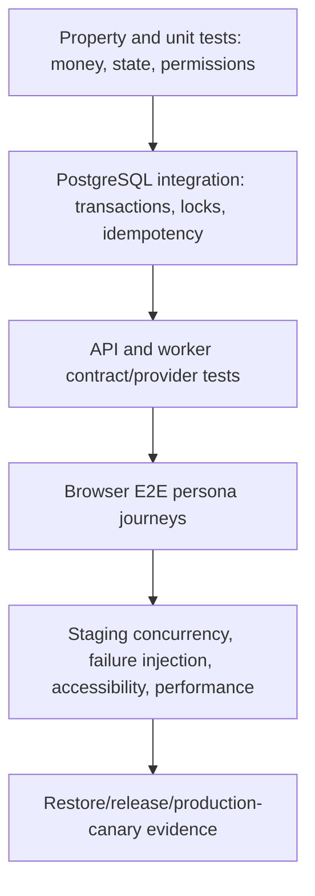

# End-to-End Acceptance and Edge-Case Matrix

**Status:** Complete draft  
**Depends on:** documents 00–18  
**Owner:** Founder  
**Purpose:** objective release evidence for the complete Rekordly v2 system  
**Core rule:** no launch label, founder discretion or “beta” disclaimer can waive tenant isolation, balanced accounting, stock integrity, idempotency, export ownership, deletion separation or recoverability

## 1. Scope

This document converts the entire blueprint into executable acceptance evidence. It covers:

- end-to-end persona journeys;
- module acceptance tests;
- accounting and inventory golden fixtures;
- permissions and tenant isolation;
- concurrent commands and idempotent retries;
- offline, stale-state and multi-device conflict;
- provider outage and ambiguous outcomes;
- responsive, accessible and low-bandwidth UX;
- pricing, downgrade, export and deletion;
- backup, restore, deployment and incident recovery;
- controlled public versus invite-only go/no decisions.

It supplements the owning documents' detailed test lists. A module cannot be called complete merely because its isolated happy path passes.

## 2. Gate levels

| Level | Meaning | Release consequence |
|---|---|---|
| **G0** | Integrity, security, privacy, recoverability or ownership gate | Automatic public no-go; cannot be waived |
| **G1** | Module completeness/reliability gate | Hide/disable the affected module until it passes |
| **G2** | Bounded beta-quality issue | May ship only when documented, communicated and safely worked around |

An invite-only beta still requires every G0 test relevant to enabled data and infrastructure. “Invite-only” reduces exposure; it does not permit corrupt truth.

## 3. Test outcome vocabulary

- `not_run`: no current evidence;
- `blocked`: prerequisite/environment unavailable, with named owner/date;
- `failed`: observed result violates pass condition;
- `passed`: current release candidate produced required evidence;
- `passed_with_documented_g2`: only for G2 with approved limitation;
- `not_applicable`: justified because module is inaccessible in the tested release;
- `stale_evidence`: previous build/provider/config evidence cannot prove current candidate.

Only `passed` counts for G0/G1.

## 4. Evidence record

Every execution stores:

```text
test_id
requirement/blueprint links
gate level
release build/commit and frontend/API/worker versions
environment and provider modes/tiers
date/time/timezone
tester/reviewer
fixture IDs and seed version
preconditions/flags/plan/role/device/browser
steps or automated suite reference
expected result
observed result
pass/fail
logs/screenshots/videos/exports/reconciliation reports as appropriate
linked defect and severity
retest result/build
```

Sensitive evidence stays in an access-controlled repository, not public Markdown.

## 5. Evidence freshness

Re-run a gate when its relevant input changes:

- financial/stock/domain logic;
- database schema/migration;
- auth/permission/tenant scoping;
- idempotency/job/provider adapter;
- plan/retention/deletion policy;
- service worker/offline schema;
- rendering/export/file storage;
- production provider/tier/config;
- release candidate build.

Unit evidence alone cannot prove deployment, concurrency, restore, responsive or provider-integration behaviour.

## 6. Test environments

| Environment | Use | Restrictions |
|---|---|---|
| Unit/property | Deterministic rules/invariants | No external claims |
| Integration | Real PostgreSQL transactions/locks | Synthetic fixtures |
| CI E2E | Full services/mocks/sandboxes | No production secrets/data |
| Staging | Release/provider/smoke/accessibility/load | Synthetic/anonymized approved data only |
| Production canary | Narrow final infrastructure checks | Dedicated canary tenant; no customer impact |
| Restore environment | Disaster-recovery rehearsal | Isolated, access-restricted, destroyed after evidence |

## 7. Fixture catalogue

Required deterministic fixtures:

- Personal owner with NGN accounts/categories/budgets;
- Freelancer owning Personal and Business;
- service Business without inventory;
- FIFO inventory Business;
- weighted-average inventory Business;
- two-outlet Business;
- owner, admin, cashier/outlet staff, accountant and removed member;
- customers/suppliers including guest/non-member contacts;
- taxable/non-taxable products/services;
- partial payments, advances, loans and mixed records;
- storefront/custom-domain configuration;
- Free, Personal Plus, Business, past-due, grace and downgraded entitlements;
- offline devices with queued dependencies/conflicts;
- deletion/retention/export/support cases;
- provider success, timeout, duplicate and out-of-order webhook fixtures.

## 8. Golden money fixture rules

Golden fixtures include exact:

- input decimal strings;
- currency/exponent;
- quantity/unit price/discount/tax order;
- expected minor-unit line/document totals;
- expected accounts/debits/credits;
- expected outstanding/advance/allocation balances;
- expected report outputs;
- expected reversals/corrections.

Expected values are independently reviewed and never generated by the same code under test without an external assertion source.

## 9. Golden inventory fixture rules

For FIFO and weighted average, record:

- receipt dates/quantities/unit costs/additional/landed costs;
- batch/expiry/serial data;
- sales/returns/transfers/count adjustments;
- expected layers or moving-average calculations;
- expected on-hand/available/reserved/in-transit quantities;
- expected inventory asset, COGS, loss/variance and GRNI values;
- expected outlet/company totals.

Every expected quantity/value is exact fixed decimal/minor-unit output.

## 10. Automated test pyramid



Higher layers do not replace lower deterministic coverage; lower layers cannot prove the whole user journey.

## 11. Persona P1 — new Personal user

Journey:

1. visits product on mobile;
2. registers with email/phone OTP;
3. selects Normal/Personal role;
4. creates Personal space and first money account;
5. records income, expense and transfer;
6. creates category budget;
7. views monthly summary and drill-down;
8. goes offline and views cached state;
9. exports owned data;
10. manages session/security settings.

Activation target: three confirmed entries and one useful summary within seven days.

## 12. P1 acceptance matrix

| ID | Scenario | Level | Pass condition |
|---|---|---:|---|
| P1-01 | OTP signup/onboarding | G0 | Account/Personal space created once; no OTP replay/enumeration |
| P1-02 | First income | G0 | Correct account/equity/income effect; balanced journal |
| P1-03 | Expense with category | G0 | Cash/expense/category summary reconcile |
| P1-04 | Own-account transfer | G0 | No income/expense; both balances reconcile |
| P1-05 | Budget actual | G1 | Only posted eligible expenses counted in correct period/timezone |
| P1-06 | Summary drill-down | G1 | Total traces to entries/journals |
| P1-07 | Mobile/offline read | G1 | Cached data visibly stale; no fake current totals |
| P1-08 | Free limit | G1 | New usage blocked clearly; existing read/export preserved |
| P1-09 | Ownership export | G0 | Complete/reconciled/private download |
| P1-10 | Session revoke | G0 | Revoked device loses server authority immediately |

## 13. Persona P2 — Personal Plus power user

Journey adds:

- CSV import;
- multiple accounts/budgets;
- loan borrowed/lent;
- asset/investment records;
- AI-assisted draft;
- offline queued simple entry;
- full history/report/export.

## 14. P2 acceptance matrix

| ID | Scenario | Level | Pass condition |
|---|---|---:|---|
| P2-01 | CSV map/review/confirm | G1 | Invalid/duplicate rows visible; confirmed rows post once |
| P2-02 | AI expense draft | G1 | Typed draft only; ambiguity/edit visible; human confirms |
| P2-03 | Loan opening/repayment | G0 | Principal/cash/interest allocation exact; no negative principal |
| P2-04 | Asset/investment | G1 | Cash/cost/income events accurate; valuations not auto-posted incorrectly |
| P2-05 | Offline simple entry | G0 | Pending excluded; sync revalidates and posts once |
| P2-06 | Stale offline conflict | G0 | Preserves intent; no silent amount/category/balance change |
| P2-07 | Plan downgrade | G0 | History/files preserved; new excess usage blocked |
| P2-08 | Purchased AI credits | G1 | Reserve/consume/release exactly once; manual fallback remains |

## 15. Persona P3 — freelancer with combined spaces

Journey:

1. selects Freelancer;
2. creates Personal and Business spaces;
3. records Business service income/invoice;
4. records Personal spending;
5. records owner contribution/drawing correctly;
6. sees combined owner summary;
7. splits a mixed transaction with explicit confirmation;
8. exports each ledger separately.

## 16. P3 acceptance matrix

| ID | Scenario | Level | Pass condition |
|---|---|---:|---|
| P3-01 | Freelancer onboarding | G1 | Both spaces created once with correct setup/routes |
| P3-02 | Space switch | G0 | No cross-space list/search/form/data leak |
| P3-03 | Owner contribution | G0 | Business equity, not revenue; Personal counterpart explicit |
| P3-04 | Owner drawing | G0 | Business equity reduction, not business expense |
| P3-05 | Combined summary | G0 | Side-by-side/authorized aggregation; books never merged |
| P3-06 | Mixed split | G0 | Separate confirmed records/journals; amounts sum exactly |
| P3-07 | Business member access | G0 | Staff sees no owner Personal space/summary/notifications |
| P3-08 | Separate export | G0 | Each scope complete and independently reconcilable |

## 17. Persona B1 — service Business owner

Journey:

- creates Business and settings;
- creates customer or uses Guest/walk-in;
- drafts/issues estimate/invoice;
- shares via email/WhatsApp handoff;
- records partial/split payment;
- applies customer deposit;
- issues receipt/refund/credit correction;
- views P&L, AR and customer statement;
- invites accountant/staff.

## 18. B1 acceptance matrix

| ID | Scenario | Level | Pass condition |
|---|---|---:|---|
| B1-01 | Guest custom-service sale | G1 | No party creation required; totals/journal correct |
| B1-02 | Estimate to invoice | G1 | Version/source preserved; revenue not duplicated |
| B1-03 | VAT/discount invoice | G0 | Stored totals and journal match configured order/rounding |
| B1-04 | Partial/split payment | G0 | Methods/allocations/accounts/outstanding reconcile |
| B1-05 | Overpayment | G0 | Rejected or explicit deposit path; never silently applied |
| B1-06 | Customer deposit | G0 | Liability until applied/refunded; no premature revenue |
| B1-07 | Credit/refund | G0 | Original preserved; tax/AR/cash effects reconcile |
| B1-08 | Immutable PDF/share | G1 | Exact version; guest sees no internal/cost data |
| B1-09 | Reports/statements | G1 | Source drill-down and balances reconcile |
| B1-10 | Accountant/staff | G0 | Role/outlet/Personal boundaries enforced server-side |

## 19. Persona B2 — inventory retailer

Journey:

- chooses FIFO or weighted average before first movement;
- creates products/variants/outlet/opening stock;
- receives inventory at different costs;
- sells with stock/COGS;
- accepts returns/damage/expiry;
- performs count adjustment;
- views valuation/margin/GL reconciliation.

## 20. B2 acceptance matrix

| ID | Scenario | Level | Pass condition |
|---|---|---:|---|
| B2-01 | Costing-method lock | G0 | Change blocked after first posted movement without migration |
| B2-02 | Opening stock | G0 | Quantity/layers/value/journal reconcile |
| B2-03 | Multi-cost receipts | G0 | FIFO layers or moving average exact |
| B2-04 | Partial sale | G0 | Stock/COGS/inventory/revenue exact |
| B2-05 | Last-stock concurrency | G0 | At most available quantity sold/reserved |
| B2-06 | Return/damage/expiry | G0 | Correct quantity/cost/loss/refund relationships |
| B2-07 | Stock count | G0 | Frozen count, approval, adjustment and journal exact |
| B2-08 | Valuation-to-GL | G0 | Subledger equals GL by date/outlet/company |
| B2-09 | Batch/serial | G1 | Required capture/unique location/state enforced |
| B2-10 | Archived product | G1 | No improper new use; historical documents remain readable |

## 21. Persona B3 — procurement Business

Journey:

- supplier/PO approval;
- share PO;
- partial goods/service receipt;
- batch/expiry/serial capture;
- supplier bill and PO/receipt/bill match;
- landed cost/variance approval;
- partial payment;
- supplier return/credit;
- AP/GRNI/valuation reports.

## 22. B3 acceptance matrix

| ID | Scenario | Level | Pass condition |
|---|---|---:|---|
| B3-01 | PO approval | G1 | Approved exact version; no stock/payable posted |
| B3-02 | Partial receiving | G0 | Received/remaining/lots/layers/GRNI correct |
| B3-03 | Receipt before bill | G0 | Inventory/GRNI exact, no AP yet |
| B3-04 | Bill match | G0 | GRNI/AP/tax exact; no duplicate stock |
| B3-05 | Landed cost | G0 | Allocations sum exactly and valuation/GL reconcile |
| B3-06 | Variance | G1 | Reason/permission/approval and original comparison retained |
| B3-07 | Supplier payment | G0 | AP/cash/allocation/outstanding reconcile |
| B3-08 | Supplier return | G0 | Quantity/cost/credit/payable resolution exact |
| B3-09 | Unsafe receipt reversal | G0 | Blocked; controlled correction offered |
| B3-10 | Duplicate bill/reference | G0 | Warning/block/idempotency prevents duplicate obligation |

## 23. Persona B4 — multi-outlet team

Journey:

- owner creates second outlet;
- assigns cashier to one outlet;
- receives/sells at outlet;
- transfers stock with in-transit/partial receipt/variance;
- owner sees company totals;
- cashier remains outlet-scoped;
- downgrade restricts excess outlet without deleting history.

## 24. B4 acceptance matrix

| ID | Scenario | Level | Pass condition |
|---|---|---:|---|
| B4-01 | Outlet-scoped list/search/export | G0 | Cashier sees only allowed scope |
| B4-02 | Direct API bypass | G0 | Out-of-scope mutation denied |
| B4-03 | Transfer dispatch | G0 | Source/in-transit quantity/value exact |
| B4-04 | Partial receipt/variance | G0 | Destination/remainder/variance explicit and reconciled |
| B4-05 | Company total | G0 | No duplicate transfer value in consolidated total |
| B4-06 | Concurrent outlet sale | G0 | Per-outlet/company stock constraints enforced |
| B4-07 | Role change mid-session | G0 | Next request/offline sync uses new scope |
| B4-08 | Outlet downgrade restriction | G0 | History/stock report retained; new operations blocked safely |

## 25. Persona C1 — storefront merchant and guest buyer

Journey:

- merchant configures/publishes storefront/subdomain;
- guest browses/searches product;
- adds variants to cart;
- submits order request without account;
- merchant reviews/confirms and reserves stock;
- processes/fulfils/receives payment;
- cancellation releases stock;
- custom domain verified/connected;
- Business expiry disables public store after grace while admin/export remains.

## 26. C1 acceptance matrix

| ID | Scenario | Level | Pass condition |
|---|---|---:|---|
| C1-01 | Host/subdomain isolation | G0 | Host routes exact storefront; no cross-tenant/admin leak |
| C1-02 | Mobile low-bandwidth browse | G1 | Core search/product/cart/request usable |
| C1-03 | Guest checkout request | G1 | No registration required; no stock/accounting yet |
| C1-04 | Confirm order | G0 | Current stock/price/fulfilment reviewed; reservation atomic |
| C1-05 | Concurrent confirmations | G0 | Available stock never exceeded |
| C1-06 | Modify/cancel | G0 | Reservation changes/releases exactly once |
| C1-07 | Fulfil retry | G0 | Stock/COGS/sale effects once; reservation consumed |
| C1-08 | Customer identity | G0 | Guest contact not assumed to be Rekordly user |
| C1-09 | Custom domain/TLS | G1 | Only verified hostname active; fallback remains |
| C1-10 | Expiry grace | G1 | Store disables per policy; orders/history/export retained |

## 27. Persona A1 — staff/accountant

Journey:

- accepts invitation;
- sees exact role/outlet preview;
- cashier records allowed sale/payment;
- manager approves PO/count;
- accountant views ledger/reports/exports;
- owner changes/removes access;
- historical authorship remains.

## 28. A1 acceptance matrix

| ID | Scenario | Level | Pass condition |
|---|---|---:|---|
| A1-01 | Invitation replay/expiry | G0 | Token single-use/expiring; authority/seat rechecked |
| A1-02 | Role matrix API | G0 | Every disallowed command/query denied server-side |
| A1-03 | Approval segregation | G1 | Required approver cannot be bypassed by UI/API |
| A1-04 | Accountant report access | G1 | Granted data only; no billing instruments/Personal data |
| A1-05 | Remove member | G0 | Access/offline sync revoked; business records remain |
| A1-06 | Ownership transfer | G0 | Recent auth, recipient acceptance, atomic change |
| A1-07 | Audit authorship | G0 | Past actions retain actual actor after role/removal/name change |
| A1-08 | Seat downgrade | G0 | Selected excess access restricted; no data deletion |

## 29. Persona R1 — external document recipient

Journey:

- receives email/WhatsApp link;
- opens guest portal without account;
- views exact invoice/receipt/statement;
- downloads PDF;
- link expires/revokes/supersedes;
- optionally creates account and claims eligible documents through verified flow.

## 30. R1 acceptance matrix

| ID | Scenario | Level | Pass condition |
|---|---|---:|---|
| R1-01 | Opaque token | G0 | Sequential/guessed IDs grant nothing; token stored hashed |
| R1-02 | Projection | G0 | No internal notes, margin, staff, journals or unrelated history |
| R1-03 | Private PDF | G0 | Fresh short-lived signed access; no permanent provider URL |
| R1-04 | Expired/revoked | G0 | Neutral unavailable response; future access blocked |
| R1-05 | Version correction | G1 | Exact shared version/supersession behaviour explicit |
| R1-06 | View claim | G1 | Scanner/open not called proven human read |
| R1-07 | Optional signup | G1 | Registration not a gate; independent identity verification |
| R1-08 | Party claim | G0 | Email alone does not expose all documents/merge parties |

## 31. Persona O1 — billing owner

Journey:

- reviews Free/Personal Plus/Business;
- records plan intent during beta;
- later initializes Paystack checkout when enabled;
- receives verified activation;
- views usage/receipts;
- upgrades/adds seat/outlet/domain;
- experiences renewal failure/grace;
- cancels/downgrades while preserving owned data.

## 32. O1 acceptance matrix

| ID | Scenario | Level | Pass condition |
|---|---|---:|---|
| O1-01 | Controlled beta | G0 | No charge/checkout when commercial mode disabled |
| O1-02 | Client price tamper | G0 | Server catalogue/minor-unit amount controls checkout |
| O1-03 | Callback spoof | G0 | Browser callback alone grants nothing |
| O1-04 | Signed webhook duplicate/order | G0 | One valid state effect; older event cannot regress |
| O1-05 | Concurrent limit | G0 | Atomic reservation lets only allowed unit(s) through |
| O1-06 | Payment failure/grace | G1 | Published state/deadline; no deletion/data loss |
| O1-07 | Downgrade impact | G1 | Excess resources enumerated/restricted, not deleted |
| O1-08 | Export after expiry | G0 | Usable ownership export remains |
| O1-09 | Custom domain/store expiry | G1 | Grace/fallback/admin data behave as published |
| O1-10 | Refund | G0 | Cannot exceed/repeat captured amount; entitlement explicit |

## 33. Persona D1 — deletion requester

Journey:

- differentiates cancellation/downgrade from deletion;
- resolves Business ownership;
- receives export offer;
- recent-authenticates;
- explicitly requests deletion;
- account/public surfaces enter 60-day grace restriction;
- cancels and restores, or allows verified permanent purge;
- retention exceptions and backups behave accurately.

## 34. D1 acceptance matrix

| ID | Scenario | Level | Pass condition |
|---|---|---:|---|
| D1-01 | Subscription expiry | G0 | No deletion case/timer created |
| D1-02 | Explicit request | G0 | Recent auth, consequence, export and exact 60-day instant |
| D1-03 | Owned Business dependency | G0 | Transfer/delete resolution required; members protected |
| D1-04 | Grace restriction | G0 | Writes/public links/billing/provider spend stop per policy; data recoverable |
| D1-05 | Cancel deletion | G0 | Same verified identity restores safely and idempotently |
| D1-06 | Billing/public restore | G1 | No silent subscription restart/share-link/domain republish |
| D1-07 | Retention hold | G0 | Scoped/reasoned/reviewed; retained data not ordinary-use |
| D1-08 | Processor purge | G0 | Mandatory DB/files/providers verified; partial failure visible |
| D1-09 | Backup expiry/replay | G0 | Restore cannot resurrect deleted authority/data into production |
| D1-10 | Tombstone | G0 | Minimal proof only; no unnecessary full profile/financial content |

## 35. Persona S1 — support/admin operator

Journey:

- receives verified support case;
- starts with metadata diagnostics;
- obtains explicit scoped support grant if content needed;
- re-runs job/reconciliation;
- performs typed recovery command when necessary;
- never silently impersonates or edits posted rows;
- audits and closes case/incident.

## 36. S1 acceptance matrix

| ID | Scenario | Level | Pass condition |
|---|---|---:|---|
| S1-01 | Identity verification | G0 | Unverified requester gets no account-specific disclosure |
| S1-02 | Metadata-first | G0 | Routine diagnosis needs no arbitrary DB/content browsing |
| S1-03 | Support grant | G0 | Visible, scoped, expiring, revocable and audited |
| S1-04 | No impersonation | G0 | No silent login-as path; actual admin actor retained |
| S1-05 | Financial recovery | G0 | Typed idempotent correction/reversal; original/audit retained |
| S1-06 | Cross-tenant target | G0 | Explicit scope/preview; wrong workspace denied |
| S1-07 | Admin auth | G0 | Strong restricted role/recent auth; ordinary users blocked |
| S1-08 | Dead-letter retry | G1 | Reason/attempt history preserved; no duplicate external effect |

## 37. Identity and tenant isolation matrix

| ID | Scenario | Level | Pass condition |
|---|---|---:|---|
| SEC-01 | Guess another workspace resource ID | G0 | Denied without unsafe existence/data leak |
| SEC-02 | Cross-workspace list/filter/search/export | G0 | Only authorized scope returned/counts correct |
| SEC-03 | Modify body workspace ID | G0 | Server route/session scope controls; request rejected |
| SEC-04 | Expired/revoked session | G0 | Protected action denied immediately |
| SEC-05 | OTP replay/brute/resend abuse | G0 | One-time/expiry/rate limits/generic response |
| SEC-06 | Role API bypass | G0 | Hidden UI irrelevant; server denies |
| SEC-07 | Outlet bypass | G0 | Query/mutation/export denied outside scope |
| SEC-08 | Access removed mid-session | G0 | Next request/offline sync denied |
| SEC-09 | Personal/Business boundary | G0 | Staff/accountant cannot discover/access owner Personal data |
| SEC-10 | Guest token scope | G0 | Exact resource/actions only |
| SEC-11 | Admin target scope | G0 | No broad browsing or unscoped mutation |
| SEC-12 | Logs/analytics/errors | G0 | No OTP/token/financial narration/contact/private URLs |

## 38. Authentication recovery edge cases

| ID | Scenario | Level | Pass condition |
|---|---|---:|---|
| AUTH-01 | OTP arrives after newer resend | G0 | Superseded/expired challenge cannot authenticate |
| AUTH-02 | Two correct uses racing | G0 | One succeeds; replay fails |
| AUTH-03 | New contact verification fails | G0 | Existing login unchanged |
| AUTH-04 | Remove last login method | G0 | Blocked with recovery guidance |
| AUTH-05 | Manual recovery social engineering | G0 | Financial knowledge/caller ID insufficient |
| AUTH-06 | Session rotation theft/replay | G0 | Old/reused token family revoked/detected per design |
| AUTH-07 | Shared device logout | G0 | Next user sees no prior cached/offline data |
| AUTH-08 | Recent-auth window expires | G0 | Sensitive command re-prompts, normal safe work unaffected |

## 39. Money and ledger matrix

| ID | Scenario | Level | Pass condition |
|---|---|---:|---|
| LED-01 | Every posting fixture | G0 | Debit equals credit exactly |
| LED-02 | Decimal/rounding/residual | G0 | No float drift; line/document/journal totals agree |
| LED-03 | Duplicate command | G0 | One source/journal; original response |
| LED-04 | Income/expense/transfer | G0 | Correct accounts and summaries |
| LED-05 | Credit invoice/payment | G0 | Revenue/AR then cash/AR reconcile |
| LED-06 | Supplier bill/payment | G0 | Expense/AP then AP/cash reconcile |
| LED-07 | Reversal/replacement | G0 | Original immutable; net/audit correct |
| LED-08 | Locked period | G0 | Direct post/edit blocked; open-period linked adjustment |
| LED-09 | Overflow/extreme amount | G0 | Checked rejection; no partial write |
| LED-10 | Currency exponent | G0 | Non-hardcoded exponent and display/JSON correctness |
| LED-11 | Negative/exponent/NaN input | G0 | Invalid machine formats rejected |
| LED-12 | Drill-down | G1 | Report → journal → source → correction trace |

## 40. Allocation and advance matrix

| ID | Scenario | Level | Pass condition |
|---|---|---:|---|
| PAY-01 | One payment/one invoice | G0 | Allocation and outstanding exact |
| PAY-02 | One payment/multiple invoices | G0 | Sum exact; no document overallocated |
| PAY-03 | Split methods/multiple documents | G0 | Method totals=payment=allocations+explicit remainder |
| PAY-04 | Partial payment | G0 | Derived partial state/outstanding exact |
| PAY-05 | Customer advance | G0 | Liability until application/refund |
| PAY-06 | Supplier advance | G0 | Asset/control until application/refund |
| PAY-07 | Wallet above balance | G0 | Atomic rejection |
| PAY-08 | Concurrent last outstanding | G0 | Only valid allocation commits; other conflicts |
| PAY-09 | Reversal | G0 | Allocations/balances/journal restored exactly once |
| PAY-10 | Unknown purpose | G1 | Controlled suspense and Review, not invented category |

## 41. Sales calculation edge cases

| ID | Scenario | Level | Pass condition |
|---|---|---:|---|
| SAL-01 | Fixed/percentage line/document discount | G0 | Residual allocation deterministic, totals exact |
| SAL-02 | Tax-inclusive/exclusive/zero/exempt | G0 | Configured calculation and disclosure exact |
| SAL-03 | Quantity/unit price fractional precision | G0 | Fixed decimal then documented rounding |
| SAL-04 | Empty/zero/negative line misuse | G0 | Invalid except explicit supported document type |
| SAL-05 | Customer/contact changed after issue | G1 | Issued snapshot unchanged |
| SAL-06 | Estimate accepted after supersession | G0 | Stale version rejected/latest shown |
| SAL-07 | Number sequence concurrency | G0 | Unique/no duplicate; gaps handled per policy |
| SAL-08 | Invoice and stock fulfil separation | G0 | No duplicate stock/COGS/revenue |
| SAL-09 | Refund exceeds source | G0 | Rejected/limited explicitly |
| SAL-10 | Walk-in sale | G1 | No forced customer account/record |

## 42. Inventory FIFO matrix

| ID | Scenario | Level | Pass condition |
|---|---|---:|---|
| FIF-01 | Two receipts, sale within first | G0 | First layer reduced; COGS exact |
| FIF-02 | Sale crosses layers | G0 | Ordered layer consumption/residual exact |
| FIF-03 | Customer return | G0 | Original/declared cost policy exact and traceable |
| FIF-04 | Supplier return unconsumed layer | G0 | Layer/value reduced correctly |
| FIF-05 | Supplier return after consumption | G0 | Controlled variance/correction, no negative layer |
| FIF-06 | Backdated receipt/sale | G0 | Blocked or controlled recalculation; future layers not corrupted |
| FIF-07 | Landed cost after receipt | G0 | Eligible remaining/sold variance treatment reconciles |
| FIF-08 | Transfer | G0 | Company cost preserved; outlet layers traceable |

## 43. Inventory weighted-average matrix

| ID | Scenario | Level | Pass condition |
|---|---|---:|---|
| WAV-01 | First receipt | G0 | Quantity/value/average exact |
| WAV-02 | Second cost receipt | G0 | New moving average fixed-precision exact |
| WAV-03 | Sale | G0 | COGS at stored average; remaining value exact |
| WAV-04 | Customer return | G0 | Policy-consistent cost restored, traceable |
| WAV-05 | Supplier return | G0 | Quantity/value/average treatment exact |
| WAV-06 | Landed cost | G0 | Average/value recalculation/residual exact |
| WAV-07 | Zero quantity residual value | G0 | No unexplained value; rounding adjustment controlled |
| WAV-08 | Backdated movement | G0 | Blocked/recalculated without silent downstream corruption |

## 44. Inventory concurrency matrix

| ID | Scenario | Level | Pass condition |
|---|---|---:|---|
| CON-INV-01 | Two sales for last unit | G0 | One succeeds; no negative stock |
| CON-INV-02 | Order reserve vs counter sale | G0 | Deterministic lock/current availability |
| CON-INV-03 | Transfer dispatch vs sale | G0 | No double consumption |
| CON-INV-04 | Count post vs receipt | G0 | Version/lock conflict or exact serial order |
| CON-INV-05 | Duplicate goods receipt retry | G0 | One movement/layer/journal |
| CON-INV-06 | Same serial at two outlets | G0 | Unique constraint/state prevents it |
| CON-INV-07 | Cancel vs fulfil order | G0 | One terminal path; reservation/stock consistent |
| CON-INV-08 | Partial transfer receives racing | G0 | Total accepted never exceeds dispatched |

## 45. Procurement edge cases

| ID | Scenario | Level | Pass condition |
|---|---|---:|---|
| PRO-01 | Material PO edit after approval | G0 | Approval invalidated/new version |
| PRO-02 | Over-receipt tolerance | G1 | Unauthorized excess blocked/approval required |
| PRO-03 | Bill quantity > receipt | G1 | Variance explicit; no duplicate inventory |
| PRO-04 | Bill before receipt | G0 | Correct AP/expense or configured clearing, later match exact |
| PRO-05 | Service receipt | G1 | No physical stock; accrual/acceptance semantics clear |
| PRO-06 | Partial bill/receipt/return | G0 | Remaining and GRNI/AP/stock reconcile |
| PRO-07 | Duplicate supplier invoice number | G0 | Appropriate warning/block plus exact override audit if allowed |
| PRO-08 | Locked-period bill/receipt | G0 | Blocked/controlled open-period correction |

## 46. AI safety and quality matrix

| ID | Scenario | Level | Pass condition |
|---|---|---:|---|
| AI-01 | Clear expense sentence | G1 | Correct typed draft; no post |
| AI-02 | Missing amount/account/date | G1 | Required clarification/highlight |
| AI-03 | Ambiguous category/counterparty | G1 | Confidence/alternatives visible |
| AI-04 | Multiple transactions in one prompt | G1 | Separate drafts/count explicit |
| AI-05 | Prompt injection in narration/file | G0 | Treated as untrusted data; authority unchanged |
| AI-06 | Hallucinated IDs/accounts | G0 | Deterministic validation rejects |
| AI-07 | Direct AI post attempt | G0 | Impossible without human-confirmed domain command |
| AI-08 | Plan/rate/credit limit | G1 | Provider blocked before spend; manual fallback |
| AI-09 | Timeout/invalid schema | G1 | No post/credit policy correct/retry bounded |
| AI-10 | Edited draft confirmation | G1 | Confirmed values equal reviewed edits; audit field names |

## 47. Import matrix

| ID | Scenario | Level | Pass condition |
|---|---|---:|---|
| IMP-01 | UTF-8/basic CSV | G1 | Columns mapped/previewed accurately |
| IMP-02 | Alternate date/decimal format | G1 | Explicit mapping/locale; no ambiguous silent parse |
| IMP-03 | Oversized/invalid/polyglot | G0 | Reject/quarantine safely |
| IMP-04 | Duplicate file/row | G0 | Candidate detection and user decision; no silent duplicate |
| IMP-05 | Mixed valid/invalid rows | G1 | Per-row state/failure export; valid policy explicit |
| IMP-06 | Cross-account/category mapping | G0 | Only authorized workspace resources accepted |
| IMP-07 | Retry after partial completion | G0 | Confirmed rows not duplicated |
| IMP-08 | Undo import | G0 | Controlled reversals, not hard deletion |
| IMP-09 | Delete source file | G0 | Posted history remains |
| IMP-10 | Formula injection export | G0 | Dangerous spreadsheet prefixes neutralized |

## 48. Offline matrix

| ID | Scenario | Level | Pass condition |
|---|---|---:|---|
| OFF-01 | Cached read | G1 | Stale/as-of clearly shown |
| OFF-02 | Free attempts queued write | G1 | Blocked, draft preserved |
| OFF-03 | Eligible queued simple entry | G1 | Pending separate; one confirmed result |
| OFF-04 | Lost response/reconnect | G0 | Same key returns original; no duplicate |
| OFF-05 | Permission removed | G0 | Denied; safe draft recovery/export |
| OFF-06 | Stock/balance changed | G0 | Needs Review; no blind post/resize |
| OFF-07 | Queue cap/quota | G1 | New confirmation blocked; existing work retained |
| OFF-08 | Dependency chain | G0 | Topological mapping; failure blocks dependants visibly |
| OFF-09 | Multi-tab leader race | G0 | One effective sync; server idempotency final defense |
| OFF-10 | App/schema upgrade | G0 | Queue migrates or review/export; never silently erased |
| OFF-11 | Logout/user switch | G0 | Old queue not submitted/visible under new user |
| OFF-12 | Temporary receipt | G1 | Clearly pending, no final number/posted claim |

## 49. File/upload matrix

| ID | Scenario | Level | Pass condition |
|---|---|---:|---|
| FIL-01 | Public storefront image | G1 | Allowlisted type/transform; safe public delivery |
| FIL-02 | Financial attachment | G0 | Authenticated/private delivery only |
| FIL-03 | Direct upload tamper | G0 | Server verifies provider metadata/purpose/ownership |
| FIL-04 | Oversized/decompression/pixel bomb | G0 | Reject/quarantine within resource bounds |
| FIL-05 | MIME/extension mismatch | G0 | Detected policy governs; no script execution |
| FIL-06 | Cross-workspace asset link | G0 | Rejected |
| FIL-07 | Concurrent last storage unit | G0 | Atomic reservation prevents overrun |
| FIL-08 | Quarantined download/AI | G0 | Blocked |
| FIL-09 | Replace file | G1 | New capacity reserved before old release |
| FIL-10 | Delete linked/held evidence | G0 | Link/hold prevents unsafe physical deletion |

## 50. PDF, sharing and delivery matrix

| ID | Scenario | Level | Pass condition |
|---|---|---:|---|
| DOC-01 | PDF renderer unavailable | G0 | Invoice remains issued; render failure separate |
| DOC-02 | Exact immutable input | G0 | Historical PDF unchanged by later master edits |
| DOC-03 | Long/multi-page/Unicode | G1 | Readable, totals/labels/page breaks correct |
| DOC-04 | Duplicate render | G1 | Reuses/creates one artifact per idempotency key/hash |
| DOC-05 | Email timeout after acceptance | G0 | Reconcile before resend; no accidental duplicate |
| DOC-06 | Bounce/complaint | G1 | Normalized status/suppression/recovery |
| DOC-07 | WhatsApp handoff | G1 | Not labelled sent/delivered/read |
| DOC-08 | Guest scanner open | G1 | Link-open signal not claimed human read |
| DOC-09 | Revoke link | G0 | Future portal/download denied; limitation on downloaded copies stated |
| DOC-10 | CSV/PDF parity | G1 | Same filter/as-of/basis/totals/warnings |

## 51. Billing/entitlement matrix

| ID | Scenario | Level | Pass condition |
|---|---|---:|---|
| ENT-01 | Direct API plan bypass | G0 | Server denies before mutation/provider cost |
| ENT-02 | Concurrent final allowance | G0 | One reservation/consumption succeeds |
| ENT-03 | Idempotent retry | G0 | Usage counted once |
| ENT-04 | Active-count archive/reactivate | G1 | Capacity recalculated; history retained |
| ENT-05 | History limit | G0 | No misleading report from truncated data; export complete |
| ENT-06 | Storage above downgraded limit | G0 | Existing download/read; new upload blocked |
| ENT-07 | Staff plan vs Business plan | G0 | Workspace grant controls, constrained by role |
| ENT-08 | Personal Plus vs Business | G0 | Personal plan does not unlock Business operations |
| ENT-09 | Beta/trial expiry | G0 | No automatic charge without consent; no deletion |
| ENT-10 | Old plan version | G1 | Immutable/grandfathered rules applied as recorded |

## 52. Paystack/provider billing matrix

| ID | Scenario | Level | Pass condition |
|---|---|---:|---|
| BILL-01 | Same checkout idempotency | G0 | One intent/provider transaction initialization |
| BILL-02 | Same key/different plan | G0 | Conflict |
| BILL-03 | Invalid webhook signature | G0 | No state effect |
| BILL-04 | Duplicate success webhook | G0 | One activation/paid-through extension |
| BILL-05 | Out-of-order failure after success | G0 | Newer verified state not regressed |
| BILL-06 | Amount/currency mismatch | G0 | Review; no activation |
| BILL-07 | Renewal failure/recovery | G1 | Past-due/grace/active transitions exact |
| BILL-08 | Cancel/resume race | G0 | Deterministic paid-through/final state |
| BILL-09 | Refund duplicate/excess | G0 | Rejected/idempotent; documents/audit retained |
| BILL-10 | Chargeback | G0 | Restricted review; no data destruction |

## 53. Deletion and retention matrix

| ID | Scenario | Level | Pass condition |
|---|---|---:|---|
| DEL-01 | Accidental cancel-plan click | G0 | No deletion case |
| DEL-02 | Replayed deletion command | G0 | Same case/deadline, not multiple timers |
| DEL-03 | Request with sole-owned Business | G0 | Explicit transfer/delete dependency |
| DEL-04 | Reminder delivery fails | G0 | Deletion timing follows policy; failure visible/recoverable path remains |
| DEL-05 | Cancel near deadline race | G0 | Lock/order yields one valid restore-or-purge outcome |
| DEL-06 | Hold placed near purge | G0 | Purge rechecks and pauses scoped tasks |
| DEL-07 | Processor delete timeout | G0 | Case remains incomplete/retryable; no false completion |
| DEL-08 | Restore from old backup | G0 | Tombstones/revocations replay before production access |
| DEL-09 | Deletion with posted accounting | G0 | Workspace retention/purge policy applies; no partial book corruption |
| DEL-10 | Support/log/analytics data | G0 | Included in processor/retention manifest |

## 54. Notifications and Review matrix

| ID | Scenario | Level | Pass condition |
|---|---|---:|---|
| NTF-01 | Duplicate outbox processing | G1 | One notification/dedupe outcome |
| NTF-02 | Mark read | G1 | Per-user, idempotent, does not resolve Review |
| NTF-03 | Removed member notification | G0 | Click/retrieval reauthorizes and denies stale access |
| NTF-04 | Mandatory security notice | G0 | Cannot be improperly disabled |
| NTF-05 | Aggregated low-stock | G1 | No hidden independent unresolved conditions |
| NTF-06 | Delivery failure | G1 | Sender notification and Review item when actionable |
| NTF-07 | Sensitive subject/preview | G0 | No amounts/contact/document content leakage |
| NTF-08 | Bounded polling | G2 | No WebSocket dependency; backoff/background behaviour correct |

## 55. Report and export matrix

| ID | Scenario | Level | Pass condition |
|---|---|---:|---|
| REP-01 | Trial Balance | G0 | Debits=credits and GL totals exact |
| REP-02 | P&L | G0 | Revenue/COGS/expenses fixture exact |
| REP-03 | Balance Sheet | G0 | Assets=liabilities+equity |
| REP-04 | Cash Flow | G0 | Reconciles to cash-account movement |
| REP-05 | AR/AP aging | G1 | Dates/allocations/outstanding exact |
| REP-06 | Inventory valuation/COGS | G0 | Subledger/GL exact for FIFO/WAV |
| REP-07 | VAT/WHT schedule | G1 | Source/tax basis traceable and limitations shown |
| REP-08 | Date/timezone boundary | G0 | Period inclusion consistent and documented |
| REP-09 | Large async export | G0 | Consistent snapshot, private artifact, exact manifest |
| REP-10 | Downgraded/deleting user export | G0 | Ownership route remains per policy |

## 56. Concurrency matrix

Run with real PostgreSQL transactions and deterministic synchronization barriers.

| ID | Race | Level | Pass condition |
|---|---|---:|---|
| CON-01 | Same idempotency key same payload | G0 | One execution/original result |
| CON-02 | Same key different payload | G0 | One contract accepted; other conflict |
| CON-03 | Two allocations to last outstanding | G0 | No over-allocation |
| CON-04 | Two uses of last advance/wallet balance | G0 | No negative/overspend |
| CON-05 | Two invoice numbers | G0 | Unique ordered policy/no collision |
| CON-06 | Two last-stock sales/reservations | G0 | No oversell |
| CON-07 | Payment vs invoice credit/reversal | G0 | One serializable valid result; other review/conflict |
| CON-08 | Period close vs posting | G0 | Command is wholly before close or rejected after; never ambiguous |
| CON-09 | Role removal vs command | G0 | Deterministic permission/transaction result and next requests denied |
| CON-10 | Deletion cancel vs purge | G0 | One locked state transition, no half-restored account |
| CON-11 | Plan downgrade vs paid command | G0 | Reservation/revision produces documented valid outcome |
| CON-12 | File delete vs download/share | G0 | Authorization/lifecycle consistent; no private leak |

## 57. Idempotency and ambiguous-response matrix

For each financial/stock/billing/external command test:

1. failure before server receives request;
2. failure after receipt but before transaction;
3. failure during transaction causing rollback;
4. response lost after commit;
5. client retries same key/payload;
6. client mistakenly retries same key/different payload;
7. worker/provider callback duplicates;
8. process restarts between external effect and finalization.

G0 pass: exactly one valid effect/result, or clear safe unresolved/reconciliation state—never a guessed duplicate.

## 58. Failure injection matrix

| ID | Injection | Level | Pass condition |
|---|---|---:|---|
| FI-01 | DB unavailable before command | G0 | No fake success/partial effect |
| FI-02 | DB connection drops during transaction | G0 | Commit status resolved through idempotency/reconciliation |
| FI-03 | API restart during request | G0 | Safe retry/original result |
| FI-04 | Worker restart with leased job | G0 | Lease recovery, no duplicate external effect |
| FI-05 | Email/AI/storage timeout | G1 | Domain truth preserved; bounded retry/fallback |
| FI-06 | Paystack timeout after request | G0 | Verify/reconcile before second charge/refund |
| FI-07 | Renderer out of memory/invalid PDF | G1 | Job fails visibly; API/worker remains healthy |
| FI-08 | Queue poison job | G1 | Dead-letter, no infinite loop/starvation |
| FI-09 | Monitoring provider down | G1 | Product continues; secondary/local signal where planned |
| FI-10 | DNS/custom-domain failure | G1 | Fallback/admin data retained; no takeover |

## 59. Database constraint tests

G0 integration tests must prove constraints/transactions prevent:

- unbalanced journal commit;
- duplicate document/provider/idempotency keys in their scope;
- cross-workspace foreign-key relationship where model enforces it;
- allocation above available amounts under concurrency;
- duplicate active serial/location state;
- invalid stock layer quantity/value;
- two owners where ownership model requires one;
- multiple active usage reservations beyond atomic counter rule;
- invalid state transition through repository bypass;
- deletion of referenced immutable financial evidence.

Application checks remain required even when database constraints provide defense in depth.

## 60. Migration matrix

| ID | Scenario | Level | Pass condition |
|---|---|---:|---|
| MIG-01 | Empty DB migrate | G0 | Latest schema starts cleanly |
| MIG-02 | Prior release forward migrate | G0 | Data retained/reconciled |
| MIG-03 | API version overlap | G0 | Expand schema supports rolling deploy |
| MIG-04 | Migration runner race | G0 | Advisory lock allows one runner |
| MIG-05 | Backfill interruption | G0 | Resumable/idempotent, no duplicate effects |
| MIG-06 | Financial backfill | G0 | Pre/post counts/totals/invariants exact |
| MIG-07 | Failed migration | G0 | Deploy stops; recovery documented |
| MIG-08 | Old-code rollback incompatibility | G0 | Unsafe rollback blocked; forward fix used |

## 61. Backup and restore matrix

| ID | Scenario | Level | Pass condition |
|---|---|---:|---|
| BAK-01 | Automated database backup | G0 | Recent protected artifact/checksum/alert |
| BAK-02 | Independent logical backup | G0 | Separate protected destination and retention |
| BAK-03 | File inventory/backup | G0 | Representative private/public originals recoverable |
| BAK-04 | Isolated restore | G0 | Clean environment, access restricted |
| BAK-05 | Tenant/auth restore | G0 | Boundaries preserved; production tokens not reusable in drill |
| BAK-06 | Ledger/allocations restore | G0 | Exact reconciliation |
| BAK-07 | Inventory restore | G0 | Movement/layer/reservation/valuation exact |
| BAK-08 | File/artifact restore | G0 | Checksums/access correct |
| BAK-09 | Job/provider restore | G0 | Old jobs/events do not duplicate effects |
| BAK-10 | Deletion tombstone replay | G0 | Deleted/revoked state not resurrected |
| BAK-11 | Measured RPO/RTO | G0 | Recorded actuals/defects, no unsupported public promise |
| BAK-12 | Drill cleanup | G0 | Restored sensitive environment safely destroyed |

## 62. Deployment/release matrix

| ID | Scenario | Level | Pass condition |
|---|---|---:|---|
| OPS-01 | Immutable release | G1 | Commit/build/config/flags recorded |
| OPS-02 | Health/readiness | G0 | Bad schema/config not ready; liveness avoids restart loops |
| OPS-03 | Graceful API shutdown | G0 | No corrupt/ambiguous command beyond idempotent recovery |
| OPS-04 | Worker drain | G0 | Claims stop; leases/effects safe |
| OPS-05 | Failed deploy | G0 | Rollback/forward recovery without data corruption |
| OPS-06 | Feature kill switch | G0 | Affected writes stop; safe read/export remains |
| OPS-07 | Secret scan/rotation | G0 | No committed/logged secret; rotation tested |
| OPS-08 | Paid Render services | G0 public | Always-on API/separate worker active before public beta |
| OPS-09 | Neon pool budget | G0 | Connection ceiling/saturation measured with reserve |
| OPS-10 | Provider readiness | G1/G0 by dependency | MFA, billing, limits, backup/export/deletion documented |

## 63. Observability and alert matrix

| ID | Scenario | Level | Pass condition |
|---|---|---:|---|
| OBS-01 | API outage/error spike | G0 | Actionable founder alert and runbook |
| OBS-02 | Committed imbalance signal | G0 | Immediate SEV-0/kill path (expected count zero) |
| OBS-03 | Reconciliation discrepancy | G0 | Finding/case with scope/time; not silently ignored |
| OBS-04 | Queue oldest age/dead letter | G1 | Alert/detail/retry safety |
| OBS-05 | Backup stale/fail | G0 | Alert before risky release/within objective |
| OBS-06 | Cost threshold | G1 | Alert/disable noncritical spend without data/export harm |
| OBS-07 | Sensitive scrubbing | G0 | Realistic fixture absent from logs/traces/errors |
| OBS-08 | Correlation | G1 | Request→command→journal/job/provider traceable by safe IDs |

## 64. Incident exercise matrix

Tabletop/failure exercise at minimum:

- suspected cross-tenant exposure;
- committed financial/inventory mismatch;
- database outage/restore;
- Paystack webhook/amount mismatch;
- leaked provider secret;
- public private-file exposure;
- deletion resurrection after restore;
- unavailable API/worker during launch.

For each, prove declaration, severity, containment, evidence, communications, typed recovery, reconciliation, user/legal notification decision and post-incident actions.

## 65. Responsive device matrix

Minimum supported test classes:

| Class | Representative coverage |
|---|---|
| Small mobile | ~320–375 CSS px width |
| Typical mobile | ~390–430 px |
| Tablet | portrait/landscape responsive states |
| Laptop | ~1280 px |
| Wide desktop | ~1440–1920 px |

Test current supported Chrome/Edge and mobile Safari/Chrome according to published browser policy. Browser/version policy must be recorded before launch.

## 66. Responsive acceptance matrix

| ID | Scenario | Level | Pass condition |
|---|---|---:|---|
| UX-01 | Signup/onboarding mobile | G1 | No clipped/hidden required fields/actions |
| UX-02 | Personal entry/budget mobile | G1 | Review/confirm/amount readable |
| UX-03 | Business invoice/payment mobile | G1 | Full workflow without desktop |
| UX-04 | Product/stock/receiving mobile | G1 | Responsive alternate for dense tables/forms |
| UX-05 | Storefront guest mobile | G1 | Browse/cart/request usable on low bandwidth |
| UX-06 | Settings/deletion mobile | G0 | Consequences/deadlines/confirm controls readable |
| UX-07 | Money/date/table overflow | G0 | No clipped/misleading amount/currency/date/state |
| UX-08 | Orientation/zoom | G1 | No data/action loss at supported zoom/layout |

## 67. Accessibility matrix

| ID | Scenario | Level | Pass condition |
|---|---|---:|---|
| A11Y-01 | Keyboard navigation | G1 | Core journeys complete with visible focus |
| A11Y-02 | Dialog/drawer focus | G1 | Focus trapped/restored; escape policy safe |
| A11Y-03 | Screen-reader labels | G1 | Inputs/buttons/status/tables understandable |
| A11Y-04 | Errors | G1 | Summary + field association; not colour-only |
| A11Y-05 | Async/offline/status | G1 | Meaningful announcements without spam |
| A11Y-06 | Contrast/theme | G1 | Text/control/focus contrast passes chosen standard |
| A11Y-07 | Reduced motion | G2/G1 | No essential information depends on animation |
| A11Y-08 | Touch targets | G1 | Primary mobile controls usable |
| A11Y-09 | PDF accessibility | G2/G1 by document | Selectable/readable text and logical structure where feasible |

Target conformance should be documented (recommended WCAG 2.2 AA for public/core UI) and tested with automated plus manual methods.

## 68. Loading/empty/error/state coverage

For every public module prove:

- first-use empty state and primary action;
- loading/skeleton without layout ambiguity;
- no-results/filter state;
- permission denial;
- plan limit/read-only/downgrade;
- offline/cached/stale;
- validation/business conflict;
- provider/service failure with retry/reference;
- archived/reversed/superseded/deleted state;
- asynchronous queued/running/succeeded/failed state;
- partial/mixed result where supported.

No financial operation relies on an indefinite spinner to indicate unknown success.

## 69. Performance/load scenarios

Measure rather than assume:

- login/OTP safe rate limits;
- dashboard/list/search/report queries at representative data volumes;
- concurrent posting/number/stock locks;
- storefront browse/order burst;
- large import/export/PDF;
- offline reconnect batch burst;
- worker provider throttling;
- DB pool saturation and Neon cold/warm behaviour;
- frontend route payload/interaction on mid-range mobile and constrained network;
- storage upload/download.

Performance failure cannot justify removing integrity checks.

## 70. Initial performance pass conditions

Internal targets are recorded per release/environment after baseline. At minimum:

- no unbounded request/job memory or body processing;
- normal core commands return within declared synchronous deadline or durable async status;
- p95 objectives in document 17 are measured and reviewed;
- pool wait/timeouts remain below capacity threshold;
- queue age stays within type objective;
- mobile core UI remains usable on declared low-bandwidth profile;
- load does not cause duplicate posting, oversell or cross-tenant cache leakage;
- degradation/rate limiting is explicit.

## 71. Security abuse matrix

Test:

- IDOR/cross-tenant IDs and filters;
- CSRF on browser mutations;
- XSS through names/notes/templates/storefront/uploads;
- SSRF through URLs/imports/rendering/webhooks;
- SQL injection/search/filter inputs;
- guest/invite/share token brute/enumeration;
- OTP/account enumeration/rate abuse;
- upload MIME/polyglot/path/header injection;
- webhook signature/replay/oversize;
- CSV formula injection;
- prompt injection/tool authority;
- CORS/cookie/session misconfiguration;
- signed URL/token leakage through logs/referrers/analytics;
- admin/support privilege escalation.

Any confirmed cross-tenant or credential/token exposure is G0.

## 72. Privacy matrix

| ID | Scenario | Level | Pass condition |
|---|---|---:|---|
| PRIV-01 | Analytics inspection | G0 | No forbidden amounts/names/contacts/prompts/doc contents |
| PRIV-02 | Consent withdrawal | G1 | Future optional processing stops/adapters updated |
| PRIV-03 | Privacy export | G0 | Identity verified; third-party/security exclusions correct |
| PRIV-04 | Support attachment | G0 | Private/scanned/restricted/retention-bound |
| PRIV-05 | AI retention | G0/G1 | Approved prompt/output policy/provider controls followed |
| PRIV-06 | Guest page | G0 | No third-party token/referrer/preview leakage |
| PRIV-07 | Public storefront | G0 | Merchant public fields only; admin/private data absent |
| PRIV-08 | Processor deletion | G0 | Inventory/task evidence across all selected processors |

## 73. Internationalization/time/currency edges

Test:

- NGN/kobo with leading/trailing zeroes;
- currency exponent metadata and non-NGN fixture;
- large values near product limits but well below int64 overflow;
- timezone midnight/month/year/fiscal boundary;
- daylight-saving fixture for non-Lagos timezone if supported;
- locale date display versus ISO API;
- Unicode names/product/addresses;
- sorting/search/case/diacritics behaviour;
- server time versus skewed client time;
- annual/monthly plan period boundaries.

Never sum unlike currencies without explicit conversion/report policy.

## 74. Empty/extreme data edges

- zero transactions/reports/budgets/products/customers;
- one item/one line/one payment;
- maximum lines per document;
- maximum string lengths/Unicode;
- maximum allowed attachment/import rows/bytes;
- thousands of records/products/parties within stated beta limits;
- archived/deleted/merged references;
- missing optional contact/address/logo;
- leap day/month-end/year-end;
- zero tax/discount/quantity invalid combinations;
- all stock reserved/no available stock;
- complete refund/credit/write-off.

Limits are disclosed and server-enforced.

## 75. State-transition coverage

For every registered aggregate in document 18:

- each allowed transition has at least one success test;
- each forbidden transition has rejection test;
- terminal state behaviour tested;
- stale expected version tested;
- permission/plan/period precondition tested;
- idempotent replay tested;
- audit/outbox event tested;
- notification/Review projector tested where applicable;
- reversal/supersession/history tested;
- UI label matches machine state meaning.

Coverage report links registry types to tests; missing registered transition is a visible gap.

## 76. API contract tests

Prove:

- authentication/authorization/tenant scope;
- request validation and stable Problem Details/error codes;
- minor-unit JSON strings and fixed-decimal formats;
- cursor/filter/sort boundaries;
- idempotency and expected-version headers/fields;
- no sensitive/provider internals in errors;
- rate/body/file limits;
- backward compatibility/version handling;
- correct cache headers for public/private responses;
- OpenAPI or equivalent contract matches implementation;
- TypeScript client/schema and Go handlers agree.

## 77. Event/job contract tests

- event schema/type/version registry round-trip;
- atomic domain/outbox commit;
- duplicate consumer idempotency;
- unsupported version dead-letter;
- poison event isolation;
- aggregate ordering/version policy;
- cross-aggregate no-order assumption;
- job lease/heartbeat/expiry;
- ambiguous provider effect reconciliation;
- retry/dead-letter/manual retry audit;
- PII/secret payload minimization.

## 78. Notification/delivery contract tests

- correct recipient resolver/role/outlet scope;
- mandatory versus optional preference;
- removed member not notified/access denied;
- dedupe/aggregation;
- template escaping and versioning;
- provider accepted/delivered/opened distinctions;
- bounce/complaint suppression;
- resend versus retry semantics;
- safe subject/preview/link;
- actionable failure opens Review;
- click reauthorizes resource.

## 79. Beta cohort acceptance

Before controlled public beta:

- at least five named users/businesses complete onboarding;
- at least three complete core money journey without founder intervention;
- at least two Business users complete invoice-to-payment;
- if inventory public, at least two businesses execute reconciled inventory loop;
- if procurement public, at least one Business executes PO→receipt→bill→payment;
- if storefront public, at least one merchant executes request→confirm→fulfil/cancel;
- at least one accountant/bookkeeper reviews deterministic fixtures, target two;
- support load/critical issues are classified and sustainable.

User data is not copied into public evidence.

## 80. Activation/retention evidence

Track:

- signup/onboarding completion;
- median time to first/third confirmed entry;
- primary activation within seven days;
- Business secondary loop completion;
- weekly active recorders and distinct active weeks;
- AI edit/abandonment and correction/reversal rates;
- reconciliation failures (target zero);
- support requests per activated user;
- Week 1/4 and Month 3 retention as cohorts mature;
- plan intent/willingness only after value.

These are product decisions, not substitutes for G0 correctness.

## 81. Accountant review evidence

Review package contains anonymized deterministic fixtures for:

- chart/account mappings;
- income/expense/transfer/owner movements;
- invoice/payment/deposit/refund/credit;
- supplier bill/payment/advance;
- VAT/WHT schedules and limitations;
- FIFO/weighted-average/GRNI/returns/landed costs;
- trial balance/P&L/balance sheet/cash flow;
- reversals/locked-period adjustments;
- drill-down/export.

Record reviewer qualification, findings, disagreements, changes and retest. Without review, professional reports stay beta-labelled/invite-only as applicable.

## 82. Defect policy

Every failed gate creates a defect with:

- affected test/requirement;
- severity/G-level;
- user/data scope;
- reproduction/evidence;
- root cause when known;
- mitigation/feature flag;
- owner/target;
- fix build and retest.

Closing a defect requires the failed test and relevant regression suite to pass; “cannot reproduce” alone is not resolution without evidence.

## 83. Known-issue policy

A known issue may ship only if:

- not G0;
- affected module still passes its G1 gates or is disabled;
- scope and workaround are accurate;
- no money/stock/privacy/access ambiguity;
- monitoring/support can detect/manage it;
- user limitation is communicated;
- owner/review date exists.

No blanket “beta” waiver.

## 84. Module enablement matrix

Release record lists each module as:

| Module | State | Required evidence |
|---|---|---|
| Core identity/workspaces/export/deletion | Required | All G0 + applicable G1 |
| Personal money/budgets | Enabled or disabled | Module G0/G1 |
| AI/import | Separately flaggable | AI/import gates |
| Sales/payments | Separately flaggable | Sales/ledger/share gates |
| Inventory | Separately flaggable | Both selected costing tests |
| Procurement | Separately flaggable | Procurement/GRNI/AP gates |
| Storefront/domains | Separately flaggable | Host/order/domain/expiry gates |
| Offline queued writes | Separately flaggable | Full offline/idempotency/schema gates |
| Paid billing | Disabled until paid-launch gates | Billing/terms/reconciliation |

Disabled means inaccessible server-side, not merely hidden navigation.

## 85. Public-beta go/no checklist

Public controlled beta is `GO` only when:

- all global G0 tests pass on the release candidate;
- each enabled module's G0/G1 tests pass;
- paid Render API and separate worker are active;
- selected Neon tier/pools are accepted;
- automated and independent backup plus restore evidence exists;
- policies, limitations, support and security contact are published;
- monitoring/alerts/runbooks/incident ownership work;
- provider accounts/MFA/billing/spend limits are ready;
- known issues are safe/bounded;
- cohort/support capacity is credible;
- founder signs dated build/config/flag decision.

## 86. Automatic public no-go list

Any of these forces public `NO-GO`:

- cross-tenant/Personal-Business/role/outlet exposure;
- committed unbalanced journal or unreconciled core accounting fixture;
- corrupt/negative-out-of-policy stock or valuation mismatch;
- non-idempotent duplicate financial/stock/billing effect;
- silent AI/import/offline posting;
- broken owned-data export;
- subscription expiry triggering deletion;
- missing 60-day deletion recovery separation;
- private file/share/token exposure;
- no recent protected backup or failed restore reconciliation;
- production secrets logged/committed;
- no safe incident containment/support path;
- Render Free/sleeping API used for promised public-beta reliability;
- unresolved G0 failure in any enabled dependency/module.

## 87. Invite-only fallback checklist

Invite-only may proceed only when:

- all global G0s pass;
- all G0/G1 gates for enabled modules pass;
- incomplete modules are inaccessible through UI and API;
- exact scope/limitations/uptime/support are communicated;
- invite list/cohort/support load is bounded;
- export/deletion/security/backup remain functional;
- no paid promise/charge for disabled scope;
- weekly go/no reassessment is scheduled.

Invite-only cannot excuse missing tenant isolation, balanced journals, stock integrity, idempotency, restore or safe deletion.

## 88. Paid-launch gate

Paid mode remains disabled until:

- retention/activation evidence supports packaging;
- final prices/limits/taxes/refunds/terms approved;
- Paystack live account/keys/webhooks/reconciliation pass;
- checkout/renewal/failure/grace/cancel/refund/chargeback tests pass;
- entitlement concurrency/downgrade/export pass;
- billing support/receipts exist;
- provider cost/gross-margin estimate reviewed;
- users are not automatically charged from beta intent/trial without consent.

## 89. Release-candidate execution order

1. freeze build/config/schema/flags;
2. run unit/property/static/security suites;
3. run PostgreSQL integration/concurrency/migration suites;
4. deploy staging and run E2E persona/module matrices;
5. run provider sandbox/contract/failure tests;
6. run responsive/accessibility/performance checks;
7. run backup and isolated restore reconciliation;
8. run incident/tabletop/kill-switch checks;
9. execute production infrastructure canaries;
10. compile evidence/defects/module flags;
11. hold founder go/no review;
12. preserve immutable release/evidence record.

## 90. Test execution ownership

Founder owns final sign-off but may use:

- automated CI for repeatable suites;
- accountant/bookkeeper for financial fixture review;
- security/privacy/legal specialists where needed;
- beta users for usability evidence;
- provider dashboards/support for integration facts.

External review does not replace founder verification that the tested build/config is the deployed one.

## 91. Launch-day smoke suite

After production deploy, using canary/synthetic data:

- frontend/API health and auth;
- Personal create/entry/post/drill-down/export;
- Business invoice/payment/journal/report;
- enabled inventory/procurement/storefront loop;
- email/PDF/share private access;
- worker/job completion;
- webhook ingestion in safe test/live procedure;
- backup freshness/monitor alerts;
- tenant/role negative check;
- feature flags/module visibility;
- deletion/export/support links/policies available.

Smoke actions must clean up through normal domain commands, not direct deletion.

## 92. First-72-hour acceptance

Daily:

- core journal/stock/payment/provider reconciliation;
- backup freshness;
- queue/dead letters;
- auth/tenant/security alerts;
- support/known issues;
- AI/email/storage/DB cost/errors;
- activation/drop-off;
- provider status/webhooks;
- deletion/export failures.

Any integrity signal pauses the affected module immediately pending scope/reconciliation.

## 93. Two-week expansion gate

Before broadening cohort/module access:

- zero unresolved reconciliation failures;
- no cross-tenant/security/data-loss incident;
- G0/G1 evidence remains current after fixes;
- restore/backup/provider operations healthy;
- support load sustainable;
- core activation observed;
- cost within forecast;
- accountant feedback applied or report limitations retained;
- known issues reviewed and flags updated.

## 94. Broader-launch exit criteria

- all founder-selected P0 modules pass complete G0/G1 suites;
- at least two weeks of beta evidence show no unresolved money/stock mismatch;
- target retention/value signals justify scale;
- paid tier/provider/recovery capacity measured;
- accountant review complete for professional outputs;
- privacy/legal/terms/pricing current;
- support/incident/on-call reality communicated honestly;
- no material planning/implementation contradiction remains open.

## 95. Requirements traceability

Maintain a machine-readable or generated map:

```text
blueprint requirement/invariant
  -> command/state/event/API
  -> implementation package/database constraint
  -> automated/manual test IDs
  -> latest evidence/build
  -> defect/waiver (G2 only)
```

Every G0 invariant must have at least one automated test and, where relevant, integration/E2E/operational evidence.

## 96. Suggested evidence folder structure

```text
release-evidence/
  2026-12-01-rc1/
    release-record.md
    environment-and-flags.md
    test-results/
    reconciliation/
    accessibility/
    performance/
    providers/
    backup-restore/
    security/
    accountant-review/
    known-issues.md
    go-no-go.md
```

Do not commit production secrets, raw user exports or sensitive screenshots/logs. Store protected evidence through the selected secure process.

## 97. Go/no decision record

```markdown
# Rekordly v2 Go/No-Go

- Decision: controlled public beta / invite-only / delay
- Date/time/timezone:
- Founder/approver:
- Frontend/API/worker build:
- Database schema/migration:
- Environment/provider tiers:
- Enabled modules and feature flags:
- G0 result summary:
- G1 result per enabled module:
- Backup/restore evidence:
- Reconciliation evidence:
- Security/privacy/legal/support readiness:
- Known G2 issues/workarounds:
- Cohort/support/cost capacity:
- Decision reasons:
- Next review date:
```

## 98. Planning-to-implementation handoff

Before coding a module, implementation work should extract at most ten actionable tasks at a time from:

1. owning workflow blueprint;
2. document 18 state/command/event catalogue;
3. this acceptance matrix;
4. final plan invariants and infrastructure decisions.

Each task names its acceptance IDs. Implementation is not done until its tests/evidence are updated.

## 99. Final blueprint definition of done

The system blueprint is planning-complete when:

- documents 00–19 exist and are internally indexed;
- all major personas/workflows/modules/states are covered;
- financial/stock/security/privacy/deletion invariants are explicit;
- commands/events/jobs/provider boundaries are catalogued;
- acceptance/gate evidence requirements are objective;
- unresolved decisions are clearly marked as validation/provider/legal dependencies;
- implementation can be decomposed without inventing core product behaviour.

Planning-complete does not mean production-ready or that the selected full scope fits the December date. Production readiness requires passing this document against the actual implementation and deployed providers.

## 100. Final handoff checklist

- [ ] Assign stable automated/manual test IDs in the test system.
- [ ] Seed deterministic Personal, service, FIFO, weighted-average and multi-outlet fixtures.
- [ ] Implement money/inventory property and golden tests.
- [ ] Implement PostgreSQL concurrency/idempotency/tenant tests.
- [ ] Implement persona/browser E2E journeys.
- [ ] Implement provider sandbox/failure/webhook suites.
- [ ] Implement offline/service-worker/schema-upgrade tests.
- [ ] Implement accessibility/responsive/low-bandwidth checks.
- [ ] Implement migration, backup, restore and tombstone replay drills.
- [ ] Build traceability map from blueprint to code/tests/evidence.
- [ ] Configure module flags so failed G1 scope is genuinely inaccessible.
- [ ] Prepare evidence and go/no templates.
- [ ] Run full release-candidate sequence.
- [ ] Record controlled public, invite-only or delay decision honestly.

