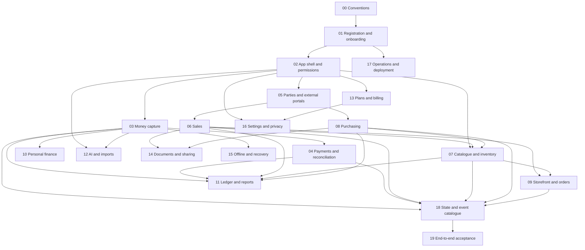

# Rekordly v2 System Blueprint

**Started:** 7 November 2026  
**Status:** Complete draft — documents 00–20 exist; implementation and deployed-provider acceptance evidence remain pending
**Purpose:** Implementation-ready description of the complete Rekordly v2 experience  
**Authority:** Extends `planning/final-v2-plan`; it may add implementation detail but may not silently change locked product/accounting decisions

## What this folder answers

This blueprint explains the product from the first anonymous visit through registration, daily operation, accounting effects, external collaboration, subscription changes, deletion and recovery.

For every major workflow it documents:

- user goal and entry points;
- actors, roles and permissions;
- page, drawer, modal and mobile states;
- form fields, defaults and validation;
- decision rules and algorithms;
- API queries and commands;
- database records and atomic transaction boundaries;
- ledger, stock, receivable/payable and audit effects;
- background jobs, notifications and retry behavior;
- loading, empty, offline, stale, error and conflict states;
- security, privacy, plan and usage-limit controls;
- guest/non-member behavior;
- event/analytics instrumentation;
- acceptance criteria and edge-case tests;
- Mermaid flowcharts and state diagrams.

## Reading order

| # | Document | Coverage | Status |
|---:|---|---|---|
| 00 | `00-blueprint-conventions.md` | Shared notation, state rules, money/time/ID conventions and document template | Complete |
| 01 | `01-registration-authentication-and-onboarding.md` | Email-first password, OTP, magic-link and Google authentication; invitations, sessions, role choice and initial workspace creation | Approved for implementation |
| 02 | `02-app-shell-navigation-and-permissions.md` | Shell, menus, search, Universal Add, roles, plan gates and responsive behavior | Complete draft |
| 03 | `03-money-capture-classification-and-confirmation.md` | Manual, AI and import capture for Personal/Business/Mixed records | Complete draft |
| 04 | `04-payments-allocations-and-reconciliation.md` | Document linking, split methods, multi-document allocation, deposits, advances and suspense resolution | Complete draft |
| 05 | `05-customers-suppliers-and-external-portals.md` | Party records, statements, guest links, claiming and recipient conversion | Complete draft |
| 06 | `06-sales-estimates-invoices-and-receipts.md` | Sales lifecycle, tax, discounts, settlement, refunds and corrections | Complete draft |
| 07 | `07-catalogue-inventory-and-outlets.md` | Products, variants, stock movements, costing, transfers, counts and adjustments | Complete draft |
| 08 | `08-purchasing-procurement-and-payables.md` | Requests, POs, receipts, bills, matching, supplier returns and payments | Complete draft |
| 09 | `09-storefront-orders-domains-and-fulfilment.md` | Store setup, catalogue, guest checkout, reservations, fulfilment, subdomain and custom domain | Complete draft |
| 10 | `10-personal-finance-budgets-loans-assets-and-investments.md` | Personal workflows and combined-owner views | Complete draft |
| 11 | `11-ledger-reports-tax-and-period-close.md` | Posting engine, reports, drill-down, reconciliation, locks, export and tax summaries | Complete draft |
| 12 | `12-ai-assistant-imports-and-automation.md` | Draft-only AI, CSV imports, confidence, credits, worker logic and human confirmation | Complete draft |
| 13 | `13-plans-billing-entitlements-and-downgrades.md` | Pricing, subscription states, limits, add-ons, read-only behavior and Paystack | Complete draft |
| 14 | `14-notifications-documents-files-and-sharing.md` | Email, WhatsApp sharing, PDFs, Cloudinary controls and delivery status | Complete draft |
| 15 | `15-offline-sync-conflicts-and-recovery.md` | PWA cache, offline queue, idempotency, conflicts and stale-state behavior | Complete draft |
| 16 | `16-settings-security-privacy-deletion-and-support.md` | Settings, sessions, audit, export, 60-day deletion, recovery and support | Complete draft |
| 17 | `17-admin-operations-observability-and-deployment.md` | Internal operations, jobs, alerts, backups, restore and provider topology | Complete draft |
| 18 | `18-complete-state-and-event-catalogue.md` | Cross-module state machines, events, commands and notification matrix | Complete draft |
| 19 | `19-end-to-end-acceptance-and-edge-case-matrix.md` | Complete persona journeys and cross-module failure/concurrency tests | Complete draft |
| 20 | `20-frontend-page-map-and-acceptance.md` | Route inventory, workspace-state rules, page responsibilities and frontend completion gates | Implementation index |

## Blueprint dependency map

## Completion standard

A module is not blueprint-complete until:

1. Every user-visible state has an owner and recovery action.
2. Every financial/stock mutation identifies its atomic boundary and journal/stock effects.
3. Every form defines fields, validation, defaults and permission/plan gates.
4. Every async operation defines timeout, retry, idempotency and failure visibility.
5. Every external-recipient path works without assuming Rekordly membership.
6. Every state-changing path has acceptance and edge-case tests.
7. Diagrams agree with prose, commands and state tables.

## Change control

- Product changes discovered here must be recorded explicitly in the final planning package.
- Accounting changes must also update the accounting rulebook.
- Infrastructure changes must also update documents 10 and 11 of the final plan.
- No diagram is authoritative by itself; prose, invariants and acceptance tests control when a visual is ambiguous.

